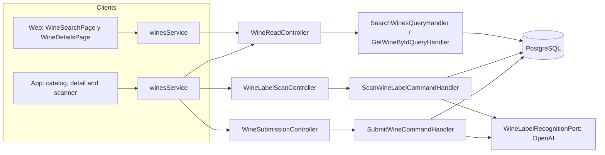
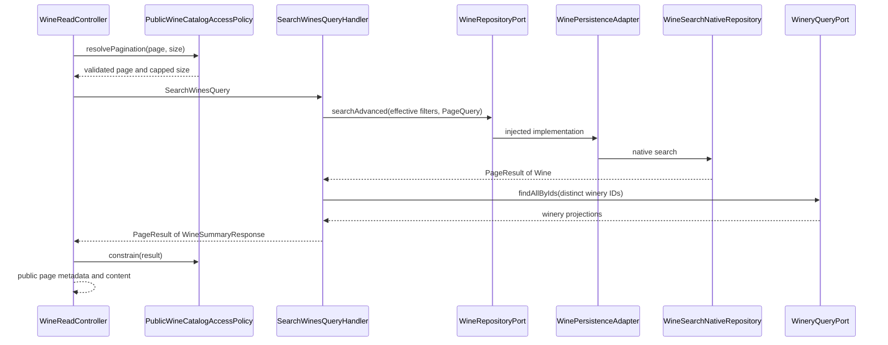
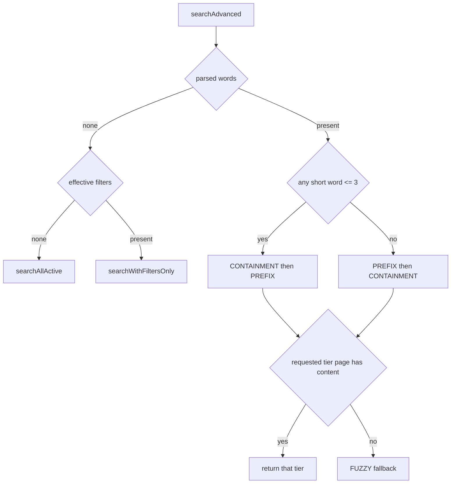
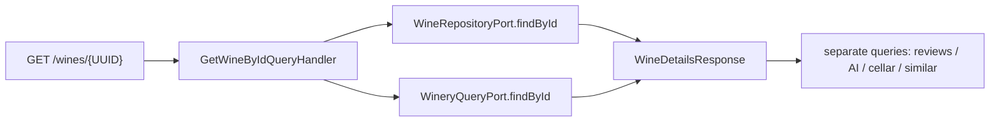
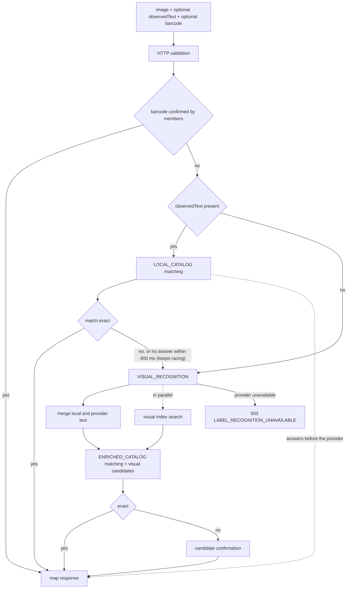
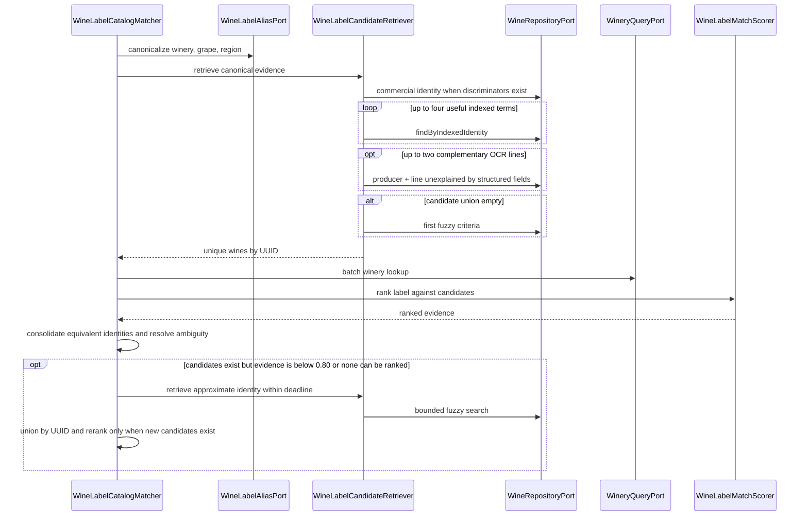
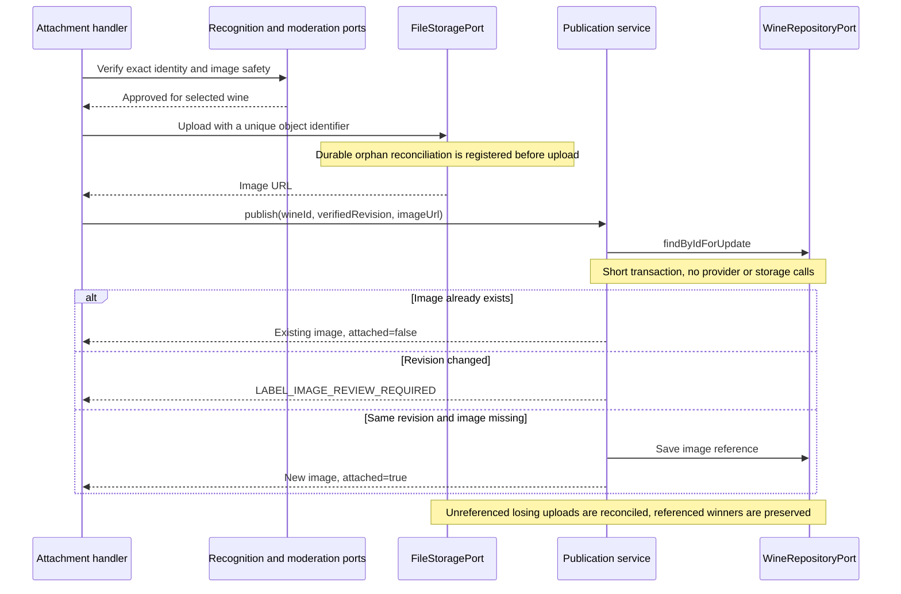
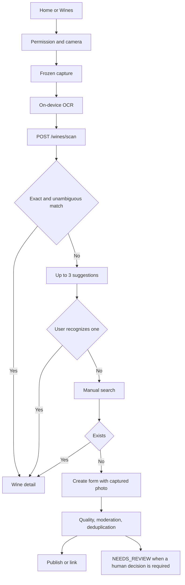
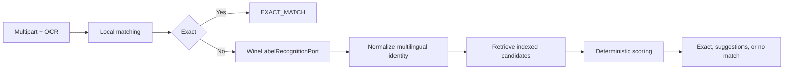

# Architecture

How the module is built in each layer. The backend follows the hexagonal flow
`controller → input port → handler → domain → output port → adapter`;
the web and the app follow `screen → hook → service → API client → HTTP transport`.
The proposed-wines pipeline is in [Proposed wines](submissions.md).

[View the full “Architecture” diagram](https://images.vinnot.com/docs/diagrams/v1/en/modules-wines-architecture-fa095e4bf61c.svg)

## Backend

### Search and detail

#### Functional scope

Web and mobile query the same catalog through GET /wines and its /wines/search alias. Text search does not perform image recognition: scanning belongs to the mobile workflow and uses a separate use case. Public search selects active wines; detail is a UUID lookup.

#### Search flow

[View the full “Search flow” diagram](https://images.vinnot.com/docs/diagrams/v1/en/modules-wines-architecture-97bb8a271eeb.svg)

The handler is read-only and batches winery IDs into one port call, avoiding one winery lookup per wine for this projection. It does not return JPA entities. The policy lives in web infrastructure: internal ports and administrative queries do not automatically inherit the public limit.

#### Effective filters and limits

| Port criterion | Application |
|---|---|
| searchTerm | words over wine/winery identity |
| wineType | persisted wine type |
| wineryId | winery UUID |
| country / region | adapter geographic predicates |
| grapeVariety | wine-grape predicate |
| page / size | zero-based page and effective size |

This table enumerates arguments SearchWinesQueryHandler passes to searchAdvanced. Featured, top-rated, recent, popular and similar rankings have dedicated endpoints/use cases; they are not arbitrary ordering options for this query.

The policy rejects page < 0 (INVALID_PAGE), size <= 0 (INVALID_PAGE_SIZE) and offset >= 500 (PUBLIC_CATALOG_WINDOW_EXCEEDED); it caps size at 20 and clips content and totalElements to the 500-result public window. Similar wines allows up to 10 items and rejects nonpositive limits. The handler does not impose a three-character minimum; UI debounce/minimum belongs to the client.

#### Bounded Home highlights

`GET /wines/highlights?limit=4` requires a session and returns a
`WineSummaryResponse` list without `PageResult` or a total count. The controller
delegates to `GetWineHighlightsUseCase` → `GetWineHighlightsQueryHandler` →
`WineRepositoryPort.findHighlights` → JPA adapter. The handler rejects
nonpositive limits (`INVALID_RESULT_LIMIT`) and caps results at ten.

The query selects active wines with `ratingCount > 0` and `ratingAverage > 0`,
ordered by average descending, count descending and UUID ascending. It uses
the wine's persisted public aggregates without recalculating or changing
moderation rules. The limit applies in the query after ordering. Country and
region use fetch joins of singular relationships, yielding one statement without
`COUNT` or N+1. It does not modify search, its filters, tiers, indexes or the
paginated `/featured`, `/top-rated`, `/popular` and `/recommended` contracts.

The PostgreSQL test verifies ordering, ties, limit, unrated/inactive exclusion
and a single SQL statement; handler tests verify validation and mapping. An empty
list is valid and distinct from an HTTP error.

#### Search-plan selection

[View the full “Search-plan selection” diagram](https://images.vinnot.com/docs/diagrams/v1/en/modules-wines-architecture-140405bd75c2.svg)

PREFIX queries search_vector with simple to_tsquery and prefixes; CONTAINMENT requires LIKE '%word%' for every word in search_text. Without filters both use wine_catalog_search, combining wine and winery names. FUZZY uses pg_trgm wine/winery branches and groups by ID. With a type, winery, country, region or grape filter, every tier selects candidates from wine_catalog_filter_search (V86), whose multicolumn GIN intersects text and filters inside the index; a grape filter without text pages through wine_grape_search in name order. Ranking, tier order and the response contract are the same with and without filters. Details and measurements are in [Query performance](../../backend/data/query-performance.md). PostgreSQL tests pin the fuzzy tier combined with a winery filter, the plans of filtered searches on a production-shaped catalog, and the trigger synchronization of both read models. Values are bound parameters rather than concatenated SQL values.

Tiers are alternatives: the first tier with content on the requested page is returned, not the union of all prefix, substring and fuzzy matches. Text tiers finally order selected candidates by relevance DESC, name ASC, id ASC. Browse orders by name. These orders do not represent an immutable snapshot across requests.

#### Pagination contract

The unfiltered browse query uses PostgreSQL reltuples as its total estimate and COUNT when that estimate is unavailable. Filtered/text queries read size+1 and build a lower-bound total for incremental navigation. The public policy clips it. totalElements must not be interpreted as an exact full-catalog count for these routes; hasNext/totalPages derive from the returned PageResult.

#### Detail composition

[View the full “Detail composition” diagram](https://images.vinnot.com/docs/diagrams/v1/en/modules-wines-architecture-596ebb1e231d.svg)

A missing wine, or an inactive one when the reader is neither catalog staff nor its creator (`ResourceReader.mayRead`), produces EntityNotFoundException (404). The handler does not resolve a slug. When wineryId is present it adds WineryInfo and origin names; if the winery cannot be resolved, those fields remain unenriched. Reviews, AI and cellar are not loaded as JPA collections during serialization.

#### Errors, tests and observability

Policy errors are DomainException and map to 400; search text and option errors (`INVALID_SEARCH`, `INVALID_SEARCH_OPTION`) are business rules and answer 422. Propagated query errors use the global mapper; this search does not inherit the scan candidate retriever's specific fallback. HTTP correlation/duration come from HttpRequestLoggingFilter. Empty results and failed HTTP responses are distinct contracts.

Test cases: empty text, short/long fragments, winery name, combined criteria, 20/500 limits, size+1, batched winery data and missing detail. SQL is checked with PostgreSQL and EXPLAIN for each tier; scan accuracy thresholds do not replace manual-search tests.

#### Sources and navigation

Under `backend/src/main/java/com/vinnot/wine/`: `infrastructure/web/controller/WineReadController.java`, `infrastructure/web/policy/PublicWineCatalogAccessPolicy.java`, `application/query/handler/SearchWinesQueryHandler.java`, `GetWineByIdQueryHandler.java`, `infrastructure/persistence/search/WineSearchNativeRepository.java`.

[API](../../backend/architecture/api.md) · [SQL](../../backend/data/query-performance.md) · [Scanning](architecture.md).

#### Profile projection in detail

`GetWineByIdQueryHandler` queries `WineProfileOverviewPort` to add
`profileOverview` to detail. The AI module adapter only reads persisted profiles
by ID/language; it neither generates nor stores content. Each ES/EN entry
contains summary, acidity, tannins, body, sweetness and pairing list. Invalid
scores become null rather than being transformed into valid measurements.
Original catalog fields remain unchanged, and wine lists do not perform these
additional reads. Frontends apply the projection only to quick information
rendering, never to catalog editing.

### Label recognition

#### Scope and responsibilities

Scanning is a mobile feature. Web invites users to download the app; it does not need a second recognizer. The backend exposes an authenticated use case receiving an image and optional OCR evidence, extracting identity and querying the catalog. Executing /scan neither creates a wine nor stores the image.

| Layer | Responsibility and component |
|---|---|
| HTTP | WineLabelScanController, WineLabelUploadValidator, WineLabelObservedTextValidator |
| Application | ScanWineLabelCommandHandler, WineLabelScanPolicy, WineLabelCatalogMatcher, WineLabelCandidateRetriever, WineLabelCandidateVerifier, WineVisualIndexService, WineLabelScanRecorder |
| Domain | ExtractedWineLabel, WineLabelMatchScorer, WineLabelIdentityNormalizer, RankedWineLabelCandidate, WineLabelPickEvidence |
| Ports | WineLabelRecognitionPort, WineRepositoryPort, WineryQueryPort, WineLabelAliasPort, WineLabelMetricsPort, WineLabelCandidateVerificationPort, WineVisualIndexPort, WineBarcodeConfirmationPort, CatalogQualitySignalPort |
| Adapters | OpenAiWineLabelRecognitionAdapter, WineSearchNativeRepository, ConfiguredWineLabelAliasAdapter, MicrometerWineLabelMetricsAdapter, OpenAiWineLabelCandidateVerificationAdapter, GeminiImageEmbeddingAdapter, InMemoryWineVisualIndex |

#### Multipart contract and validation

`POST /api/wines/scan`: Bearer JWT, `multipart/form-data`, required `image`,
`observedText` optional as a list of lines and `barcode` optional.

| Check | Input contract |
|---|---|
| Content | JPEG / PNG; MIME must match signature |
| Size | 8 MiB maximum; nonempty file |
| Dimensions | short edge >= 320 and long edge >= 720 pixels; maximum 24 million pixels, checked in the header before decoding |
| Quality | mean luminance 12..248; edge energy >= 1.5 |
| observedText | up to 24 lines, 120 characters/line, 2000 total normalized characters |
| barcode | 8, 12, 13 or 14 ASCII digits with a valid GS1 mod-10 check digit (EAN-8, UPC-A, EAN-13, GTIN-14); otherwise 400 `INVALID_LABEL_BARCODE`; it is validated before the image |

OCR normalizes whitespace, skips null/empty lines and deduplicates case-insensitively. It is untrusted evidence, not an instruction to select an ID. Scan validation returns original bytes; validateAndSanitizeForPersistence, used by submission/label-image, creates a new RGB JPEG with a maximum 1600-pixel long edge without reusing source metadata. These are separate operations.

Reading uses `ImageReader`: dimensions are inspected first, then pixels are decoded once with subsampling to bound the buffer to a 1600-pixel long edge. Quality validation reuses this buffer; readers, streams and images are released afterwards. The byte limit is checked both on multipart metadata and actual bytes. Missing MIME, corrupt content and excessive dimensions are input errors, not recognition outcomes.

#### Orchestration

[View the full “Orchestration” diagram](https://images.vinnot.com/docs/diagrams/v1/en/modules-wines-architecture-47703621372d.svg)

The local step builds ExtractedWineLabel with observedText and a vintage only when there is one distinct plausible year line. The scorer can corroborate the candidate's producer and product only when all significant tokens occur literally in OCR and no significant text remains unexplained by identity, observed grapes or candidate origin. This is matching evidence, not catalog enrichment. Partial text, another commercial line or an incompatible variety prevents promotion. Early exit still requires match.exact with unchanged thresholds and ambiguity checks. Structured reliability is 1.0 with two distinct terms, 0.75 with one and 0.55 without terms. Insufficient evidence invokes visual recognition; local and remote lines are merged preserving order and deduplication.

#### Visual extraction

The OCR-only catalog stage has a 3 s sub-budget within the global deadline.
Exhausting it allows visual recognition when global time remains; this neither
extends the deadline nor hides failures unrelated to timeouts.

The local lookup runs on the `wineLabelScanExecutor` executor (`WINE_LABEL_SCAN_THREADS`, 8 by default, no queue). If it has not answered the scan within 400 ms, label recognition and the visual index search start beside it instead of after it: the local lookup keeps racing and, if it can then answer alone, its result answers the scan and the provider results are discarded. A local lookup that answers within 400 ms avoids the provider call. If the provider fails at once (for example paused paid calls or an exhausted budget), the scan waits for the local lookup and uses it when it can answer; otherwise it returns the provider failure. When the executor is full, the work runs on the request thread, one stage after the other.

If the optional OCR-only catalog stage exhausts its query budget, visual extraction may still proceed within the shared deadline. The enriched lookup must then succeed; an exhausted total deadline or another technical error is not converted into an empty business result.

The adapter requests structured JSON with isWineLabel, producer, product, grape, vintage, type, country/region, alcohol, confidence, searchKeywords, visualDescription, observedText and identitySymbols. The prompt requires visible text, preserves original scripts/commercial symbols and separates public brand from product designation. Provider confidence describes extraction; it is not a probability of catalog identity.

application.yml defaults: WINE_LABEL_RECOGNITION_TIMEOUT=12s, DETAIL=HIGH and MAX_TOKENS=500; the request uses temperature 0. The adapter limits its request to the lesser of configured timeout and remaining budget, with one attempt to avoid multiplying latency/cost through hidden retries. An empty provider result becomes ExternalServiceUnavailableException, not NO_MATCH.

The schema requests observedText and identitySymbols before interpreted fields. Transcription includes product numbers, cuvees and small brand-adjacent marks; legible varieties are copied, never inferred from an appellation. visualDescription is optional and brief, not a substitute for identity evidence.

#### Catalog retrieval and aliases

[View the full “Catalog retrieval and aliases” diagram](https://images.vinnot.com/docs/diagrams/v1/en/modules-wines-architecture-e22f7f51f461.svg)

Each commercial/indexed query uses a pool of 60; results are unioned by UUID, so the combined set can exceed 60. Terms come from product, keywords, producer and useful OCR. Commercial/indexed retrieval precedes fuzzy. Caught query-specific timeouts allow other identity views to continue. The fuzzy query can also use type/grape/vintage cues when readable identity terms are absent.

Numbered product lines precede broad terms. Origin/type-only lines and standalone plausible vintages are excluded. Up to two additional OCR lines not represented in structured fields are searched together with the producer, so a detached commercial designation is not lost to a global search's candidate limit.

Aliases are app.wine-label.aliases configuration maps for WINERY, GRAPE and REGION. ConfiguredWineLabelAliasAdapter compares normalized keys and preserves the original when no entry exists. It does not translate the label into Spanish or assume an origin country.

An unrelated indexed hit does not suppress approximate retrieval: when evidence stays below 0.80 without an exact result, the matcher requests a bounded fuzzy supplement and reranks the union. Full-text search separates internal dots such as `13.Cabernet` before constructing tsquery, preserving scripts and accents. Terms remain parameterized, never interpolated into SQL.

If only the optional supplement times out, usable indexed suggestions are retained. Without any usable suggestions, that failure is reported as catalog unavailability. An exhausted global deadline is never concealed as successful recovery.

#### Ranking, exactness and ambiguity

The approximate supplement uses the observed producer when available, avoiding a generic varietal query over the whole catalog. Numbered OCR product lines also contribute commercial discriminators during ranking.

The score renormalizes available signals: name 0.40; winery 0.30; vintage 0.10; grape 0.08; type 0.05; country 0.04; region 0.03. Commercial discriminators carry their own 0.35 weight when included. With structured evidence, it blends base score (0.70) and identity coverage (0.30), multiplies by reliability and rounds to four decimals. Absent signals are not counted as matches.

rank retains score >= 0.42 and sorts by descending score/UUID. isExact requires name signal >= 0.72, represented producer/product, label coverage >= 0.80 and catalog coverage >= 0.90, compatible vintage/grape and discriminators. It accepts score >= 0.90 or >= 0.80 with complete identity. Matcher consolidates equivalent identities and, if another candidate also satisfies exactness, requires a lead >= 0.06. A high number alone does not decide the outcome.

An observed variety incompatible with the candidate's known grapes caps its score at 0.41, below suggestions. Missing grapes are not treated as contradictory. Complementary OCR evidence excludes terms already explained by the structured product and activates its signal only when backed by a candidate from the observed producer, when known. Secondary text matching another winery's wine name must not penalize the correct identity. Unobserved catalog grapes are omitted from name comparison only when another explicit commercial designation exists; a varietal-only name does not authorize treating a single-variety wine as an exact blend match.

A catalog-backed complementary OCR designation (for example, a detached quality line) contributes identity evidence even when omitted from structured extraction. Known catalog geography is excluded from product evidence, so an appellation does not become a rival cuvee. When no complementary designation has catalog support, a supported structured product contributes that signal instead. Matching a grape repeated in a winery name is not independent producer evidence and cannot authorize a producer/product role inversion. Partial producer names cannot erase the rest of an explicit brand; a distinct public brand in the product field can still represent the full catalog identity.

Symbols extracted only from measurement lines (altitude, alcohol or volume) are not commercial marks. Conversely, when a catalog sibling differs by an unobserved commercial symbol, the matcher returns the generic and marked variants as alternatives rather than certifying the generic label.

Equivalent-row consolidation requires identical commercial discriminators. A long shared name cannot hide a different product number or mark through token-overlap thresholds.

#### Response and follow-up actions

| outcome | Content |
|---|---|
| EXACT_MATCH | `wine` present, suggestions empty, candidates contains the selected wine |
| POSSIBLE_MATCHES | `wine=null`; up to three suggestions and their candidates |
| NO_MATCH | `wine=null`; empty lists, confidence=0 |

Every response also carries `scanId`, the id of the recorded scan the member can send feedback on, or `null` when it was not recorded.

extractedData accompanies the response. Suggestions expose confidence capped at 0.89 even when their ranking score is higher; these are not statistically calibrated certainty percentages. Exactness is decided by the backend, not an additional UI threshold.

The temporary image retained during manual search belongs to the client. Creating a wine resubmits it with form data to /wines/submissions. Filling a missing image uses /wines/{id}/label-image: match.exact and the selected ID as top candidate are required, together with approved moderation. Suggestions or manual selection do not authorize automatic photo publication. Recognition/moderation/upload run outside the publication transaction. Every upload has a unique object ID; `WineLabelImagePublicationService` briefly locks the row, preserves any concurrent image and checks that the wine revision still matches the verified revision before saving. Losing objects are handled by durable storage reconciliation without deleting the winner.

##### Safe publication of a missing catalog image

[View the full “Safe publication of a missing catalog image” diagram](https://images.vinnot.com/docs/diagrams/v1/en/modules-wines-architecture-6154ea6fe4f0.svg)

#### Timing, errors and observation

Optional approximate expansion has a 2 s sub-budget and starts only with more
than 3 s of global time remaining. If its sub-budget expires, usable indexed
candidates are retained; without valid candidates a technical error is returned.
The global deadline is checked again before returning the response.

For identity comparison, visible `orgánico`, `orgânica` and `organique` descriptors
are canonicalized to `organic`, without adding the descriptor when absent.
When two candidates have the same score, a normalized producer name matching the
observed name takes precedence over the catalog ID tie-breaker. This preserves
the visible variant when producer aliases share a canonical identity; it does
not increase the score or change the acceptance threshold.
Producer similarity tolerates OCR spacing in complete names of at least eight
characters, without accepting prefixes. Core tokens are sorted before comparison
to avoid dependence on set iteration order. The identity checks required for an
exact match remain separate from this similarity signal.
Measurement lines, including altitude in `m`/`mts`, do not supply commercial numbers.
Indexed search separates internal hyphens and dots between letters/numbers before
building `plainto_tsquery`: it preserves tokens without requiring a compound lexeme
absent from the catalog. Original evidence and exactness thresholds are unchanged.
Each indexed branch sorts before applying its limit: length-normalized text relevance
or producer similarity, followed by ID for stability. Retrieval retains the strongest
evidence per candidate rather than counting a text/producer overlap twice. This
relevance selects candidates for evaluation; it is not the scan confidence percentage.
The indexed query timeout remains 750 ms.

`WineLabelScanDeadline` shares a monotonic 18-second budget across OCR/catalog matching and visual recognition. It is checked around stages and between queries; visual recognition receives only the remaining time. This is neither an artificial wait nor the latency target: interactive latency is measured separately. Catalog keeps per-query hints (indexed 750 ms; fuzzy/commercial/visual 1500 ms); an already submitted query retains its own timeout. Upload, validation and transport are outside this application clock; mobile keeps a 22-second HTTP timeout. Cancellation does not imply rollback or distributed cancellation of remote work already started.

Image errors include INVALID_LABEL_IMAGE, LABEL_IMAGE_RESOLUTION_TOO_LOW, LABEL_IMAGE_TOO_DARK, LABEL_IMAGE_TOO_BRIGHT and LABEL_IMAGE_OUT_OF_FOCUS; invalid OCR uses INVALID_LABEL_TEXT. Visual failure returns 503 LABEL_RECOGNITION_UNAVAILABLE; exhausted catalog retrieval without recovery returns LABEL_CATALOG_UNAVAILABLE; the deadline uses LABEL_SCAN_TIMEOUT. A timeout followed by valid recovery may continue, but an unrecovered technical failure never becomes NO_MATCH. Provider logs include numeric HTTP status, never keys or response bodies.

LOCAL_CATALOG, VISUAL_RECOGNITION, VISUAL_WAIT, ENRICHED_CATALOG and CANDIDATE_VERIFICATION stages record SUCCESS/FAILURE duration. Scan total/duration are recorded when building a business response; earlier thrown errors do not pass that point. Each scan also writes one INFO line `Label scan finished: outcome=<outcome> totalMs=<ms> <STAGE>=<ms> ...` with only the stages it ran; a failed scan uses `outcome=FAILED_<code>` (or the exception type). Metrics and logs never store images.

#### Tests and sources

Verify multipart validation, persistence normalization, fixture extraction, OCR merging, aliases, ranking/ambiguity with the real scorer, outcome shapes and provider failures. PostgreSQL validates retrieval; the benchmark measures precision/recall/stability/latency separately. Fake-provider tests are not evidence of OpenAI execution.

Sources under `backend/src/main/java/com/vinnot/wine/`: `application/command/handler/ScanWineLabelCommandHandler.java`, `AttachWineLabelImageCommandHandler.java`; `application/service/WineLabelCatalogMatcher.java`, `WineLabelCandidateRetriever.java`, `WineLabelScanPolicy.java`; `domain/service/WineLabelMatchScorer.java`; `infrastructure/web/WineLabelUploadValidator.java`; `infrastructure/ai/OpenAiWineLabelRecognitionAdapter.java`.

[Submissions](submissions.md) · [SQL](../../backend/data/query-performance.md) · [Mobile workflow](architecture.md) · [Observability](../../backend/architecture/observability.md).

#### Label scan accuracy

Scanning combines four independent signals; each one degrades to the previous behaviour when it is unavailable.

| Signal | How it works | Components |
|---|---|---|
| Accent-insensitive text | `V90` adds `catalog_search_unaccent`, an `IMMUTABLE` wrapper of `unaccent` with a fixed dictionary, and makes the build functions of both search read models store unaccented, lower-cased text. Queries are normalized the same way, so "SEPTIMA" finds "Séptima" in scans, the public catalog and administration. Rows written before `V90` are rewritten after startup in committed batches (5000 rows, 200 ms pause) on the `catalogMaintenanceTaskScheduler`; until then searches match both forms. | `WineSearchNativeRepository`, `CatalogSearchAccentNormalizer` |
| Producer-first retrieval | The producer read on the label also retrieves that winery's wines; a generic line on its own ("Reserva", "Malbec", "Estate") never becomes the wine's identity. | `WineLabelCandidateRetriever`, `WineLabelLanguageVocabulary`, `WineLabelIdentityNormalizer` |
| Visual search | Every catalog wine whose label image Vinnot hosts has one Google Gemini embedding (`gemini-embedding-2`, 768 dimensions) stored as int8 in `wine_image_embeddings` (`V91`). The backend loads all vectors of the active model into an in-memory index and compares the scanned photo by cosine similarity (at least 0.6), in parallel with OpenAI recognition and on a bounded pool (2 threads, queue of 4); the scan waits at most 1.5 s for it. Up to 10 visual matches join the candidates and, when the text finds nothing, become suggestions. A scheduler loads the index 30 s after startup and embeds up to 200 pending images every 60 s. Without `GEMINI_API_KEY` the signal is off. | `WineVisualIndexService`, `GeminiImageEmbeddingAdapter`, `InMemoryWineVisualIndex`, `JdbcWineImageEmbeddingRepository`, `CatalogImageSourceAdapter`, `WineVisualIndexScheduler` |
| Candidate confirmation | Without an exact match and with at least 3 s left, the vision model receives the photo with the 5 best text candidates and up to 3 visual ones, reads the printed producer and product and picks one or none (at most 8 s). The pick becomes exact only with confidence of at least 0.85 and when `WineLabelPickEvidence` finds every word of the product read in the candidate, every word of the candidate's name in the label text and an agreeing producer. | `WineLabelCandidateVerifier`, `WineLabelPickEvidence`, `OpenAiWineLabelCandidateVerificationAdapter` |

**AI capacity.** `ai.admission.maximum-concurrent` (3 by default) bounds provider calls. With three or more slots the last one is kept for interactive requests: a label scan tries the reserved slot first and then waits up to `ai.admission.interactive-wait` (4 s) for any slot before answering 503 `AI_CAPACITY_EXCEEDED`, while profiles and comparisons use the other slots and fail fast. Image decoding waits up to 2 s for a processing slot before answering 503 `IMAGE_PROCESSING_BUSY`. `services.openai.vision-reasoning-effort` (empty by default) lets the vision request use a reasoning model with the `max_completion_tokens` shape.

**Barcodes and feedback.** `POST /wines/scan` accepts an optional `barcode` (8, 12, 13 or 14 digits with a valid GS1 mod-10 check digit, otherwise 400 `INVALID_LABEL_BARCODE`) and returns the `scanId` of the recorded scan (`null` when it was not recorded). Before any AI call, a barcode confirmed for one active wine by at least two members, and by more members than any other wine, answers `EXACT_MATCH` with confidence 1.0; that scan earns no scan point and stores no barcode. `POST /wines/scans/{scanId}/feedback` stores the member's latest verdict (`CONFIRMED`, `CORRECTED` or `NOT_IN_CATALOG`) on their own scan and answers 204. `CONFIRMED` is only valid for the scan's exact match, and only it confirms the barcode the scan read (one confirmation per member and barcode in `wine_barcode_confirmations`, `V92`): a correction is the member's word alone. A `CORRECTED` verdict on an exact match calls `CatalogQualitySignalPort`, which the community module turns into a catalog quality report; a failed signal never fails the feedback and catalog rows are never edited automatically.

| Layer | Components |
|---|---|
| HTTP | `WineLabelScanController`, `WineLabelBarcodeValidator`, `WineLabelScanFeedbackRequest`, `WineLabelScanExceptionHandler` (404 for `SCAN_NOT_FOUND` and `WINE_NOT_FOUND`) |
| Application | `SubmitWineLabelScanFeedbackCommandHandler`, `WineLabelScanRecorder` |
| Domain | `WineLabelScanVerdict` |
| Ports | `WineLabelScanHistoryPort`, `WineBarcodeConfirmationPort`, `CatalogQualitySignalPort`, `WineImageEmbeddingPort`, `WineImageEmbeddingRepositoryPort`, `WineVisualIndexPort`, `CatalogImageSourcePort`, `WineLabelCandidateVerificationPort` |
| Adapters | `JdbcWineLabelScanHistory`, `JdbcWineBarcodeConfirmations`, `CommunityCatalogQualitySignalAdapter` |

| Property | Default | Effect |
|---|---|---|
| `app.wine-label.visual-index.enabled` | `true` | Turns the visual index scheduler on; without a Gemini key it does nothing |
| `app.wine-label.visual-index.min-similarity` | `0.6` | Cosine similarity a catalog label needs to count as a visual candidate |
| `app.wine-label.visual-index.backfill-batch` / `backfill-delay-ms` / `initial-delay-ms` | `200` / `60000` / `30000` | Backfill size and schedule |
| `app.wine-label.visual-index.image-timeout` | `10s` | Download timeout of each catalog image |
| `app.wine-label.visual-index.search-threads` / `search-queue` | `2` / `4` | Pool that embeds scanned photos |
| `app.wine-label.verification.enabled` / `min-confidence` | `true` / `0.85` | Candidate confirmation by the vision model |
| `app.wine-label.search-normalization.enabled` / `batch-size` / `pause` | `true` / `5000` / `200ms` | Rewriting of pre-`V90` search rows |
| `services.google.gemini.api-key` | empty (`GEMINI_API_KEY`) | Enables Google embeddings |
| `services.google.gemini.embedding-model` / `embedding-dimensions` | `gemini-embedding-2` / `768` | Embedding model; a change re-embeds the images |
| `services.google.gemini.connect-timeout` / `timeout` | `3s` / `8s` | Gemini HTTP timeouts |
| `ai.admission.interactive-wait` | `4s` | Longest wait of a scan for an AI slot |
| `services.openai.vision-reasoning-effort` (`OPENAI_VISION_REASONING_EFFORT`) | empty | Reasoning effort of the vision model; only for a reasoning vision model |

## Web

### Scope and actors

Catalog discovers wines and opens details without generating AI content.
Catalog reads and personal actions require a session. Cellar, reviews and
private operations retain their permissions and ownership checks.
Backend resolves ranking and text matching; frontend does not perform fuzzy
search across all downloaded bottles.

### Input and parameters

| UI input | Query construction |
|---|---|
| Text | Trim after 400 ms debounce; search sent from two characters |
| Empty or one-character text | Search omitted; catalog/filter mode remains |
| Type | One of the active types from `GET /reference/wine-types` (`ORANGE` included), with its translated name |
| Grape | Name normalized through grape reference data |
| Country | Selected country resolved against references |
| Region | Options for country; country change clears region |
| Page | Zero-based index, size twenty |

Additional DTO parameters do not imply corresponding screen controls.
This table describes current browse. Three-letter input still reaches
`GET /wines`; substring, normalization and ranking rules belong to backend.

The initial country is suggested from authorized browser location and reverse
geocoding through the existing Maps SDK. ISO code or name is matched to backend
countries. Explicit URL values (including `country=`), manual selection and clearing
take precedence over late responses. Missing permission, provider or match enables
global/manual browsing; country is not inferred from IP. Location and SDK waits
are bounded to ten seconds each, without automatic retries. Wine queries wait for
resolution so global results are not presented as localized. Mobile behavior is
documented separately in
[mobile catalog](architecture.md).

### Presentation state and URL

The ViewModel reads `q` or `search`, `type`, `grape`, `country`, `region` and
`page` as initial state. `updateUrl` writes `q`, `page`, `country` and `region`
through replace. Changing country clears region/page; removing it leaves `country=`
to prevent reapplying the suggestion. Type/grape and region changes retain some
local state; complete restoration of every filter is not asserted.

Page changes request twenty results and scroll to the top. Filter handlers
reset to page zero. `keepPreviousData` retains previous responses during key
transitions.

Query keys represent arguments. Previous data, initial load and refetch are
different states; rendering/tests distinguish them without inferring an empty
result before a response arrives.

### Technical flow

1. Screen/page collects input and calls ViewModel/hook.
2. Hook builds query key and query function.
3. `winesService` converts filters/pagination into client parameters.
4. Client requests `GET /wines`.
5. Service maps content and pagination metadata.
6. Presentation renders cards, total and continuation controls.

Detail reads wine ID from the route and queries the wine. Reviews, AI
profile/availability, comparison and cellar are separate queries/actions.
Navigation does not require passing a complete DTO from a card to load detail.

### Navigation and actions

Detail uses `/wines/:id`. Comparison represents A in its route and B in
`compareWith`. Return uses history or explicit origin by workflow; it does not
guarantee retaining an in-memory-only filter form.

Scanning is mobile-only. `/wines/scan` invites app download, with no capture, multipart or recognition.

### Errors, contracts and tests

Server validation decides invalid parameters and permissions. Mappers normalize
types, URLs and pagination; UI does not reinterpret scores as probabilities.
See [backend search](architecture.md) and
[product processes](../../frontend-web/diagrams/product-processes.md).

Relevant cases include short text, grape references, country/region, next page,
refresh, failure and direct detail navigation by ID. The
[testing strategy](../../frontend-web/testing/strategy.md) separates mapper, service, hook and
UI-journey verification.

### Evidence

- [ViewModel](../../../../frontend-react/src/presentation/pages/wines/useWineSearchViewModel.ts)
- [Servicio / Service](../../../../frontend-react/src/application/services/wines.service.ts)
- [Modelos / Models](../../../../frontend-react/src/domain/wine/wine.types.ts)

### Sensory overview in detail

`profileOverview` keeps saved profile summaries, scores and pairings in both
languages separate from catalog fields. `useWineDetailsViewModel` applies
`wineQuickInfo` as a read projection: it selects the language and supplements
only missing values, preserving manual descriptions and known scores including
zero. Mappers and editing forms retain original fields; the screen projection
is not used for catalog writes. Reading details does not generate profiles or
consume AI calls.

The wine type is never shown as the enum code: `wineTypeLabel` translates it (“Red”,
“Orange”) on the detail page, winery and cellar cards and administration tables; a code
without a translation uses the reference catalog name. The type filter and the
administration form take their options from `GET /reference/wine-types` through
`useWineTypes` → `referenceDataService` → `referenceDataClient`, so a new catalog type
appears without a client change.

Overview and full profile share `sensoryBarWidth`, using a 0–100 scale and a 3%
minimum visual marker for scores 0–3. The marker changes neither stored scores
nor accessibility values; it does not fill missing data.

### Catalog images

HTTP adapters resolve backend `imageUrl` and `bottleImageUrl` against the
configured API origin. For example, `/api/uploads/wine-labels/label.jpg` loads
from `https://api.vinnot.com/api/uploads/wine-labels/label.jpg` in production.
Absolute URLs are preserved; no database image references are rewritten.
Normalization preserves search parameters, filters and page metadata, covering
catalog, detail, recommendations and cellar/admin projections.

The wine profile shows sensory content and recommendations. Cache provenance
and generation date remain in the internal model but are not shown to users.

## App

### Catalog and detail

#### Scope and actors

Catalog discovers wines and opens details without generating AI content.
Catalog reads and personal actions require a session. Cellar, reviews and
private operations retain their permissions and ownership checks.
Backend resolves ranking and text matching; frontend does not perform fuzzy
search across all downloaded bottles.

#### Home highlights

Home uses `useWineHighlights(4)` → `wine.highlights` operation →
`winesService.getHighlights` → `winesClient.getHighlights` →
`GET /wines/highlights?limit=4`. The response is a summary list without pagination
metadata. Backend selection uses active wines with public ratings: average
descending, review count descending and UUID ascending as a tie-breaker. The
limit applies after ordering in the database. Frontend preserves that order and
image defaults; it does not sort a catalog page locally.

The cache key is separate from `wine.list`, shares subscriptions for the same
limit and is invalidated with `Wines/LIST`, including review mutations and
moderation. Returning between tabs does not force another request. Missing
candidates show a localized empty state; failures offer retry. Neither errors
nor empty results fall back to the catalog's first wines. Search/filter behavior
and “See all” retain the existing catalog flow.

#### Input and parameters

| UI input | Query construction |
|---|---|
| Text | Trim after 400 ms debounce; search sent from two characters |
| Empty or one-character text | Search omitted; catalog/filter mode remains |
| Type | One of the active types from `GET /reference/wine-types` (`ORANGE` included), with its translated name |
| Grape | Name normalized through grape reference data |
| Country | Selected country resolved against references |
| Region | Options for country; country change clears region |
| Page | Zero-based index, size twenty |

Additional DTO parameters do not imply corresponding screen controls.
This table describes current browse. Three-letter input still reaches
`GET /wines`; substring, normalization and ranking rules belong to backend.

#### Presentation state and URL

The ViewModel owns text, filters, page and accumulated list. Expo Router
`type`/`grape` parameters initialize selection. Location may resolve a reference
country before manual selection; `clearFilters` marks user intent to prevent
reapplying automatic geolocation.

The first catalog request waits for the initial country resolution to finish,
avoiding a global request followed by another initial request for the detected
country. Denied permission, empty/failed reference data, or an unmatched country
allow one global catalog request. The initial wait is bounded to ten seconds.
On Android, reaching the deadline enables the global catalog without discarding
the pending location: a valid country arriving later is applied once and its
first page is requested. Selecting a country or clearing filters ends the wait
and takes precedence over that late response. iOS retains its previous behavior:
a country arriving after the deadline is ignored. Loading remains active during
the initial wait.

On Android, the adapter checks the current permission first and only requests it
when missing and the system allows another prompt. With permission, it uses the
last system position if at most five minutes old and with an uncertainty radius
of at most one kilometer; otherwise, or if that lookup fails, it requests a new
position. Coordinates are not persisted and background location is not requested.
iOS retains its existing permission and position flow. Tests cover an existing
grant, recent/missing/failed position lookup, late resolution, manual precedence,
and unchanged iOS behavior. They do not replace verification on the affected
Android device.

`useWineCatalogPagination` coordinates pages in presentation. Query identity
includes the existing filters, account, session enablement and page size. A new
identity starts at zero before subscribing; filter values, mapping, debounce and
backend search strategy remain unchanged. Only the requested page's `currentData`
is accepted, with a collection per page. A repeated/focus response replaces that
page; the projection preserves server order and one card per ID, using the latest
data when a wine appears across pages. RTK retains each query's cache.

`loadMore` requires `hasNext`, a received page without errors and no fetch or
refresh in progress. Two end-reached events in the same render advance once.
A failed next page preserves loaded results; Retry requests that same page.

Pull-to-refresh requests page zero through `useRefreshWines`, without clearing
the list or changing the subscribed page during the request. Success replaces
the accumulation and returns to zero, even for an identical cached response.
Failure keeps the list and offers a refresh retry. The temporary subscription
is released without deleting cached data; late responses after query changes,
logout or unmount do not modify the list. Catalog and auxiliary cellar queries
are skipped without a session; cellar badges and accumulated pages are cleared
on logout. Existing authentication also resets private cache on account changes.

Query keys represent arguments. Previous data, initial load and refetch are
different states; rendering/tests distinguish them without inferring an empty
result before a response arrives.

#### Technical flow

1. Screen/page collects input and calls ViewModel/hook.
2. Hook builds `wine.list` operation and params.
3. `winesService` converts filters/pagination into client parameters.
4. Client requests `GET /wines`.
5. Service maps content and pagination metadata.
6. Presentation renders cards, total and continuation controls.

Detail reads wine ID from the route and queries the wine. Reviews, AI
profile/availability, comparison and cellar are separate queries/actions.
Navigation does not require passing a complete DTO from a card to load detail.

#### Navigation and actions

Tapping Wines calls `openTabRoot` to open catalog root. Detail opened from
scan retains contextual return; scanner navigation distinguishes home/wines
origin. Comparison can return to the initial wine or catalog without history.

Scanning is mobile-only. Browse exposes the scanner; own submissions ("My
submitted wines") open from Profile (`app/(app)/my-submissions.tsx`). An empty
catalog offers "Add your wine": `createAddWineRoute` opens the scanner with
`intent=add` and the searched text as `wineName`. In that mode a scan without
`EXACT_MATCH` goes straight to the submission form, and the searched name fills
the field only when the label had none. In that mode the camera also offers
"Add without a photo", which opens the form without a photo
([proposal without a photo](submissions.md#proposal-without-a-photo)). "Clear"
stays as a secondary action when filters are active.

The header is the `BrowseScreenHeader` shared with Events and Routes. Its
subtitle comes from
[`catalogCountLabel.ts`](../../../../frontend-mobile/src/presentation/features/wine/catalogCountLabel.ts):
the public API never reports more than 500 results (`PUBLIC_RESULT_WINDOW`, equal
to `PublicWineCatalogAccessPolicy.MAX_RESULT_WINDOW`), so a total at that cap
reads "Thousands of wines to discover" with no filters, "More than 500 wines from
{country}" with only a country, or "More than 500 wines match your search"; below
the cap the exact number is shown. While the first page loads it says "Searching
wines…", never "0 wines".

#### Errors, contracts and tests

Server validation decides invalid parameters and permissions. Mappers normalize
types, URLs and pagination; UI does not reinterpret scores as probabilities.
See [backend search](architecture.md) and
[product processes](../../frontend-mobile/diagrams/product-processes.md).

Relevant cases include short text, grape references, country/region, next page,
refresh, failure and direct detail navigation by ID.
`winesBrowsePagination.test.tsx` uses the real ViewModel, query hooks and RTK store,
with deferred responses at the application operation boundary. It covers repeated
scroll, focus, overlapping IDs, errors/retry, identical or failed refresh, out-of-order
responses, cached return and visitor/login/logout. It also verifies combined
parameters and the original 400 ms debounce. These local tests do not replace
scroll acceptance on the installed iPhone. The
[testing strategy](../../frontend-mobile/testing/strategy.md) separates mapper, service, hook and
UI-journey verification.

#### Evidence

- [ViewModel](../../../../frontend-mobile/src/presentation/features/wine/useWinesBrowseViewModel.ts)
- [Page coordination](../../../../frontend-mobile/src/presentation/features/wine/useWineCatalogPagination.ts)
- [Servicio / Service](../../../../frontend-mobile/src/application/services/wines.service.ts)
- [Modelos / Models](../../../../frontend-mobile/src/domain/wine/wine.types.ts)

#### Quick information from the saved profile

Details include `profileOverview` with ES/EN summaries, scores and pairings.
The mapper keeps this map separate from catalog fields. `wineQuickInfo` builds
a read-only projection for Info, selecting the current language and filling
missing fields without mutating the original wine. Manual descriptions and
scores, including zero, take precedence. The card renders summary, bars and
pairings; scores always use the 0–100 scale (5 means 5%, not 100%).
Overview and full profile share `sensoryBarWidth`: a 3% visual minimum marks the
scale origin for scores 0–3 without changing the actual or accessibility value.
A missing value is not converted to zero.
No incidental generation or additional provider request occurs. Generating or
editing a profile invalidates wine detail to refresh this projection. The
optional map supports older responses without data migrations.

#### Catalog images

HTTP adapters resolve backend `imageUrl` and `bottleImageUrl` against the
configured API origin. For example, `/api/uploads/wine-labels/label.jpg` loads
from `https://api.vinnot.com/api/uploads/wine-labels/label.jpg` in production.
Absolute URLs are preserved; no database image references are rewritten.
Normalization preserves search parameters, filters and page metadata, covering
catalog, detail, recommendations and cellar/admin projections.

`WineImage` displays the genuine photo when available and a bundled default
bottle when missing or broken. It shares web's `winebottle.webp` for red/other
wines and `winebottle2.webp` for white/sparkling wines. This presentation fallback
never generates a catalog URL or replaces photos when saving. It also covers
comparison and cellar wine selection.

On Android, `WineImage` resolves the local asset and passes only its URI to the
fallback. It retains the same file and design but omits source dimensions:
`expo-image` 3.0.11 uses them in `SourceMap.createGlideOptions` to override Glide's
decode size. The dark bottle is 3840×5760 and the light bottle 2333×3500; passing
the numeric asset directly forces dimensions unnecessary for cards. Without
that override, the target uses view bounds and `contentFit="contain"` allows
downsampling. The resolved source is memoized to retain failed fallback identity
and avoid unintended retries. iOS keeps the numeric asset; remote photos keep
their URI and recovery after failure. Filters, pagination and animations remain
unchanged.

Tests check type selection, omitted Android dimensions, stable failed fallback
and recovery of genuine photos. They do not measure device memory/FPS. A report
of degraded scrolling after Android build 0.1.0 (3) requires comparing both
candidates on the same phone and under the same conditions before declaring
the regression resolved.

The wine profile shows sensory content and recommendations. Cache provenance
and generation date remain in the internal model but are not shown to users.

### Label scanning

#### Goal

Identify an existing wine from a label, offer safe suggestions, or let the user
search/add an unknown wine. The feature is mobile-only; the backend owns
recognition, matching, deduplication, and publication.

#### Functional flow

[View the full “Functional flow” diagram](https://images.vinnot.com/docs/diagrams/v1/en/modules-wines-architecture-8dfa1db533a1.svg)

The captured image stays in temporary state across scanning, suggestions,
manual search, and the form. A normal scan uploads the image through multipart for analysis, without making
it a persisted catalog image. Submission and label attachment are separate
operations that also transmit the photo.

#### Activity diagram: label scan

Shows in UML activity notation the path from capture to the wine detail or a new proposal, with one lane per actor.

```mermaid
flowchart TD
    subgraph U["User"]
        start((" ")) --> u1("Open the scanner from Home or Wines")
        d2{" "}
        d3{" "}
    end
    subgraph A["App"]
        a1("Ask for permission, capture and freeze the photo")
        a2("On-device OCR of the visible text")
        a3("Open the wine detail")
        a4("Show up to 3 suggestions")
        a5("Manual catalogue search")
        a6("Creation form with the captured photo")
    end
    subgraph B["Backend"]
        b1("POST /wines/scan: extract, retrieve and rank")
        d1{" "}
        b2("POST /wines/submissions: moderate, deduplicate, publish or NEEDS_REVIEW")
        b3("POST /wines/{id}/label-image when the wine has no image")
    end
    u1 --> a1 --> a2 --> b1 --> d1
    d1 -->|"[EXACT_MATCH]"| a3
    d1 -->|"[POSSIBLE_MATCHES]"| a4
    d1 -->|"[NO_MATCH]"| a5
    a4 --> d2
    d2 -->|"[recognises one]"| a3
    d2 -->|"[none]"| a5
    a5 --> d3
    d3 -->|"[exists]"| a3
    d3 -->|"[does not exist]"| a6 --> b2
    a3 -->|"[exact and no image]"| b3
    a3 -->|"[otherwise]"| stop
    b2 & b3 --> stop(((" ")))
    classDef bar fill:#30262c,stroke:#30262c,color:#30262c
    style start fill:#30262c,stroke:#30262c
    style stop fill:#30262c,stroke:#30262c
```

[View the full “Activity diagram: label scan” diagram](https://images.vinnot.com/docs/diagrams/v1/en/modules-wines-architecture-ae94e40a0fb2.svg)

#### Capture and on-device OCR

`WineLabelCamera` encapsulates Expo Camera, processing, and ML Kit. The UI freezes
the photo after capture to communicate what is being analyzed. Resolution,
exposure, and focus are checked before upload; OCR contributes `observedText`.

OCR evidence normalizes whitespace and duplicates and follows the HTTP contract:
24 lines, 120 characters per line and 2,000 characters in total. Lines that would
exceed the total budget are omitted without splitting them; a later shorter line
can use the remaining space. OCR is an optional aid and must not prevent visual
recognition by exceeding request limits.

If local OCR produces an exact and unambiguous catalog match, the backend finishes
through the fast path. Otherwise it calls the visual port. The provider extracts
structured evidence and observed text; when the catalog search is not exact, the
vision model may pick among the shortlisted candidates, and the backend accepts
that pick only when the words read on the label support it (see
[Label scan accuracy](#label-scan-accuracy)).

#### Backend pipeline

[View the full “Backend pipeline” diagram](https://images.vinnot.com/docs/diagrams/v1/en/modules-wines-architecture-ff8377899e97.svg)

`ScanWineLabelCommandHandler` orchestrates stages. `WineLabelCatalogMatcher`
retrieves, ranks, and consolidates equivalent identities.
`WineLabelMatchScorer` is pure domain logic: it weighs name, winery, vintage,
grape, type, country, region, and discriminators. Visual-provider confidence does
not replace the comparable label-to-catalog score.

#### Exactness and suggestions

- Base exact threshold: `0.90`.
- A complete identity may qualify from `0.80` only with product/producer coverage
  and compatible discriminators.
- Internal suggestion threshold: `0.42`.
- A suggestion is never presented as 100% unless it was accepted as exact.
- A high score alone is insufficient: the top result must be unambiguous against
  duplicates or incompatible variants.
- At most three suggestions are returned in deterministic order.

Normalization does not depend on a Spanish word list in UI. Multilingual
vocabulary, symbols, and aliases live in backend domain/configuration; wineries,
grapes, and regions can be extended without changing the screen.

#### Contract

`POST /api/wines/scan` uses `multipart/form-data`:

- `image`: transient JPEG;
- `observedText`: optional repeatable parameter;
- `barcode`: optional EAN or UPC code read by the camera.

Outcomes:

- `EXACT_MATCH`: `wine` and ranked evidence in `candidates`.
- `POSSIBLE_MATCHES`: candidates and presentable scores.
- `NO_MATCH`: no safe candidate.

Each answer carries `scanId`; feedback goes to `POST /api/wines/scans/{scanId}/feedback`.

Default configuration allows 12 seconds for visual recognition, one attempt and
up to 500 tokens, also limited by the remaining 18-second pipeline budget. Mobile
keeps a 22-second HTTP timeout for upload, catalog and network time. These are
limits, not minimum waits or proof of the interactive latency target.

#### Feedback, back label, barcode and vintage

- **Barcode.** `WineLabelCamera` enables the `CameraView` barcode scanner for
  EAN-13, EAN-8, UPC-A and UPC-E while framing. `normalizeLabelBarcode` keeps the
  last code of 8, 12, 13 or 14 digits with a valid GS1 check digit; the screen shows
  "Barcode read" and the scan sends it as `barcode`.
- **Feedback.** `useWineLabelScanViewModel` sends at most one verdict per `scanId`
  through the `wine.scanFeedback` operation, fire-and-forget: `CONFIRMED` when the
  person opens or adds the exact match, `CORRECTED` when they open another
  suggestion, a manual search result or a duplicate found by a proposal, and
  `NOT_IN_CATALOG` when they propose the wine. Failures never reach the person.
- **Back label.** Without an exact match the result offers "Scan the back label"
  once. The next capture is read as the back label: `mergeObservedLabelText`
  merges both readings so each side keeps at least half of the 24 lines, the back
  photo is released and the front photo is sent again with the merged text.
- **Vintage.** `plausibleScannedVintage` keeps a vintage read on the label between
  1900 and the current year; `createScannedWineDetailRoute` passes it as
  `scannedVintage` and the wine detail gives it to `CellarAddSheet` as the initial
  vintage of a new entry, never of an edited one.

These changes are JavaScript only and ship by OTA.

#### Manual search and submission

Manual search uses the same indexed catalog as Wines. It is enabled only in manual
mode with at least two normalized characters and a 300 ms debounce. It displays
`currentData` for the current query, never previous-text results; retry does not
trigger a disabled query. If no result exists, the
form requires at least wine and winery name and can include grape, type, country,
region, vintage, and other data. Before creation:

1. deduplication runs again using data and image;
2. content, file, and metadata are validated;
3. valid content is published or linked without unnecessary waiting;
4. uncertain content enters `NEEDS_REVIEW` with a reason;
5. the user tracks status in their submissions.

If an existing wine has no image and is the selected `EXACT_MATCH`, the flow may
attach the photo through the dedicated use case. Suggestions or manual selection
can open a wine but do not automatically publish the capture. The backend checks
exact identity, moderation and concurrency again.

#### Security, privacy, and cost

- Scanning: 30 tokens per user/hour by default.
- Submission: 10 per user/day by default.
- MIME, size, quality, and content validation.
- EXIF removal before persistence.
- Normal scans do not store images.
- Rejected submissions are retained for 30 days and corrections for 90 by default.
- Aggregate metrics record outcome and latency, not the photo.

#### Errors and cancellation

The error state keeps the photo and separates its message from three actions:
retry the same image, search manually or scan another wine. Actions share the
available width; title and message are centered. A timeout reports processing
delay without attributing the failure to label quality.

Mobile distinguishes offline, timeout, expired session, a dark, too bright,
blurred or low-resolution photo, unavailable catalog and unavailable provider;
any other error shows the general scan message. Cancellation increments request generation and
propagates RTK's `AbortSignal` through operation, service and client to Axios.
Generation checks after capture, OCR and HTTP discard late work, including after
unmount. This does not guarantee cancelling work/cost already started on the server.
Errors keep the capture and offer retry or retake.

Camera-generated files are registered as owned resources inside the cache. Raw
photos and quality samples are released after use; prepared captures survive
results, search and submission. Native OCR and uploads retain a reference until
completion: reset/unmount does not delete files still used by those operations.
Only registered URIs are deleted, never arbitrary files or the whole cache. See
[lifecycle](../../frontend-mobile/diagrams/scan-lifecycle.md).

Native OCR is single-flight: a UI timeout does not imply that its native operation ended. While it remains active, subsequent captures omit local OCR and use visual recognition rather than accumulating native jobs and retained files. The lease and busy guard are released when the native promise actually settles.

#### Testing and acceptance

- Domain: normalization, aliases, symbols, scoring, exactness, and ambiguity.
- Application: fast path, fallback, timeouts, metrics, and outcomes.
- Infrastructure: real PostgreSQL, multipart, and provider contract test.
- Mobile: permission, capture, freeze, cancellation, errors, navigation, submission.
- Benchmark: Argentine/global cohorts, negatives, and repetitions with gates for
  accuracy, top-3, false exacts, stability, latency, and cost.
- Physical matrix: iOS/Android, light, glare, angle, typography, and adverse network.

Documentation defines the procedure and gates. Dated results are stored as
reproducible artifacts outside the canonical tree and are not presented as a
permanent system property.

#### Entry points and shutter

Home and Wines highlight their existing scanner entry points; the five tabs remain.
On Home, Scan is the only highlighted action; Explore wines and My cellar use
the secondary translucent style. The card adapts its height to available space:
an undimmed camera preview above and a white control strip below. The circular
shutter and “Take photo” are centered; flash sits to the side, outside the frame.
Shared `WINE_LABEL_CAPTURE_REGION` aligns frame and crop within the actual camera
area, excluding the control strip. Capture
retains a ref lock in addition to visual `isCapturing` state, preventing duplicate
photos or analysis on double taps. OCR, provider, ranking, cancellation and label
publication are unchanged.
