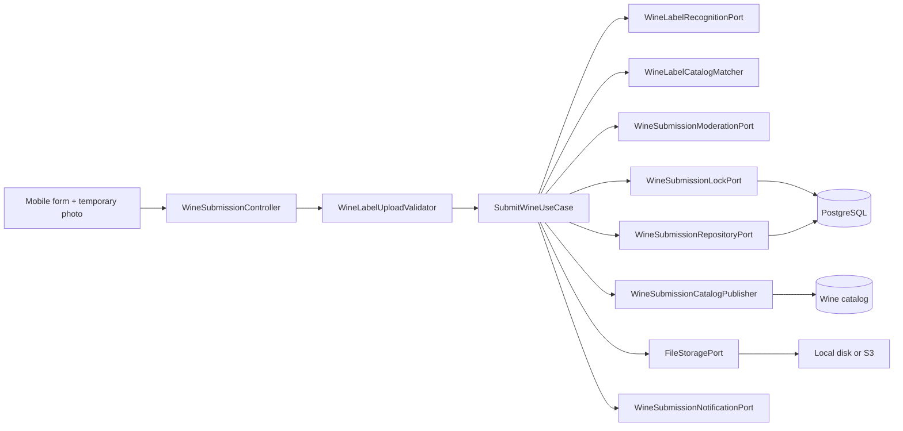
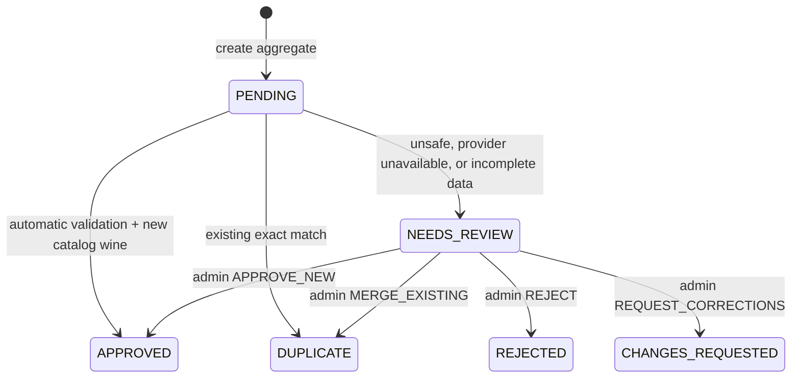
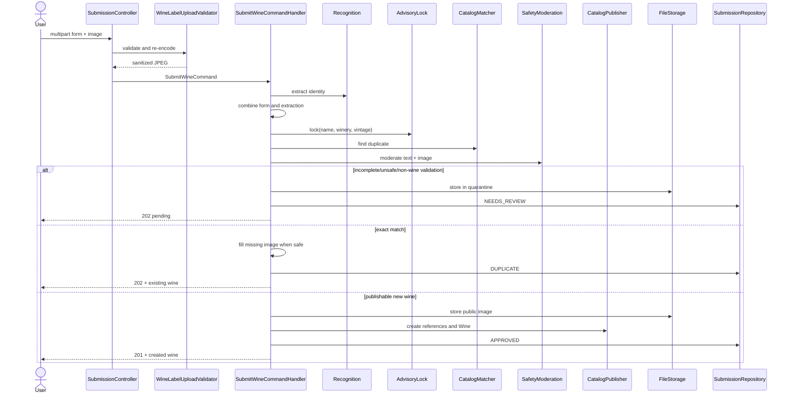
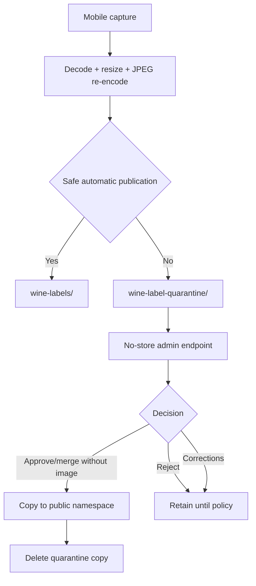

# Proposed wines: submission, moderation and publishing

The moderation list and detail include `submittedByUsername`, resolved through `WineSubmissionAuthorQueryPort`. Lists fetch distinct submitters in one batch; detail checks access before resolving the name. Email is not exposed and missing accounts return `null`. Owner queries retain the private contract without resolving other users’ names.

## Objective

This flow lets a user add a wine that could not be found through scanning or
manual search without turning untrusted input directly into catalog data. The
captured photo is reused, a form provides basic identity, the backend combines
recognition, deduplication, and moderation, and automatic publication only
occurs when all required evidence is safe.

`WineSubmission` is an auditable aggregate separate from `Wine`. This separation
is the primary boundary between a proposal and the canonical catalog.

## Architecture

[View the full “Proposed wines: submission, moderation and publishing · Architecture” diagram](https://images.vinnot.com/docs/diagrams/v1/en/modules-wines-submissions-10784bbbda09.svg)

The controller validates multipart input and builds a command. The `image` part
is optional: leaving it out means the person does not have the bottle at hand;
an empty `image` part still answers 400. The handler
decides the flow; the domain controls transitions; adapters implement AI,
persistence, locks, email, and storage.

## Proposal data

Required fields:

- wine name, up to 255 characters;
- winery name, up to 255 characters.

Optional fields:

- valid JPEG or PNG image (when the `image` part is sent, it must be one);

- wine type, up to 50 characters;
- vintage between 1800 and the maximum supported by `Year`;
- up to 10 grapes, 100 characters each;
- country and region, up to 100 characters;
- alcohol from 0 to 100;
- notes, up to 1000 characters.

The aggregate trims strings and requires `submittedBy`, `wineName`, and
`wineryName`. Recognition may fill missing data; user-entered values take
precedence.

## Catalog references

The form may also send `wineryId`, `countryId` and `regionId` for values picked
from the catalog. Older app versions send only text, and both forms are accepted.
`WineSubmissionCatalogResolver` links the values before the submission is created:

- a picked ID must exist, otherwise the request fails with
  `INVALID_SUBMISSION_CATALOG_REFERENCE` (400); the catalog name replaces the
  submitted text;
- a picked region implies its country and must belong to the picked country;
- text without an ID, from older apps or label recognition, is linked only when
  exactly one catalog entry has that name, ignoring case, accents and punctuation
  (`CatalogNameNormalizer`);
- grapes that match an active grape variety (English or Spanish name) take its
  catalog name; the rest are stored in `proposed_grapes`, a subset of `grapes`.

A text value with a NULL reference is a proposal that an admin approves or
merges. The detail response adds `wineryId`, `countryId`, `regionId` and
`proposedGrapes`.

## States and transitions

[View the full “States and transitions” diagram](https://images.vinnot.com/docs/diagrams/v1/en/modules-wines-submissions-b6027fdb7bfe.svg)

Every terminal decision preserves status, reason, confidence, related wine,
reviewer, and timestamps where applicable. Only `PENDING` accepts automatic
decisions, and only `NEEDS_REVIEW` accepts an administrative decision. Repeating
a decision fails with `INVALID_SUBMISSION_TRANSITION`.

`APPROVED` references `createdWineId`; `DUPLICATE` references `matchedWineId`.
An automatic decision does not invent `reviewedBy`; a human decision requires a
reviewer and non-empty reason.

The diagram represents the handler-driven flow. The domain also exposes
`reject(reason, confidence)` for `PENDING`, but HTTP intake uses `requireReview`
when automatic publication is not permitted.

## End-to-end intake

[View the full “End-to-end intake” diagram](https://images.vinnot.com/docs/diagrams/v1/en/modules-wines-submissions-30db13ab0fde.svg)

### Activity diagram: from proposal to publication

Shows in UML activity notation how a proposal reaches each status, through an automatic or administrative decision.

```mermaid
flowchart TD
    start((" ")) --> a1("Send the form with the label photo")
    a1 --> a2("Validate and re-encode the image")
    a2 --> a3("Recognise the identity and combine it with the form")
    a3 --> a4("Take the name, winery and vintage lock")
    a4 --> a5("Look for a duplicate and moderate text and image")
    a5 --> d1{" "}
    d1 -->|"[exact match]"| a6("DUPLICATE: link to the existing wine")
    d1 -->|"[new, safe and showing a wine label]"| a7("Publish Wine and image: APPROVED")
    d1 -->|"[unsafe, incomplete or no provider]"| a8("Quarantined image: NEEDS_REVIEW")
    a8 --> a9("Admin or moderator review")
    a9 --> d2{" "}
    d2 -->|"[APPROVE_NEW]"| a7
    d2 -->|"[MERGE_EXISTING]"| a6
    d2 -->|"[REJECT]"| a10("REJECTED")
    d2 -->|"[REQUEST_CORRECTIONS]"| a11("CHANGES_REQUESTED")
    a6 & a7 & a10 & a11 --> m1{" "}
    m1 --> a12("Queue the email for the new status")
    a12 --> a13("The user checks the status in their submissions")
    a13 --> stop(((" ")))
    classDef bar fill:#30262c,stroke:#30262c,color:#30262c
    style start fill:#30262c,stroke:#30262c
    style stop fill:#30262c,stroke:#30262c
```

[View the full “Activity diagram: from proposal to publication” diagram](https://images.vinnot.com/docs/diagrams/v1/en/modules-wines-submissions-8d3692f3c5b5.svg)

## App form

The photo remains a URI across scan, search and form. In add mode ("Add your
wine"), the camera offers "Don't have the bottle with you?" and "Add without a
photo", which opens the form without a photo and the notice "Without a photo, an
administrator checks the wine before it is published."; the client then leaves out
the `image` part.
`WineSubmissionForm` initializes fields from extracted data. Wine and winery
names are required; type, vintage, grapes, country, region, alcohol and notes
are optional. Winery, country, region and grapes are searchable catalog
selectors (`CatalogSelectField`, `GrapesSelectField`); regions are limited to
the picked country. "Not in the list" keeps the typed text as a proposed new
value, marked for admin review. Label prefill and typed text that match exactly
one catalog entry, ignoring case and accents, are linked to it. Picked IDs are
sent next to their names; numeric fields convert before multipart submission. The submission form accepts either comma or dot for decimal alcohol (`13,6` / `13.6`) and sends `13.6` without truncation. Validation retains the 0–100 range and rejects multiple separators or non-numeric text. Validation/deduplication outcome comes from the server.

`REJECTED` displays an error result; other states use the returned message.
The user's submission list ("My submitted wines", in Profile) queries status and
submission data.

From a catalog with no results, "Add your wine" opens the scanner in add mode
(`intent=add`): a scan without `EXACT_MATCH` goes straight to this form and the
searched text fills the name only when the label has none; label data always
wins.

Attaching a photo to an imageless wine uses a different endpoint from creating
a submission. Selecting an existing wine does not instruct replacement of an
already-published image.

## Recognition and data precedence

Recognition extracts type, vintage, grape, country, region, alcohol, observed
text, and a `wineLabel` signal. The handler builds the proposal using:

- form text when non-empty, otherwise extracted text;
- form value when non-null, otherwise extracted value;
- form grape list when populated, otherwise the extracted grape.

A recognition-provider outage neither fails the entire flow nor publishes
blindly. It is represented as unavailable extraction and sends the proposal to
review.

Deduplication reuses the deterministic scan matcher. Identity is evaluated
after acquiring an advisory lock so equivalent proposals are serialized within
the transaction.

## Moderation and fail-closed policy

`OpenAiWineSubmissionModerationAdapter` sends the moderation endpoint:

- normalized form text;
- image as a data URI;
- configurable moderation model.

Moderation returns content safety only. Wine relevance comes from the separate
recognition port, preserving single responsibilities.

`WineSubmissionReview.permitsAutomaticPublication()` requires all of:

1. completed review;
2. safe content;
3. wine-label evidence.

If the provider is unconfigured, empty, timed out, or failed, the flow fails
closed: it stores the image in quarantine and creates `NEEDS_REVIEW`. It neither
permanently rejects the user nor publishes uncertified content.

### Proposal without a photo

With no `image` part (`SubmitWineCommand.hasLabelPhoto()` is false), the handler
skips label recognition, moderation and image storage. Only the matcher runs on
the form data: an exact match becomes `DUPLICATE` linked to that wine, with no
image added; anything else becomes `NEEDS_REVIEW` with the `LABEL_PHOTO_MISSING`
reason (stored text "No label photo was attached"). It is never published
automatically.

## Deduplication and concurrency

The lock key joins normalized name, winery, and vintage:

- Unicode NFD and diacritic removal;
- lowercase with `Locale.ROOT`;
- non-alphanumeric separators converted to spaces;
- collapsed whitespace;
- absent vintage represented as `0`.

`PostgresWineSubmissionLockAdapter` uses
`pg_advisory_xact_lock(hashtextextended(key, 0))`. The lock lasts for the
transaction and serializes equivalent attempts without a permanent coordination
row.

Before automatic publication the matcher runs. During admin review,
`APPROVE_NEW` acquires the lock again and creates the wine: it honors the
moderator's decision and never merges it into another one. Linking the proposal
to an existing wine happens only with `MERGE_EXISTING`.

## Automatic publication

`WineSubmissionCatalogPublisher` accepts an application DTO and:

1. safely resolves `WineType`;
2. resolves or creates country, region, and winery references through
   `WineCatalogReferencePort`, using the submission's catalog IDs first (a stale
   ID, or a region of another country, falls back to the name), so a picked
   winery is reused instead of duplicated;
3. creates the `Wine` aggregate with the submitter as `createdBy`;
4. applies vintage, grapes, alcohol, and origin;
5. obtains the image from a supplier;
6. persists and projects a summary.

An admin's typed override replaces the matching pick: a new winery or region
name drops that ID, and a new country drops the country and region IDs.

Publication returns empty when a recognized type or resolvable country is
missing. The handler deletes the temporary public copy and routes the proposal
to review; it does not create a partial wine.

## Duplicate wine and missing image

When matching finds the wine:

- submission becomes `DUPLICATE`;
- the canonical wine summary is returned;
- if the wine has no image and automatic review is safe, the capture is stored
  as managed media and fills `imageUrl`;
- an existing image is never replaced.

Admin merge follows the same rule: a curated image wins; an absence may be
filled by promoting the moderated capture.

`AttachWineLabelImageCommandHandler` also provides a dedicated operation for a
known wine without an image. Recognition/matching must include that wine as the first ranked candidate and safety moderation must complete. If the wine already has a
URL, the response is idempotent and no new object is stored.

## Quarantine and image lifecycle

[View the full “Quarantine and image lifecycle” diagram](https://images.vinnot.com/docs/diagrams/v1/en/modules-wines-submissions-5a2457b57e7c.svg)

The quarantine URL points to `/api/admin/wine-submissions/{id}/image` and is not
exposed to normal users. The owner's response reports `imageAvailable=true` but
hides the URL when `imageQuarantined=true`.

The admin endpoint returns `Cache-Control: no-store` and loads by submission ID.
In S3, objects use AES-256 server-side encryption. Promotion copies the object
to `wine-labels/`, then the private copy is deleted.

A proposal without a photo can also be approved as a new wine: the wine is
published without an image. When the proposal has a stored label that is not
quarantined, approval still fails with `SUBMISSION_IMAGE_REQUIRED`. The catalog
data rule is unchanged: a type and a known country are required.

With `provider=r2`, persisted labels are converted to WebP and public objects
are delivered through the Worker; quarantine remains private through the API.
Promoting legacy S3 quarantine also writes the public copy into R2. Cleanup is
queued/rechecked through the outbox after the decision, rather than depending
on synchronous request deletion. [Storage and limits](../../backend/use-cases/uploads-and-reference-data.md).

## Administrative decisions

| Decision | Specific data | Result |
|---|---|---|
| `APPROVE_NEW` | optional corrected catalog data | always creates the wine |
| `MERGE_EXISTING` | `targetWineId` | links to existing wine |
| `REJECT` | reason | terminal rejection |
| `REQUEST_CORRECTIONS` | reason | waits for user correction |

Every decision requires a reason. `APPROVE_NEW` may override proposal data with
`WineSubmissionCatalogData`; non-null/non-empty admin values take precedence.
`MERGE_EXISTING` requires an existing target.

The `/admin/wine-submissions/**` surface accepts `ROLE_ADMIN` or `ROLE_MODERATOR` at the
HTTP boundary. The image is not fetched through a public storage URL.

## User queries and notifications

The user can:

- list only owned submissions, newest first;
- fetch detail only when `submittedBy` matches the principal;
- observe status, reason, confidence, and resulting wine reference;
- know an image exists without reading quarantine content.

`GetWineSubmissionQueryHandler` verifies ownership even though the endpoint is
already authenticated, preventing IDOR.

Every status change calls `WineSubmissionNotificationPort`. The current adapter
enqueues a decision snapshot in external_effects within the transaction. The worker resolves the recipient and sends only after commit, with durable retries. Rollback emits no notification; delivery is at least once.

The email is written in the submitter's current `preferred_language`, read at
delivery time; Spanish is only the fallback. The status is shown as readable,
localized copy (for example "Necesita revisión" / "Needs review"), never as the
enum name. Reasons follow two rules:

- an administrator's reason is shown exactly as written;
- a reason recorded by the automatic review (no `reviewedBy`) is sent as a
  `WineSubmissionSystemReason` code and rendered as localized copy. The stored
  `review_reason` text does not change, so moderators still read it in the
  queue. Any text that is not one of the known automatic reasons, such as a
  moderation provider's own explanation, maps to the generic `CONTENT_REVIEW`
  code and is never shown to the submitter.

Submission detail responses (the submitter's list and the moderation queue)
carry the same code in `reasonCode`, so the website and the app show the reason
in each person's language; it is `null` when an administrator wrote the reason.
When no moderation provider is configured or it does not answer, the recorded
reason is `MODERATION_UNAVAILABLE`. A proposal without a photo records
`LABEL_PHOTO_MISSING`, shown as "It was sent without a label photo, so an
administrator will review it before publishing it." / «Se envió sin foto de la
etiqueta, así que un administrador la revisará antes de publicarla.» (app and
`submission_{es,en}.properties`).

## Retention and deletion

The scheduler runs at 03:25 by default and purges in batches:

| Status | Default retention |
|---|---:|
| `REJECTED` | 30 days |
| uncorrected `CHANGES_REQUESTED` | 90 days |

For each row it deletes public and quarantined media before deleting the row.
Periods, cron, and batch size are configurable. `APPROVED`, `DUPLICATE`, and
`NEEDS_REVIEW` are not included in these two policies.

## Metrics and cost

`SubmitWineCommandHandler` records final status and aggregate duration when
building its response through `WineLabelMetricsPort`. The metric stores no
images and does not itself prove the subsequent transaction commit.

The default `wine-submission` limit is 10 requests/day. It is a backend request
limit, distinct from provider billing. Implemented instruments and tags are
specified in [observability](../../backend/architecture/observability.md).

## HTTP contracts

- an automatically published new wine returns `201`;
- duplicate or review returns `202`;
- list and detail require authentication;
- admin can filter by status and text;
- pages use the common `PageResult` contract;
- transition, access, image, and incomplete-data failures use normalized domain
  codes.

See routes and payloads in the [API catalog](../../backend/architecture/api.md).

## Tests

### Domain

- creation and field cleanup;
- confidence clamp to 0–1;
- every valid transition;
- repeated review rejection;
- required reviewer/reason;
- `createdWineId` versus `matchedWineId` references.

### Application

- form/extraction precedence;
- unavailable recognition or moderation routes to review;
- unsafe content is not published;
- exact match becomes duplicate;
- without a photo there is no recognition or moderation: an exact match is a
  duplicate with no image and anything else is `NEEDS_REVIEW` with
  `LABEL_PHOTO_MISSING`;
- admin approval of a proposal without a photo publishes the wine without an image;
- existing wine gets a missing image once;
- incomplete catalog data cleans public media and creates quarantine;
- admin approval as new creates the wine even when the catalog has a similar one;
- promotion/deletion for every decision;
- detail ownership;
- status-change notification;
- retention by cutoff and batch.

### Integration

- real multipart with valid and invalid JPEG/PNG, with no `image` part and with an
  empty `image` part (400);
- re-encoding removes EXIF;
- advisory lock with concurrent PostgreSQL transactions;
- real uniqueness and foreign keys;
- local storage, S3 and R2 contract tests;
- no-store admin quarantine endpoint;
- simulated recognition/moderation and opt-in real-provider suite.

## Code references

- `backend/src/main/java/com/vinnot/wine/domain/model/WineSubmission.java`
- `backend/src/main/java/com/vinnot/wine/application/command/handler/SubmitWineCommandHandler.java`
- `backend/src/main/java/com/vinnot/wine/application/command/handler/ReviewWineSubmissionCommandHandler.java`
- `backend/src/main/java/com/vinnot/wine/application/service/WineSubmissionCatalogPublisher.java`
- `backend/src/main/java/com/vinnot/wine/infrastructure/web/controller/WineSubmissionController.java`
- `backend/src/main/java/com/vinnot/wine/infrastructure/web/controller/WineSubmissionAdminController.java`
- [Mobile scanning](architecture.md)

Administrative decisions lock the submission and require NEEDS_REVIEW; a second concurrent decision returns 409 INVALID_SUBMISSION_TRANSITION. [External effects](../../backend/architecture/session-and-data-integrity.md) preserve that atomicity.
