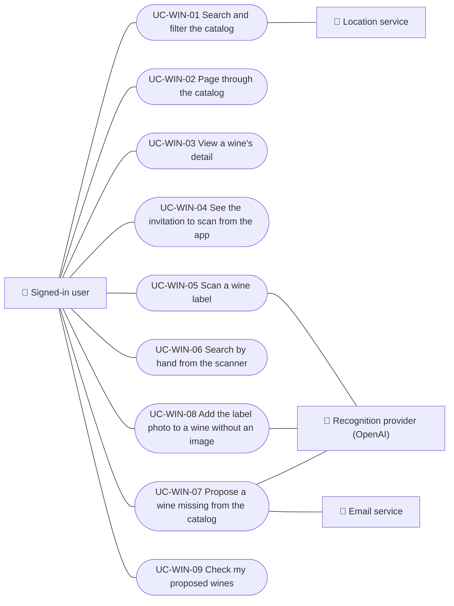

# Use cases

Use cases of the wines module: searching and paging the catalog, viewing the detail, scanning labels and proposing new wines. Each case applies to the platforms listed.

| ID | Use case | Platforms | Actors |
|---|---|---|---|
| `UC-WIN-01` | [Search and filter the catalog](uc-win-01-search-catalog.md) | Web, APK | Signed-in user, Location service |
| `UC-WIN-02` | [Page through the catalog](uc-win-02-page-catalog.md) | Web, APK | Signed-in user |
| `UC-WIN-03` | [View a wine's detail](uc-win-03-view-wine-detail.md) | Web, APK | Signed-in user |
| `UC-WIN-04` | [See the invitation to scan from the app](uc-win-04-scan-invitation.md) | Web | Signed-in user |
| `UC-WIN-05` | [Scan a wine label](uc-win-05-scan-label.md) | APK | Signed-in user, Recognition provider (OpenAI), Image embedding provider (Google Gemini) |
| `UC-WIN-06` | [Search by hand from the scanner](uc-win-06-manual-search-from-scan.md) | APK | Signed-in user |
| `UC-WIN-07` | [Propose a wine missing from the catalog](uc-win-07-submit-wine.md) | APK | Signed-in user, Recognition provider (OpenAI), Email service |
| `UC-WIN-08` | [Add the label photo to a wine without an image](uc-win-08-attach-label-photo.md) | APK | Signed-in user, Recognition provider (OpenAI) |
| `UC-WIN-09` | [Check my proposed wines](uc-win-09-track-submissions.md) | APK | Signed-in user |

## Use case diagram

[View the full “Use cases · Use case diagram” diagram](https://images.vinnot.com/docs/diagrams/v1/en/modules-wines-use-cases-readme-74c5a3a5d539.svg)

## Lucidchart mapping

| ID | Lucidchart IDs |
|---|---|
| `UC-WIN-01` | [WEB UC-WINE-01](https://lucid.app/lucidchart/9f11a16b-bb5a-42fc-a9e8-0852b17bd241/edit), [APK UC-WINE-01](https://lucid.app/lucidchart/e095dd25-e8ac-41ba-bf5b-396e1055f217/edit) |
| `UC-WIN-02` | [WEB UC-WINE-01](https://lucid.app/lucidchart/9f11a16b-bb5a-42fc-a9e8-0852b17bd241/edit), [APK UC-WINE-01](https://lucid.app/lucidchart/e095dd25-e8ac-41ba-bf5b-396e1055f217/edit) |
| `UC-WIN-03` | [WEB UC-WINE-02](https://lucid.app/lucidchart/9f11a16b-bb5a-42fc-a9e8-0852b17bd241/edit), [APK UC-WINE-02](https://lucid.app/lucidchart/e095dd25-e8ac-41ba-bf5b-396e1055f217/edit) |
| `UC-WIN-04` | [WEB UC-WINE-03](https://lucid.app/lucidchart/9f11a16b-bb5a-42fc-a9e8-0852b17bd241/edit) |
| `UC-WIN-05` | [APK UC-SCAN-01](https://lucid.app/lucidchart/e095dd25-e8ac-41ba-bf5b-396e1055f217/edit) |
| `UC-WIN-06` | [APK UC-SCAN-02](https://lucid.app/lucidchart/e095dd25-e8ac-41ba-bf5b-396e1055f217/edit) |
| `UC-WIN-07` | [APK UC-SCAN-03](https://lucid.app/lucidchart/e095dd25-e8ac-41ba-bf5b-396e1055f217/edit) |
| `UC-WIN-08` | [APK UC-SCAN-04](https://lucid.app/lucidchart/e095dd25-e8ac-41ba-bf5b-396e1055f217/edit) |
| `UC-WIN-09` | [APK UC-SCAN-05](https://lucid.app/lucidchart/e095dd25-e8ac-41ba-bf5b-396e1055f217/edit) |
