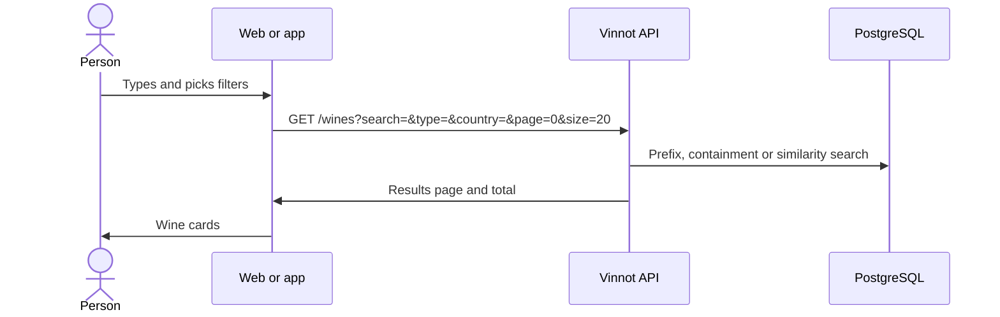

# UC-WIN-01 · Search and filter the catalog

| Field | Value |
|---|---|
| ID | `UC-WIN-01` |
| Module | [Wines](../README.md) |
| Platforms | Web, APK |
| Actors | Signed-in user, Location service |
| Lucidchart IDs | [WEB UC-WINE-01](https://lucid.app/lucidchart/9f11a16b-bb5a-42fc-a9e8-0852b17bd241/edit), [APK UC-WINE-01](https://lucid.app/lucidchart/e095dd25-e8ac-41ba-bf5b-396e1055f217/edit) |
| Requirements | [`RF-WEB-WIN-01`](../requirements.md), [`RF-WEB-WIN-02`](../requirements.md), [`RF-WEB-WIN-03`](../requirements.md), [`RF-WEB-WIN-04`](../requirements.md), [`RF-WEB-WIN-05`](../requirements.md), [`RF-APK-WIN-01`](../requirements.md), [`RF-APK-WIN-02`](../requirements.md), [`RF-APK-WIN-03`](../requirements.md), [`RF-APK-WIN-04`](../requirements.md), [`RF-APK-WIN-05`](../requirements.md) |
| Test cases | [`CP-WIN-01`](../testing.md), [`CP-WIN-02`](../testing.md), [`CP-WIN-03`](../testing.md), [`CP-WIN-04`](../testing.md), [`CP-WIN-05`](../testing.md), [`CP-WIN-06`](../testing.md), [`CP-WIN-07`](../testing.md), [`CP-WIN-08`](../testing.md) |

## Preconditions

- The person is signed in: the catalog is not public.

## Postconditions

- The active wines matching the text and filters are shown, with the total.

## Main flow

1. The person opens "Wines".
2. On first entry the client suggests the country of the device location, waiting up to 10 seconds.
3. The person types some text and picks type, grape, country or region.
4. The client waits for 400 ms without changes and calls `GET /wines` with the text, the filters and pages of 20.
5. The API validates the query and searches the active wines.
6. The client shows cards with name, winery, type, image and rating, and the total.

## Alternative flows

- 3a. The text has fewer than 2 characters: it is not sent and the catalog stays.
- 2a. There is no location permission or it does not answer: the global catalog is shown.
- 3b. The person changes the country: the chosen region is cleared.
- 3c. The person clears the filters: the unfiltered catalog comes back and the declined country is not suggested again.
- 5a. A text longer than 512 characters answers 422 `INVALID_SEARCH`.
- 6a. There are no results: the empty state is shown. On the app it offers “Add your wine”, which opens the scanner to propose the wine with the searched text as its name ([UC-WIN-07](uc-win-07-submit-wine.md)), and “Clear” when there are filters.
- 6b. The query fails: the error state is shown.

## Business rules

- The text searches by words over the wine and winery names: first by prefix and containment and, when nothing matches, by similarity (pg_trgm).
- The type is matched exactly; country and region exactly, ignoring case; the grape, by containment.
- Inactive wines never appear in the catalog.
- Without text or filters the total is a PostgreSQL estimate.
- On the app, a total below 500 is shown exactly; from 500, the cap of the public window, it reads “Thousands of wines to discover” with no filters, “More than 500 wines from {country}” with only a country, or “More than 500 wines match your search”.
- Each user can make up to 60 requests per minute to `GET /wines/**`.

## Diagram

[View the full “UC-WIN-01 · Search and filter the catalog” diagram](https://images.vinnot.com/docs/diagrams/v1/en/modules-wines-use-cases-uc-win-01-search-catalog-87e233a1c292.svg)

Component diagram in Lucidchart: [WEB UC-WINE-01](https://lucid.app/lucidchart/9f11a16b-bb5a-42fc-a9e8-0852b17bd241/edit), [APK UC-WINE-01](https://lucid.app/lucidchart/e095dd25-e8ac-41ba-bf5b-396e1055f217/edit).

## Code

| Layer | Location |
|---|---|
| Endpoints | `GET /wines`, `GET /grape-types` |
| Backend | [`WineReadController.java`](../../../../../backend/src/main/java/com/vinnot/wine/infrastructure/web/controller/WineReadController.java), [`SearchWinesQueryHandler.java`](../../../../../backend/src/main/java/com/vinnot/wine/application/query/handler/SearchWinesQueryHandler.java), [`PublicWineCatalogAccessPolicy.java`](../../../../../backend/src/main/java/com/vinnot/wine/infrastructure/web/policy/PublicWineCatalogAccessPolicy.java), [`WineSearchNativeRepository.java`](../../../../../backend/src/main/java/com/vinnot/wine/infrastructure/persistence/search/WineSearchNativeRepository.java), [`GrapeTypeController.java`](../../../../../backend/src/main/java/com/vinnot/wine/infrastructure/web/controller/GrapeTypeController.java) |
| Web | [`WineSearchPage.tsx`](../../../../../frontend-react/src/presentation/pages/wines/WineSearchPage.tsx), [`useWineSearchViewModel.ts`](../../../../../frontend-react/src/presentation/pages/wines/useWineSearchViewModel.ts), [`useWineSearch.ts`](../../../../../frontend-react/src/presentation/hooks/queries/wine/useWineSearch.ts), [`wines.service.ts`](../../../../../frontend-react/src/application/services/wines.service.ts), [`wines.service.helpers.ts`](../../../../../frontend-react/src/application/services/wines.service.helpers.ts), [`wines.core.client.ts`](../../../../../frontend-react/src/infrastructure/api/clients/wines.core.client.ts) |
| App | `frontend-mobile/app/(app)/(tabs)/wines/index.tsx`, [`useWinesBrowseViewModel.ts`](../../../../../frontend-mobile/src/presentation/features/wine/useWinesBrowseViewModel.ts), [`useWineCatalogPagination.ts`](../../../../../frontend-mobile/src/presentation/features/wine/useWineCatalogPagination.ts), [`useWines.ts`](../../../../../frontend-mobile/src/presentation/hooks/queries/wine/useWines.ts), [`wines.service.ts`](../../../../../frontend-mobile/src/application/services/wines.service.ts), [`wines.client.ts`](../../../../../frontend-mobile/src/infrastructure/api/clients/wines.client.ts) |

## Automated tests

- Backend: [`SearchWinesQueryHandlerTest.java`](../../../../../backend/src/test/java/com/vinnot/wine/application/query/handler/SearchWinesQueryHandlerTest.java), [`PublicWineCatalogAccessPolicyTest.java`](../../../../../backend/src/test/java/com/vinnot/wine/infrastructure/web/policy/PublicWineCatalogAccessPolicyTest.java), [`WineSearchNativeRepositoryTest.java`](../../../../../backend/src/test/java/com/vinnot/wine/infrastructure/persistence/search/WineSearchNativeRepositoryTest.java), [`SearchInputLimitsTest.java`](../../../../../backend/src/test/java/com/vinnot/shared/application/util/SearchInputLimitsTest.java), [`SecurityConfigAccessTest.java`](../../../../../backend/src/test/java/com/vinnot/shared/infrastructure/config/SecurityConfigAccessTest.java)
- Web: [`useWineSearchViewModel.test.tsx`](../../../../../frontend-react/src/presentation/pages/wines/useWineSearchViewModel.test.tsx), [`wines.service.test.ts`](../../../../../frontend-react/src/application/services/wines.service.test.ts), [`wines.core.client.test.ts`](../../../../../frontend-react/src/infrastructure/api/clients/wines.core.client.test.ts), [`wine-search-flow.spec.tsx`](../../../../../frontend-react/tests/unit/integration/wine-search-flow.spec.tsx), [`wines.spec.ts`](../../../../../frontend-react/tests/e2e/wines.spec.ts)
- App: [`winesBrowsePagination.test.tsx`](../../../../../frontend-mobile/src/presentation/features/wine/__tests__/winesBrowsePagination.test.tsx), [`wines.service.test.ts`](../../../../../frontend-mobile/src/application/services/wines.service.test.ts), [`wines.client.test.ts`](../../../../../frontend-mobile/src/infrastructure/api/clients/wines.client.test.ts)
