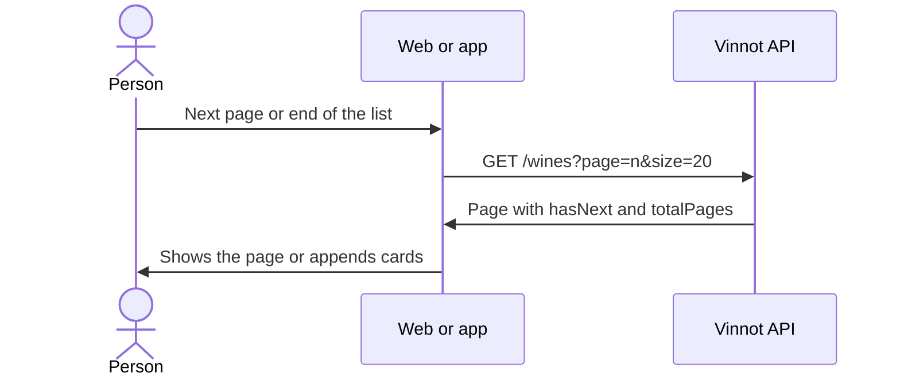

# UC-WIN-02 · Page through the catalog

| Field | Value |
|---|---|
| ID | `UC-WIN-02` |
| Module | [Wines](../README.md) |
| Platforms | Web, APK |
| Actors | Signed-in user |
| Lucidchart IDs | [WEB UC-WINE-01](https://lucid.app/lucidchart/9f11a16b-bb5a-42fc-a9e8-0852b17bd241/edit), [APK UC-WINE-01](https://lucid.app/lucidchart/e095dd25-e8ac-41ba-bf5b-396e1055f217/edit) |
| Requirements | [`RF-WEB-WIN-06`](../requirements.md), [`RF-WEB-WIN-07`](../requirements.md), [`RF-WEB-WIN-08`](../requirements.md), [`RF-APK-WIN-06`](../requirements.md), [`RF-APK-WIN-07`](../requirements.md), [`RF-APK-WIN-08`](../requirements.md) |
| Test cases | [`CP-WIN-09`](../testing.md), [`CP-WIN-10`](../testing.md), [`CP-WIN-11`](../testing.md), [`CP-WIN-12`](../testing.md), [`CP-WIN-13`](../testing.md), [`CP-WIN-14`](../testing.md) |

## Preconditions

- A catalog search is on screen ([UC-WIN-01](uc-win-01-search-catalog.md)).

## Postconditions

- The requested page is shown with the same criteria.

## Main flow

1. On the web, the person moves to the next or previous page; in the app, they reach the end of the list.
2. The client asks for the next page of 20 with the same criteria.
3. The API returns the page with `hasNext`, `hasPrevious` and `totalPages`.
4. On the web the page is replaced and the URL keeps `page`; in the app the cards are appended without repeating wines.

## Alternative flows

- 1a. On the web, the previous page stays on screen while the new one arrives.
- 1b. In the app no other page is requested while one is loading, when there is no next one or after an error.
- 1c. In the app, pulling down reloads the first page and the list is replaced only when the load succeeds.
- 1d. The criteria or the account change: it goes back to page 0.
- 3a. The requested page goes past the first 500 results: the API answers 400 `PUBLIC_CATALOG_WINDOW_EXCEEDED`.

## Business rules

- The largest page size is 20 and only the first 500 results can be paged; the reported total never goes above 500 either.
- A negative page answers 400 `INVALID_PAGE` and a non-positive size, 400 `INVALID_PAGE_SIZE`.
- The web reads `q` or `search`, `type`, `grape`, `country`, `region` and `page` from the URL.

## Diagram

[View the full “UC-WIN-02 · Page through the catalog” diagram](https://images.vinnot.com/docs/diagrams/v1/en/modules-wines-use-cases-uc-win-02-page-catalog-ad208511de0c.svg)

Component diagram in Lucidchart: [WEB UC-WINE-01](https://lucid.app/lucidchart/9f11a16b-bb5a-42fc-a9e8-0852b17bd241/edit), [APK UC-WINE-01](https://lucid.app/lucidchart/e095dd25-e8ac-41ba-bf5b-396e1055f217/edit).

## Code

| Layer | Location |
|---|---|
| Endpoints | `GET /wines?page=&size=20` |
| Backend | [`WineReadController.java`](../../../../../backend/src/main/java/com/vinnot/wine/infrastructure/web/controller/WineReadController.java), [`PublicWineCatalogAccessPolicy.java`](../../../../../backend/src/main/java/com/vinnot/wine/infrastructure/web/policy/PublicWineCatalogAccessPolicy.java), [`WineSearchNativeRepository.java`](../../../../../backend/src/main/java/com/vinnot/wine/infrastructure/persistence/search/WineSearchNativeRepository.java) |
| Web | [`WineSearchPage.tsx`](../../../../../frontend-react/src/presentation/pages/wines/WineSearchPage.tsx), [`useWineSearchViewModel.ts`](../../../../../frontend-react/src/presentation/pages/wines/useWineSearchViewModel.ts), [`useWineSearch.ts`](../../../../../frontend-react/src/presentation/hooks/queries/wine/useWineSearch.ts) |
| App | [`useWinesBrowseViewModel.ts`](../../../../../frontend-mobile/src/presentation/features/wine/useWinesBrowseViewModel.ts), [`useWineCatalogPagination.ts`](../../../../../frontend-mobile/src/presentation/features/wine/useWineCatalogPagination.ts) |

## Automated tests

- Backend: [`PublicWineCatalogAccessPolicyTest.java`](../../../../../backend/src/test/java/com/vinnot/wine/infrastructure/web/policy/PublicWineCatalogAccessPolicyTest.java), [`WineSearchNativeRepositoryTest.java`](../../../../../backend/src/test/java/com/vinnot/wine/infrastructure/persistence/search/WineSearchNativeRepositoryTest.java)
- Web: [`useWineSearchViewModel.test.tsx`](../../../../../frontend-react/src/presentation/pages/wines/useWineSearchViewModel.test.tsx), [`useWineQueries.spec.tsx`](../../../../../frontend-react/tests/unit/hooks/useWineQueries.spec.tsx)
- App: [`winesBrowsePagination.test.tsx`](../../../../../frontend-mobile/src/presentation/features/wine/__tests__/winesBrowsePagination.test.tsx)
