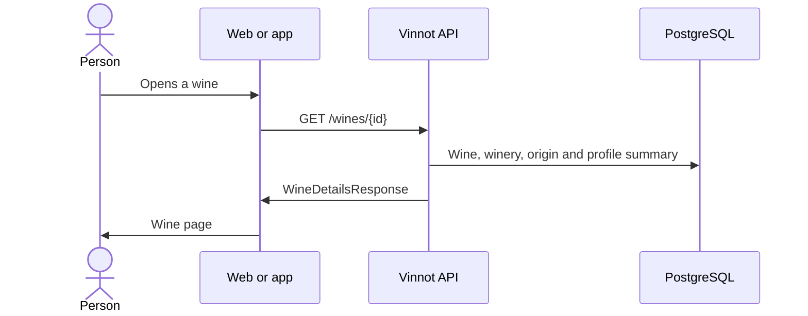

# UC-WIN-03 · View a wine's detail

| Field | Value |
|---|---|
| ID | `UC-WIN-03` |
| Module | [Wines](../README.md) |
| Platforms | Web, APK |
| Actors | Signed-in user |
| Lucidchart IDs | [WEB UC-WINE-02](https://lucid.app/lucidchart/9f11a16b-bb5a-42fc-a9e8-0852b17bd241/edit), [APK UC-WINE-02](https://lucid.app/lucidchart/e095dd25-e8ac-41ba-bf5b-396e1055f217/edit) |
| Requirements | [`RF-WEB-WIN-09`](../requirements.md), [`RF-WEB-WIN-10`](../requirements.md), [`RF-WEB-WIN-11`](../requirements.md), [`RF-APK-WIN-09`](../requirements.md), [`RF-APK-WIN-10`](../requirements.md), [`RF-APK-WIN-11`](../requirements.md) |
| Test cases | [`CP-WIN-15`](../testing.md), [`CP-WIN-16`](../testing.md), [`CP-WIN-17`](../testing.md) |

## Preconditions

- The person is signed in and picked a wine.

## Postconditions

- The wine's page is shown; reading it does not generate an AI profile.

## Main flow

1. The person opens a wine from the catalog, the home screen or another module.
2. The client calls `GET /wines/{id}`.
3. The API loads the wine, its winery with the origin and the summary of the saved profile.
4. The client shows the wine data (description in the interface language, winery and origin, grapes, alcohol and rating) and the sensory summary, kept apart from the AI profile. In the app, the reviews close the “Info” tab.
5. It offers going to the winery, comparing, sharing and adding to the cellar.

## Alternative flows

- 3a. The wine does not exist, or it is inactive and the reader is neither catalog staff nor its creator: the API answers 404 and the client shows it was not found.
- 4a. A field is missing: that block is not shown and no value is made up.

## Business rules

- The sensory summary uses the wine's values and fills in the missing ones from the saved profile; it keeps hand-entered values and zeros.
- Reviews, the AI profile and the cellar are requested separately; the detail does not include them.
- If the image is missing or fails to load, a default image is shown.

## Diagram

[View the full “UC-WIN-03 · View a wine's detail” diagram](https://images.vinnot.com/docs/diagrams/v1/en/modules-wines-use-cases-uc-win-03-view-wine-detail-d458b343b315.svg)

Component diagram in Lucidchart: [WEB UC-WINE-02](https://lucid.app/lucidchart/9f11a16b-bb5a-42fc-a9e8-0852b17bd241/edit), [APK UC-WINE-02](https://lucid.app/lucidchart/e095dd25-e8ac-41ba-bf5b-396e1055f217/edit).

## Code

| Layer | Location |
|---|---|
| Endpoints | `GET /wines/{id}` |
| Backend | [`WineReadController.java`](../../../../../backend/src/main/java/com/vinnot/wine/infrastructure/web/controller/WineReadController.java), [`GetWineByIdQueryHandler.java`](../../../../../backend/src/main/java/com/vinnot/wine/application/query/handler/GetWineByIdQueryHandler.java) |
| Web | [`WineDetailsPage.tsx`](../../../../../frontend-react/src/presentation/pages/wines/WineDetailsPage.tsx), [`useWineDetailsViewModel.ts`](../../../../../frontend-react/src/presentation/pages/wines/useWineDetailsViewModel.ts), [`wine.mappers.details.ts`](../../../../../frontend-react/src/domain/wine/wine.mappers.details.ts) |
| App | `frontend-mobile/app/(app)/(tabs)/wines/[id].tsx`, [`useWines.ts`](../../../../../frontend-mobile/src/presentation/hooks/queries/wine/useWines.ts), [`wine.quick-info.ts`](../../../../../frontend-mobile/src/domain/wine/wine.quick-info.ts) |

## Automated tests

- Backend: [`GetWineByIdQueryHandlerTest.java`](../../../../../backend/src/test/java/com/vinnot/wine/application/query/handler/GetWineByIdQueryHandlerTest.java), [`CheckWineReadAccessQueryHandlerTest.java`](../../../../../backend/src/test/java/com/vinnot/wine/application/query/handler/CheckWineReadAccessQueryHandlerTest.java), [`WineResourceAccessInterceptorTest.java`](../../../../../backend/src/test/java/com/vinnot/wine/infrastructure/web/WineResourceAccessInterceptorTest.java)
- Web: [`wine.mappers.test.ts`](../../../../../frontend-react/src/domain/wine/wine.mappers.test.ts), [`WineTasteProfile.test.tsx`](../../../../../frontend-react/src/presentation/components/features/wine/WineTasteProfile.test.tsx), [`wine.quick-info.test.ts`](../../../../../frontend-react/src/domain/wine/wine.quick-info.test.ts)
- App: [`wine.mappers.test.ts`](../../../../../frontend-mobile/src/domain/wine/wine.mappers.test.ts), [`wine.quick-info.test.ts`](../../../../../frontend-mobile/src/domain/wine/wine.quick-info.test.ts), [`WineImage.test.tsx`](../../../../../frontend-mobile/src/presentation/features/wine/WineImage.test.tsx)
