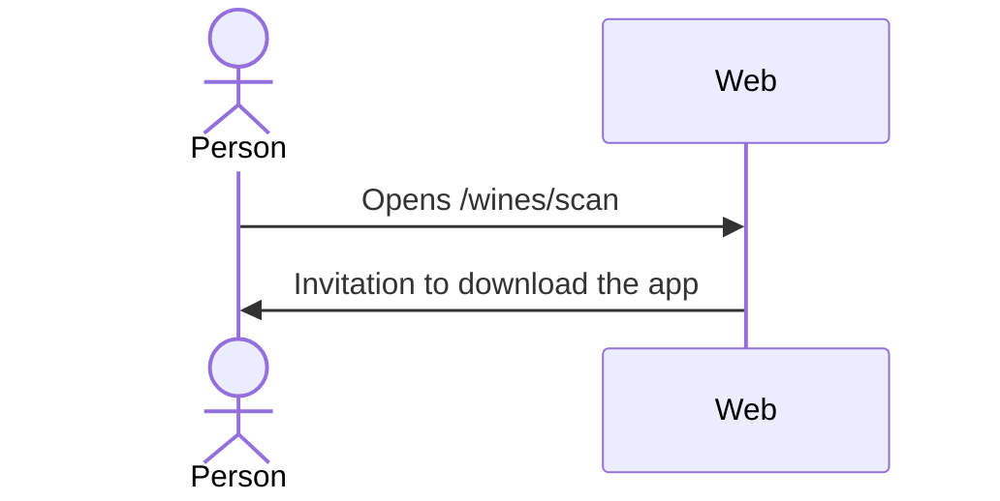

# UC-WIN-04 · See the invitation to scan from the app

| Field | Value |
|---|---|
| ID | `UC-WIN-04` |
| Module | [Wines](../README.md) |
| Platforms | Web |
| Actors | Signed-in user |
| Lucidchart IDs | [WEB UC-WINE-03](https://lucid.app/lucidchart/9f11a16b-bb5a-42fc-a9e8-0852b17bd241/edit) |
| Requirements | [`RF-WEB-WIN-12`](../requirements.md) |
| Test cases | [`CP-WIN-18`](../testing.md) |

## Preconditions

- The person is signed in on the web.

## Postconditions

- The person knows scanning lives in the app and how to download it.

## Main flow

1. The person opens `/wines/scan`.
2. The web shows the invitation to download the app to scan labels.

## Alternative flows

None.

## Business rules

- The web does not use the camera, process files or call recognition.

## Diagram

[View the full “UC-WIN-04 · See the invitation to scan from the app” diagram](https://images.vinnot.com/docs/diagrams/v1/en/modules-wines-use-cases-uc-win-04-scan-invitation-64066f1d9cf1.svg)

Component diagram in Lucidchart: [WEB UC-WINE-03](https://lucid.app/lucidchart/9f11a16b-bb5a-42fc-a9e8-0852b17bd241/edit).

## Code

| Layer | Location |
|---|---|
| Web | [`WineScanPage.tsx`](../../../../../frontend-react/src/presentation/pages/wines/WineScanPage.tsx) |

## Automated tests

- Backend: None
- Web: [`wines.spec.ts`](../../../../../frontend-react/tests/e2e/wines.spec.ts)
- App: None
