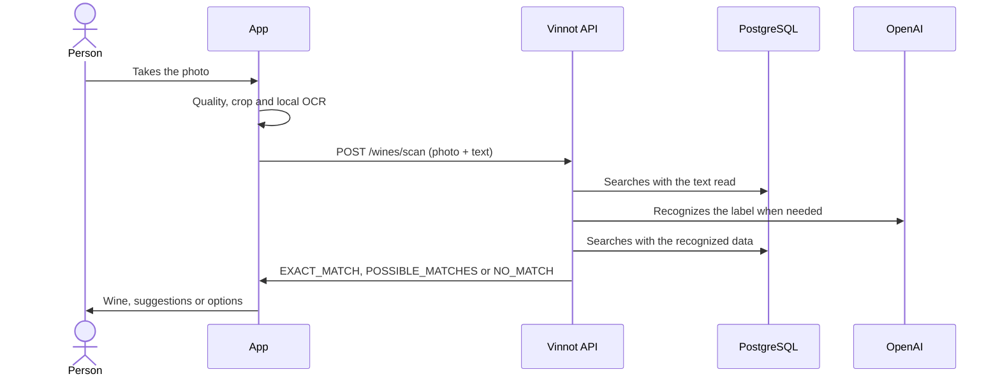

# UC-WIN-05 · Scan a wine label

| Field | Value |
|---|---|
| ID | `UC-WIN-05` |
| Module | [Wines](../README.md) |
| Platforms | APK |
| Actors | Signed-in user, Recognition provider (OpenAI) |
| Lucidchart IDs | [APK UC-SCAN-01](https://lucid.app/lucidchart/e095dd25-e8ac-41ba-bf5b-396e1055f217/edit) |
| Requirements | [`RF-APK-WIN-12`](../requirements.md), [`RF-APK-WIN-13`](../requirements.md), [`RF-APK-WIN-14`](../requirements.md), [`RF-APK-WIN-15`](../requirements.md), [`RF-APK-WIN-16`](../requirements.md), [`RF-APK-WIN-17`](../requirements.md), [`RF-APK-WIN-18`](../requirements.md) |
| Test cases | [`CP-WIN-19`](../testing.md), [`CP-WIN-20`](../testing.md), [`CP-WIN-21`](../testing.md), [`CP-WIN-22`](../testing.md), [`CP-WIN-23`](../testing.md), [`CP-WIN-24`](../testing.md), [`CP-WIN-25`](../testing.md), [`CP-WIN-42`](../testing.md) |

## Preconditions

- The person is signed in on the app.

## Postconditions

- The person sees the recognized wine, up to three suggestions or the option to search for or propose the wine.
- Scanning does not store the photo in the catalog.

## Main flow

1. The person opens the scanner from the home screen or from "Wines".
2. The app asks for camera permission.
3. The person frames the label and takes the photo; the image freezes.
4. The app checks resolution, light and focus, crops and saves the photo as JPEG up to 1600 px.
5. The app reads the label text on the device (up to 24 lines of 120 characters and 2000 in total).
6. The app sends `POST /wines/scan` with the photo and the text read.
7. The API validates the photo, first searches the catalog with the text read and, without an exact match, recognizes the label with OpenAI and searches again.
8. The API answers `EXACT_MATCH`, `POSSIBLE_MATCHES` (up to 3) or `NO_MATCH`.
9. With an exact match, the app shows the wine with "View details"; with suggestions, the person picks one; without matches, it offers searching by hand or proposing the wine.

## Alternative flows

- 2a. The person denies camera permission: the app explains it is needed to scan.
- 4a. The photo is dark, too bright, out of focus or low resolution: the app says so and asks for another shot.
- 7a. More than 18 seconds pass: the API answers 503 `LABEL_SCAN_TIMEOUT` and the app reports the delay, keeps the photo and offers retrying, searching by hand or taking another one.
- 7b. Recognition is unavailable or not configured: the app says so and keeps the photo.
- 6a. The person went over 30 scans in the hour: the API answers 429 and the app explains that the scan limit was reached and suggests waiting a few minutes or searching for the wine by name, keeping the photo.
- 7c. The API rejects the photo (`INVALID_LABEL_IMAGE`), the read text (`INVALID_LABEL_TEXT`) or is processing too many images (503 `IMAGE_PROCESSING_BUSY`): the app shows its own message for each case (photo format or size, too much text, wait a few seconds) and keeps the photo.
- 1a. The person cancels or leaves: the app drops late answers and deletes only the temporary files it created.

## Business rules

- The photo must be JPEG or PNG, up to 8 MiB and 24 Mpx, with a short side of at least 320 px and a long side of at least 720 px.
- A match is exact with a score of 0.90, or 0.80 with a full identity, and a lead of 0.06 over another candidate; suggestions start at 0.42 and are never shown above 0.89.
- If the server is processing other images at its limit, it answers 503 `IMAGE_PROCESSING_BUSY`.

## Diagram

[View the full “UC-WIN-05 · Scan a wine label” diagram](https://images.vinnot.com/docs/diagrams/v1/en/modules-wines-use-cases-uc-win-05-scan-label-24dabbad7682.svg)

Component diagram in Lucidchart: [APK UC-SCAN-01](https://lucid.app/lucidchart/e095dd25-e8ac-41ba-bf5b-396e1055f217/edit).

## Code

| Layer | Location |
|---|---|
| Endpoints | `POST /wines/scan` |
| Backend | [`WineLabelScanController.java`](../../../../../backend/src/main/java/com/vinnot/wine/infrastructure/web/controller/WineLabelScanController.java), [`ScanWineLabelCommandHandler.java`](../../../../../backend/src/main/java/com/vinnot/wine/application/command/handler/ScanWineLabelCommandHandler.java), [`WineLabelUploadValidator.java`](../../../../../backend/src/main/java/com/vinnot/wine/infrastructure/web/WineLabelUploadValidator.java), [`WineLabelCatalogMatcher.java`](../../../../../backend/src/main/java/com/vinnot/wine/application/service/WineLabelCatalogMatcher.java), [`OpenAiWineLabelRecognitionAdapter.java`](../../../../../backend/src/main/java/com/vinnot/wine/infrastructure/ai/OpenAiWineLabelRecognitionAdapter.java) |
| App | `frontend-mobile/app/(app)/(tabs)/wines/scan.tsx`, [`WineLabelScanScreen.tsx`](../../../../../frontend-mobile/src/presentation/features/wine/scan/WineLabelScanScreen.tsx), [`useWineLabelScanViewModel.ts`](../../../../../frontend-mobile/src/presentation/features/wine/scan/useWineLabelScanViewModel.ts), [`WineLabelCamera.tsx`](../../../../../frontend-mobile/src/infrastructure/device/camera/WineLabelCamera.tsx), [`wineLabelTextRecognizer.ts`](../../../../../frontend-mobile/src/infrastructure/device/camera/wineLabelTextRecognizer.ts), [`wineLabelImageProcessor.ts`](../../../../../frontend-mobile/src/infrastructure/device/camera/wineLabelImageProcessor.ts), [`wineLabelTemporaryImages.ts`](../../../../../frontend-mobile/src/infrastructure/device/camera/wineLabelTemporaryImages.ts) |

## Automated tests

- Backend: [`ScanWineLabelCommandHandlerTest.java`](../../../../../backend/src/test/java/com/vinnot/wine/application/command/handler/ScanWineLabelCommandHandlerTest.java), [`WineLabelCatalogMatcherTest.java`](../../../../../backend/src/test/java/com/vinnot/wine/application/service/WineLabelCatalogMatcherTest.java), [`WineLabelMatchScorerTest.java`](../../../../../backend/src/test/java/com/vinnot/wine/domain/service/WineLabelMatchScorerTest.java), [`WineLabelUploadValidatorTest.java`](../../../../../backend/src/test/java/com/vinnot/wine/infrastructure/web/WineLabelUploadValidatorTest.java), [`WineLabelObservedTextValidatorTest.java`](../../../../../backend/src/test/java/com/vinnot/wine/infrastructure/web/WineLabelObservedTextValidatorTest.java), [`OpenAiWineLabelRecognitionAdapterTest.java`](../../../../../backend/src/test/java/com/vinnot/wine/infrastructure/ai/OpenAiWineLabelRecognitionAdapterTest.java), [`WineLabelScanDeadlineTest.java`](../../../../../backend/src/test/java/com/vinnot/wine/application/service/WineLabelScanDeadlineTest.java), [`WineLabelScanPolicyTest.java`](../../../../../backend/src/test/java/com/vinnot/wine/application/service/WineLabelScanPolicyTest.java)
- Web: None
- App: [`useWineLabelScanViewModel.test.ts`](../../../../../frontend-mobile/src/presentation/features/wine/scan/useWineLabelScanViewModel.test.ts), [`WineLabelScanScreen.test.tsx`](../../../../../frontend-mobile/src/presentation/features/wine/scan/WineLabelScanScreen.test.tsx), [`WineLabelCamera.test.tsx`](../../../../../frontend-mobile/src/infrastructure/device/camera/WineLabelCamera.test.tsx), [`wineLabelTextRecognizer.test.ts`](../../../../../frontend-mobile/src/infrastructure/device/camera/wineLabelTextRecognizer.test.ts), [`wineLabelImageProcessor.test.ts`](../../../../../frontend-mobile/src/infrastructure/device/camera/wineLabelImageProcessor.test.ts), [`wineLabelTemporaryImages.test.ts`](../../../../../frontend-mobile/src/infrastructure/device/camera/wineLabelTemporaryImages.test.ts), [`wineLabelImageQuality.test.ts`](../../../../../frontend-mobile/src/shared/image/wineLabelImageQuality.test.ts)
