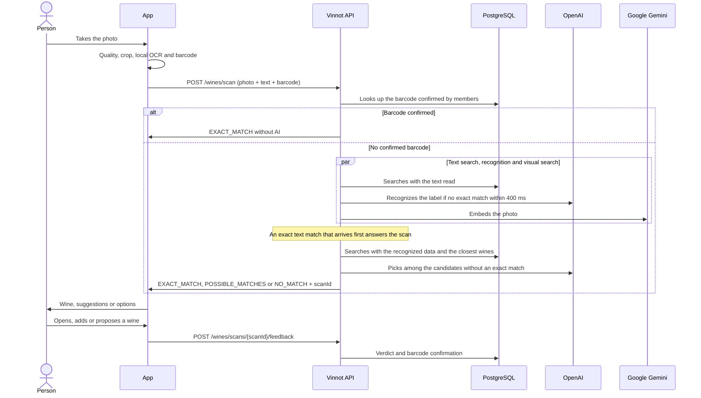

# UC-WIN-05 · Scan a wine label

| Field | Value |
|---|---|
| ID | `UC-WIN-05` |
| Module | [Wines](../README.md) |
| Platforms | APK |
| Actors | Signed-in user, Recognition provider (OpenAI), Image embedding provider (Google Gemini) |
| Lucidchart IDs | [APK UC-SCAN-01](https://lucid.app/lucidchart/e095dd25-e8ac-41ba-bf5b-396e1055f217/edit) |
| Requirements | [`RF-APK-WIN-12`](../requirements.md), [`RF-APK-WIN-13`](../requirements.md), [`RF-APK-WIN-14`](../requirements.md), [`RF-APK-WIN-15`](../requirements.md), [`RF-APK-WIN-16`](../requirements.md), [`RF-APK-WIN-17`](../requirements.md), [`RF-APK-WIN-18`](../requirements.md), [`RF-APK-WIN-24`](../requirements.md), [`RF-APK-WIN-25`](../requirements.md), [`RF-APK-WIN-26`](../requirements.md), [`RF-APK-WIN-27`](../requirements.md) |
| Test cases | [`CP-WIN-19`](../testing.md), [`CP-WIN-20`](../testing.md), [`CP-WIN-21`](../testing.md), [`CP-WIN-22`](../testing.md), [`CP-WIN-23`](../testing.md), [`CP-WIN-24`](../testing.md), [`CP-WIN-25`](../testing.md), [`CP-WIN-42`](../testing.md), [`CP-WIN-44`](../testing.md), [`CP-WIN-45`](../testing.md), [`CP-WIN-46`](../testing.md), [`CP-WIN-47`](../testing.md), [`CP-WIN-48`](../testing.md), [`CP-WIN-49`](../testing.md), [`CP-WIN-50`](../testing.md), [`CP-WIN-51`](../testing.md), [`CP-WIN-52`](../testing.md), [`CP-WIN-53`](../testing.md) |

## Preconditions

- The person is signed in on the app.

## Postconditions

- The person sees the recognized wine, up to three suggestions or the option to search for or propose the wine.
- Scanning does not store the photo in the catalog.
- The scan is recorded with its outcome, the barcode read and, once the person acts on the result, their verdict.

## Main flow

1. The person opens the scanner from the home screen or from "Wines".
2. The app asks for camera permission.
3. The person frames the label and takes the photo; the image freezes. While framing, the camera also reads the bottle's EAN or UPC barcode when it is in view.
4. The app checks resolution, light and focus, crops and saves the photo as JPEG up to 1600 px.
5. The app reads the label text on the device (up to 24 lines of 120 characters and 2000 in total).
6. The app sends `POST /wines/scan` with the photo, the text read and, when it read one, the `barcode`.
7. The API validates the photo and searches the catalog with the text read. If that search has no exact match within 400 ms, the API starts recognizing the label with OpenAI alongside it, and an exact catalog match that arrives first still answers the scan; otherwise it searches again with the recognized data. While OpenAI reads the label, the API compares the photo with the catalog labels Vinnot hosts (visual search) and adds the closest wines to the candidates.
8. When the search is not enough for an exact match, OpenAI looks at the photo together with the best text and image candidates, reads the printed producer and product, and picks one or none. The pick counts as exact only when the words read on the label support it.
9. The API records the scan and answers `EXACT_MATCH`, `POSSIBLE_MATCHES` (up to 3) or `NO_MATCH`, with the `scanId` of the recorded scan.
10. With an exact match, the app shows the wine with "View details"; with suggestions, the person picks one; without matches, it offers searching by hand or proposing the wine.
11. When the person opens or adds a wine from the result, or proposes the wine, the app sends `POST /wines/scans/{scanId}/feedback` once for that scan, without waiting for the answer: `CONFIRMED` with the matched wine, `CORRECTED` with another suggestion or search result, or `NOT_IN_CATALOG` when proposing the wine. The API stores the verdict on the scan and answers 204; when the verdict is `CONFIRMED` and the scan carried a barcode, it also records the person's confirmation that the barcode belongs to that wine.

## Alternative flows

- 1a. The person cancels or leaves: the app drops late answers and deletes only the temporary files it created.
- 2a. The person denies camera permission: the app explains it is needed to scan.
- 3a. The camera reads a barcode of 8, 12, 13 or 14 digits with a valid check digit: the app shows "Barcode read" and sends it with the scan; other codes are ignored.
- 4a. The photo is dark, too bright, out of focus or low resolution: the app says so and asks for another shot.
- 6a. The person went over 30 scans in the hour: the API answers 429 and the app explains that the scan limit was reached and suggests waiting a few minutes or searching for the wine by name, keeping the photo.
- 6b. The `barcode` part is not 8, 12, 13 or 14 digits or its GS1 check digit is wrong: the API answers 400 `INVALID_LABEL_BARCODE`.
- 7a. More than 18 seconds pass: the API answers 503 `LABEL_SCAN_TIMEOUT` and the app reports the delay, keeps the photo and offers retrying, searching by hand or taking another one.
- 7b. Recognition is unavailable or not configured: the app says so and keeps the photo.
- 7c. The API rejects the photo (`INVALID_LABEL_IMAGE`), the read text (`INVALID_LABEL_TEXT`) or is processing too many images (503 `IMAGE_PROCESSING_BUSY`): the app shows its own message for each case (photo format or size, too much text, wait a few seconds) and keeps the photo.
- 7d. Visual search or the pick among candidates is unavailable, slow or not confident: the scan goes on with the catalog result, without an error.
- 7e. AI is busy with other work: the scan uses the slot kept for scans or waits up to 4 seconds for a free slot before answering 503 `AI_CAPACITY_EXCEEDED`.
- 7f. The barcode was confirmed for one active wine by at least two members, and by more members than any other wine: the API answers `EXACT_MATCH` with that wine and confidence 1.0, without calling OpenAI or searching the catalog. That scan earns no scan point and stores no barcode, so a verdict on it never reinforces the barcode that answered it.
- 10a. There is no exact match: the app offers "Scan the back label" once. The person photographs the back label; the app reads its text, merges it with the front reading, keeps the front photo and sends the scan again.
- 10b. The label shows a vintage between 1900 and the current year: the app passes it to the wine it opens, and adding that wine to the cellar prefills "Vintage" for a new entry; an existing entry keeps its own vintage.
- 11a. The person corrects an exact match with another wine: besides storing the verdict, Vinnot files a catalog quality report about both wines for the moderation team ([UC-ADM-07](../../admin/use-cases/uc-adm-07-moderate-reports.md)); the catalog is never edited automatically.
- 11b. The scan does not exist or belongs to someone else (404 `SCAN_NOT_FOUND`), the wine does not exist or is inactive (404 `WINE_NOT_FOUND`), the verdict and the wine do not match, or `CONFIRMED` names a wine other than the scan's exact match (400 `INVALID_SCAN_FEEDBACK`): the API stores nothing.
- 11c. Sending the verdict fails or the scan has no `scanId`: the app shows nothing and the person goes on.

## Business rules

- The photo must be JPEG or PNG, up to 8 MiB and 24 Mpx, with a short side of at least 320 px and a long side of at least 720 px.
- A match is exact with a score of 0.90, or 0.80 with a full identity, and a lead of 0.06 over another candidate; suggestions start at 0.42 and are never shown above 0.89.
- If the server is processing other images at its limit, it waits up to 2 seconds and then answers 503 `IMAGE_PROCESSING_BUSY`.
- Catalog search ignores accents and case: "SEPTIMA" finds "Séptima". It also searches by producer: "Norton" brings Bodega Norton's wines.
- A generic line on its own ("Reserva", "Malbec", "Estate") is not used as the wine's identity.
- Visual search only considers labels with a similarity of at least 0.6 and never replaces the text: its wines join the candidates and, when the text finds nothing, they are shown as suggestions.
- OpenAI's pick among candidates needs a confidence of 0.85, every word of the product it read in the candidate, every word of the candidate's name read on the label, and an agreeing producer.
- The scan photo is not stored: it is only used to read and compare it at that moment.
- A barcode is only learned from `CONFIRMED` verdicts, where the label recognized in the photo and the member agree on the wine; `CORRECTED` and `NOT_IN_CATALOG` never confirm a barcode. Each member counts once per barcode (their latest confirmation wins), and a tie for the lead answers nothing. If the lookup fails, the scan goes on as usual.
- `CONFIRMED` and `CORRECTED` require `wineId`; `NOT_IN_CATALOG` must not carry one. `CONFIRMED` is only valid on an `EXACT_MATCH` scan and with its matched wine. Sending a verdict again replaces the previous one.
- `scanId` is `null` when the scan could not be recorded; the app then sends no verdict.
- When merging two readings, each side keeps at least half of the 24 lines, within the same limits as a single reading.

## Diagram

[View the full “UC-WIN-05 · Scan a wine label” diagram](https://images.vinnot.com/docs/diagrams/v1/en/modules-wines-use-cases-uc-win-05-scan-label-b9bf4a4b8e7d.svg)

Component diagram in Lucidchart: [APK UC-SCAN-01](https://lucid.app/lucidchart/e095dd25-e8ac-41ba-bf5b-396e1055f217/edit).

## Code

| Layer | Location |
|---|---|
| Endpoints | `POST /wines/scan`, `POST /wines/scans/{scanId}/feedback` |
| Backend | [`WineLabelScanController.java`](../../../../../backend/src/main/java/com/vinnot/wine/infrastructure/web/controller/WineLabelScanController.java), [`ScanWineLabelCommandHandler.java`](../../../../../backend/src/main/java/com/vinnot/wine/application/command/handler/ScanWineLabelCommandHandler.java), [`WineLabelUploadValidator.java`](../../../../../backend/src/main/java/com/vinnot/wine/infrastructure/web/WineLabelUploadValidator.java), [`WineLabelCatalogMatcher.java`](../../../../../backend/src/main/java/com/vinnot/wine/application/service/WineLabelCatalogMatcher.java), [`OpenAiWineLabelRecognitionAdapter.java`](../../../../../backend/src/main/java/com/vinnot/wine/infrastructure/ai/OpenAiWineLabelRecognitionAdapter.java), [`WineLabelCandidateVerifier.java`](../../../../../backend/src/main/java/com/vinnot/wine/application/service/WineLabelCandidateVerifier.java), [`OpenAiWineLabelCandidateVerificationAdapter.java`](../../../../../backend/src/main/java/com/vinnot/wine/infrastructure/ai/OpenAiWineLabelCandidateVerificationAdapter.java), [`WineLabelPickEvidence.java`](../../../../../backend/src/main/java/com/vinnot/wine/domain/service/WineLabelPickEvidence.java), [`WineVisualIndexService.java`](../../../../../backend/src/main/java/com/vinnot/wine/application/service/WineVisualIndexService.java), [`GeminiImageEmbeddingAdapter.java`](../../../../../backend/src/main/java/com/vinnot/wine/infrastructure/visual/GeminiImageEmbeddingAdapter.java), [`InMemoryWineVisualIndex.java`](../../../../../backend/src/main/java/com/vinnot/wine/infrastructure/visual/InMemoryWineVisualIndex.java), [`SubmitWineLabelScanFeedbackCommandHandler.java`](../../../../../backend/src/main/java/com/vinnot/wine/application/command/handler/SubmitWineLabelScanFeedbackCommandHandler.java), [`WineLabelScanRecorder.java`](../../../../../backend/src/main/java/com/vinnot/wine/application/service/WineLabelScanRecorder.java), [`WineLabelBarcodeValidator.java`](../../../../../backend/src/main/java/com/vinnot/wine/infrastructure/web/WineLabelBarcodeValidator.java), [`JdbcWineBarcodeConfirmations.java`](../../../../../backend/src/main/java/com/vinnot/wine/infrastructure/persistence/adapter/JdbcWineBarcodeConfirmations.java), [`CommunityCatalogQualitySignalAdapter.java`](../../../../../backend/src/main/java/com/vinnot/wine/infrastructure/community/CommunityCatalogQualitySignalAdapter.java) |
| App | `frontend-mobile/app/(app)/(tabs)/wines/scan.tsx`, [`WineLabelScanScreen.tsx`](../../../../../frontend-mobile/src/presentation/features/wine/scan/WineLabelScanScreen.tsx), [`useWineLabelScanViewModel.ts`](../../../../../frontend-mobile/src/presentation/features/wine/scan/useWineLabelScanViewModel.ts), [`WineLabelCamera.tsx`](../../../../../frontend-mobile/src/infrastructure/device/camera/WineLabelCamera.tsx), [`wineLabelTextRecognizer.ts`](../../../../../frontend-mobile/src/infrastructure/device/camera/wineLabelTextRecognizer.ts), [`wineLabelImageProcessor.ts`](../../../../../frontend-mobile/src/infrastructure/device/camera/wineLabelImageProcessor.ts), [`wineLabelTemporaryImages.ts`](../../../../../frontend-mobile/src/infrastructure/device/camera/wineLabelTemporaryImages.ts), [`labelScan.ts`](../../../../../frontend-mobile/src/domain/wine/labelScan.ts), [`wineLabelText.ts`](../../../../../frontend-mobile/src/shared/image/wineLabelText.ts), [`CellarAddSheet.tsx`](../../../../../frontend-mobile/src/presentation/features/cellar/CellarAddSheet.tsx), [`wineNavigation.ts`](../../../../../frontend-mobile/src/presentation/navigation/wineNavigation.ts) |

## Automated tests

- Backend: [`ScanWineLabelCommandHandlerTest.java`](../../../../../backend/src/test/java/com/vinnot/wine/application/command/handler/ScanWineLabelCommandHandlerTest.java), [`WineLabelCatalogMatcherTest.java`](../../../../../backend/src/test/java/com/vinnot/wine/application/service/WineLabelCatalogMatcherTest.java), [`WineLabelMatchScorerTest.java`](../../../../../backend/src/test/java/com/vinnot/wine/domain/service/WineLabelMatchScorerTest.java), [`WineLabelUploadValidatorTest.java`](../../../../../backend/src/test/java/com/vinnot/wine/infrastructure/web/WineLabelUploadValidatorTest.java), [`WineLabelObservedTextValidatorTest.java`](../../../../../backend/src/test/java/com/vinnot/wine/infrastructure/web/WineLabelObservedTextValidatorTest.java), [`OpenAiWineLabelRecognitionAdapterTest.java`](../../../../../backend/src/test/java/com/vinnot/wine/infrastructure/ai/OpenAiWineLabelRecognitionAdapterTest.java), [`WineLabelScanDeadlineTest.java`](../../../../../backend/src/test/java/com/vinnot/wine/application/service/WineLabelScanDeadlineTest.java), [`WineLabelScanPolicyTest.java`](../../../../../backend/src/test/java/com/vinnot/wine/application/service/WineLabelScanPolicyTest.java), [`WineLabelCandidateVerifierTest.java`](../../../../../backend/src/test/java/com/vinnot/wine/application/service/WineLabelCandidateVerifierTest.java), [`WineLabelPickEvidenceTest.java`](../../../../../backend/src/test/java/com/vinnot/wine/domain/service/WineLabelPickEvidenceTest.java), [`WineVisualIndexServiceTest.java`](../../../../../backend/src/test/java/com/vinnot/wine/application/service/WineVisualIndexServiceTest.java), [`OpenAiWineLabelCandidateVerificationAdapterTest.java`](../../../../../backend/src/test/java/com/vinnot/wine/infrastructure/ai/OpenAiWineLabelCandidateVerificationAdapterTest.java), [`JdbcWineImageEmbeddingRepositoryPostgresIntegrationTest.java`](../../../../../backend/src/test/java/com/vinnot/wine/infrastructure/persistence/adapter/JdbcWineImageEmbeddingRepositoryPostgresIntegrationTest.java), [`SubmitWineLabelScanFeedbackCommandHandlerTest.java`](../../../../../backend/src/test/java/com/vinnot/wine/application/command/handler/SubmitWineLabelScanFeedbackCommandHandlerTest.java), [`WineLabelScanRecorderTest.java`](../../../../../backend/src/test/java/com/vinnot/wine/application/service/WineLabelScanRecorderTest.java), [`WineLabelScanControllerTest.java`](../../../../../backend/src/test/java/com/vinnot/wine/infrastructure/web/controller/WineLabelScanControllerTest.java), [`WineLabelScanFeedbackPostgresIntegrationTest.java`](../../../../../backend/src/test/java/com/vinnot/wine/infrastructure/persistence/adapter/WineLabelScanFeedbackPostgresIntegrationTest.java), [`WineLabelCandidateRetrieverTest.java`](../../../../../backend/src/test/java/com/vinnot/wine/application/service/WineLabelCandidateRetrieverTest.java), [`CatalogSearchAccentNormalizerTest.java`](../../../../../backend/src/test/java/com/vinnot/wine/infrastructure/persistence/search/CatalogSearchAccentNormalizerTest.java), [`GeminiImageEmbeddingAdapterTest.java`](../../../../../backend/src/test/java/com/vinnot/wine/infrastructure/visual/GeminiImageEmbeddingAdapterTest.java), [`InMemoryWineVisualIndexTest.java`](../../../../../backend/src/test/java/com/vinnot/wine/infrastructure/visual/InMemoryWineVisualIndexTest.java), [`AiProviderAdmissionServiceTest.java`](../../../../../backend/src/test/java/com/vinnot/ai/application/service/AiProviderAdmissionServiceTest.java)
- Web: None
- App: [`useWineLabelScanViewModel.test.ts`](../../../../../frontend-mobile/src/presentation/features/wine/scan/useWineLabelScanViewModel.test.ts), [`WineLabelScanScreen.test.tsx`](../../../../../frontend-mobile/src/presentation/features/wine/scan/WineLabelScanScreen.test.tsx), [`WineLabelCamera.test.tsx`](../../../../../frontend-mobile/src/infrastructure/device/camera/WineLabelCamera.test.tsx), [`wineLabelTextRecognizer.test.ts`](../../../../../frontend-mobile/src/infrastructure/device/camera/wineLabelTextRecognizer.test.ts), [`wineLabelImageProcessor.test.ts`](../../../../../frontend-mobile/src/infrastructure/device/camera/wineLabelImageProcessor.test.ts), [`wineLabelTemporaryImages.test.ts`](../../../../../frontend-mobile/src/infrastructure/device/camera/wineLabelTemporaryImages.test.ts), [`wineLabelImageQuality.test.ts`](../../../../../frontend-mobile/src/shared/image/wineLabelImageQuality.test.ts), [`labelScan.test.ts`](../../../../../frontend-mobile/src/domain/wine/labelScan.test.ts), [`wineLabelText.test.ts`](../../../../../frontend-mobile/src/shared/image/wineLabelText.test.ts), [`CellarAddSheet.test.tsx`](../../../../../frontend-mobile/src/presentation/features/cellar/CellarAddSheet.test.tsx), [`wineNavigation.test.ts`](../../../../../frontend-mobile/src/presentation/navigation/__tests__/wineNavigation.test.ts), [`wines.service.test.ts`](../../../../../frontend-mobile/src/application/services/wines.service.test.ts)
