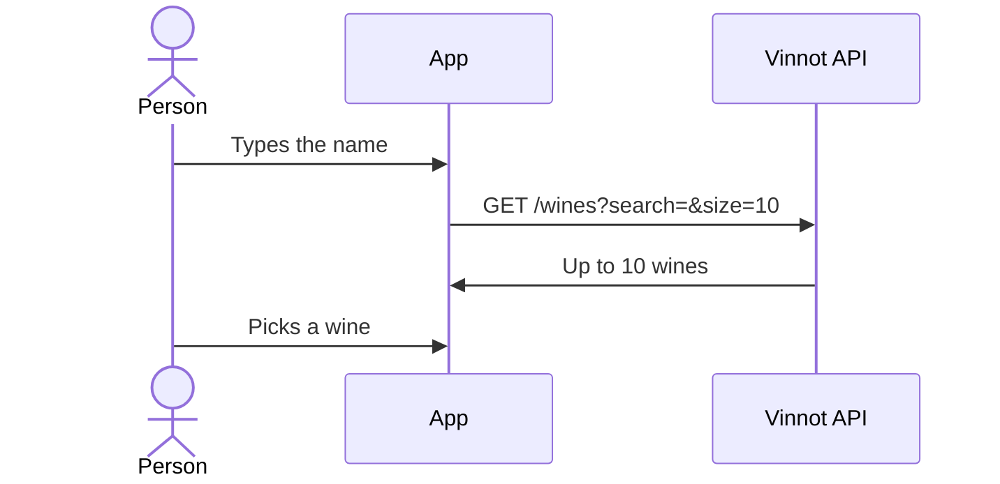

# UC-WIN-06 · Search by hand from the scanner

| Field | Value |
|---|---|
| ID | `UC-WIN-06` |
| Module | [Wines](../README.md) |
| Platforms | APK |
| Actors | Signed-in user |
| Lucidchart IDs | [APK UC-SCAN-02](https://lucid.app/lucidchart/e095dd25-e8ac-41ba-bf5b-396e1055f217/edit) |
| Requirements | [`RF-APK-WIN-19`](../requirements.md) |
| Test cases | [`CP-WIN-26`](../testing.md), [`CP-WIN-27`](../testing.md), [`CP-WIN-28`](../testing.md) |

## Preconditions

- The scanner shows an error, suggestions or no match.

## Postconditions

- The person opens the wine they searched for, or goes on with the photo they took.

## Main flow

1. The person picks "Search by hand".
2. They type at least 2 characters.
3. The app waits for 300 ms without changes and searches the catalog for up to 10 wines.
4. The person picks a wine and the app opens its detail.

## Alternative flows

- 3a. The person changes the text: the previous results are discarded.
- 3b. There are no results: the app offers to propose the wine ([UC-WIN-07](uc-win-07-submit-wine.md)).

## Business rules

- The photo taken is kept during the search.

## Diagram

[View the full “UC-WIN-06 · Search by hand from the scanner” diagram](https://images.vinnot.com/docs/diagrams/v1/en/modules-wines-use-cases-uc-win-06-manual-search-from-scan-cd18ddc32d04.svg)

Component diagram in Lucidchart: [APK UC-SCAN-02](https://lucid.app/lucidchart/e095dd25-e8ac-41ba-bf5b-396e1055f217/edit).

## Code

| Layer | Location |
|---|---|
| Endpoints | `GET /wines?search=` |
| Backend | [`WineReadController.java`](../../../../../backend/src/main/java/com/vinnot/wine/infrastructure/web/controller/WineReadController.java), [`SearchWinesQueryHandler.java`](../../../../../backend/src/main/java/com/vinnot/wine/application/query/handler/SearchWinesQueryHandler.java) |
| App | [`WineLabelScanScreen.tsx`](../../../../../frontend-mobile/src/presentation/features/wine/scan/WineLabelScanScreen.tsx), [`useWineLabelScanViewModel.ts`](../../../../../frontend-mobile/src/presentation/features/wine/scan/useWineLabelScanViewModel.ts) |

## Automated tests

- Backend: [`SearchWinesQueryHandlerTest.java`](../../../../../backend/src/test/java/com/vinnot/wine/application/query/handler/SearchWinesQueryHandlerTest.java)
- Web: None
- App: [`useWineLabelScanViewModel.test.ts`](../../../../../frontend-mobile/src/presentation/features/wine/scan/useWineLabelScanViewModel.test.ts)
