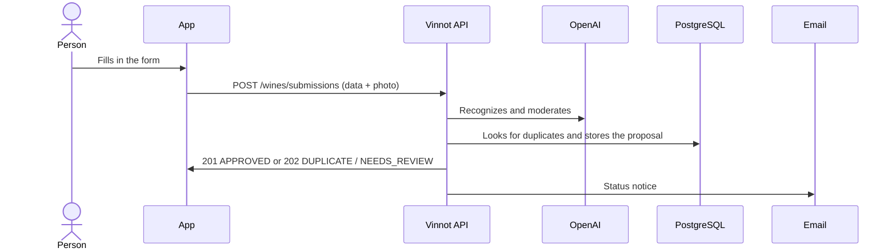

# UC-WIN-07 · Propose a wine missing from the catalog

| Field | Value |
|---|---|
| ID | `UC-WIN-07` |
| Module | [Wines](../README.md) |
| Platforms | APK |
| Actors | Signed-in user, Recognition provider (OpenAI), Email service |
| Lucidchart IDs | [APK UC-SCAN-03](https://lucid.app/lucidchart/e095dd25-e8ac-41ba-bf5b-396e1055f217/edit) |
| Requirements | [`RF-APK-WIN-20`](../requirements.md), [`RF-APK-WIN-21`](../requirements.md) |
| Test cases | [`CP-WIN-29`](../testing.md), [`CP-WIN-30`](../testing.md), [`CP-WIN-31`](../testing.md), [`CP-WIN-32`](../testing.md), [`CP-WIN-33`](../testing.md), [`CP-WIN-43`](../testing.md) |

## Preconditions

- The scanner did not find the wine and there is a label photo, or the person came from “Add your wine” and chose “Add without a photo”.

## Postconditions

- A proposal is stored with status `APPROVED`, `DUPLICATE` or `NEEDS_REVIEW`.
- With `APPROVED` the wine is already in the catalog; with `DUPLICATE` the proposal points to the existing wine.

## Main flow

1. The person chooses to propose the wine and the app opens the form with the photo.
2. They fill in wine name and winery, and can add type, vintage, grapes, country, region, alcohol and notes.
3. The app validates and sends `POST /wines/submissions` with the data and the photo.
4. The API validates the photo, recognizes the label, combines what it recognized with the form, locks name, winery and vintage, looks for duplicates and moderates text and image.
5. If everything is safe and the wine is new, it publishes it in the catalog and answers 201 `APPROVED`.
6. The app shows the result.

## Alternative flows

- 5a. The same wine already exists: it answers 202 `DUPLICATE` with the existing wine and, if it lacked an image and it is safe, uses the photo.
- 5b. Validation is incomplete or unsafe, or the provider is unavailable: it stores the photo in quarantine and answers 202 `NEEDS_REVIEW`; moderation decides ([Administration](../../admin/README.md)).
- 3a. Name or winery is missing, or a value is out of range: the form is not sent.
- 3b. The person went over 10 proposals in the day: the API answers 429.
- 1a. From “Add your wine” the person does not have the bottle with them and taps “Add without a photo”: the form opens without a photo and says “Without a photo, an administrator checks the wine before it is published.”; the app sends no `image` part and the API skips recognition, moderation and image storage: when the form matches a wine exactly it answers 202 `DUPLICATE` without adding an image, otherwise 202 `NEEDS_REVIEW` with the `LABEL_PHOTO_MISSING` reason.

## Business rules

- Name and winery take up to 255 characters; up to 10 grapes of 100 characters; country and region up to 100; notes up to 1000.
- Alcohol accepts a comma or a dot (13,6 and 13.6 are the same) between 0 and 100; the vintage goes from 1800 to the year after the current one.
- It is published without review only when every check is safe; when in doubt, the proposal waits for moderation.
- Every status change is emailed in the proposer's language.
- On the app it is also reached from “Add your wine” on a search with no results ([UC-WIN-01](uc-win-01-search-catalog.md)): the scanner is titled “Add your wine”, shows the wine when the label is an exact match and otherwise opens the form directly. The searched text fills the name only when the label has none.

## Diagram

[View the full “UC-WIN-07 · Propose a wine missing from the catalog” diagram](https://images.vinnot.com/docs/diagrams/v1/en/modules-wines-use-cases-uc-win-07-submit-wine-214310682d42.svg)

Component diagram in Lucidchart: [APK UC-SCAN-03](https://lucid.app/lucidchart/e095dd25-e8ac-41ba-bf5b-396e1055f217/edit).

## Code

| Layer | Location |
|---|---|
| Endpoints | `POST /wines/submissions` |
| Backend | [`WineSubmissionController.java`](../../../../../backend/src/main/java/com/vinnot/wine/infrastructure/web/controller/WineSubmissionController.java), [`SubmitWineCommandHandler.java`](../../../../../backend/src/main/java/com/vinnot/wine/application/command/handler/SubmitWineCommandHandler.java), [`WineLabelUploadValidator.java`](../../../../../backend/src/main/java/com/vinnot/wine/infrastructure/web/WineLabelUploadValidator.java) |
| App | [`WineSubmissionForm.tsx`](../../../../../frontend-mobile/src/presentation/features/wine/scan/WineSubmissionForm.tsx), [`WineLabelScanScreen.tsx`](../../../../../frontend-mobile/src/presentation/features/wine/scan/WineLabelScanScreen.tsx), [`wineNavigation.ts`](../../../../../frontend-mobile/src/presentation/navigation/wineNavigation.ts), [`useWineSubmissionCatalog.ts`](../../../../../frontend-mobile/src/presentation/features/wine/scan/useWineSubmissionCatalog.ts), [`useWineLabelScanViewModel.ts`](../../../../../frontend-mobile/src/presentation/features/wine/scan/useWineLabelScanViewModel.ts) |

## Automated tests

- Backend: [`SubmitWineCommandHandlerTest.java`](../../../../../backend/src/test/java/com/vinnot/wine/application/command/handler/SubmitWineCommandHandlerTest.java), [`WineSubmissionTest.java`](../../../../../backend/src/test/java/com/vinnot/wine/domain/model/WineSubmissionTest.java), [`WineSubmissionMultipartContractTest.java`](../../../../../backend/src/test/java/com/vinnot/wine/infrastructure/web/controller/WineSubmissionMultipartContractTest.java), [`WineSubmissionPostgresIntegrationTest.java`](../../../../../backend/src/test/java/com/vinnot/wine/infrastructure/persistence/WineSubmissionPostgresIntegrationTest.java)
- Web: None
- App: [`WineSubmissionForm.test.tsx`](../../../../../frontend-mobile/src/presentation/features/wine/scan/WineSubmissionForm.test.tsx), [`useWineSubmissionCatalog.test.ts`](../../../../../frontend-mobile/src/presentation/features/wine/scan/useWineSubmissionCatalog.test.ts), [`useWineLabelScanViewModel.test.ts`](../../../../../frontend-mobile/src/presentation/features/wine/scan/useWineLabelScanViewModel.test.ts), [`WineLabelScanScreen.test.tsx`](../../../../../frontend-mobile/src/presentation/features/wine/scan/WineLabelScanScreen.test.tsx)
