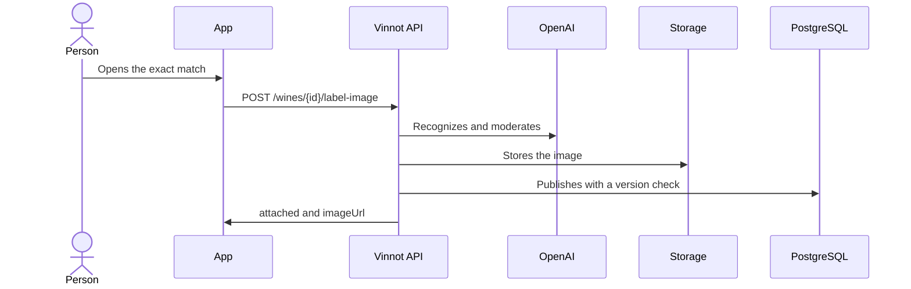

# UC-WIN-08 · Add the label photo to a wine without an image

| Field | Value |
|---|---|
| ID | `UC-WIN-08` |
| Module | [Wines](../README.md) |
| Platforms | APK |
| Actors | Signed-in user, Recognition provider (OpenAI) |
| Lucidchart IDs | [APK UC-SCAN-04](https://lucid.app/lucidchart/e095dd25-e8ac-41ba-bf5b-396e1055f217/edit) |
| Requirements | [`RF-APK-WIN-22`](../requirements.md) |
| Test cases | [`CP-WIN-34`](../testing.md), [`CP-WIN-35`](../testing.md), [`CP-WIN-36`](../testing.md), [`CP-WIN-37`](../testing.md), [`CP-WIN-38`](../testing.md) |

## Preconditions

- The scan gave an exact match and that wine has no image.

## Postconditions

- The photo is published as the wine's image.

## Main flow

1. The person opens the exact match with “View Details” or by tapping the wine's card.
2. Since the wine has no image, the app sends `POST /wines/{id}/label-image` with the photo on its own, without asking for confirmation.
3. The API recognizes the label again and requires the exact match to be that same wine.
4. It moderates the image, stores it as JPEG up to 1600 px and publishes it checking the wine's version.
5. It answers `attached: true` with the URL and the app shows the image.

## Alternative flows

- 3a. The wine already has an image: it answers `attached: false` and changes nothing.
- 3b. The label does not belong to that wine: it answers `LABEL_IMAGE_WINE_MISMATCH`.
- 4a. Moderation does not approve the image: it answers `LABEL_IMAGE_REVIEW_REQUIRED`.
- 2a. The person went over 10 photo uploads in the day: the API answers 429.

## Business rules

- It only happens with an exact match: picking a suggestion never changes a wine's photo.
- It never replaces an existing image.

## Diagram

[View the full “UC-WIN-08 · Add the label photo to a wine without an image” diagram](https://images.vinnot.com/docs/diagrams/v1/en/modules-wines-use-cases-uc-win-08-attach-label-photo-f74cbb80b511.svg)

Component diagram in Lucidchart: [APK UC-SCAN-04](https://lucid.app/lucidchart/e095dd25-e8ac-41ba-bf5b-396e1055f217/edit).

## Code

| Layer | Location |
|---|---|
| Endpoints | `POST /wines/{id}/label-image` |
| Backend | [`WineLabelScanController.java`](../../../../../backend/src/main/java/com/vinnot/wine/infrastructure/web/controller/WineLabelScanController.java), [`AttachWineLabelImageCommandHandler.java`](../../../../../backend/src/main/java/com/vinnot/wine/application/command/handler/AttachWineLabelImageCommandHandler.java) |
| App | [`useWineLabelScanViewModel.ts`](../../../../../frontend-mobile/src/presentation/features/wine/scan/useWineLabelScanViewModel.ts), [`WineLabelScanScreen.tsx`](../../../../../frontend-mobile/src/presentation/features/wine/scan/WineLabelScanScreen.tsx) |

## Automated tests

- Backend: [`AttachWineLabelImageCommandHandlerTest.java`](../../../../../backend/src/test/java/com/vinnot/wine/application/command/handler/AttachWineLabelImageCommandHandlerTest.java), [`WineLabelImagePublicationServiceTest.java`](../../../../../backend/src/test/java/com/vinnot/wine/application/service/WineLabelImagePublicationServiceTest.java)
- Web: None
- App: [`useWineLabelScanViewModel.test.ts`](../../../../../frontend-mobile/src/presentation/features/wine/scan/useWineLabelScanViewModel.test.ts)
