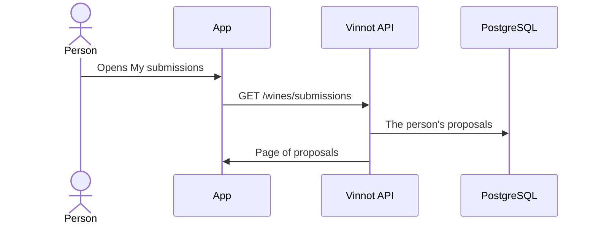

# UC-WIN-09 · Check my proposed wines

| Field | Value |
|---|---|
| ID | `UC-WIN-09` |
| Module | [Wines](../README.md) |
| Platforms | APK |
| Actors | Signed-in user |
| Lucidchart IDs | [APK UC-SCAN-05](https://lucid.app/lucidchart/e095dd25-e8ac-41ba-bf5b-396e1055f217/edit) |
| Requirements | [`RF-APK-WIN-23`](../requirements.md) |
| Test cases | [`CP-WIN-39`](../testing.md), [`CP-WIN-40`](../testing.md), [`CP-WIN-41`](../testing.md) |

## Preconditions

- The person proposed at least one wine.

## Postconditions

- The person sees each proposal's status, the reason and the resulting wine.

## Main flow

1. The person opens "My submitted wines" from Profile.
2. The app calls `GET /wines/submissions` with paging.
3. The API returns only that person's proposals, newest first.
4. The app shows status (`PENDING`, `APPROVED`, `DUPLICATE`, `NEEDS_REVIEW`, `REJECTED` or `CHANGES_REQUESTED`), reason and linked wine.

## Alternative flows

- 2a. Someone else's proposal is requested by ID: the API rejects it.
- 4a. The proposal has a linked wine: the person can open it.

## Business rules

- The person knows whether the proposal has an image, but cannot see the quarantined photo.
- Automatic reasons are shown as translated text; an administrator's, as written.

## Diagram

[View the full “UC-WIN-09 · Check my proposed wines” diagram](https://images.vinnot.com/docs/diagrams/v1/en/modules-wines-use-cases-uc-win-09-track-submissions-c775c612c2d4.svg)

Component diagram in Lucidchart: [APK UC-SCAN-05](https://lucid.app/lucidchart/e095dd25-e8ac-41ba-bf5b-396e1055f217/edit).

## Code

| Layer | Location |
|---|---|
| Endpoints | `GET /wines/submissions`, `GET /wines/submissions/{id}` |
| Backend | [`WineSubmissionController.java`](../../../../../backend/src/main/java/com/vinnot/wine/infrastructure/web/controller/WineSubmissionController.java), [`GetMyWineSubmissionsQueryHandler.java`](../../../../../backend/src/main/java/com/vinnot/wine/application/query/handler/GetMyWineSubmissionsQueryHandler.java), [`GetWineSubmissionQueryHandler.java`](../../../../../backend/src/main/java/com/vinnot/wine/application/query/handler/GetWineSubmissionQueryHandler.java) |
| App | `frontend-mobile/app/(app)/my-submissions.tsx` (from Profile), `frontend-mobile/app/(app)/(tabs)/wines/submissions.tsx` (after a proposal), [`ProfileScreen.tsx`](../../../../../frontend-mobile/src/presentation/features/profile/ProfileScreen.tsx), [`WineSubmissionsScreen.tsx`](../../../../../frontend-mobile/src/presentation/features/wine/scan/WineSubmissionsScreen.tsx) |

## Automated tests

- Backend: [`GetWineSubmissionQueryHandlerTest.java`](../../../../../backend/src/test/java/com/vinnot/wine/application/query/handler/GetWineSubmissionQueryHandlerTest.java), [`WineSubmissionPostgresIntegrationTest.java`](../../../../../backend/src/test/java/com/vinnot/wine/infrastructure/persistence/WineSubmissionPostgresIntegrationTest.java), [`WineSubmissionStatusTemplateTest.java`](../../../../../backend/src/test/java/com/vinnot/notification/infrastructure/template/WineSubmissionStatusTemplateTest.java)
- Web: None
- App: None
