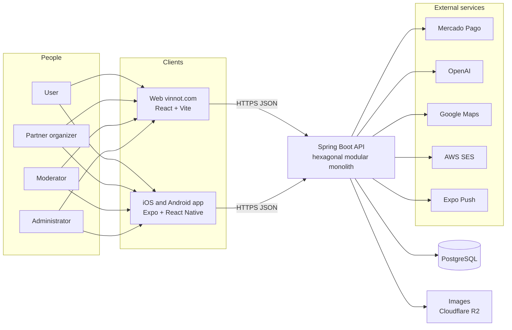

# Project

Vinnot on one page: what it is, the problem it solves, where it stands and how to move
through the rest of the documentation. This chapter holds these pages:

| Page | What it covers |
|---|---|
| [Project plan](project-plan.md) | Objectives, audience, scope, assumptions, milestones, methodology, risks and success criteria |
| [Requirements index](requirements-index.md) | Functional requirements per module and platform, with their counts, and the link to the non-functional ones |
| [Product access](deliverables-and-access.md) | Links, app installation, roles and permissions, demo accounts and a guided tour by role |
| [Repository organization](repository-organization.md) | Folders, architecture conventions, branches, access, running locally and CI |

## What Vinnot is

Vinnot is a platform for discovering and managing wine. It brings together the wine
catalog, wineries, wine routes and paid events, with a community that reviews and
shares. It runs on the web, at [vinnot.com](https://vinnot.com), and in an iOS and
Android app that can also scan a wine label to find the wine in the catalog.

## The problem

People who drink wine or travel for wine in Argentina spread their information across
many sources: the label, each winery's website, social media to hear about tastings,
and their own spreadsheets or notes to remember what they tried. Wineries and event
organizers, in turn, have no channel of their own to publish activities, sell tickets
and reach people interested in wine.

The market and competitor analysis is in the [Business model](../business/README.md)
chapter.

## The solution

| Need | What Vinnot offers | Where it is documented |
|---|---|---|
| Identify a wine | Search with filters, and label scanning in the app | [Wines](../modules/wines/README.md) |
| Remember what you tried | A personal cellar with notes and ratings, and public reviews | [Cellar](../modules/cellar/README.md) and [Reviews](../modules/reviews/README.md) |
| Find and visit wineries | Winery pages and wine routes on the map | [Wineries and regions](../modules/wineries/README.md) and [Wine routes](../modules/wine-routes/README.md) |
| Go to events | Discovery, registration, Mercado Pago payment and the ticket on the phone | [Events and tickets](../modules/events/README.md) and [Payments](../modules/payments/README.md) |
| Organize events and get paid | A partner panel with registrations, payments and refunds | [Partners](../modules/partner/README.md) |
| Understand a wine | AI-generated profiles and comparisons | [AI profiles and comparisons](../modules/ai/README.md) |
| Look after the content | An administration panel and reactive moderation | [Administration and moderation](../modules/admin/README.md) |

## System overview

[View the full “System overview” diagram](https://images.vinnot.com/docs/diagrams/v1/en/project-readme-421b60ca8d95.svg)

The detail of each piece, the network and the containers is in
[System architecture](../architecture/README.md) and in
[Hosting and runtime](../infra/architecture/hosting-and-runtime.md).

## Platforms

| Platform | Technology | Code | Status |
|---|---|---|---|
| Web | React 19, Vite and TypeScript | [`frontend-react/`](../../../frontend-react/package.json) | Implemented, in production at [vinnot.com](https://vinnot.com) |
| iOS | Expo SDK 58 and React Native | [`frontend-mobile/`](../../../frontend-mobile/app.config.ts) | Implemented, version 0.2.2 on the App Store |
| Android | Expo SDK 58 and React Native | [`frontend-mobile/`](../../../frontend-mobile/app.config.ts) | Implemented, version 0.2.2 on Google Play |
| API | Spring Boot 4.1 and Java 25 | [`backend/`](../../../backend/pom.xml) | Implemented, in production at `api.vinnot.com` |
| Documentation | Docusaurus | [`docs-site/`](../../../docs-site/docusaurus.config.ts) | Published with restricted access |

The app version comes from `version` in
[`app.config.ts`](../../../frontend-mobile/app.config.ts). Each dependency's version is
in the [technology catalog](../architecture/technologies/README.md).

## Project status

- **Production.** The first production release was on 29 September 2026. The web, the
  API and the app run in production ([Timeline](../gantt/README.md)).
- **Functional scope.** 16 modules with use cases and requirements: 117 use cases, 169
  web requirements, 193 app requirements and 497 traced test cases
  ([Global traceability matrix](../modules/traceability.md)). Two more modules,
  [Activity](../modules/activity/README.md) and
  [Points and seals](../modules/gamification/README.md), are documented without use
  cases of their own.
- **Ticket sales.** Implemented with Mercado Pago and a 3% platform commission
  ([Payments](../modules/payments/README.md) and
  [Monetization](../business/monetization.md)).
- **Planned.** The stepped commission increase and the winery subscription are being
  planned, not implemented ([Monetization](../business/monetization.md)).

## Team and responsibilities

The repository belongs to the GitHub account `Bielaszczuk`, which approves changes and
publishes releases. The project responsibilities are split like this:

| Responsibility | What it includes | Reference |
|---|---|---|
| Product and business | Priorities, business model, relationship with wineries and organizers | [Business model](../business/README.md) |
| Backend | API, domain, persistence, payments and AI | [Backend](../backend/README.md) |
| Web | Public site, administration panel and user flows | [Web](../frontend-web/README.md) |
| Mobile app | iOS and Android app, scanning and notifications | [Mobile app](../frontend-mobile/README.md) |
| Infrastructure and releases | AWS, Cloudflare, CI/CD and store publishing | [Infrastructure](../infra/README.md) |
| Quality and security | Testing, CI gates, risks and security controls | [Quality](../quality/README.md) and [Security](../security/README.md) |
| Documentation | This site, in Spanish and English | [Governance](../governance/README.md) |

Pending: the repository owner fills in the list of team members with each person's role.

## How to read this documentation

The suggested order goes from the general to the technical, for anyone joining the
project: new team members, partners or readers interested in the product.

| Step | Read | To understand |
|---|---|---|
| 1 | This page and the [Project plan](project-plan.md) | What Vinnot is, who it is for and how far it reaches |
| 2 | [Business model](../business/README.md) | Value proposition, monetization, costs and scale |
| 3 | [Product access](deliverables-and-access.md) | How to open the web, install the app and try each role |
| 4 | [Manuals](../manuals/README.md) and [Videos](../videos/README.md) | How each feature is used, by role and platform |
| 5 | [Requirements index](requirements-index.md) and [Modules](../modules/README.md) | Use cases, requirements and tests of each module |
| 6 | [System architecture](../architecture/README.md) | How the web, app, API and infrastructure connect |
| 7 | [UML domain model](../backend/diagrams/domain-class-model.md), [Detailed ERD by context](../backend/diagrams/relational-model.md) and [Diagrams](../diagrams/README.md) | Classes, entities, states and the diagram catalog |
| 8 | [Quality](../quality/README.md) and [Security](../security/README.md) | How the platform is tested and protected |
| 9 | [Repository organization](repository-organization.md) and [Getting started](../getting-started/README.md) | Where everything is and how to run it locally |
| 10 | [Infrastructure](../infra/README.md) and [Governance](../governance/README.md) | Deployment, operations and ways of working |
