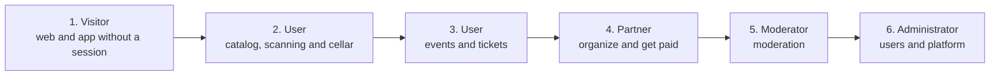

# Product access

How to reach each part of Vinnot: the links for each environment, installing the app,
what each role can do, how demo accounts are handled, and a guided tour by role to show
the product live.

## Links

### Product

| Resource | Production | Development |
|---|---|---|
| Web | [vinnot.com](https://vinnot.com) | [dev.vinnot.com](https://dev.vinnot.com) |
| API | `https://api.vinnot.com/api` | `https://api-dev.vinnot.com/api` |
| API health | [api.vinnot.com/api/actuator/health](https://api.vinnot.com/api/actuator/health) | [api-dev.vinnot.com/api/actuator/health](https://api-dev.vinnot.com/api/actuator/health) |
| Images | `https://images.vinnot.com` | `https://images.vinnot.com` |
| Public share link | `https://vinnot.com/share/{type}/{id}` | `https://dev.vinnot.com/share/{type}/{id}` |

- `/actuator/health` is public; the rest of `/actuator/**` requires the `ADMIN` role
  ([`SecurityConfig.java`](../../../backend/src/main/java/com/vinnot/shared/infrastructure/config/SecurityConfig.java)).
- Development shuts down every day between 02:00 and 09:00, Argentina time
  ([Low-cost development operations](../infra/operations/low-cost-dev.md)). Its links
  do not answer during that window.
- The interactive API documentation (Swagger) is served locally, at
  `http://localhost:8080/api/swagger-ui.html`.

### App

| Store | Link | Identifier |
|---|---|---|
| App Store (iOS) | [Vinnot on the App Store](https://apps.apple.com/app/vinnot/id6817992780) | `com.vinnot.app` |
| Google Play (Android) | [Vinnot on Google Play](https://play.google.com/store/apps/details?id=com.vinnot.app) | `com.vinnot.app` |

The identifiers come from the production profile in
[`app.config.ts`](../../../frontend-mobile/app.config.ts), and the App Store Connect ID
from [`eas.json`](../../../frontend-mobile/eas.json).

### Project

| Resource | Link | Access |
|---|---|---|
| Repository (monorepo) | [github.com/Bielaszczuk/vinnot](https://github.com/Bielaszczuk/vinnot) | Private; see [Repository organization](repository-organization.md#how-to-get-access) |
| Documentation site | [vinnot-docs.pages.dev](https://vinnot-docs.pages.dev) | Private: only emails authorized in Cloudflare Access ([Documentation site](../governance/documentation-site.md)) |
| Demo videos | [Videos](../videos/README.md) | Inside this documentation |
| Service consoles | [Important URLs](../important-urls/README.md#consoles) | Team accounts |

## Install the app

### From the stores

1. Open the [App Store](https://apps.apple.com/app/vinnot/id6817992780) on an iPhone or
   [Google Play](https://play.google.com/store/apps/details?id=com.vinnot.app) on an
   Android phone.
2. Install Vinnot and open it.
3. Create an account with your email, or sign in with Google (Android and iOS) or Apple
   (iOS only).
4. Open the verification email and tap the link. Then sign in.

The step-by-step guide with screenshots is in the [App user manual](../manuals/app-user.md).

### Test builds

| Channel | What for | How to get in |
|---|---|---|
| TestFlight (iOS) | Try a build before it goes to review | The owner adds your Apple ID as a tester in App Store Connect; install the TestFlight app and accept the invitation |
| Google Play closed testing (Android) | Try a build before it is published to production | The owner adds your Google account to the tester list; open the Play Console opt-in link and install from Google Play |
| Development build | Development in the simulator, with the `com.vinnot.app.dev` identifier | Only for people working on the code ([Mobile development](../frontend-mobile/guides/development.md)) |

Publishing to each store is explained in
[iOS and Android distribution](../frontend-mobile/guides/distribution.md).

### Updates

- JavaScript changes arrive on their own, as Expo OTA updates on the `production`
  channel.
- Native changes need a new store version. If the installed version is lower than the
  minimum the team sets, the app shows "Update Vinnot to continue" with a button to the
  store ([Forcing the update](../frontend-mobile/guides/distribution.md#forcing-the-update)).

## Roles and permissions

### What each role can do

The operational roles are those of the
[`Role.java`](../../../backend/src/main/java/com/vinnot/user/domain/valueobject/Role.java)
enum: `USER`, `PARTNER`, `MODERATOR` and `ADMIN`. A new account gets `USER`; an
administrator assigns the other roles.

| Can… | Visitor | User | Partner | Moderator | Administrator |
|---|---|---|---|---|---|
| Create an account, sign in and recover the password | Yes | — | — | — | — |
| Read help, contact, terms and policies; write to support; open a shared link preview | Yes | Yes | Yes | Yes | Yes |
| Browse wines, wineries, routes and events | No | Yes | Yes | Yes | Yes |
| Review, comment, like, report and block | No | Yes | Yes | Yes | Yes |
| Scan labels and propose wines | No | Yes | Yes | Yes | Yes |
| Keep a cellar | No | Yes | Yes | Only if the account also has `USER` | Yes |
| Register for events and pay for tickets | No | Yes | Yes | Yes | Yes |
| Create events and edit their own | No | No | Yes | Yes, and other people's too | Yes |
| Connect Mercado Pago, see the payments of their events and refund payments | No | No | Yes | No | Yes |
| Use the panel and create or edit wines, wineries, events and routes | No | No | No | Yes | Yes |
| Review proposed wines, reports, publications and reviews; edit AI profiles | No | No | No | Yes | Yes |
| Delete wines, wineries and routes, and cancel other people's events | No | No | No | No | Yes |
| Manage users and roles, and suspend accounts | No | No | No | No | Yes |
| Send announcements, control push and set the minimum app version | No | No | No | No | Yes |

Sources: [Administration manual](../manuals/admin.md#roles-and-access),
[Partner manual](../manuals/partner.md#how-to-get-the-partner-role) and the route rules
in [`SecurityConfig.java`](../../../backend/src/main/java/com/vinnot/shared/infrastructure/config/SecurityConfig.java).
A visitor without a session does not see the catalog: reading wines, wineries, events
and routes requires a session.

### API access rules

| Route | Access |
|---|---|
| `/auth/*` for sign-in, sign-up, refresh, recovery and verification | Public |
| `GET /share/**`, `POST /support/requests`, `GET /legal/terms/current`, `GET /app-versions/minimum` | Public |
| Mercado Pago webhooks and callback, `GET /payments/receipt` | Public, with their own signature or token check |
| `/health`, `/version`, `/actuator/health`, `/uploads/**` | Public |
| `GET /wines/**`, `/wineries/**`, `/events/**`, `/wine-routes/**`, `/grape-types/**`, `/regions/**`, `/reference/**` | Signed in |
| `/admin/users/**`, `/admin/notifications/**`, `/admin/app-versions/**`, `/actuator/**` | `ADMIN` |
| The rest of `/admin/**` | `ADMIN` or `MODERATOR` |
| Everything else, writes included | Signed in, plus the permission or ownership each operation requires |

The detail, with the ownership check per operation, is in
[Security, authorization, and abuse protection](../backend/architecture/security-and-authorization.md).

### Permissions by role

Permissions are seeded in
[`V2__seed_reference_data.sql`](../../../backend/src/main/resources/db/migration/V2__seed_reference_data.sql)
(tables `roles`, `permissions` and `role_permissions`) and travel in the access token.
[`V76__remove_unused_roles_and_permissions.sql`](../../../backend/src/main/resources/db/migration/V76__remove_unused_roles_and_permissions.sql)
removed the unused roles and permissions. The table shows the 31 permissions left; the
full matrix, with the permissions each controller checks through `@PreAuthorize`, is in
[Security and authorization](../backend/architecture/security-and-authorization.md#permissions-per-role).

| Permission | User | Partner | Moderator | Administrator |
|---|---|---|---|---|
| `WINE_READ`, `WINERY_READ`, `EVENT_READ`, `WINE_ROUTE_READ` | Yes | Yes | Yes | Yes |
| `REVIEW_CREATE`, `REVIEW_UPDATE_OWN`, `REVIEW_DELETE_OWN` | Yes | Yes | Yes | Yes |
| `CELLAR_MANAGE_OWN` | Yes | Yes | No | Yes |
| `EVENT_CREATE` | No | Yes | Yes | Yes |
| `EVENT_UPDATE_OWN`, `EVENT_DELETE_OWN` | No | Yes | No | Yes |
| `EVENT_UPDATE` | No | No | Yes | Yes |
| `EVENT_DELETE` | No | No | No | Yes |
| `WINE_CREATE`, `WINE_UPDATE`, `WINERY_CREATE`, `WINERY_UPDATE` | No | No | Yes | Yes |
| `WINE_DELETE`, `WINERY_DELETE` | No | No | No | Yes |
| `WINE_ROUTE_CREATE`, `WINE_ROUTE_UPDATE` | No | No | Yes | Yes |
| `WINE_ROUTE_UPDATE_OWN`, `WINE_ROUTE_DELETE_OWN`, `WINE_ROUTE_DELETE` | No | No | No | Yes |
| `REVIEW_DELETE` | No | No | Yes | Yes |
| `USER_READ`, `ADMIN_DASHBOARD_READ` | No | No | Yes | Yes |
| `USER_UPDATE`, `USER_BAN`, `USER_DELETE`, `ROLE_ASSIGN` | No | No | No | Yes |

- The cellar requires `CELLAR_MANAGE_OWN` across
  [`CellarController`](../../../backend/src/main/java/com/vinnot/cellar/infrastructure/web/controller/CellarController.java).
  That permission is not seeded for `MODERATOR`: a moderator uses the cellar through
  `USER`, which assigning a role from Admin keeps
  ([`User.replaceRole`](../../../backend/src/main/java/com/vinnot/user/domain/model/User.java)).
- The Mercado Pago account, per-event payments and refunds require the `PARTNER` or
  `ADMIN` role (`@PreAuthorize("hasAnyRole('PARTNER','ADMIN')")` in
  [`PaymentAccountController`](../../../backend/src/main/java/com/vinnot/payment/infrastructure/web/PaymentAccountController.java),
  `OrganizerPaymentsController` and `PaymentRefundController`).
- The `ROLE_TOURISM_OPERATOR` and `ROLE_VERIFIED_EXPERT` roles and the `ARTICLE_*`
  permissions were seeded by V2 with no features behind them; V76 removed them. The only
  roles are `USER`, `PARTNER`, `MODERATOR` and `ADMIN`.

## Demo accounts

Demo account credentials are **never** published in this documentation or in the
repository. The owner shares them privately with each person who needs to try the
product.

| Account | Role | Suggested environment | To show |
|---|---|---|---|
| Demo user | `USER` | Production (app and web) | Catalog, scanning, cellar, reviews, events and AI profiles |
| Demo partner | `PARTNER` | Production for free events; development for test payments | Partner panel, events and registrations |
| Demo moderator | `MODERATOR` | Production | Panel, proposed wines, reports and reviews |
| Demo administrator | `ADMIN` | Development | Users and roles, announcements, push and minimum version |
| Mercado Pago test buyer | Mercado Pago test account | Development | Pay for a ticket without real money |

- **Pending:** the repository seeds no users (the migrations only load roles,
  permissions and reference data), so the owner creates the accounts in this table and
  assigns their roles from the administration panel.
- The store app points to the production API, so a demo in the app uses production
  accounts.
- Production charges with `EVENT_PAYMENTS_ENVIRONMENT=LIVE`, with real money
  ([Environments, configuration and secrets](../infra/architecture/environments-and-secrets.md)).
  To show a payment, use the development web; before the demo, confirm that
  development is on `SANDBOX`.
- The demo account Apple asks for its review is kept in App Store Connect, not in Git
  ([iOS and Android distribution](../frontend-mobile/guides/distribution.md#app-store-connect)).
- The videos were recorded on development with test accounts and data
  ([Videos](../videos/README.md#how-to-record)).

## Guided tour by role

A tour of about 20 minutes to show the product live. Each step links the manual section
that explains it and the video that shows it. Before you start, check the
[API health](https://api.vinnot.com/api/actuator/health), have the app installed and
open the web in another tab.

[View the full “Guided tour by role” diagram](https://images.vinnot.com/docs/diagrams/v1/en/project-deliverables-and-access-3f2b61c3a0ff.svg)

### 1. Visitor

1. Open [vinnot.com](https://vinnot.com) without a session: it shows the home page,
   help and legal documents
   ([Web user manual](../manuals/web-user.md#first-visit-what-you-can-see-without-an-account)).
2. Open a shared link `https://vinnot.com/share/...`: the preview works without an
   account ([Sharing](../modules/sharing/README.md)).
3. In the app, show the welcome screen and sign-up
   ([App user manual](../manuals/app-user.md#install-the-app-and-create-an-account)).

Video: [Product tour](../videos/01-product-tour.md).

### 2. User: catalog, scanning and cellar

1. Sign in to the app with the user account and accept the terms if asked.
2. Scan a bottle's label and open the wine it finds
   ([Scan a wine label](../manuals/app-user.md#scan-a-wine-label)).
3. Show the wine and winery pages, and the wine's AI profile
   ([AI profile and comparison](../manuals/app-user.md#ai-profile-and-comparison)).
4. Add the wine to the cellar with a note and a rating
   ([Your cellar](../manuals/app-user.md#your-cellar)).
5. Write a review and show the points and seal it earns
   ([Points and seals](../manuals/points-and-seals.mdx)).
6. On the web, search wines with filters
   ([Search for wines](../manuals/web-user.md#search-for-wines)).

Videos: [Wines](../videos/02-wines-on-the-web.md) and
[The app: scan and your cellar](../videos/03-app-scan-and-cellar.md).

### 3. User: events, routes and community

1. Find an event and register
   ([Events](../manuals/app-user.md#events-register-pay-and-see-your-tickets)).
2. For a paid event, show the Mercado Pago checkout on development with the test buyer,
   and the ticket in "My tickets".
3. Open a wine route on the map and share it
   ([Wine routes and maps](../manuals/app-user.md#wine-routes-and-maps)).
4. Show the notification preferences and how to report or block
   ([Report or block](../manuals/app-user.md#report-or-block)).

Videos: [Events and tickets](../videos/04-events-and-tickets.md),
[Wine routes and shared links](../videos/05-routes-and-sharing.md) and
[Your account, community and help](../videos/06-account-and-community.md).

### 4. Partner

1. Sign in with the partner account and open "My events" ("Partner panel" in the app).
2. Show the connected Mercado Pago account
   ([Connect your Mercado Pago account](../manuals/partner.md#connect-your-mercado-pago-account)).
3. Create an event, publish it and review its registrations
   ([Create an event](../manuals/partner.md#create-an-event) and
   [Review registrations](../manuals/partner.md#review-registrations)).
4. Explain the 3% platform commission on each ticket
   ([Payments](../modules/payments/README.md) and [Monetization](../business/monetization.md)).

Video: [Organizing events](../videos/07-organize-events.md).

### 5. Moderator

1. Sign in with the moderator account and open "Administration".
2. Review a proposed wine and approve or reject it
   ([Proposed wines](../manuals/admin.md#proposed-wines)).
3. Handle a report and a review
   ([Reports](../manuals/admin.md#reports) and [Reviews](../manuals/admin.md#reviews)).
4. Show that user management is not visible: that section is for administrators only.

Video: [Moderation](../videos/08-moderation.md).

### 6. Administrator

1. Sign in with the administrator account and confirm your identity when asked
   ([Confirm your identity](../manuals/admin.md#confirm-your-identity)).
2. Open the dashboard and its metrics ([Dashboard](../manuals/admin.md#dashboard)).
3. Give an account the partner role ([Users and roles](../manuals/admin.md#users-and-roles)).
4. Show announcements, push control and the minimum app version
   ([Announcements](../manuals/admin.md#announcements),
   [Push control](../manuals/admin.md#push-control) and
   [App versions](../manuals/admin.md#app-versions)).

Videos: [Administration](../videos/09-administration.md) and [The web](../videos/10-web.md).

### Technical close

To show how it is built, follow a wine search end to end in the
[Request walkthrough](../architecture/README.md#request-walkthrough) and the
[System map](../architecture/README.md#system-map).
