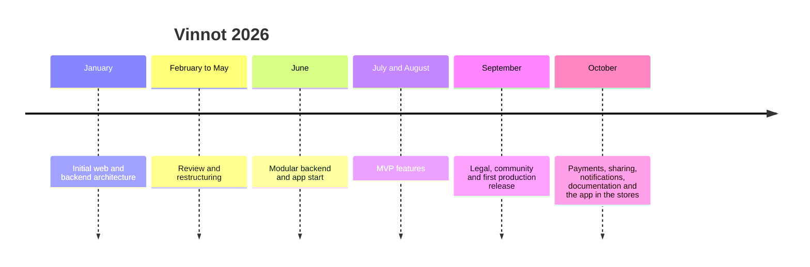
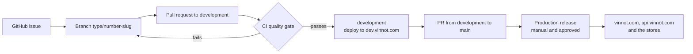

# Project plan

Vinnot's objectives, audience, scope, assumptions, milestones, methodology, risks and
success criteria. Each item states its status: **implemented** (it is in the code),
**verified** (a test or production evidence backs it), **planned** (a plan, not in the
code yet) or **out of scope**.

## General objective

Offer a single platform, on the web and in an iOS and Android app, where people
discover, record and share wines, visit wineries and wine routes and attend events, and
where wineries and organizers publish their activities and sell their tickets.

## Specific objectives

| # | Objective | Indicator | Status | Evidence |
|---|---|---|---|---|
| O1 | Publish a wine catalog with search and filters on the web and in the app | Search by type, region, country, winery, grape and rating on both platforms | Implemented | [Wines](../modules/wines/README.md) |
| O2 | Identify a wine from a photo of its label | On-device OCR scanning and catalog matching | Implemented in the app | [Label scanning](../modules/wines/README.md) |
| O3 | Cover the product with traceable requirements | 117 use cases, 169 web and 193 app requirements, each with test cases | Verified | [Global traceability matrix](../modules/traceability.md) |
| O4 | Sell event tickets | Mercado Pago checkout, ticket on the phone, refunds and a 3% commission | Implemented | [Payments](../modules/payments/README.md) |
| O5 | Publish the app in both stores | Version 0.2.2 available on the App Store and Google Play | Implemented | [Product access](deliverables-and-access.md) |
| O6 | Run at a low monthly cost | One host per environment and development switched off at night | Implemented | [Low-cost development operations](../infra/operations/low-cost-dev.md) and [Costs](../business/README.md) |
| O7 | Verify every change before publishing it | A required CI gate for deploys; a manual, approved production release | Implemented | [CI/CD](../infra/guides/ci-cd.md) |
| O8 | Document everything in Spanish and English | Every page in `docs/es` has its mirror in `docs/en`, validated in CI | Verified | [Technical documentation standard](../governance/documentation-standards.md) |
| O9 | Raise the ticket commission as the user base grows | From today's 3% to 8% and, within a year, to 12% | Planned | [Monetization](../business/monetization.md) |
| O10 | Launch a winery subscription | A Free plan with profile, own wines, events and basic metrics, and a USD 20 monthly Pro plan with reports | Planned | [Monetization](../business/monetization.md) |

## Audience and segments

| Segment | Who | What they look for in Vinnot | Platform role |
|---|---|---|---|
| Wine drinkers | People who drink wine and want to choose, remember and give their opinion | Catalog, scanning, cellar, reviews and AI profiles | `USER` |
| Wine tourists | People who visit regions and wineries | Wine routes, wineries and events | `USER` |
| Event attendees | People who go to tastings and fairs | Find events, pay and carry the ticket on the phone | `USER` |
| Organizers and wineries | Wineries, sommeliers and venues that run events | Publish events, manage registrations and get paid | `PARTNER` |
| Wineries with their own catalog | Wineries that want data about their wines | Market reports on their wines (planned) | `PARTNER` |
| Vinnot team | Moderators and administrators | Look after the catalog and the community, manage users | `MODERATOR` and `ADMIN` |

Vinnot is a global product: the interface is in Spanish and English, and the catalog,
reviews and AI do not depend on the country. The first stage is Argentina, where
payments are in pesos through Mercado Pago; later stages add countries and currencies. The market detail is in
[Business model](../business/README.md).

## Scope

### In scope

| Area | Status | Reference |
|---|---|---|
| Account: sign-up, email, Google and Apple sign-in, verification, profile, privacy and closure | Implemented | [Users and account](../modules/users/README.md) |
| Versioned terms and their acceptance | Implemented | [Legal](../modules/legal/README.md) |
| Wine catalog, search, wine proposals and label scanning | Implemented | [Wines](../modules/wines/README.md) |
| Wineries and regions | Implemented | [Wineries and regions](../modules/wineries/README.md) |
| Reviews, comments, likes, reports and blocks | Implemented | [Reviews](../modules/reviews/README.md) and [Community](../modules/community/README.md) |
| Personal cellar | Implemented | [Cellar](../modules/cellar/README.md) |
| Events, registrations, tickets and Mercado Pago payments | Implemented | [Events and tickets](../modules/events/README.md) and [Payments](../modules/payments/README.md) |
| Wine routes on the map | Implemented | [Wine routes](../modules/wine-routes/README.md) |
| AI profiles and comparisons | Implemented | [AI profiles and comparisons](../modules/ai/README.md) |
| Push and email notifications, and personalized suggestions | Implemented | [Notifications](../modules/notifications/README.md) |
| Share links that open the web or the app | Implemented | [Sharing](../modules/sharing/README.md) |
| Points and seals for activity | Implemented | [Points and seals](../modules/gamification/README.md) |
| Partner panel, administration and moderation | Implemented | [Partners](../modules/partner/README.md) and [Administration and moderation](../modules/admin/README.md) |
| Support and public pages | Implemented | [Support and public information](../modules/support/README.md) |

### Out of current scope

| Topic | Situation |
|---|---|
| Selling bottles | Out of scope: Vinnot does not sell wine |
| Paid winery subscription | Planned, not implemented ([Monetization](../business/monetization.md)) |
| Tourism operator and verified expert roles | Out of scope: [`V76__remove_unused_roles_and_permissions.sql`](../../../backend/src/main/resources/db/migration/V76__remove_unused_roles_and_permissions.sql) removed `ROLE_TOURISM_OPERATOR` and `ROLE_VERIFIED_EXPERT`, which were not part of the [`Role`](../../../backend/src/main/java/com/vinnot/user/domain/valueobject/Role.java) enum |
| Expert articles | Out of scope: there is no articles module and V76 removed the `ARTICLE_*` permissions |
| Label scanning on the web | Out of scope: scanning is an app feature ([Web user manual](../manuals/web-user.md)) |
| Payments in other currencies | Next stage: in the first stage payments are in Argentine pesos through Mercado Pago |

## Assumptions and constraints

| Type | Description | Reference |
|---|---|---|
| Assumption | Users have a phone with a camera to scan labels | [App user manual](../manuals/app-user.md) |
| Assumption | Organizers have a Mercado Pago account to receive payments | [Partner manual](../manuals/partner.md) |
| Constraint | A low infrastructure budget: one EC2 host with Docker Compose per environment, and development switched off between 02:00 and 09:00 (Argentina time) | [AWS deployment architecture](../infra/architecture/aws-deployment.md) and [Low-cost development operations](../infra/operations/low-cost-dev.md) |
| Constraint | AI usage has a budget and quotas | [Resource protection](../backend/architecture/resource-protection.md) |
| Constraint | Every native app version goes through Apple and Google review; Google requires a closed test before production access | [iOS and Android distribution](../frontend-mobile/guides/distribution.md) |
| Constraint | Payments depend on Mercado Pago's rules and on the environment (`SANDBOX`, `LIVE_PILOT` or `LIVE`) | [Environments, configuration and secrets](../infra/architecture/environments-and-secrets.md) |
| Constraint | Fixed tooling: JDK 25 and Node 22 locally and in CI | [Local development](../getting-started/local-development.md) |

## Project outputs

| Output | Status | Where it is |
|---|---|---|
| Web in production | Implemented | [vinnot.com](https://vinnot.com) |
| iOS and Android app | Implemented, version 0.2.2 | [Product access](deliverables-and-access.md) |
| API and database | Implemented | [Backend](../backend/README.md) |
| Infrastructure as versioned files | Implemented | [`infra/`](../../../infra/docker-compose.yml) and [Infrastructure](../infra/README.md) |
| Source code in a monorepo | Implemented | [Repository organization](repository-organization.md) |
| Bilingual documentation with diagrams | Implemented | This site and the [diagram catalog](../diagrams/README.md) |
| Manuals by role and demo videos | Implemented | [Manuals](../manuals/README.md) and [Videos](../videos/README.md) |
| Business model, costs and projections | Implemented as a document | [Business model](../business/README.md) |

## Milestones

The [Timeline](../gantt/README.md) rebuilds the stages from the repository history. In
short:

[View the full “Milestones” diagram](https://images.vinnot.com/docs/diagrams/v1/en/project-project-plan-b597e931ea34.svg)

| Milestone | Date | Status |
|---|---|---|
| First production release | 29 September 2026 | Verified |
| Documentation site published | 21 October 2026 | Verified |
| App 0.2.0 on Expo SDK 58 sent to the stores | 25 October 2026 | Verified |
| App 0.2.2 with the Expo SDK 58.0.21 native patches | Version set on 28 October 2026 | Implemented |
| Ticket commission at 8% | With more users, no fixed date | Planned |
| Ticket commission at 12% | Within a year, around October 2027 | Planned |
| Winery subscription | Target launch on 2027-03-01, per the [business roadmap](../gantt/README.md) | Planned |

## Methodology

Work is organized in GitHub issues, each with its own branch, and lands through pull
requests that pass CI before reaching `development`. Production is published from
`main` with a manual workflow that needs approval. The full process is in
[Development process](../governance/development-process.md); the rules for issues,
branches and pull requests are in
[Issue, branch, and pull request workflow](../governance/github-work-items.md).

[View the full “Methodology” diagram](https://images.vinnot.com/docs/diagrams/v1/en/project-project-plan-8bb8ba312015.svg)

## Main risks

The full analysis, with likelihood, impact and tests per risk, is in
[Risk-based testing](../quality/risk-based-testing.md). Summary:

| Risk | Mitigation | Reference |
|---|---|---|
| A single host per environment: one failure leaves the service unavailable | Backups, verified restore and recovery procedures | [Backup and disaster recovery](../infra/operations/backup-and-disaster-recovery.md) |
| An error in a payment or a refund | Mercado Pago reconciliation, signed webhooks and test environments | [Payments](../modules/payments/README.md) |
| Runaway AI spending | Budget reservations and daily quotas | [Resource protection](../backend/architecture/resource-protection.md) |
| Personal data exposure or unauthorized access | Token authentication, roles and permissions, rate limiting, a temporary lock after wrong passwords, session theft detection, a security-event log and dependency scanning; a Cloudflare WAF in front of the API, pending the owner's apply (state on 2026-10-30) | [Security](../security/README.md) |
| Store review rejection or delay | OTA updates for JavaScript changes and a forced minimum version | [iOS and Android distribution](../frontend-mobile/guides/distribution.md) |
| Dependence on external providers | Ports and adapters that isolate each provider | [System architecture](../architecture/README.md) |

## Success criteria

| Criterion | How it is measured | Status |
|---|---|---|
| The product works on all three platforms | Web, App Store and Google Play with the current version | Verified |
| The API answers in production | `GET https://api.vinnot.com/api/actuator/health` returns `UP`, and Caddy checks it every 30 seconds | Implemented |
| Every requirement has a test | The traceability matrix links use cases, requirements and test cases | Verified |
| No change reaches production without CI | The deploy depends on the `CI quality gate` of the same commit | Implemented |
| The documentation is complete and bilingual | The documentation validator passes in CI | Verified |
| The business is sustainable | Commission revenue that covers the monthly cost at each scale | Planned ([Business model](../business/README.md)) |
