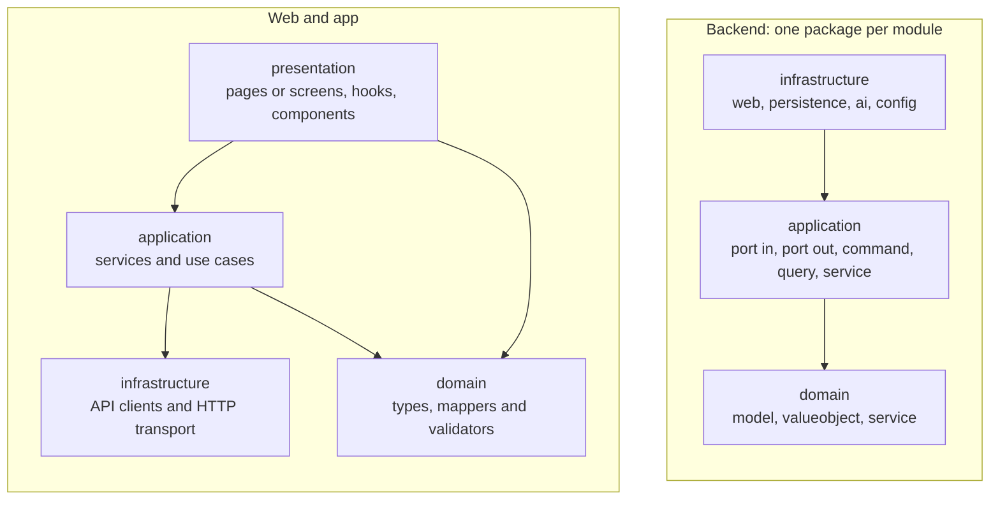

# Repository organization

How Vinnot's code is organized: the monorepo folders, each application's architecture
conventions, the branches, how to get access, how to run it locally and what continuous
integration checks.

## One monorepo

The whole product lives in one GitHub repository,
[`Bielaszczuk/vinnot`](https://github.com/Bielaszczuk/vinnot): the API, the web, the
app, the infrastructure, the scripts and this documentation. A change that touches
several parts is reviewed and published together.

| Folder | Contents | Documentation |
|---|---|---|
| [`backend/`](../../../backend/pom.xml) | Spring Boot 4.1 and Java 25 API: a modular monolith with hexagonal architecture and logical CQRS; Flyway migrations in `src/main/resources/db/migration` | [Backend](../backend/README.md) |
| [`frontend-react/`](../../../frontend-react/package.json) | Web in React 19, Vite 8, TypeScript and Tailwind, including the administration panel | [Web](../frontend-web/README.md) |
| [`frontend-mobile/`](../../../frontend-mobile/package.json) | iOS and Android app in Expo SDK 58 and React Native 0.88 | [Mobile app](../frontend-mobile/README.md) |
| [`infra/`](../../../infra/docker-compose.yml) | Docker Compose, Caddy, host deploy and backup scripts, the Cloudflare images Worker and environment templates | [Infrastructure](../infra/README.md) |
| `docs/` | This documentation, in `docs/es` and its mirror `docs/en` | [Governance](../governance/README.md) |
| [`docs-site/`](../../../docs-site/docusaurus.config.ts) | Docusaurus site that publishes `docs/` as a browsable book | [Documentation site](../governance/documentation-site.md) |
| [`content/`](../../../content/public-pages.json) | Bilingual public-page texts, synced with `scripts/sync-public-content.mjs` | [Support and public information](../modules/support/README.md) |
| [`scripts/`](../../../scripts/ci-preflight.mjs) | Local preflight, CI validators, releases, data import and maintenance | [CI/CD](../infra/guides/ci-cd.md) |
| [`tools/`](../../../tools/docs-diagrams/generate.mjs) | Generation of the diagram images | [Documentation site](../governance/documentation-site.md) |
| `.github/` | CI/CD workflows, issue forms, the pull request template and Dependabot | [Issue, branch, and pull request workflow](../governance/github-work-items.md) |

What is versioned and what stays out (credentials, data dumps, local files) is explained
in [Versioned content and private files](../governance/repository-hygiene.md).

## Architecture conventions

All three applications keep the domain apart from the frameworks and leave the adapters
at the edges. Dependencies point inwards.

[View the full “Architecture conventions” diagram](https://images.vinnot.com/docs/diagrams/v1/en/project-repository-organization-301b105c54ee.svg)

### Backend

Each module is a `com.vinnot.<module>` package with three layers. For example, the
wines module:

| Layer | Packages | What it holds |
|---|---|---|
| `domain` | `model`, `valueobject`, `service` | Aggregates, value objects and invariants, with no Spring or JPA |
| `application` | `port/in`, `port/out`, `command`, `query`, `service` | Inbound and outbound ports, command and query handlers |
| `infrastructure` | `web`, `persistence`, `ai`, `config` and others | Controllers, HTTP requests, JPA entities, native SQL and external adapters |

The backend modules are `activity`, `admin`, `ai`, `cellar`, `community`, `engagement`,
`event`, `gamification`, `legal`, `notification`, `partner`, `payment`, `region`,
`review`, `sharing`, `support`, `user`, `wine`, `wineroute` and `winery`, plus `shared`
for common code
([`backend/src/main/java/com/vinnot`](../../../backend/src/main/java/com/vinnot/VinnotApplication.java)).
The `Controller → inbound port → handler → domain → outbound port → adapter` flow is
described in [Backend architecture](../backend/architecture/overview.md) and the allowed
dependencies between modules in
[Backend module boundaries and dependencies](../backend/architecture/module-boundaries.md).

### Web

[`frontend-react/src`](../../../frontend-react/src/app/main.tsx) is split into `app`
(bootstrap and routes), `domain`, `application`, `infrastructure`, `presentation`
(pages, hooks, components and stores) and `shared`. Pages do not call the API: they use
hooks that delegate to application services, which in turn use infrastructure clients
([Web frontend architecture](../frontend-web/architecture/overview.md)).

### App

[`frontend-mobile/app/`](../../../frontend-mobile/app/_layout.tsx) holds only the Expo
Router routes, with groups such as `(app)`, `(auth)` and `(onboarding)` that do not
appear in the URL. The logic lives in `frontend-mobile/src`, with the same layers as the
web: `domain`, `application`, `infrastructure`, `presentation` and `shared`
([Mobile frontend architecture](../frontend-mobile/architecture/overview.md) and
[Mobile conventions](../frontend-mobile/architecture/conventions.md)).

## Branches

| Branch | What for | Published to |
|---|---|---|
| `main` | Code published in production | Production, with the manual `production-release.yml` workflow |
| `development` | Integration of all finished work | Development, automatically after CI |
| `feature/<issue>-<slug>` | New functionality, from `development` | — |
| `bugfix/<issue>-<slug>` | A non-urgent defect, from `development` | — |
| `task/<issue>-<slug>` | Infrastructure, documentation or maintenance, from `development` | — |
| `hotfix/<issue>-<slug>` | An urgent production incident, from `main` | — |

- Each issue and its branch are created with the **Create Work Branch** workflow
  ([`create-work-branch.yml`](../../../.github/workflows/create-work-branch.yml)), not by
  hand. The branch number is the issue number, without `#` or leading zeros.
- CI validates the branch name on every pull request.
- `development` reaches `main` through a pull request and a merge commit.
- The full process is in [Development process](../governance/development-process.md)
  and in [Issue, branch, and pull request workflow](../governance/github-work-items.md).

## How to get access

| Resource | How to get in |
|---|---|
| GitHub repository | It is private. Ask the owner, the GitHub account `Bielaszczuk`, giving your GitHub username; they add you as a collaborator with the permission your work needs |
| Documentation site | It is private. The owner authorizes your email in Cloudflare Access ([Documentation site](../governance/documentation-site.md#cloudflare-access)) |
| Consoles (AWS, Cloudflare, Expo, stores, Mercado Pago) | Operations team only ([Important URLs](../important-urls/README.md#consoles)) |
| Secrets and environment variables | Never in the repository ([Environments, configuration and secrets](../infra/architecture/environments-and-secrets.md)) |
| Product | See [Product access](deliverables-and-access.md) |

## Run it locally

You need Git, Docker, JDK 25, Maven and Node 22; Xcode or Android Studio only for the
native app. The order is:

1. Start PostgreSQL with Docker Compose.
2. Start the backend with Maven.
3. Start the web with `npm run dev` in `frontend-react/`.
4. Start the app with Expo in `frontend-mobile/`.

The commands, variables and troubleshooting are in
[Local development](../getting-started/local-development.md). Before pushing changes,
run `node scripts/ci-preflight.mjs`, which repeats the CI checks locally.

## Continuous integration

| Workflow | When it runs | What it does |
|---|---|---|
| [`ci.yml`](../../../.github/workflows/ci.yml) | Pull requests, pushes to `main` and `development`, manual | Works out what changed and runs only the affected checks: backend, web, app, documentation and repository; publishes development |
| [`security-checks.yml`](../../../.github/workflows/security-checks.yml) | From CI, manual and weekly | Scans dependencies, the backend image and the history; blocks the deploy on critical or high vulnerabilities |
| [`ios-native-validation.yml`](../../../.github/workflows/ios-native-validation.yml) | Manual or with the `validate:ios-native` label | Builds the iOS app on a macOS runner |
| [`deploy-backend-dev.yml`](../../../.github/workflows/deploy-backend-dev.yml) and [`deploy-frontend-dev.yml`](../../../.github/workflows/deploy-frontend-dev.yml) | Called from approved CI | Deploy the API and the web to development |
| [`production-release.yml`](../../../.github/workflows/production-release.yml) | Manual on `main` | Prepares, publishes or rolls back production after CI and the commit's approval |
| [`create-work-branch.yml`](../../../.github/workflows/create-work-branch.yml) | Manual | Creates the issue and its branch |

No deploy runs without the approved `CI quality gate` of the same commit. The per
component checks, thresholds and publishing are in [CI/CD](../infra/guides/ci-cd.md);
testing is in [Quality](../quality/README.md).
