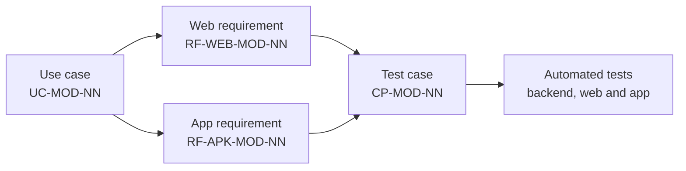

# Requirements index

The entry point to all of Vinnot's requirements. Functional requirements live on each
module's page, next to its use cases and tests; this page orders them, counts them and
explains how to read them. Non-functional requirements are in
[Non-functional requirements](../quality/non-functional-requirements.md).

## How they are identified

| Prefix | What it is | Example |
|---|---|---|
| `UC-<MODULE>-NN` | Use case: actors, platforms, preconditions, postconditions, main and alternative flows, business rules, diagram, code and tests | [`UC-USR-01`](../modules/users/use-cases/uc-usr-01-sign-up.md) |
| `RF-WEB-<MODULE>-NN` | Functional requirement for the web | `RF-WEB-USR-01` in [Users and account](../modules/users/requirements.md) |
| `RF-APK-<MODULE>-NN` | Functional requirement for the iOS and Android app | `RF-APK-USR-01` in [Users and account](../modules/users/requirements.md) |
| `CP-<MODULE>-NN` | Test case that verifies one or more requirements | `CP-USR-01` in [Users tests](../modules/users/testing.md) |

Each functional requirement is a row with five columns: the ID, the requirement, its
**acceptance criterion**, the use case it comes from and the former ID it had in the
per-platform specification. The `RF-APK` prefix keeps its historical name but covers the
app on both platforms.

[View the full “How they are identified” diagram](https://images.vinnot.com/docs/diagrams/v1/en/project-requirements-index-da447cff93c7.svg)

## Functional requirements by module

Counted from each requirements and testing page. They match the summary of the
[Global traceability matrix](../modules/traceability.md).

| Module | Code | Use cases | RF-WEB | RF-APK | Total RF | Test cases | Requirements |
|---|---|---|---|---|---|---|---|
| [Users and account](../modules/users/README.md) | `USR` | [23](../modules/users/use-cases/README.md) | 30 | 35 | 65 | [69](../modules/users/testing.md) | [Requirements](../modules/users/requirements.md) |
| [Legal](../modules/legal/README.md) | `LEG` | [8](../modules/legal/use-cases/README.md) | 7 | 7 | 14 | [27](../modules/legal/testing.md) | [Requirements](../modules/legal/requirements.md) |
| [Wines](../modules/wines/README.md) | `WIN` | [9](../modules/wines/use-cases/README.md) | 12 | 23 | 35 | [43](../modules/wines/testing.md) | [Requirements](../modules/wines/requirements.md) |
| [Wineries and regions](../modules/wineries/README.md) | `WRY` | [3](../modules/wineries/use-cases/README.md) | 4 | 5 | 9 | [13](../modules/wineries/testing.md) | [Requirements](../modules/wineries/requirements.md) |
| [Reviews](../modules/reviews/README.md) | `REV` | [7](../modules/reviews/use-cases/README.md) | 10 | 10 | 20 | [33](../modules/reviews/testing.md) | [Requirements](../modules/reviews/requirements.md) |
| [Cellar](../modules/cellar/README.md) | `CEL` | [6](../modules/cellar/use-cases/README.md) | 7 | 8 | 15 | [26](../modules/cellar/testing.md) | [Requirements](../modules/cellar/requirements.md) |
| [Community](../modules/community/README.md) | `COM` | [4](../modules/community/use-cases/README.md) | 4 | 4 | 8 | [21](../modules/community/testing.md) | [Requirements](../modules/community/requirements.md) |
| [Events and tickets](../modules/events/README.md) | `EVT` | [9](../modules/events/use-cases/README.md) | 16 | 15 | 31 | [46](../modules/events/testing.md) | [Requirements](../modules/events/requirements.md) |
| [Payments](../modules/payments/README.md) | `PAY` | [6](../modules/payments/use-cases/README.md) | 3 | 2 | 5 | [30](../modules/payments/testing.md) | [Requirements](../modules/payments/requirements.md) |
| [Wine routes](../modules/wine-routes/README.md) | `RTE` | [4](../modules/wine-routes/use-cases/README.md) | 7 | 7 | 14 | [15](../modules/wine-routes/testing.md) | [Requirements](../modules/wine-routes/requirements.md) |
| [Sharing](../modules/sharing/README.md) | `SHR` | [3](../modules/sharing/use-cases/README.md) | 7 | 8 | 15 | [15](../modules/sharing/testing.md) | [Requirements](../modules/sharing/requirements.md) |
| [Notifications](../modules/notifications/README.md) | `NOT` | [7](../modules/notifications/use-cases/README.md) | 9 | 14 | 23 | [43](../modules/notifications/testing.md) | [Requirements](../modules/notifications/requirements.md) |
| [AI profiles and comparisons](../modules/ai/README.md) | `AI` | [4](../modules/ai/use-cases/README.md) | 8 | 10 | 18 | [20](../modules/ai/testing.md) | [Requirements](../modules/ai/requirements.md) |
| [Support and public information](../modules/support/README.md) | `SUP` | [3](../modules/support/use-cases/README.md) | 5 | 5 | 10 | [10](../modules/support/testing.md) | [Requirements](../modules/support/requirements.md) |
| [Partners](../modules/partner/README.md) | `PAR` | [6](../modules/partner/use-cases/README.md) | 7 | 7 | 14 | [23](../modules/partner/testing.md) | [Requirements](../modules/partner/requirements.md) |
| [Administration and moderation](../modules/admin/README.md) | `ADM` | [15](../modules/admin/use-cases/README.md) | 33 | 33 | 66 | [63](../modules/admin/testing.md) | [Requirements](../modules/admin/requirements.md) |
| **Total** | | **117** | **169** | **193** | **362** | **497** | |

The [Activity](../modules/activity/README.md) and
[Points and seals](../modules/gamification/README.md) modules have no requirements page
of their own: their rules are described on each module's page and are used by other
modules' use cases, such as the personalized suggestions in
[`UC-NOT-07`](../modules/notifications/use-cases/uc-not-07-receive-suggestions.md).

## Non-functional requirements

Performance, availability, security, usability, maintainability, portability and the
other quality attributes are listed in
[Non-functional requirements](../quality/non-functional-requirements.md). The technical
rules that implement them are in:

| Attribute | Where it is implemented |
|---|---|
| Security and authorization | [Security](../security/README.md) and [Security, authorization, and abuse protection](../backend/architecture/security-and-authorization.md) |
| Resource and cost protection | [Resource protection and external transports](../backend/architecture/resource-protection.md) |
| Query performance | [Query performance and indexing](../backend/data/query-performance.md) |
| Consistency and errors | [Errors, transactions and consistency](../backend/architecture/errors-transactions-and-consistency.md) |
| Observability | [Infrastructure observability and incidents](../infra/operations/observability-and-incidents.md) |
| Failure recovery | [Backup and disaster recovery](../infra/operations/backup-and-disaster-recovery.md) |
| Quality and testing | [Quality](../quality/README.md) and [Comprehensive testing strategy](../backend/testing/strategy.md) |

## How to use this index

1. Pick the module in the table and open its **Requirements** page.
2. From each requirement, follow the link to its use case to see the full flow.
3. Open the module's **Test cases** to see which test cases and tests cover it.
4. For a cross-cutting view, use the [Global traceability matrix](../modules/traceability.md).
