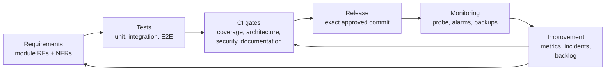

# Software quality

This chapter defines how Vinnot specifies, measures and assures the quality of its web
app, its iOS and Android app and its API. It uses the ISO/IEC 25000 (SQuaRE) family as the
framework and applies it to the real product: prioritised characteristics, non-functional
requirements with values taken from the code, metrics with thresholds, risk analysis, a
test plan and an improvement backlog.

It does not repeat what other sections already cover. Per-layer test strategies, each
module's test cases, traceability, CI/CD gates, observability and backups have their own
pages, linked from [Where quality lives in the repository](#where-quality-lives-in-the-repository).

## Purpose and scope

- **Product:** web app (`vinnot.com`), iOS and Android app, and REST API (`api.vinnot.com`).
- **Environments:** development (`dev.vinnot.com`) and production.
- **Source of truth:** the code and its configuration. Every numeric value in this chapter
  cites the file that defines it. When a value changes in the code, the page that cites it
  is updated in the same change.
- **States:** each control is *implemented*, *verified*, *pending* or *out of scope*. Targets
  that have no measurement or control yet are marked **proposed target**, status pending.

## Reference standards

| Standard | Use in Vinnot |
|---|---|
| ISO/IEC 25010:2011, with notes on the 2023 edition | Product quality and quality-in-use model: basis of the [Quality model](quality-model.md) |
| ISO/IEC 25012:2008 | Catalog data quality (accuracy, completeness, consistency, currentness) |
| ISO/IEC 25023:2016 and 25022:2016 | Product and quality-in-use measures: basis of [Metrics](metrics.md) |
| ISO/IEC 25030 | Verifiable quality requirements: basis of [Non-functional requirements](non-functional-requirements.md) |
| ISO/IEC 25040:2011 | Five-activity quality evaluation process |
| ISO/IEC/IEEE 29119-3:2021 | Test documentation structure: basis of the [Test plan](test-plan.md) |

## The framework in brief

Software quality is the degree to which the product meets the stated and implied needs of
the people who use it, in a concrete context of use. It is not an absolute value: a wine
catalog and a Mercado Pago charge have different demands inside the same product.

The standards distinguish three chained views. **Internal quality** is measured without
running the software (architecture, code, coverage). **External quality** is measured by
running it (failures, response times, defects). **Quality in use** is the effect on the
person using it (whether they finish the task, how long it takes, whether they trust it).
Process quality drives internal quality, which drives external quality, which drives
quality in use. That is why Vinnot works on quality from the process and the code, not only
with tests at the end.

ISO/IEC 9126 introduced the characteristic → subcharacteristic → attribute → metric
hierarchy. SQuaRE (ISO/IEC 25000) replaced and extended it: security and compatibility
become characteristics of their own, a data quality model (25012) is added, and so is a
formal evaluation process (25040). The 2023 edition of 25010 adds the *Safety*
characteristic, renames *Usability* to *Interaction capability* and *Portability* to
*Flexibility* (which now includes scalability), replaces *maturity* with *faultlessness*,
adds *resistance* under Security, and moves quality in use to ISO/IEC 25019:2023. This
chapter uses the 2011 structure and maps it to 2023 in the
[Quality model](quality-model.md#equivalences-with-the-2023-edition).

The characteristics are not independent. More security usually costs usability and adds
latency; maintainability helps reliability; integrating external services improves
compatibility but widens the attack surface. That is why each characteristic's priority is
set by business criticality.

## Criticality by business area

| Area | Business type | What happens if it fails | Criticality |
|---|---|---|---|
| Catalog and discovery | Content and marketplace | Wrong or incomplete data hurts trust, with no direct financial loss | Medium |
| Community | Social network | Abusive content, missing moderation or exposed personal data | Medium |
| Paid events | E-commerce | Double charge, overselling capacity, or a payment credited without real confirmation | High |

On top of these areas come personal data (accounts, emails, location for nearby events)
and external services (Mercado Pago, OpenAI, Google Maps, push notifications), which raise
the priority of security and fault tolerance. The platform's ticket commission is described
in [Payments](../modules/payments/README.md).

## Quality system

[View the full “Quality system” diagram](https://images.vinnot.com/docs/diagrams/v1/en/quality-readme-1e2997894ad0.svg)

Every requirement has traceable tests; CI gates block a change when a test, a coverage
threshold or a security check fails; production is published only from the exact commit
that passed those gates; monitoring feeds the metrics; and every deviation or failure turns
into a product improvement or a new process rule.

## Chapter map

| Page | Content |
|---|---|
| [Quality model](quality-model.md) | ISO/IEC 25010 characteristics and subcharacteristics applied to Vinnot, quality in use, data quality and priority ranking |
| [Non-functional requirements](non-functional-requirements.md) | Consolidated table RNF-01 to RNF-26 with the current value, the source file and the verification; index of functional requirements per module |
| [Metrics](metrics.md) | M-01 to M-25 with formula, interpretation and threshold; observed values with their date |
| [Risk-based testing](risk-based-testing.md) | Risks R-01 to R-10, prioritised test types and test design techniques with examples |
| [Test plan](test-plan.md) | PP-VINNOT-01 in ISO/IEC/IEEE 29119-3 structure: scope, approach, criteria, severities and per-release cycle |
| [Non-functional test cases](non-functional-test-cases.md) | CP-NF-01 to CP-NF-07 with steps, expected result and status |
| [Quality improvement backlog](improvement-backlog.md) | Gaps found, with priority and status |

The working process behind this system (issues, branches, pull requests, CI and release)
is in [Development process](../governance/development-process.md).

## Where quality lives in the repository

| Topic | Document |
|---|---|
| Backend test strategy and JaCoCo thresholds | [Backend testing strategy](../backend/testing/strategy.md) |
| Web test strategy (Vitest and Playwright) | [Web testing strategy](../frontend-web/testing/strategy.md) |
| Mobile test strategy (Jest) | [Mobile testing strategy](../frontend-mobile/testing/strategy.md) |
| Requirements, use cases and test cases per module | [Modules](../modules/README.md) |
| Use case → requirement → test case → test traceability | [Traceability matrix](../modules/traceability.md) |
| Workflows, check selection and quality gate | [CI/CD](../infra/guides/ci-cd.md) and [CI/CD pipeline](../infra/diagrams/ci-cd-pipeline.md) |
| Dependencies, images and SBOM | [Dependency security](../infra/guides/dependency-security.md) |
| Signals, thresholds and incident response | [Observability and incidents](../infra/operations/observability-and-incidents.md) |
| Backups, restore, RPO and RTO | [Backup and disaster recovery](../infra/operations/backup-and-disaster-recovery.md) |
| Query performance and indexes | [Query performance](../backend/data/query-performance.md) |
| Accessibility and layout | [Layout and accessibility](../shared/design/layout-and-accessibility.md) |
| Release step by step | [Step-by-step release](../infra/guides/release-step-by-step.md) |
| Pre-merge checklist | [Issue, branch, and pull request workflow](../governance/github-work-items.md#pre-merge-checklist) |

## Glossary

| Term | Definition |
|---|---|
| Quality in use | Effect of the product on the person using it: effectiveness, efficiency, satisfaction, freedom from risk and context coverage |
| Characteristic / subcharacteristic | Levels of the ISO/IEC 25010 model, for example Reliability / Availability |
| Code coverage | Share of lines, branches or functions the tests execute |
| Acceptance criterion | Verifiable condition a module or a release must meet to be approved |
| Quality gate | Automatic check that blocks a change when a verification fails or is skipped |
| HSTS | Header that forces the browser to always use HTTPS with a domain |
| Rate limit | Maximum number of requests in a period; above it the API answers HTTP 429 with `Retry-After` |
| p95 | 95th percentile: 95% of the measurements are at or below that value |
| Regression | A defect in something that used to work |
| RPO / RTO | Maximum tolerable data loss / maximum tolerable time to restore the service |
| Sandbox | A provider's test mode (for example Mercado Pago) that moves no real money |
| Severity | How serious a defect's impact is: critical, high, medium or low |
| SQuaRE | The ISO/IEC 25000 family: systems and software quality requirements and evaluation |
| SUS | System Usability Scale: a 10-question questionnaire that yields a 0 to 100 score |
| Webhook | A notification an external service sends to the backend when something happens, such as an approved payment |

## References

- ISO/IEC 9126-1:2001. Software engineering — Product quality — Part 1: Quality model.
- ISO/IEC 25000:2014. Systems and software engineering — SQuaRE — Guide to SQuaRE.
- ISO/IEC 25010:2011. Systems and software engineering — SQuaRE — System and software quality models.
- ISO/IEC 25010:2023. Systems and software engineering — SQuaRE — Product quality model.
- ISO/IEC 25012:2008. Software engineering — SQuaRE — Data quality model.
- ISO/IEC 25019:2023. Systems and software engineering — SQuaRE — Quality-in-use model.
- ISO/IEC 25022:2016 and 25023:2016. Measurement of quality in use / Measurement of system and software product quality.
- ISO/IEC 25040:2011. Systems and software engineering — SQuaRE — Evaluation process.
- ISO/IEC/IEEE 29119-3:2021. Software and systems engineering — Software testing — Part 3: Test documentation.
- ISO 25000 portal: <https://iso25000.com>
- ISTQB. Certified Tester Foundation Level Syllabus, version 4.0.
- OWASP Foundation. OWASP Top 10 and OWASP API Security Top 10.
- W3C. Web Content Accessibility Guidelines (WCAG) 2.1.
- Brooke, J. (1996). SUS: A quick and dirty usability scale.
