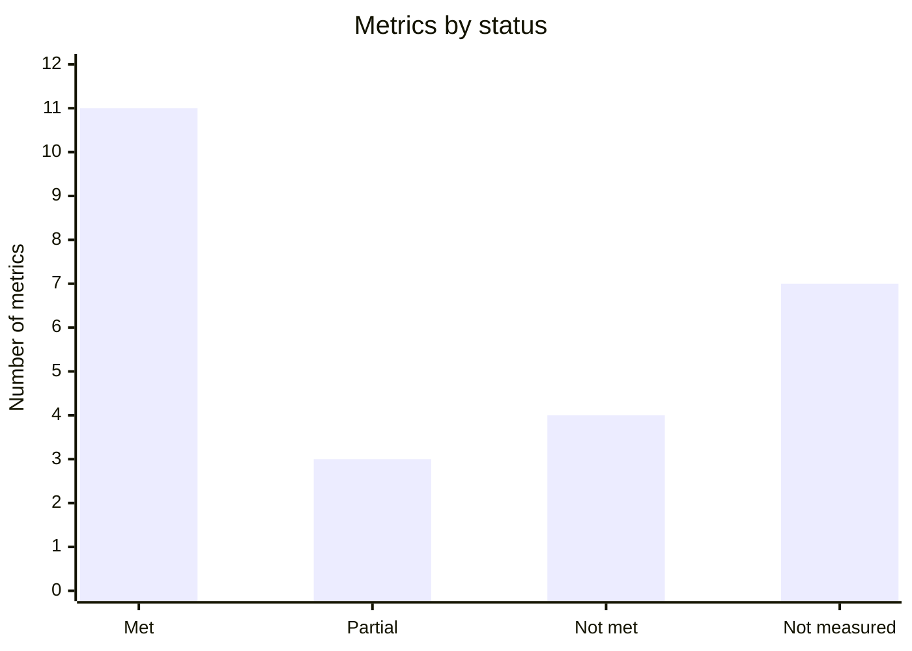

# Quality metrics

Defines 25 metrics following the ISO/IEC 25020 measurement model and the ISO/IEC 25023
(product) and 25022 (quality in use) measures. Most are a ratio `X = A / B`, where `A` is the
count that meets the condition and `B` the total; the result lies between 0 and 1 and is
compared with a threshold.

Each metric states its characteristic, purpose, formula, interpretation, threshold,
observed value and instrument. Thresholds with no automatic control yet are a **proposed
target**, status pending.

## Where the observed values come from

- **Measurement of 2026-10-16:** a quality audit with a full suite run, a load sample of 20
  concurrent reads on development, the pre-launch scan benchmark and the October 2026 winery
  geolocation. These are point measurements: they hold for that date and environment.
- **Measurement of 2026-10-29:** a full run of the web and mobile suites, and a static count
  of backend tests.
- **Current configuration:** when the value is a configured control (alarm, gate or limit),
  the file is cited and was checked against the current code.

## Summary

| ID | Characteristic | Metric | Threshold | Observed | Met |
|---|---|---|---|---|---|
| M-01 | Functional suitability | Functional completeness | 100% of prioritised requirements | 18 of 18 (2026-10-16) | Yes |
| M-02 | Functional suitability | Test pass rate | 100% on the commit to release | Web 1,515 and app 2,375, no failures (2026-10-29) | Yes |
| M-03 | Functional suitability | Accuracy of credited payments | 0 differences | Not measured | — |
| M-04 | Functional suitability | Critical defects escaped to production | 0 critical and ≤ 2 high per version | Not measured | — |
| M-05 | Efficiency | Read response time p95 | ≤ 500 ms (proposed target) | 2,913 ms with 20 concurrent reads on development (2026-10-16) | No |
| M-06 | Efficiency | Scan time p95 | ≤ 10 s | 11.2 s (2026-10-16) | No |
| M-07 | Suitability / Efficiency | Scan accuracy (first result) | ≥ 90% | 87.1% (27 of 31) (2026-10-16) | No, deviation accepted |
| M-08 | Efficiency / Capacity | Concurrent requests without errors | 20 with 0% errors | 20 of 20 (2026-10-16) | Yes |
| M-09 | Efficiency / Resources | Free server memory | ≥ 256 MiB | Alarm configured | Yes |
| M-10 | Compatibility | Processed payment webhooks | ≥ 99.9% | Not measured | — |
| M-11 | Usability | Task completion rate | ≥ 90% (proposed target) | Not measured | — |
| M-12 | Usability | SUS score | ≥ 70 (proposed target) | Not measured | — |
| M-13 | Usability | Input validation coverage | 100% of fields | Client and server validation | Yes |
| M-14 | Accessibility | WCAG 2.1 AA criteria met | ≥ 95% (proposed target) | No automatic tool | — |
| M-15 | Reliability | Monthly availability | ≥ 99.5% (proposed target) | Probe every 5 min, no consolidated report | — |
| M-16 | Reliability | 5xx error rate | < 1% (proposed target) | Alarm configured at 5% | Partial |
| M-17 | Reliability | RTO and RPO | RTO ≤ 4 h; RPO ≤ 24 h | Daily backup; full drill not recorded | Partial |
| M-18 | Security | High or critical vulnerabilities | 0 | 0: the pipeline blocks | Yes |
| M-19 | Security | Access control test coverage | 100% of protected routes | Access matrix tested | Yes |
| M-20 | Security | Exposed secrets | 0 | 0: whole-history scan | Yes |
| M-21 | Security | Brute-force resistance | ≤ 10 attempts per minute | 10 per minute, then HTTP 429 | Yes |
| M-22 | Maintainability | Code coverage | See [RNF-23](non-functional-requirements.md#maintainability-and-portability) | Thresholds met; web 92.7% branches (2026-10-16) | Yes |
| M-23 | Maintainability | Architecture rule violations | 0 | 0: checked in the pipeline | Yes |
| M-24 | Portability | Platforms with passing E2E | 100% of the matrix | In CI, one spec in Chromium; the rest and the full matrix on demand | Partial |
| M-25 | Data quality | Wineries with an exact location | ≥ 80% in the medium term | 834 of 5,051 Argentine wineries, 16.5% (October 2026) | No |

### Metric status

[View the full “Metric status” diagram](https://images.vinnot.com/docs/diagrams/v1/en/quality-metrics-d8b605157b8f.svg)

Metrics that are not measured or not met have an action in the
[improvement backlog](improvement-backlog.md).

## Functional suitability

### M-01 Functional completeness

- **Subcharacteristic:** functional completeness.
- **Purpose:** know whether every specified function is implemented.
- **Formula:** `X = A / B`; `A` = requirements implemented and verified; `B` = requirements specified.
- **Interpretation:** the closer to 1, the better; below 1 means missing functions.
- **Threshold:** `X = 1` for the prioritised requirements of the critical flows.
- **Observed:** 18 of 18 (2026-10-16). The [traceability matrix](../modules/traceability.md) now covers 124 use cases and 536 test cases, including Activity and Points and seals.
- **Instrument:** traceability matrix.

### M-02 Test pass rate

- **Subcharacteristic:** functional correctness.
- **Purpose:** measure the share of automatic tests that pass.
- **Formula:** `X = A / B`; `A` = passing tests; `B` = executed tests.
- **Interpretation:** any failure blocks the change from merging.
- **Threshold:** `X = 1` on the production candidate commit.
- **Observed:** web 1,515 tests in 296 files and app 2,375 tests in 340 suites, no failures (2026-10-29). Backend: 1,189 of 1,189 (2026-10-16); the static count of 2026-10-29 gives 2,125 test methods.
- **Instrument:** CI with JUnit, Vitest and Jest.

### M-03 Accuracy of credited payments

- **Subcharacteristic:** functional correctness.
- **Purpose:** check that every paid registration matches a real approved payment.
- **Formula:** `X = A / B`; `A` = credited payments matching Mercado Pago in amount and status; `B` = credited payments.
- **Interpretation:** it must be exactly 1; any difference is a critical defect.
- **Threshold:** `X = 1`.
- **Observed:** pending; it needs a periodic reconciliation against the Mercado Pago panel.
- **Instrument:** payments database and Mercado Pago reports.

### M-04 Critical defects escaped to production

- **Subcharacteristic:** functional correctness.
- **Purpose:** measure how effective testing is before release.
- **Formula:** `X` = critical or high severity defects found in production per version.
- **Interpretation:** the lower, the better.
- **Threshold:** 0 critical and ≤ 2 high per version.
- **Observed:** pending; measured with each version's `hotfix` and `bugfix` issues.
- **Instrument:** GitHub Issues ([work types](../governance/github-work-items.md#work-types)).

## Performance efficiency

### M-05 Read response time p95

- **Subcharacteristic:** time behaviour.
- **Purpose:** measure the perceived speed of search and detail.
- **Formula:** `X` = 95th percentile of read response time over a period.
- **Interpretation:** the lower, the better; p95 represents the 5% of users who fare worst.
- **Threshold:** proposed target of 500 ms in production under normal load.
- **Observed:** p50 2,063 ms and p95 2,913 ms with 20 concurrent reads on development (2026-10-16). Development runs on a smaller server than production: the measurement must be repeated in production.
- **Instrument:** slow-request log and load test ([CP-NF-04](non-functional-test-cases.md#cp-nf-04-measure-response-time-under-load)).

### M-06 Scan time p95

- **Subcharacteristic:** time behaviour.
- **Purpose:** measure the wait from the photo to the result.
- **Formula:** `X` = 95th percentile of recognition time.
- **Interpretation:** the lower, the better.
- **Threshold:** 10 s.
- **Observed:** p50 4.1 s and p95 11.2 s (2026-10-16). The product owner accepted the deviation for launch.
- **Instrument:** [`benchmark-wine-label-scanning.mjs`](../../../scripts/benchmark-wine-label-scanning.mjs) with a fixed label set.

### M-07 Scan accuracy

- **Subcharacteristic:** functional correctness.
- **Purpose:** measure whether scanning finds the right wine.
- **Formula:** `X = A / B`; `A` = scans whose first result is the right wine; `B` = scorable scans.
- **Interpretation:** the closer to 1, the better.
- **Threshold:** 0.90.
- **Observed:** 27 of 31, 87.1% (2026-10-16); deviation accepted. A rerun on a narrowed catalog gave 37 of 37.
- **Instrument:** scan benchmark.

### M-08 Concurrent requests without errors

- **Subcharacteristic:** capacity.
- **Purpose:** know how many concurrent requests the system handles without failing.
- **Formula:** `X = A / B`; `A` = correct responses; `B` = requests sent with N concurrent users.
- **Interpretation:** it must be 1 for the target N.
- **Threshold:** `X = 1` with N = 20.
- **Observed:** 20 of 20 (2026-10-16). With an artificial limit of 6 connections, 3 requests were admitted and 17 were rejected in a controlled, recoverable way.
- **Instrument:** load test.

### M-09 Free server memory

- **Subcharacteristic:** resource utilisation.
- **Purpose:** detect saturation before it affects users.
- **Formula:** `X` = available memory in MiB, measured every 5 minutes.
- **Interpretation:** the higher, the better.
- **Threshold:** 256 MiB; also 3 GiB of free disk and database connections below 80% of the pool.
- **Observed:** alarms configured in [`config.example.json`](../../../infra/aws-low-cost/monitoring/config.example.json).
- **Instrument:** metrics collector and CloudWatch.

## Compatibility

### M-10 Processed payment webhooks

- **Subcharacteristic:** interoperability.
- **Purpose:** verify the Mercado Pago integration.
- **Formula:** `X = A / B`; `A` = valid notifications processed; `B` = valid notifications received.
- **Interpretation:** the closer to 1, the better.
- **Threshold:** 0.999.
- **Observed:** pending.
- **Instrument:** payments API logs.

## Usability

### M-11 Task completion rate

- **Subcharacteristic:** quality in use, effectiveness.
- **Purpose:** measure whether people finish key tasks without help: sign up, find a wine, review it and buy a ticket.
- **Formula:** `X = A / B`; `A` = tasks completed; `B` = tasks attempted.
- **Interpretation:** the closer to 1, the better.
- **Threshold:** proposed target of 0.90 and a mean ticket purchase time of 3 minutes or less.
- **Observed:** pending; it needs a moderated test with 5 to 8 users.
- **Instrument:** usability test.

### M-12 SUS score

- **Subcharacteristic:** quality in use, satisfaction.
- **Purpose:** measure perceived satisfaction.
- **Formula:** 10-question SUS questionnaire; score from 0 to 100.
- **Interpretation:** above 68 beats the industry average.
- **Threshold:** proposed target of 70.
- **Observed:** pending; measured together with M-11.
- **Instrument:** SUS questionnaire.

### M-13 Input validation coverage

- **Subcharacteristic:** user error protection.
- **Purpose:** catch invalid data before processing it.
- **Formula:** `X = A / B`; `A` = fields validated on client and server; `B` = form fields.
- **Interpretation:** it must be 1.
- **Threshold:** `X = 1`.
- **Observed:** schemas on the client and domain rules on the server.
- **Instrument:** code review and validator tests.

### M-14 WCAG criteria met

- **Subcharacteristic:** accessibility.
- **Purpose:** measure the accessibility of the main screens.
- **Formula:** `X = A / B`; `A` = WCAG 2.1 AA criteria met; `B` = applicable criteria reviewed.
- **Interpretation:** the closer to 1, the better.
- **Threshold:** proposed target of 0.95.
- **Observed:** pending; today it is reviewed by hand with the keyboard and screen readers.
- **Instrument:** axe or Lighthouse (pending) and manual review.

## Reliability

### M-15 Monthly availability

- **Subcharacteristic:** availability.
- **Purpose:** measure how long the service is up.
- **Formula:** `X` = uptime / total time in the period.
- **Interpretation:** 99.5% equals about 3.6 hours of downtime per month.
- **Threshold:** proposed target of 0.995.
- **Observed:** the probe measures every 5 minutes, but there is no consolidated monthly report.
- **Instrument:** external probe and CloudWatch.

### M-16 5xx error rate

- **Subcharacteristic:** maturity.
- **Purpose:** measure how often internal failures happen.
- **Formula:** `X = A / B`; `A` = 5xx responses; `B` = total responses.
- **Interpretation:** the lower, the better.
- **Threshold:** proposed target below 1%.
- **Observed:** the alarm fires with 3 or more errors that are at least 5% ([`policy.py`](../../../infra/aws-low-cost/monitoring/policy.py)).
- **Instrument:** metrics collector.

### M-17 RTO and RPO

- **Subcharacteristic:** recoverability.
- **Purpose:** measure how long the system takes to come back and how much data can be lost.
- **Formula:** RTO = time from outage to restored service; RPO = time between the last backup and the failure.
- **Interpretation:** the lower, the better.
- **Threshold:** RTO of 4 h; RPO of 24 h.
- **Observed:** daily off-host backup; a full drill is still to be recorded ([Backup](../infra/operations/backup-and-disaster-recovery.md#rporto)).
- **Instrument:** [CP-NF-05](non-functional-test-cases.md#cp-nf-05-restore-a-backup).

## Security

### M-18 High or critical vulnerabilities

- **Subcharacteristic:** confidentiality and integrity.
- **Purpose:** avoid components with known vulnerabilities.
- **Formula:** `X` = HIGH or CRITICAL vulnerabilities in dependencies and the server image.
- **Interpretation:** it must be 0.
- **Threshold:** 0.
- **Observed:** the security pipeline fails if it finds any and also runs weekly ([`security-checks.yml`](../../../.github/workflows/security-checks.yml)).
- **Instrument:** Trivy, `npm audit` and CycloneDX SBOM.

### M-19 Access control test coverage

- **Subcharacteristic:** confidentiality.
- **Purpose:** check that every protected route rejects whoever lacks permission.
- **Formula:** `X = A / B`; `A` = protected routes with an access test; `B` = protected routes.
- **Interpretation:** it must be 1.
- **Threshold:** `X = 1`.
- **Observed:** [`SecurityConfigAccessTest.java`](../../../backend/src/test/java/com/vinnot/shared/infrastructure/config/SecurityConfigAccessTest.java) validates the access matrix.
- **Instrument:** backend security tests.

### M-20 Exposed secrets

- **Subcharacteristic:** confidentiality.
- **Purpose:** keep credentials out of the code and the history.
- **Formula:** `X` = secrets found.
- **Interpretation:** it must be 0.
- **Threshold:** 0.
- **Observed:** Gitleaks scans the whole history on every CI run ([`ci.yml`](../../../.github/workflows/ci.yml)).
- **Instrument:** Gitleaks.

### M-21 Brute-force resistance

- **Subcharacteristic:** authenticity and resistance.
- **Purpose:** limit password guessing.
- **Formula:** `X` = sign-in attempts accepted per minute and origin.
- **Interpretation:** the lower, the better, without hurting legitimate users.
- **Threshold:** 10; the next attempt gets HTTP 429 with `Retry-After`.
- **Observed:** 10 per minute configured ([RNF-05](non-functional-requirements.md#rate-limits)).
- **Instrument:** rate-limit configuration and [CP-NF-01](non-functional-test-cases.md#cp-nf-01-limit-sign-in-attempts).

## Maintainability

### M-22 Code coverage

- **Subcharacteristic:** testability.
- **Purpose:** measure how much of the code the tests exercise.
- **Formula:** `X` = lines (or branches) executed / lines (or branches) in the measured scope.
- **Interpretation:** the higher, the better. Coverage does not guarantee test quality, but its absence signals risk.
- **Threshold:** the [RNF-23](non-functional-requirements.md#maintainability-and-portability) gates.
- **Observed:** every threshold is met; the web reached 92.7% branches in its scope (2026-10-16).
- **Instrument:** JaCoCo, Vitest and Jest; see the [backend](../backend/testing/strategy.md), [web](../frontend-web/testing/strategy.md) and [app](../frontend-mobile/testing/strategy.md) strategies.

### M-23 Architecture rule violations

- **Subcharacteristic:** modularity.
- **Purpose:** keep layers decoupled.
- **Formula:** `X` = violations found, for example the domain importing the framework.
- **Interpretation:** it must be 0.
- **Threshold:** 0.
- **Observed:** [`verify-test-architecture.mjs`](../../../scripts/verify-test-architecture.mjs) runs on every CI.
- **Instrument:** automatic architecture check.

## Portability

### M-24 Platforms with passing E2E

- **Subcharacteristic:** adaptability.
- **Purpose:** check that the web works on the target browsers and devices.
- **Formula:** `X = A / B`; `A` = matrix platforms where the tests pass; `B` = matrix platforms.
- **Interpretation:** it must be 1.
- **Threshold:** `X = 1` with Chromium, Firefox, WebKit, Pixel 7 and iPhone 13.
- **Observed:** CI runs only `release-retention.spec.ts` in Chromium; the 12 E2E specs and the full matrix run on demand ([`playwright.config.ts`](../../../frontend-react/playwright.config.ts)).
- **Instrument:** Playwright ([CP-NF-07](non-functional-test-cases.md#cp-nf-07-run-the-critical-flows-on-the-browser-matrix)).

## Data quality

### M-25 Wineries with an exact location

- **ISO/IEC 25012 characteristic:** accuracy and completeness.
- **Purpose:** measure whether each winery's map marks its real address.
- **Formula:** `X = A / B`; `A` = wineries with verified coordinates for their address; `B` = wineries in the catalog.
- **Interpretation:** the closer to 1, the better.
- **Threshold:** 0.80 in the medium term.
- **Observed:** 834 of 5,051 Argentine wineries, 16.5% (October 2026). The rest had no reliable result or was left for the next cycle because of the maps service's free tier.
- **Instrument:** geolocation with name, province and place-type checks.
