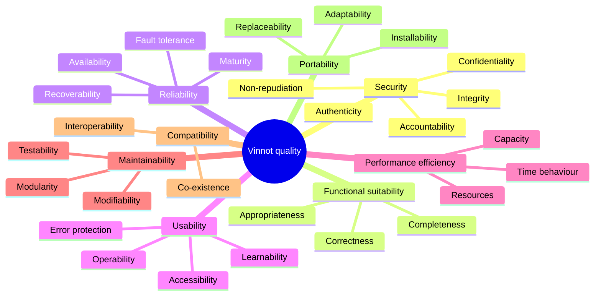

# Quality model

Applies the eight product quality characteristics of ISO/IEC 25010:2011 to Vinnot. For each
subcharacteristic it states how it applies, its priority and the evidence in the code or the
documentation. Priority depends on the impact of a failure:

- **High:** it can cause financial loss, data exposure or mass abandonment.
- **Medium:** it degrades the experience, but there is a workaround.
- **Low:** the impact is limited.

## Model map

[View the full “Model map” diagram](https://images.vinnot.com/docs/diagrams/v1/en/quality-quality-model-6c1408bfa23c.svg)

## Functional suitability

| Subcharacteristic | Application in Vinnot | Priority | Evidence |
|---|---|---|---|
| Functional completeness | Functions cover each role's goals: find and view wines, review, manage the cellar, register and pay for events, moderate | High | `RF-WEB-*` and `RF-APK-*` requirements per module and the [traceability matrix](../modules/traceability.md) with 117 use cases and 496 test cases |
| Functional correctness | Review averages recalculated, capacity never exceeded, commission applied correctly, payment credited only when Mercado Pago confirms it | High | Domain rules and [tests against real PostgreSQL](../backend/testing/strategy.md#backend-postgresql-persistence); [Payments architecture](../modules/payments/architecture.md) |
| Functional appropriateness | Combinable filters, search from two characters, label scanning instead of typing | Medium | `RF-WEB-WIN-02` and `RF-APK-WIN-02` in [Wines requirements](../modules/wines/requirements.md) |

## Performance efficiency

| Subcharacteristic | Application in Vinnot | Priority | Evidence |
|---|---|---|---|
| Time behaviour | Search, wine detail and checkout response; scanning answers within seconds | High | 1000 ms slow-request threshold and 12 s recognition timeout in [`application.yml`](../../../backend/src/main/resources/application.yml) (lines 184 and 168); per-provider timeouts in [RNF-16](non-functional-requirements.md#performance-and-capacity) |
| Resource utilisation | Memory, CPU, disk, connections and AI cost | Medium | 20-connection pool, at most 3 concurrent AI calls and a monthly AI spending cap in [`application.yml`](../../../backend/src/main/resources/application.yml); zstd/gzip compression in the [`Caddyfile`](../../../infra/aws-low-cost/Caddyfile) |
| Capacity | Page size, files and requests per period | Medium | Page maximum of 200 in [`PageQuery.java`](../../../backend/src/main/java/com/vinnot/shared/domain/valueobject/PageQuery.java); 20 per page with a 500-result window in [`PublicWineCatalogAccessPolicy.java`](../../../backend/src/main/java/com/vinnot/wine/infrastructure/web/policy/PublicWineCatalogAccessPolicy.java); rate limits in [RNF-05](non-functional-requirements.md#rate-limits) |

## Compatibility

| Subcharacteristic | Application in Vinnot | Priority | Evidence |
|---|---|---|---|
| Co-existence | The app coexists with other apps: camera, location, notifications and storage | Low | Permissions declared in [`app.config.ts`](../../../frontend-mobile/app.config.ts), with usage text for camera and location |
| Interoperability | Mercado Pago, OpenAI, Google Maps, Google and Apple sign-in, push notifications and Open Graph previews | High | OpenAPI contract (springdoc in [`pom.xml`](../../../backend/pom.xml)), webhook signature in [`MercadoPagoWebhookSignature.java`](../../../backend/src/main/java/com/vinnot/payment/infrastructure/security/MercadoPagoWebhookSignature.java), [public sharing](../infra/guides/public-sharing.md) |

## Usability

| Subcharacteristic | Application in Vinnot | Priority | Evidence |
|---|---|---|---|
| Appropriateness recognisability | People quickly understand what each section is for | Medium | Tab navigation in the app and [manuals per role](../manuals/README.md) |
| Learnability | A new user signs up, finds a wine and reviews it without help | Medium | [Manuals per role](../manuals/README.md) |
| Operability | Filters, forms, camera scanning and ticket purchase | High | Distinct loading, empty, error, limit, offline and timeout states (`RF-WEB-SUP-05`, `RF-APK-SUP-05` in [Support](../modules/support/requirements.md)) |
| User error protection | Validate before submitting and confirm destructive actions | High | Zod validation on the web, confirmation phrase to delete the account ([Users](../modules/users/requirements.md)) |
| User interface aesthetics | A pleasant, consistent interface | Medium | [Visual system](../shared/design/visual-system.md) shared by web and app |
| Accessibility | Use by people with disabilities, in Spanish and English | Medium | [Accessibility checklist](../shared/design/layout-and-accessibility.md#accessibility-checklist); automatic check pending ([backlog](improvement-backlog.md)) |

## Reliability

| Subcharacteristic | Application in Vinnot | Priority | Evidence |
|---|---|---|---|
| Maturity | Few failures in normal use | High | CI quality gate that blocks failing tests or insufficient coverage ([CI/CD](../infra/guides/ci-cd.md)) |
| Availability | Service up when needed, especially during ticket sales | High | External probe every 5 minutes and alarms ([Observability](../infra/operations/observability-and-incidents.md)). Limitation: one server per environment, no high availability |
| Fault tolerance | If AI, maps or payments fail, the rest keeps working | High | Per-provider timeouts, distinct network, timeout and HTTP errors, automatic refund of duplicate or late payments ([Payments](../modules/payments/README.md)) |
| Recoverability | Restore data and service | High | Daily backup to S3 with an alarm at 30 h and a 30 s health check in the [`Caddyfile`](../../../infra/aws-low-cost/Caddyfile) ([Backup](../infra/operations/backup-and-disaster-recovery.md)) |

## Security

| Subcharacteristic | Application in Vinnot | Priority | Evidence |
|---|---|---|---|
| Confidentiality | Only the allowed role reaches personal data, payments and panels | High | Role rules in [`SecurityConfig.java`](../../../backend/src/main/java/com/vinnot/shared/infrastructure/config/SecurityConfig.java), tested by [`SecurityConfigAccessTest.java`](../../../backend/src/test/java/com/vinnot/shared/infrastructure/config/SecurityConfigAccessTest.java); payment credentials encrypted with AES-GCM in [`PaymentCredentialCipher.java`](../../../backend/src/main/java/com/vinnot/payment/infrastructure/security/PaymentCredentialCipher.java) |
| Integrity | Data is not changed without authorisation | High | HMAC-SHA256 signed webhooks, input validation, only the author or an administrator edits a review |
| Non-repudiation | Prove that an action happened | Medium | Terms acceptance with version, locale and hash in [`TermsDocument.java`](../../../backend/src/main/java/com/vinnot/legal/domain/model/TermsDocument.java); payment receipts |
| Accountability | Trace each action to whoever did it | Medium | `X-Request-ID` on every response ([`HttpRequestLoggingFilter.java`](../../../backend/src/main/java/com/vinnot/shared/infrastructure/web/HttpRequestLoggingFilter.java)) and a record of moderation actions |
| Authenticity | Verify the identity of people and systems | High | 15-minute JWTs with rotating refresh, BCrypt, email verification, Google and Apple; see [RNF-01 and RNF-02](non-functional-requirements.md#security) |

## Maintainability

| Subcharacteristic | Application in Vinnot | Priority | Evidence |
|---|---|---|---|
| Modularity | A change in one module does not affect others | High | Hexagonal modular monolith with logical CQRS ([Architecture](../architecture/README.md)) |
| Reusability | Reused components and services | Medium | [Shared components](../shared/design/components.md) and per-layer application services |
| Analysability | Diagnose failures quickly | Medium | Standard error format in [`GlobalExceptionHandler.java`](../../../backend/src/main/java/com/vinnot/shared/infrastructure/web/GlobalExceptionHandler.java) with a code and a request id |
| Modifiability | Change without degrading | High | Versioned Flyway migrations in [`db/migration`](../../../backend/src/main/resources/db/migration), pull request review |
| Testability | Clear, runnable test criteria | High | More than 2,000 backend tests, 1,515 web and 2,375 mobile; mandatory minimum coverage ([RNF-23](non-functional-requirements.md#maintainability-and-portability)) |

## Portability

| Subcharacteristic | Application in Vinnot | Priority | Evidence |
|---|---|---|---|
| Adaptability | Browsers, screen sizes and operating systems | High | Playwright matrix with Chromium, Firefox, WebKit, Pixel 7 and iPhone 13 in [`playwright.config.ts`](../../../frontend-react/playwright.config.ts); iOS 16.4 or later in [`app.config.ts`](../../../frontend-mobile/app.config.ts) |
| Installability | Simple app installation and simple server deployment | Medium | Official stores; containers with images pinned by digest in [`docker-compose.yml`](../../../infra/aws-low-cost/docker-compose.yml) |
| Replaceability | Switch AI or storage provider without a rewrite | Medium | Each external provider sits behind a port ([Architecture](../architecture/README.md)) |

## Quality in use

| Characteristic | Application in Vinnot | Priority | How it is measured |
|---|---|---|---|
| Effectiveness | Find the wine, review it or buy the ticket without errors | High | [M-11](metrics.md#m-11-task-completion-rate) |
| Efficiency | Do it quickly and in few steps, for example scanning instead of typing | Medium | Mean purchase time in M-11; [M-06](metrics.md#m-06-scan-time-p95) |
| Satisfaction | Trust reviews and payments, and enjoy the app | High | [M-12](metrics.md#m-12-sus-score) |
| Freedom from risk | No financial loss and no exposed data | High | [M-03](metrics.md#m-03-accuracy-of-credited-payments) and [M-18 to M-21](metrics.md#security) |
| Context coverage | Phone, web and limited connectivity | Medium | Offline states in [Support](../modules/support/requirements.md) |

## Data quality

The catalog's value depends on its data, so ISO/IEC 25012 characteristics apply:

| Characteristic | Application in Vinnot | Evidence |
|---|---|---|
| Accuracy | Correct winery, vintage and alcohol; the map marks each winery's real address, not a generic point in the provincial capital | [M-25](metrics.md#m-25-wineries-with-an-exact-location) |
| Completeness | How many wines have an image, description, grape and region; the detail view does not invent missing values | [Wines requirements](../modules/wines/requirements.md) |
| Consistency | A wine is not duplicated; submissions are reviewed and can end as `DUPLICATE` | [`WineSubmission.java`](../../../backend/src/main/java/com/vinnot/wine/domain/model/WineSubmission.java), [wine submissions](../modules/wines/submissions.md) |
| Currentness | Finished events are no longer listed | [Events requirements](../modules/events/requirements.md) |

## Priority ranking

| Priority | Characteristic | Rationale |
|---|---|---|
| 1 | Security | Personal data, payments and admin panels; a failure exposes information or enables fraud |
| 2 | Functional suitability (correctness) | Capacity, payments, refunds and averages must be exact |
| 3 | Reliability | Availability during ticket sales and tolerance to external service failures |
| 4 | Usability | A consumer app: if it is hard to use, people leave |
| 5 | Performance efficiency | Search and scanning must feel immediate |
| 6 | Maintainability | Sustains product evolution and fix speed |
| 7 | Compatibility | Depends on several external providers |
| 8 | Portability | Cross-platform web and app, already covered by design |

## Interrelations between characteristics

| Relation | Type | In Vinnot |
|---|---|---|
| Security ↔ Usability | Trade-off | Email verification, short sessions and the confirmation phrase add friction |
| Security ↔ Efficiency | Trade-off | Encryption, validation and rate limits add latency |
| Maintainability ↔ Efficiency | Trade-off | Decoupled layers add indirection |
| Maintainability → Reliability | Synergy | Modular, tested code means fewer production failures |
| Testability → Functional suitability | Synergy | What is easy to test is verified better against the requirement |
| Portability ↔ Efficiency | Trade-off | One React Native codebase for iOS and Android may perform below a native app |
| Reliability → Satisfaction | Synergy | Stability builds the trust needed to pay inside the platform |
| Compatibility ↔ Security | Trade-off | Every external service widens the attack surface |

## Equivalences with the 2023 edition

| ISO/IEC 25010:2011 | ISO/IEC 25010:2023 | Effect on this model |
|---|---|---|
| Usability | Interaction capability | Aesthetics becomes *user engagement*; accessibility becomes *inclusivity*; *user assistance* and *self-descriptiveness* are added |
| Portability | Flexibility | Adds *scalability*: one server per environment is the main gap |
| Reliability / Maturity | Reliability / Faultlessness | Same evidence: quality gate and automatic regression |
| Security | Security + *resistance* | Rate limits and blocking vulnerable dependencies are evidence of resistance |
| (did not exist) | Safety | No physical risk; *fail safe* applies to payments: no registration is confirmed without a real payment |
| Quality in use inside 25010 | ISO/IEC 25019:2023 | Same five quality-in-use characteristics |
