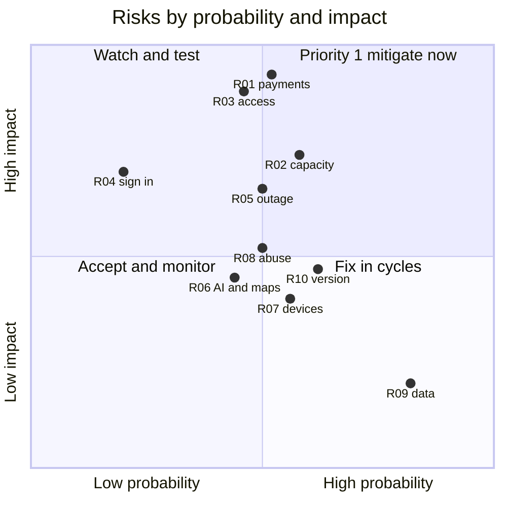

# Risk-based testing

Vinnot combines a catalog with a community (medium risk) and paid events (high risk,
comparable to e-commerce). So test order and depth follow the probability of failure and
its business impact: first what can cause financial loss, data exposure or locked-out
access; then what degrades the experience.

## Test levels

Each level is documented in its layer's strategy:

| Level | What it covers in Vinnot | Document |
|---|---|---|
| Unit | Domain rules, application services, validators and mappers; the base of the pyramid | [Backend](../backend/testing/strategy.md#pyramid-and-responsibilities), [web](../frontend-web/testing/strategy.md), [app](../frontend-mobile/testing/strategy.md) |
| Integration | 58 suites against real PostgreSQL in containers, API HTTP tests and JSON and external client contracts | [Backend: PostgreSQL persistence](../backend/testing/strategy.md#backend-postgresql-persistence) |
| System / end to end | Playwright on the web; a manual matrix on physical devices for the app | [Web testing strategy](../frontend-web/testing/strategy.md) |
| Acceptance | Module test cases and product owner validation on development before production | [Test cases per module](../modules/traceability.md) and [Test plan](test-plan.md) |

## Risks

| ID | Risk | Probability | Impact | Level | Mitigating tests |
|---|---|---|---|---|---|
| R-01 | Double charge or a payment credited without real confirmation | Medium | Very high | Critical | Payment functional and integration tests, webhooks with invalid signatures, idempotency |
| R-02 | More tickets sold than the capacity | Medium | High | Critical | Concurrency and registration state transitions |
| R-03 | Unauthorised access to data or admin panels | Medium | Very high | Critical | Security: access control, authentication, OWASP |
| R-04 | Users cannot sign up or sign in | Low | High | High | Authentication functional, regression and end-to-end tests |
| R-05 | Server outage during an event's ticket sale | Medium | High | High | Load, stress, monitoring and recovery |
| R-06 | AI or maps provider failures blocking the app | Medium | Medium | Medium | Fault tolerance with simulated services |
| R-07 | Display errors on some device | Medium | Medium | Medium | Browser and device compatibility |
| R-08 | Abusive content published unchecked | Medium | Medium | Medium | Reporting, blocking and moderation functional tests |
| R-09 | Wrong catalog data (misplaced winery, duplicate wine) | High | Low | Medium | Data quality and submission review |
| R-10 | Old app version incompatible with the API | Medium | Medium | Medium | Installation and update with a minimum version |

### Probability and impact

[View the full “Probability and impact” diagram](https://images.vinnot.com/docs/diagrams/v1/en/quality-risk-based-testing-a1aac7d17797.svg)

## Prioritised test types

| Priority | Type | Purpose in Vinnot | Status |
|---|---|---|---|
| 1 | Payment and registration functional tests | Capacity, registration states, crediting only on server confirmation, automatic refunds and ticket issuing, using the Mercado Pago sandbox | Implemented |
| 1 | Security | Authentication, role authorisation, token expiry and rotation, rate limits, HTTPS headers, webhook signatures and dependencies; guided by the OWASP Top 10 and the OWASP API Security Top 10 | Implemented |
| 1 | Automated regression | Every pull request runs the suites and the quality gate blocks on failure | Implemented |
| 1 | Integration with a real database | Queries, transactions and constraints that do not show up with mocked data | Implemented |
| 2 | Functional tests for the other modules | Sign-up, search, reviews, cellar, legal, reports and administration | Implemented |
| 2 | End to end | Sign up, verify email, find and review a wine; register, pay and see the ticket | Partial: web on demand; app manual |
| 2 | Performance and load | Response times and capacity at peaks, such as a popular event opening registrations, with k6 | Pending |
| 2 | API contract | Web and app understand responses even as they evolve separately | Implemented |
| 2 | Compatibility | Browsers, screen sizes and iOS and Android devices | Partial |
| 3 | Usability | People doing real tasks; measures M-11 and M-12 | Pending |
| 3 | Accessibility | WCAG 2.1 AA, screen readers and keyboard | Manual; automatic pending |
| 3 | Recovery | Restore a backup and measure the real time (M-17) | Partial |
| 3 | Installation and update | Install from the stores, receive OTA updates and block old versions | Manual |
| 3 | Localisation | Complete Spanish and English text, currency and dates | Implemented |
| 3 | Exploratory | Short unscripted sessions to find what the plan misses | Manual |
| Continuous | Production smoke tests | After each deployment: API health, deployed version and sign-in | Implemented |

## Static testing

Besides running the software, CI finds defects without running it: review of every pull
request with a checklist, Checkstyle on the backend, ESLint and TypeScript on the web and
the app, actionlint on workflows, the architecture check, Trivy, `npm audit` and Gitleaks,
and bilingual documentation validation. Which check runs on which change is detailed in
[CI/CD](../infra/guides/ci-cd.md#check-selection) and
[Dependency security](../infra/guides/dependency-security.md).

## Test design techniques

Each module's test cases combine positive and negative cases with four black-box
techniques. The full cases are on each module's testing page and in the
[traceability matrix](../modules/traceability.md).

| Technique | Idea | Example in Vinnot |
|---|---|---|
| Equivalence partitioning | Group inputs the system treats the same and test one representative per group | Wine search: empty or one-character text keeps the filtered catalog; from two normalised characters the search is sent (`RF-WEB-WIN-02`) |
| Boundary value analysis | Test the edges of each range, where errors cluster | Tickets per registration between 1 and 20: test 0, 1, 20 and 21. Pages of 200 and 201 items. Sign-in: attempt 10 accepted and attempt 11 answered with HTTP 429 |
| Decision table | Combine conditions and their outcome | Payment webhook: invalid signature → rejected; valid signature outside the ±10 min tolerance → rejected; valid signature and payment approved in Mercado Pago → credited; valid signature and payment not approved → not credited |
| State transition | Test valid and invalid state changes | Registration: `AWAITING_ATTENDEE_CONFIRMATION` moves to `CONFIRMED` only by the holder while the hold is valid; with an expired hold it is rejected; `WAITLISTED` is not promoted automatically when capacity frees up (`RF-WEB-EVT-11` and `RF-WEB-EVT-13`) |

### Payment webhook decision table

| Condition / outcome | C1 | C2 | C3 | C4 |
|---|---|---|---|---|
| Valid HMAC signature | No | Yes | Yes | Yes |
| Within ±10 min | — | No | Yes | Yes |
| Payment approved in Mercado Pago | — | — | Yes | No |
| **Registration is credited** | No | No | Yes | No |
