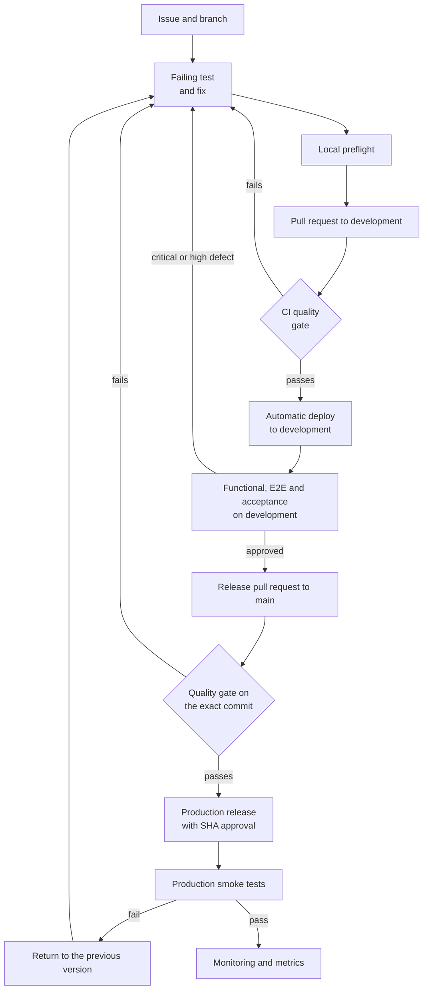

# Test plan

Vinnot's master test plan, in the ISO/IEC/IEEE 29119-3 structure. It defines what is
tested, how, where, which criteria approve a module or a release, and who does each
activity. It names roles, not people.

| Item | Detail |
|---|---|
| Identifier | PP-VINNOT-01 |
| Product | Vinnot: web, API and mobile app version 0.2.2 or later |
| Owning role | Product owner |
| References | [Non-functional requirements](non-functional-requirements.md), functional requirements per module, [Metrics](metrics.md), [Risk-based testing](risk-based-testing.md), [Non-functional test cases](non-functional-test-cases.md), test cases per module in the [traceability matrix](../modules/traceability.md) |

## Objectives

The overall goal is to give measurable evidence that each version can reach production
without putting people's money, data or experience at risk.

- Verify that the functional requirements behave as specified, including error cases and
  boundary values.
- Guarantee money accuracy: no registration is confirmed without a real payment, no
  double charge goes unrefunded and an event's capacity is never exceeded.
- Verify security: authentication, role authorisation, abuse protection and no known
  vulnerabilities.
- Prevent regressions with automatic tests on every pull request.
- Measure the non-functional attributes (performance, availability, recovery,
  compatibility and accessibility) against the [Metrics](metrics.md) thresholds.
- Find defects as early as possible, when they are cheaper to fix.
- Produce the information needed to decide a release: what works, what does not and which
  risks are accepted.

## Scope

### In scope

| Module or aspect | Functions | Test types |
|---|---|---|
| Users and authentication | Sign-up, email verification, sign-in and sign-out, refresh, password recovery, Google and Apple | Functional, security, regression, end to end |
| Wine catalog | Search, filters, pagination, detail, public catalog limits | Functional, performance, regression |
| Scanning and submissions | Label scanning, wine submission and usage limits | Functional, performance, physical devices |
| Reviews and cellar | Create, edit and validate reviews; averages; likes; personal cellar | Functional, authorisation, regression |
| Events, registrations and payments | Listing, registration, capacity, states, Mercado Pago, webhooks, refunds, tickets, partner management | Functional, integration, security, concurrency, end to end |
| Legal and community | Terms acceptance, reports, blocks, moderation | Functional, state transition |
| Administration | Users and roles, identity reconfirmation, minimum app version | Functional, security |
| Non-functional aspects | Rate limits, HTTPS and headers, performance, backups, compatibility and accessibility | Security, load, recovery, compatibility, accessibility |

### Out of scope

- The internals of third parties (Mercado Pago, OpenAI, Google Maps, app stores): the
  integration is tested, not the service.
- Wine routes, AI profiles and comparisons, notifications and support: each module's
  automatic tests cover them, outside this plan.
- External penetration tests: recommended before significant user growth.
- Tablets: the app does not officially support them.

## Approach

- **Risk-based:** order and depth follow [risks R-01 to R-10](risk-based-testing.md#risks).
- **Automation first:** unit, integration and contract tests on every pull request; manual
  testing is kept for usability, accessibility, physical devices and exploration.
- **Shift-left:** every defect is reproduced with a failing test before it is fixed.
- **Controlled production testing:** smoke tests after every deployment and continuous
  monitoring.

## Environments and tools

| Environment | Use |
|---|---|
| Local | Development and the same verification as CI with `node scripts/ci-preflight.mjs` |
| CI (GitHub Actions) | Tests, coverage, static and security analysis, and the quality gate on every pull request |
| Development (`dev.vinnot.com`) | Manual functional, end-to-end, load and acceptance testing; Mercado Pago in sandbox |
| Production (`vinnot.com`) | Smoke tests and monitoring only; never destructive test data |
| Physical devices | iPhone and Android for scanning, notifications, accessibility and installation |

| Tool | Version | Use |
|---|---|---|
| JUnit and Testcontainers | Managed by Spring Boot 4.1.2 ([`pom.xml`](../../../backend/pom.xml)) | Backend tests on Java 25 against PostgreSQL 18 |
| JaCoCo | [`pom.xml`](../../../backend/pom.xml) | Backend coverage and gates |
| Vitest | 5.0.5 ([`package.json`](../../../frontend-react/package.json)) | Web tests and coverage (React 19) |
| Testing Library | React 16.3; React Native 12.9 | Component tests |
| Playwright | 1.64 ([`package.json`](../../../frontend-react/package.json)) | Web end-to-end tests |
| Jest with jest-expo | Jest 30.5; jest-expo 58 ([`package.json`](../../../frontend-mobile/package.json)) | App tests and coverage (Expo SDK 58, React Native 0.88) |
| Trivy and Gitleaks | 0.74.0 and 8.28.0 ([`install-security-tools.mjs`](../../../scripts/install-security-tools.mjs)) | Vulnerabilities and secrets |
| k6 | — | Load: pending |
| axe | — | Automatic accessibility: pending |

## Entry, suspension and resumption criteria

- **Entry:** the change is merged into `development`, CI passed in full and the development
  environment answers with the expected version.
- **Suspension:** the environment is down, sign-in fails (it blocks almost every case) or a
  critical payment defect appears.
- **Resumption:** the cause of the suspension is fixed and verified on development; the
  affected cases are rerun from the start.

## Acceptance criteria

### Per module

A module is approved when:

- 100% of its high-priority cases and at least 95% of its medium-priority cases pass;
- it has no open critical or high defects, and medium ones have a fix plan;
- it meets its layer's coverage thresholds ([RNF-23](non-functional-requirements.md#maintainability-and-portability));
- every business rule has an automatic test that verifies it;
- error messages are clear and expose no internal information;
- its documentation is up to date in Spanish and English.

### Per release

A release is approved when:

- every module in scope is approved;
- the CI quality gate passed with no failed or skipped checks on the exact commit being
  released ([Release pull request to main](../infra/guides/release-step-by-step.md#5-release-pull-request-to-main));
- there are zero high or critical vulnerabilities and zero exposed secrets;
- the critical payment flows were verified end to end in sandbox;
- performance metrics meet their threshold, or the deviation is accepted and documented by
  the product owner, as with scan time ([M-06](metrics.md#m-06-scan-time-p95));
- there is a previous version to return to and the procedure is tested
  ([Going back](../infra/guides/release-step-by-step.md#going-back));
- after deployment the smoke tests pass: API health, deployed version equal to the
  released commit, and sign-in ([Production: backend and web](../infra/guides/release-step-by-step.md#6-production-backend-and-web)).

For the app, the release also follows the [Mobile app](../infra/guides/release-step-by-step.md#8-mobile-app)
step: a native build or an OTA update depending on the kind of change.

## Defect severity

| Severity | Definition | Example |
|---|---|---|
| Critical | Loss of money or data, a security breach or an unusable system | A registration is confirmed without payment |
| High | A main function does not work and there is no workaround | Google sign-in fails |
| Medium | It works with errors or there is a workaround | A filter does not clear when the country changes |
| Low | Cosmetic or text issue | A text left untranslated in English |

## Test cycle per release

[View the full “Test cycle per release” diagram](https://images.vinnot.com/docs/diagrams/v1/en/quality-test-plan-9e52e4686149.svg)

## Schedule and roles

| Activity | Role | When |
|---|---|---|
| Automatic tests | Development | On every pull request |
| Functional and end-to-end tests on development | Development and product owner | Before every release pull request to `main` |
| Load and recovery | Development and operations | Before a major launch, then every quarter |
| Usability and accessibility | Product owner with 5 to 8 users | Every quarter |
| Production smoke tests | Operations | After every deployment |

## Test deliverables

- This plan and the test cases with their results.
- The CI report, the coverage report and the security report (SBOM included).
- The updated [Metrics](metrics.md) summary.
- The release report with the accepted risks.

## Plan risks

| Risk | Mitigation |
|---|---|
| Small team: the same role develops and tests | Automation, the pre-merge checklist and review of every pull request |
| Development has fewer resources than production: performance measurements do not extrapolate | Measure in production outside peak hours |
| The Mercado Pago sandbox does not reproduce every real case | A low-amount pilot before enabling real payments |
