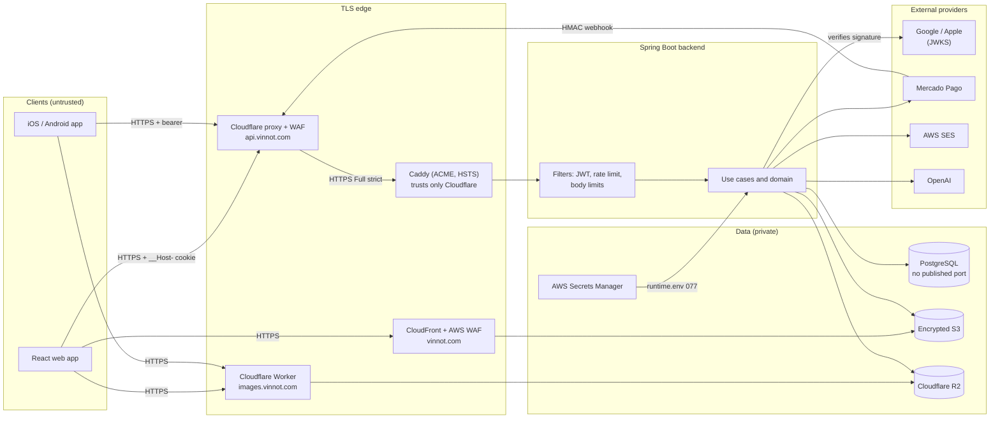

# Security

This chapter is the cross-cutting view of Vinnot's security: how passwords are
stored, how each client authenticates, which controls sit at each layer, which
external services take part, and which known limits remain open. It does not
repeat each module's depth: it states the key facts with their source and links
to the page that explains them in full.

## Is the app secure?

Short answer: Vinnot applies well-established controls at every layer, they are
implemented in the code and infrastructure cited here, and their known limits
are documented. No system is invulnerable; this chapter describes what exists,
it does not promise the absence of flaws.

| Area | Status | Summary |
|---|---|---|
| Passwords | implemented | BCrypt at Spring Security's default cost (10); plain text is never stored. [Details](passwords-and-authentication.md#password-hashing) |
| Sessions | implemented | 15-minute access JWT; opaque 7-day refresh token, rotated on every use and stored as SHA-256. [Details](passwords-and-authentication.md#access-and-refresh-tokens) |
| Instant revocation | implemented | Every bearer request checks the database: active account, not suspended, same `session_version`, same roles. [Details](passwords-and-authentication.md#instant-invalidation) |
| Sensitive actions | implemented | Re-authentication with a 5-minute proof to delete the account, change the email, and run destructive admin operations. [Details](passwords-and-authentication.md#step-up-re-authentication) |
| Transport | implemented | HTTPS on every public domain, HSTS on the API and the web app, S3 buckets that refuse non-TLS traffic. [Details](defense-in-depth.md#transport) |
| Abuse | implemented | Rate limits per policy (credentials 10/min, account actions 5 per 15 min) and size limits. [Details](defense-in-depth.md#application) |
| Brute force and session theft | implemented (2026-10-30) | After 5 wrong passwords in a row, password sign-in pauses for 15 minutes; a rotated refresh token that shows up again ends every session of the account. [Details](passwords-and-authentication.md#temporary-sign-in-lockout) |
| Security events | implemented (2026-10-30) | The `security_events` table records sign-ins, failures, locks, refresh reuse and account changes for 180 days. [Details](privacy-and-data-protection.md#security-events-log) |
| API edge | mitigated (2026-10-30) | The Cloudflare proxy and WAF in front of the API, with the origin open only to Cloudflare: in the code and the runbook, pending the owner's apply. [Details](defense-in-depth.md#edge-and-network) |
| Data at rest | implemented | Encrypted EBS volume and S3 buckets; Mercado Pago credentials encrypted with AES-GCM. [Details](defense-in-depth.md#data) |
| Supply chain | implemented | Dependabot, SHA-pinned Actions, gitleaks, Trivy, npm audit, a CycloneDX SBOM and a release that verifies provenance. [Details](defense-in-depth.md#supply-chain) |
| Verification | verified | Mandatory backend security tests for routes, rate limits and uploads ([tests](../backend/architecture/security-and-authorization.md#required-tests)) and weekly CI scans ([security-checks.yml](../../../.github/workflows/security-checks.yml)). |
| Known limits | pending | No view or alerts on the security events and no actor on admin actions, no client error reporting and no code signing of OTA updates. [Prioritised list](known-limitations.md) |

The posture fits a single-instance platform with basic personal data and payments
delegated to Mercado Pago: Vinnot never stores card data. The points worth
strengthening before growing in scale are in [Known limitations](known-limitations.md).

## Threat model

### Assets

| Asset | Why it matters | Main protection |
|---|---|---|
| Accounts and sessions | Impersonating a person or an administrator | BCrypt, temporary lockout, short JWT, rotated and hashed refresh token with theft detection, `session_version`, step-up |
| Personal data | Email, name, optional phone, avatar, activity | Session required, per-operation ownership, encrypted volume |
| Seller credentials at Mercado Pago | Charging or refunding on an organiser's behalf | AES-GCM bound to the owner, secrets outside the repository |
| Event registrations and payments | Financial integrity | HMAC webhook signature, idempotency, reconciliation |
| Catalog and content | Bulk extraction, malicious content | Session required, daily quotas, image validation and re-encoding |
| Platform secrets | They unlock everything above | AWS Secrets Manager, `runtime.env` with mode `077`, OIDC for releases |
| Release artifacts | Shipping unreviewed code | SHA-pinned Actions, digest-pinned images, checksums and provenance checks |

### Actors

| Actor | Assumed capability |
|---|---|
| Anonymous visitor | Public routes only: authentication, shared links, current terms, signed webhooks |
| Signed-in person | Their own session and resources |
| Organiser (`PARTNER`) | Their events and their payout account |
| Moderator / Administrator | The `/admin/**` surface, with step-up for destructive actions |
| External attacker | Leaked credentials, brute force, scraping, forged social tokens, malicious uploads |
| Compromised provider | Forged webhook, malicious dependency |

### Trust boundaries

The first boundary is the public network; the second is the TLS edge (CloudFront
with WAF for the web app; the Cloudflare proxy with its WAF and, behind it, Caddy
for the API); the third is the backend authentication filter; and the last is the
adapters that talk to the database, storage and external providers. The API
proxy is in the code and in the
[runbook](../infra/architecture/aws-deployment.md#put-cloudflare-in-front-of-the-api)
since 2026-10-30; until the owner applies it, clients reach Caddy directly.

[View the full “Trust boundaries” diagram](https://images.vinnot.com/docs/diagrams/v1/en/security-readme-ca44e1ebe87c.svg)

Sources: [Caddyfile](../../../infra/aws-low-cost/Caddyfile),
[production-web-stack.json](../../../infra/aws-low-cost/production-web-stack.json),
[compose.postgres.yml](../../../infra/aws-low-cost/compose.postgres.yml),
[SecurityConfig.java](../../../backend/src/main/java/com/vinnot/shared/infrastructure/config/SecurityConfig.java)
and the [deployment map](../infra/architecture/aws-deployment.md).

## Chapter map

| Page | Answers |
|---|---|
| [Passwords and authentication](passwords-and-authentication.md) | How do we hash passwords? How do we authenticate on the web, in the app and with Google or Apple? What asks for re-authentication? |
| [Defense in depth](defense-in-depth.md) | Which controls exist for network, transport, HTTP, application, data, payments, secrets, mobile and supply chain? |
| [External security services](external-security-services.md) | Which libraries and providers do we use to authenticate or defend ourselves, and where are they configured? |
| [Privacy and data protection](privacy-and-data-protection.md) | Which personal data do we keep, how is it deleted, and how long do backups last? |
| [Known limitations](known-limitations.md) | What is missing, and in which order should it be addressed? |
| [Layer explorer](security-explorer.mdx) | An interactive view of the defense layers and each control's status |

## Related in-depth pages

- [Authentication, identity and account lifecycle](../backend/architecture/authentication-and-identity.md)
- [Security, authorization and abuse protection](../backend/architecture/security-and-authorization.md)
- [Sessions, publication and external effects](../backend/architecture/session-and-data-integrity.md)
- [Resource protection and external transports](../backend/architecture/resource-protection.md)
- [Environments, configuration and secrets](../infra/architecture/environments-and-secrets.md)
- [Dependency and artifact security](../infra/guides/dependency-security.md)
- [Backup and disaster recovery](../infra/operations/backup-and-disaster-recovery.md)
- [Observability and incidents](../infra/operations/observability-and-incidents.md)
- [Payments](../modules/payments/README.md) and [Legal](../modules/legal/README.md)
