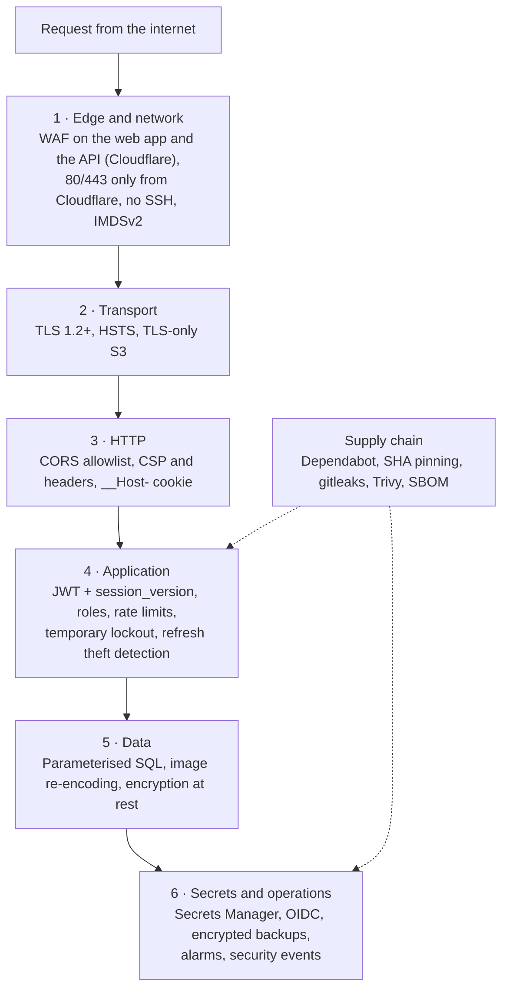

# Defense in depth

Vinnot does not rely on a single control. Each layer assumes the previous one may
fail and adds its own barrier. This page lists the controls layer by layer, with
their source, and links to the page that explains each one in depth.

## Defense layers

[View the full “Defense layers” diagram](https://images.vinnot.com/docs/diagrams/v1/en/security-defense-in-depth-40a3c5b9060f.svg)

The [interactive view](security-explorer.mdx) shows the same layers with each
control's status. The states were reviewed on 2026-10-30: **implemented** is in the code and in
the account; **mitigated** is in the code and the templates, but the
infrastructure owner still has to apply it; **accepted decision** is kept on
purpose; **pending** does not exist yet.

## Edge and network

| Control | Status | Source |
|---|---|---|
| AWS WAF on the web CloudFront distribution, with the managed groups `AWSManagedRulesAmazonIpReputationList`, `AWSManagedRulesCommonRuleSet` and `AWSManagedRulesKnownBadInputsRuleSet` | implemented | [production-web-stack.json](../../../infra/aws-low-cost/production-web-stack.json) |
| Cloudflare proxy in front of the API (`api.vinnot.com` and `api-dev.vinnot.com`): the Free managed ruleset, DDoS protection and one rate-limit rule on `/api/auth/*`. Bot Fight Mode stays off so the Mercado Pago webhooks get through | mitigated on 2026-10-30: in the code and the runbook; pending the owner's apply ([limit 2](known-limitations.md#mitigated-pending-the-apply)) | [Cloudflare runbook](../infra/architecture/aws-deployment.md#put-cloudflare-in-front-of-the-api) |
| Caddy trusts only the Cloudflare ranges (`trusted_proxies`) and reads the client IP from `CF-Connecting-IP`; from any other peer it uses the connection IP | implemented in the [Caddyfile](../../../infra/aws-low-cost/Caddyfile) on 2026-10-30; it takes effect on each host when deployed | [Caddyfile](../../../infra/aws-low-cost/Caddyfile), [proxy-trust-policy.test.mjs](../../../scripts/test/proxy-trust-policy.test.mjs) |
| Production security group: no port 22; the template opens 80 and 443 only to the 15 Cloudflare IPv4 ranges, with no operator rule | mitigated on 2026-10-30: the template matches the public launch; the account (verified on 2026-10-29) accepts 80 and 443 from anywhere until the stack is applied, after the proxy ([limit 20](known-limitations.md#mitigated-pending-the-apply)) | [production-stack.json](../../../infra/aws-low-cost/production-stack.json), [AWS deployment](../infra/architecture/aws-deployment.md#3-restrict-the-origin-to-cloudflare) |
| Host administration through AWS Systems Manager (SSM), without SSH | implemented | same |
| IMDSv2 required (`HttpTokens: required`) on the instance | implemented | [production-stack.json](../../../infra/aws-low-cost/production-stack.json) |
| PostgreSQL publishes no host port; only Caddy listens on 80/443 | implemented | [compose.postgres.yml](../../../infra/aws-low-cost/compose.postgres.yml), [docker-compose.yml](../../../infra/aws-low-cost/docker-compose.yml) |
| Least-privilege host IAM role: SSM, read one secret, send SES from one sender, pull one ECR repository, write backups | implemented | [production-stack.json](../../../infra/aws-low-cost/production-stack.json) |
| Image Worker that only serves keys matching strict regular expressions; SVGs get a CSP with `sandbox` | implemented | [worker.mjs](../../../infra/cloudflare/catalog-images/worker.mjs) |
| Backend container runs as the non-root user `vinnot`, with digest-pinned images | implemented | [Dockerfile](../../../backend/Dockerfile) |

## Transport

| Control | Status | Source |
|---|---|---|
| Automatic ACME TLS at Caddy for the API | implemented | [Caddyfile](../../../infra/aws-low-cost/Caddyfile) |
| With the proxy on, Cloudflare terminates the client TLS and encrypts again towards Caddy in Full (strict) mode | mitigated on 2026-10-30: pending the owner turning on the proxy | [Cloudflare runbook](../infra/architecture/aws-deployment.md#put-cloudflare-in-front-of-the-api) |
| API HSTS: `max-age=31536000; includeSubDomains` (1 year) | implemented | same |
| CloudFront with the minimum policy `TLSv1.2_2021`, HTTPS redirect, HTTP/2 and HTTP/3, ACM certificate | implemented | [production-web-stack.json](../../../infra/aws-low-cost/production-web-stack.json) |
| Web HSTS: `max-age=15552000` (180 days) | implemented | [security-headers.json](../../../frontend-react/security-headers.json) |
| S3 buckets deny every non-TLS request (`aws:SecureTransport = false` → Deny) | implemented | [production-stack.json](../../../infra/aws-low-cost/production-stack.json) |
| The mobile app keeps iOS App Transport Security at its default | implemented | [app.config.ts](../../../frontend-mobile/app.config.ts) |

## HTTP

| Control | Status | Source |
|---|---|---|
| CORS with an exact allowlist (`CORS_ALLOWED_ORIGINS`), credentials allowed, no wildcard | implemented | [SecurityConfig.java](../../../backend/src/main/java/com/vinnot/shared/infrastructure/config/SecurityConfig.java), [CORS](../backend/architecture/security-and-authorization.md#cors-and-browser-exposure) |
| CSRF protection disabled because the API is stateless with bearer tokens; the single cookie (`__Host-vinnot-refresh`) is protected by `SameSite=Strict`, an `Origin` allowlist and the `X-Vinnot-Web-Session` header | implemented | [BrowserSessionPolicy.java](../../../backend/src/main/java/com/vinnot/user/infrastructure/web/session/BrowserSessionPolicy.java) |
| API headers from Caddy: HSTS, `X-Content-Type-Options: nosniff`, `Referrer-Policy: strict-origin-when-cross-origin`, no `Server` header; the client `Forwarded` header is dropped and `X-Forwarded-For` is replaced with one value, `{client_ip}` | implemented | [Caddyfile](../../../infra/aws-low-cost/Caddyfile) |
| Web headers from a CloudFront policy built by [configure-web-security-headers.mjs](../../../scripts/configure-web-security-headers.mjs): CSP with `default-src 'self'`, `object-src 'none'`, `frame-ancestors 'none'`, `upgrade-insecure-requests`; `X-Frame-Options: DENY`; `Cross-Origin-Opener-Policy: same-origin-allow-popups`; a `Permissions-Policy` with no camera, microphone or payments | implemented | [security-headers.json](../../../frontend-react/security-headers.json) |
| The CSP allows `'unsafe-inline'` for styles | pending | [Known limitations](known-limitations.md) |

## Application

### Authentication and authorization

Summary; the details are in [Passwords and authentication](passwords-and-authentication.md).

- Everything not listed as public requires a session, catalog reads included
  ([SecurityConfig.java](../../../backend/src/main/java/com/vinnot/shared/infrastructure/config/SecurityConfig.java)).
- Every bearer request checks signature, expiry, `session_version`, account state
  and roles against the database.
- `@PreAuthorize` per permission, and an ownership check in every use case
  ([ownership matrix](../backend/architecture/security-and-authorization.md#ownership)).
- A 5-minute step-up for destructive actions.
- Temporary lockout: after 5 wrong passwords in a row, password sign-in pauses
  for 15 minutes; an unknown account is compared against a dummy hash so it
  takes the same time (implemented on 2026-10-30,
  [details](passwords-and-authentication.md#temporary-sign-in-lockout)).
- Theft detection: a rotated refresh token that shows up again outside the
  `rotationId` recovery ends every session of the account (implemented on
  2026-10-30, [details](passwords-and-authentication.md#refresh-token-theft-detection)).

### Rate limiting

Bucket4j 8.21.0 with Caffeine, in memory per instance
([RateLimitingFilter.java](../../../backend/src/main/java/com/vinnot/shared/infrastructure/security/RateLimitingFilter.java),
[RateLimitPolicyResolver.java](../../../backend/src/main/java/com/vinnot/shared/infrastructure/security/RateLimitPolicyResolver.java),
values in [application.yml](../../../backend/src/main/resources/application.yml#L199-L260)).
When a bucket runs out the answer is 429 with `Retry-After`.

| Policy | Default limit |
|---|---|
| Credentials (sign-in, social, re-authentication) | 10 per minute |
| Account actions (password recovery and reset, email verification, password or email change, deactivating or deleting the account) | 5 per 15 minutes |
| Registration | 5 per hour |
| Refresh | 60 per minute |
| Content reports | 10 per hour |
| AI | 20 per hour |
| Label scans | 30 per hour |
| Wine submissions | 10 per day |
| Authenticated catalog | 60 per minute and 1500 per day |
| Public catalog | 180 per minute and 1500 per day |
| API documentation | 30 per minute |
| General | 300 per minute |

An account that exhausts the daily catalog quota is locked to stop bulk
extraction; moderation staff are exempt
([daily quota](../backend/architecture/security-and-authorization.md#daily-catalog-quota)).
`RATE_LIMIT_TRUST_FORWARDED_FOR` defaults to `false` and is `true` in the
deployed [docker-compose.yml](../../../infra/aws-low-cost/docker-compose.yml),
because Caddy replaces `X-Forwarded-For` with one value, `{client_ip}`. A client
still cannot spoof its IP: whatever it sends in that header is dropped, and
`{client_ip}` comes from `CF-Connecting-IP` only when the connection comes from a
Cloudflare range.

The counters live in the instance memory. This is an **accepted decision**
(2026-10-30) because there is one backend per environment; it is revisited when a
second backend runs ([platform decisions](../infra/architecture/hosting-and-runtime.md#platform-decisions)).

### Sizes, validation and errors

| Control | Value | Source |
|---|---|---|
| Multipart | 10 MB per file, 15 MB per request | [application.yml](../../../backend/src/main/resources/application.yml#L38-L39) |
| JSON bodies | 1 MB | [JsonRequestResourceFilter.java](../../../backend/src/main/java/com/vinnot/shared/infrastructure/web/JsonRequestResourceFilter.java) |
| Images | 8 MB and at most 24 decoded megapixels | [ImageResourceLimits.java](../../../backend/src/main/java/com/vinnot/shared/infrastructure/image/ImageResourceLimits.java) |
| Validation | Bean Validation on requests and invariants in the domain value objects | [resource protection](../backend/architecture/resource-protection.md) |
| Errors | The generic handler answers `An unexpected error occurred`, without stack traces | [GlobalExceptionHandler.java](../../../backend/src/main/java/com/vinnot/shared/infrastructure/web/GlobalExceptionHandler.java) |
| Actuator | Exposes `health`, `info` and `metrics`; details and the rest require ADMIN | [application.yml](../../../backend/src/main/resources/application.yml#L67-L70) |

## Data

| Control | Status | Source |
|---|---|---|
| Parameterised SQL: JPA, `JdbcTemplate` and the native queries bind parameters; only constants or enum names are concatenated | implemented | [WineSearchNativeRepository.java](../../../backend/src/main/java/com/vinnot/wine/infrastructure/persistence/search/WineSearchNativeRepository.java) |
| Wine labels: declared MIME type and JPEG/PNG signature, minimum resolution, re-encoded to JPEG of at most 1600 px without copying metadata | implemented | [WineLabelUploadValidator.java](../../../backend/src/main/java/com/vinnot/wine/infrastructure/web/WineLabelUploadValidator.java), [uploads](../backend/architecture/security-and-authorization.md#uploads-and-untrusted-content) |
| Images optimised to WebP: decoded first, then encoded with `cwebp` invoked without a shell | implemented | [WebpImageOptimizer.java](../../../backend/src/main/java/com/vinnot/shared/infrastructure/media/WebpImageOptimizer.java) |
| File names and paths generated by the server, with no path traversal | implemented | [threat review](../backend/architecture/security-and-authorization.md#threat-review-by-flow) |
| Encryption at rest: encrypted EBS volume; S3 buckets with SSE-AES256, versioning and Block Public Access | implemented | [production-stack.json](../../../infra/aws-low-cost/production-stack.json) |
| Mercado Pago seller credentials: AES-256-GCM with a 12-byte nonce, a 128-bit tag and the context (owner and field) as authenticated data, so ciphertexts cannot be swapped | implemented | [PaymentCredentialCipher.java](../../../backend/src/main/java/com/vinnot/payment/infrastructure/security/PaymentCredentialCipher.java) |
| Application-level encryption of personal data | pending | [Known limitations](known-limitations.md) |

## Payments

The full flow is in [Payments](../modules/payments/architecture.md).

| Control | Detail | Source |
|---|---|---|
| Webhook signature | HMAC-SHA256 over `id:<data.id>;request-id:<x-request-id>;ts:<ts>;`, compared in constant time with `MessageDigest.isEqual`; an invalid signature gets 401 | [MercadoPagoWebhookSignature.java](../../../backend/src/main/java/com/vinnot/payment/infrastructure/security/MercadoPagoWebhookSignature.java) |
| Time window | The signed `ts` must be within ±10 minutes of the server clock | same |
| Idempotency | `X-Idempotency-Key` header on gateway calls, a stable refund key and `ON CONFLICT` when persisting | [MercadoPagoPaymentAdapter.java](../../../backend/src/main/java/com/vinnot/payment/infrastructure/gateway/MercadoPagoPaymentAdapter.java) |
| Organiser OAuth connection | Random 32-byte `state` stored as SHA-256 | [link a payout account](../modules/payments/use-cases/uc-pay-03-link-payment-account.md) |
| Card data | Never passes through Vinnot: checkout happens at Mercado Pago | [Payments](../modules/payments/README.md) |

## Secrets

| Control | Status | Source |
|---|---|---|
| Backend secrets live in AWS Secrets Manager (`vinnot/prod/backend-*`), and the host role can read only that secret | implemented | [environments and secrets](../infra/architecture/environments-and-secrets.md) |
| `refresh-runtime-env.sh` writes `runtime.env` with `umask 077` and replaces it with an atomic `mv` | implemented | [refresh-runtime-env.sh](../../../infra/aws-low-cost/refresh-runtime-env.sh) |
| `JWT_SECRET`, `EVENT_PAYMENTS_WEBHOOK_SECRET`, `EVENT_PAYMENTS_CLIENT_SECRET` and `EVENT_PAYMENTS_ENCRYPTION_KEY` have no default value | implemented | [application.yml](../../../backend/src/main/resources/application.yml) |
| The production release uses GitHub OIDC with the role `vinnot-production-release`, with no long-lived keys | implemented | [production-release.yml](../../../.github/workflows/production-release.yml), [production-release-stack.json](../../../infra/aws-low-cost/iam/production-release-stack.json) |
| Development deploys use long-lived access keys, scoped by a permission boundary | pending | [Known limitations](known-limitations.md) |

## Mobile

| Control | Status | Source |
|---|---|---|
| Session in `expo-secure-store` with `AFTER_FIRST_UNLOCK_THIS_DEVICE_ONLY` | implemented | [authSession.storage.ts](../../../frontend-mobile/src/infrastructure/storage/authSession.storage.ts) |
| Validated deep links: at most 4096 characters, `https` only, host `vinnot.com` or `dev.vinnot.com`, no user, password or port, and only `/share/(wines\|events\|wine-routes)/<uuid>` paths; anything else goes back home | implemented | [nativeIntent.ts](../../../frontend-mobile/src/domain/navigation/nativeIntent.ts), [+native-intent.tsx](../../../frontend-mobile/app/+native-intent.tsx) |
| Android App Links with `autoVerify` and iOS `applinks` | implemented | [app.config.ts](../../../frontend-mobile/app.config.ts) |
| Permissions: camera to scan labels and location while in use only; Android blocks `RECORD_AUDIO` and `SYSTEM_ALERT_WINDOW` | implemented | same |
| Label OCR runs on the device (ML Kit); the backend receives the validated capture only to identify the wine or propose a new one | implemented | [label scanning](../modules/wines/architecture.md#label-scanning) |
| Code signing of OTA updates, certificate pinning and root / jailbreak detection | pending | [Known limitations](known-limitations.md) |

## Supply chain

Each scan and its exceptions are detailed in
[Dependency and artifact security](../infra/guides/dependency-security.md).

| Control | Frequency | Source |
|---|---|---|
| Dependabot: GitHub Actions weekly; npm (mobile, web, docs site, diagram tooling), Maven, Docker and Docker Compose monthly | scheduled | [dependabot.yml](../../../.github/dependabot.yml) |
| Workflow policy: rejects Actions with an unreviewed SHA and `*-latest` runners | every CI run | [verify-workflow-policy.mjs](../../../scripts/verify-workflow-policy.mjs), [actions-policy.json](../../../infra/security/actions-policy.json) |
| actionlint, and gitleaks over the full history | every CI run | [ci.yml](../../../.github/workflows/ci.yml) |
| Checksum-verified scanner installs | every run | [install-security-tools.mjs](../../../scripts/install-security-tools.mjs) |
| Trivy on Maven, the container image and the Android lockfile; fails on HIGH or CRITICAL | weekly and in CI | [security-checks.yml](../../../.github/workflows/security-checks.yml) |
| `npm audit` at level `high` for web, mobile and docs | weekly and in CI | [audit-npm-dependencies.mjs](../../../scripts/audit-npm-dependencies.mjs) |
| CycloneDX SBOM of the backend image | weekly and on every release | [security-checks.yml](../../../.github/workflows/security-checks.yml), [production-release.yml](../../../.github/workflows/production-release.yml) |
| ECR with immutable tags and scan on push | every push | [production-stack.json](../../../infra/aws-low-cost/production-stack.json) |
| Release: before taking AWS credentials it verifies provenance, the candidate run, checksums, CI and the `main` SHA; it deploys the image by digest | every release | [production-release.yml](../../../.github/workflows/production-release.yml), [release step by step](../infra/guides/release-step-by-step.md) |
| CodeQL, OWASP dependency-check and image signing with cosign | pending | [Known limitations](known-limitations.md) |

## Monitoring and audit

| Control | Status | Source |
|---|---|---|
| Host metrics and an external probe every 5 minutes in production, with about nine email alarms (memory, disk, connections, backup age, 5xx ratio, AI budget, SES bounces, among others) | implemented | [observability](../infra/operations/observability-and-incidents.md) |
| Security notices by email when the password is changed or reset, when password sign-in is paused (`ACCOUNT_LOGIN_LOCKED`) and when the account is deleted | implemented | [AccountSecurityNoticeService.java](../../../backend/src/main/java/com/vinnot/user/application/service/AccountSecurityNoticeService.java) |
| Auditable histories: minimum app version changes, push type switches and announcements | implemented | [V69](../../../backend/src/main/resources/db/migration/V69__app_minimum_versions.sql), [V59](../../../backend/src/main/resources/db/migration/V59__push_type_switches_and_outcomes.sql), [V60](../../../backend/src/main/resources/db/migration/V60__announcements.sql) |
| Encrypted daily `pg_dump` backups, verified with `pg_restore --list`, kept 30 days in production | implemented | [backup and recovery](../infra/operations/backup-and-disaster-recovery.md) |
| Security-event log (`security_events`, V73): 12 types, among them sign-ins and failures, temporary locks, refresh reuse, password, email and role changes, suspensions and deletions; with the IP and browser, purged after 180 days | implemented on 2026-10-30 | [V73__security_events.sql](../../../backend/src/main/resources/db/migration/V73__security_events.sql), [privacy](privacy-and-data-protection.md#security-events-log) |
| An admin view of the log, an actor column on admin actions and alerts on the events; client error reporting | pending | [Known limitations](known-limitations.md#high-priority) |
