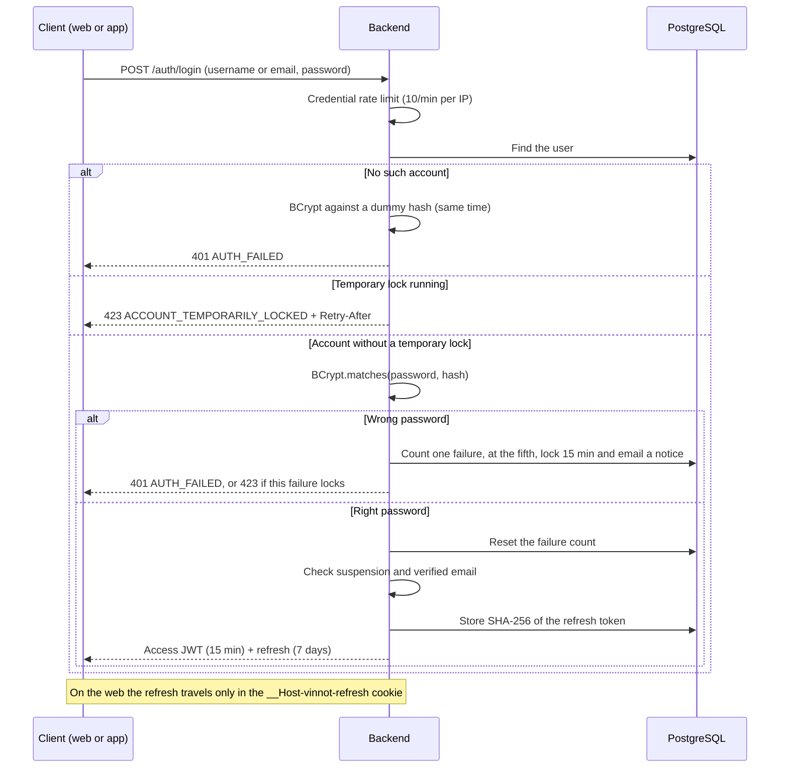
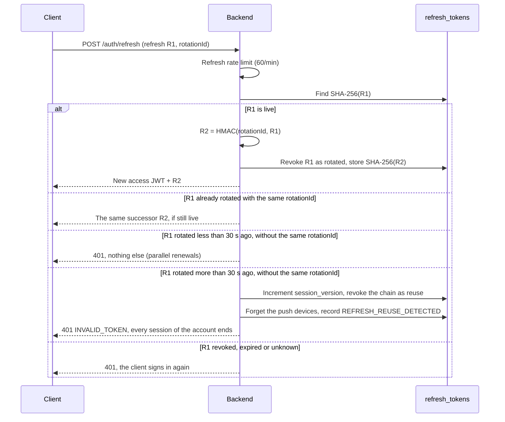
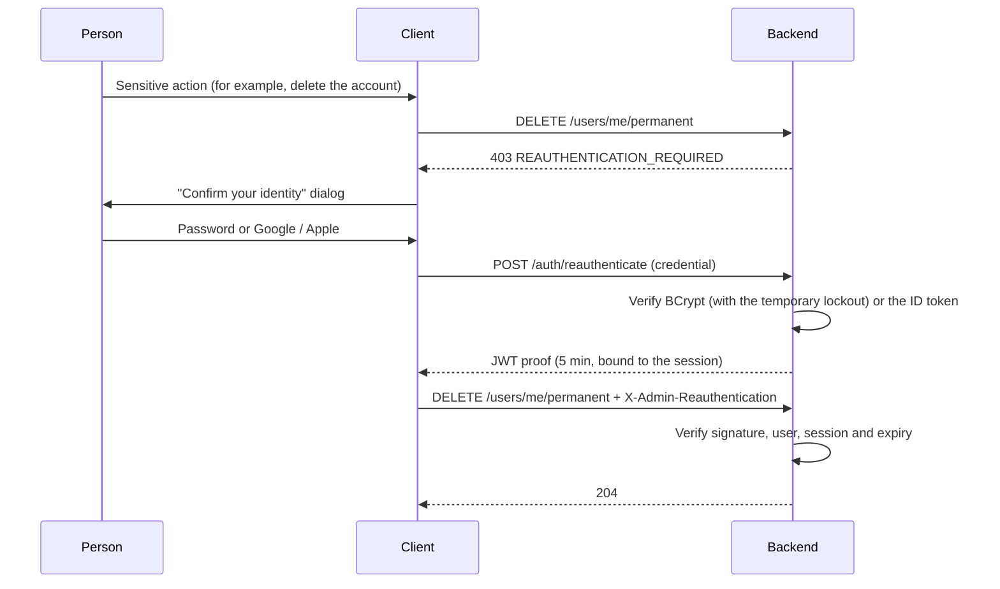

# Passwords and authentication

This page explains how Vinnot stores passwords, how it issues and renews
sessions, how it verifies Google and Apple sign-ins, and which actions ask you to
confirm your identity again. The full account lifecycle (registration,
onboarding, avatar, domain errors) is in
[Authentication, identity and account lifecycle](../backend/architecture/authentication-and-identity.md).

## Password hashing

| Item | Value | Source |
|---|---|---|
| Algorithm | BCrypt (Spring Security `BCryptPasswordEncoder`) | [SecurityConfig.java](../../../backend/src/main/java/com/vinnot/shared/infrastructure/config/SecurityConfig.java#L177-L180) |
| Cost | 10 (2^10 rounds): the bean is created without arguments and uses Spring Security's default | same |
| Salt | Random per password, embedded in the BCrypt hash itself | BCrypt behaviour |
| Domain port | `PasswordHashingPort`, implemented by `PasswordHashingAdapter`; the domain never sees BCrypt | [PasswordHashingAdapter.java](../../../backend/src/main/java/com/vinnot/user/infrastructure/identity/PasswordHashingAdapter.java) |
| Representation | The `Password` value object holds only the hash | [Password.java](../../../backend/src/main/java/com/vinnot/user/domain/valueobject/Password.java) |

The plain-text password exists only during the request that receives it: it is
validated, hashed and discarded. HTTP logs record neither bodies nor the
`Authorization` header
([HttpRequestLoggingFilter.java](../../../backend/src/main/java/com/vinnot/shared/infrastructure/web/HttpRequestLoggingFilter.java)).

### Password policy

- At least 8 characters, with one uppercase letter, one lowercase letter and one
  digit; otherwise the domain answers `WEAK_PASSWORD`
  ([Password.java](../../../backend/src/main/java/com/vinnot/user/domain/valueobject/Password.java#L34-L48)).
- Requests accept between 8 and 100 characters
  ([RegisterRequest.java](../../../backend/src/main/java/com/vinnot/user/infrastructure/web/request/RegisterRequest.java),
  [ChangePasswordRequest.java](../../../backend/src/main/java/com/vinnot/user/infrastructure/web/request/ChangePasswordRequest.java)).
- BCrypt only considers the first 72 bytes, and there is no check against
  breached-password lists: both points are in [Known limitations](known-limitations.md).

## Account action tokens

Email verification, email change and password reset share one service,
[AccountActionTokenService.java](../../../backend/src/main/java/com/vinnot/user/application/service/AccountActionTokenService.java):

| Property | Behaviour |
|---|---|
| Entropy | 32 bytes from `SecureRandom`, encoded as base64url |
| Storage | Only the SHA-256 hash; the real value travels only inside the email link |
| Use | Single use: a consumed token records `usedAt` and is never accepted again |
| Issuing | Issuing a new token invalidates the active ones of the same type |
| Lifetime | Reset 60 min, verification 1440 min (24 h), email change 60 min ([application.yml](../../../backend/src/main/resources/application.yml#L340-L342)) |

### Flows that use them

- **Email verification:** sign-in is refused with `EMAIL_NOT_VERIFIED` until
  the email is confirmed
  ([LoginCommandHandler.java](../../../backend/src/main/java/com/vinnot/user/application/command/handler/LoginCommandHandler.java)).
  Use case: [verify email](../modules/users/use-cases/uc-usr-02-verify-email.md).
- **Password recovery:** the answer is the same whether or not the account exists
  ([request password recovery](../modules/users/use-cases/uc-usr-09-request-password-recovery.md)).
- **Password reset:** consumes the token, stores the new hash, deletes every
  refresh token, forgets the push devices, clears the temporary lock and its
  counter, and sends a security notice by email
  ([ResetPasswordCommandHandler.java](../../../backend/src/main/java/com/vinnot/user/application/command/handler/ResetPasswordCommandHandler.java),
  [reset password](../modules/users/use-cases/uc-usr-10-reset-password.md)).
- **Changing the password or email:** increments `session_version`, which ends
  the sessions issued before
  ([User.java](../../../backend/src/main/java/com/vinnot/user/domain/model/User.java)).

## Access and refresh tokens

| Token | Format | Lifetime | Server-side storage | Source |
|---|---|---|---|---|
| Access token | HMAC-signed JWT (jjwt 0.13.0), claims `email`, `roles`, `permissions`, `sessionVersion` | 15 min (`JWT_EXPIRATION`) | None: signature and expiry are verified | [JwtTokenService.java](../../../backend/src/main/java/com/vinnot/shared/infrastructure/security/JwtTokenService.java), [application.yml](../../../backend/src/main/resources/application.yml#L97-L99) |
| Refresh token | Opaque random value | 7 days (`JWT_REFRESH_EXPIRATION`) | Only its SHA-256 hash in `refresh_tokens` | [RefreshTokenCommandHandler.java](../../../backend/src/main/java/com/vinnot/user/application/command/handler/RefreshTokenCommandHandler.java) |

The signing key comes from `JWT_SECRET`, which has no default: the backend does
not start without it.

### Sign-in

[View the full “Sign-in” diagram](https://images.vinnot.com/docs/diagrams/v1/en/security-passwords-and-authentication-647bc462d2ed.svg)

### Temporary sign-in lockout

Implemented on 2026-10-30 (commit `67df1d2b`). It stops brute force against one
account, even when the attacker spreads the attempts over many IPs
([LoginAttemptGuard.java](../../../backend/src/main/java/com/vinnot/user/application/service/LoginAttemptGuard.java),
[LoginAttemptRecorder.java](../../../backend/src/main/java/com/vinnot/user/application/service/LoginAttemptRecorder.java),
[LoginLockoutPolicy.java](../../../backend/src/main/java/com/vinnot/user/domain/valueobject/LoginLockoutPolicy.java)).

| Rule | Behaviour |
|---|---|
| Threshold | 5 wrong passwords in a row (`app.security.login-lockout.max-failures`, variable `LOGIN_LOCKOUT_MAX_FAILURES`) |
| Duration | 15 minutes (`app.security.login-lockout.lock-duration`, variable `LOGIN_LOCKOUT_DURATION`, value `PT15M`) in [application.yml](../../../backend/src/main/resources/application.yml) |
| Response | 423 `ACCOUNT_TEMPORARILY_LOCKED` with `Retry-After` in seconds, whatever the password, so the answer never tells whether the password was right ([LoginLockoutExceptionHandler.java](../../../backend/src/main/java/com/vinnot/user/infrastructure/web/error/LoginLockoutExceptionHandler.java)) |
| Notice | One `ACCOUNT_LOGIN_LOCKED` security email per lock |
| Reset | A right password resets the count; a password reset clears the lock and the count |
| Scope | Password sign-in and password re-authentication. Google or Apple sign-in is unaffected |
| Unknown accounts | Compared against a dummy BCrypt hash, so they take as long as a wrong password and timing does not reveal which accounts exist |
| Data | `users.failed_login_attempts` and `users.login_locked_until` ([V72__login_lockout.sql](../../../backend/src/main/resources/db/migration/V72__login_lockout.sql)); separate from the administrative suspension `users.locked` |
| Events | `LOGIN_FAILED`, `LOGIN_LOCKED` and `LOGIN_SUCCEEDED` in the [security-event log](privacy-and-data-protection.md#security-events-log) |

The lock is decided in the database, in the same statement that counts or
clears: a burst of parallel attempts starts one lock and sends one notice, nothing
counts or clears it while it runs, and a right password never lifts it. The
password is compared with no transaction open, so a burst cannot exhaust the
database connections. The full design is in [temporary sign-in lockout](../backend/architecture/authentication-and-identity.md#temporary-sign-in-lockout).

Accepted trade-off: anyone who knows the email or username can pause that
account's password sign-in for 15 minutes, and after the fifth failure the 423
confirms that the account exists. The per-IP credential rate limit and the
Cloudflare rule on `/api/auth/*` still slow down whoever triggers it; see
[limit 22](known-limitations.md#accepted-decisions).

### Refresh-token rotation

Each renewal revokes the used refresh token with the reason `rotated` and issues
a new one. If the client retries the same renewal with the same `rotationId`
(for example after losing the response), the backend derives the same successor
with HMAC-SHA256 instead of minting another, without extending its expiry.

[View the full “Refresh-token rotation” diagram](https://images.vinnot.com/docs/diagrams/v1/en/security-passwords-and-authentication-94988214ecaa.svg)

### Refresh-token theft detection

Implemented on 2026-10-30 (commit `67df1d2b`,
[RefreshTokenReuseResponder.java](../../../backend/src/main/java/com/vinnot/user/application/service/RefreshTokenReuseResponder.java)).
An already rotated refresh token that shows up again outside the idempotent
`rotationId` recovery means two parties hold the same session, and one of them
stole it. When the rotation happened more than 30 seconds earlier
(`app.security.refresh-reuse.grace-period`, value `PT30S`), the backend, in its
own transaction:

- increments `session_version`, which ends every session of the account;
- revokes the successor chain with the reason `reuse`;
- forgets the account's push devices;
- records `REFRESH_REUSE_DETECTED`.

Both parties must sign in again, and only the owner can. Within the 30 seconds
the token is only refused, so parallel renewals of the same token do not count as
theft. The app sends `rotationId`; the web app does not, so a web retry after the
30 seconds ends every session. This is an accepted decision
([limit 23](known-limitations.md#accepted-decisions)). The full design is in
[refresh-token reuse](../backend/architecture/authentication-and-identity.md#refresh-token-reuse).

### Instant invalidation

The filter
[JwtAuthenticationFilter.java](../../../backend/src/main/java/com/vinnot/shared/infrastructure/security/JwtAuthenticationFilter.java)
does not trust the JWT signature alone. On every bearer request it checks the
database
([AccountAccessAdapter.java](../../../backend/src/main/java/com/vinnot/user/infrastructure/persistence/adapter/AccountAccessAdapter.java))
and requires the account to be active, not locked, with the token's
`session_version` and exactly the same roles. If anything changed, it answers 401
`Session permissions have changed`.

`session_version` increments when the password changes, the verified email
changes, a role is added, removed or replaced, or the account is deactivated or
locked ([User.java](../../../backend/src/main/java/com/vinnot/user/domain/model/User.java)).
A stolen access token therefore stops working on the next request after any of
those events, without waiting for its 15 minutes. The full design is in
[versioned sessions](../backend/architecture/session-and-data-integrity.md#versioned-sessions).

## Where each client keeps the session

| Client | Access token | Refresh token | Source |
|---|---|---|---|
| Web | In memory only (Redux); legacy `localStorage` tokens are migrated once and removed | `__Host-vinnot-refresh` cookie: `HttpOnly`, `Secure`, `SameSite=Strict`, `Path=/`, no `Domain` | [persistence.ts](../../../frontend-react/src/presentation/stores/persistence.ts), [BrowserSessionPolicy.java](../../../backend/src/main/java/com/vinnot/user/infrastructure/web/session/BrowserSessionPolicy.java) |
| iOS / Android app | A single session record in `expo-secure-store` (Keychain / Keystore) with `AFTER_FIRST_UNLOCK_THIS_DEVICE_ONLY`: it never travels in backups to another device | same | [authSession.storage.ts](../../../frontend-mobile/src/infrastructure/storage/authSession.storage.ts) |

The cookie endpoints `/auth/web/*` also require an allowlisted `Origin` and the
header `X-Vinnot-Web-Session: 1`, and they reject requests carrying a duplicate
cookie so an injected value is never chosen. Details are in
[browser session](../backend/architecture/authentication-and-identity.md#browser-session-and-administrative-reauthentication).

## Signing in with Google and Apple

The client obtains an ID token from the provider, and the backend verifies it on
its own with `spring-security-oauth2-jose` (Nimbus) in
[SocialIdentityVerifierAdapter.java](../../../backend/src/main/java/com/vinnot/user/infrastructure/identity/SocialIdentityVerifierAdapter.java).
Profile data sent by the client is never trusted.

| Provider | Signature (JWKS) | Issuer | Audience | Other checks |
|---|---|---|---|---|
| Google | `https://www.googleapis.com/oauth2/v3/certs` | `https://accounts.google.com` or `accounts.google.com` | `GOOGLE_OAUTH_AUDIENCES` | `email_verified` and expiry |
| Apple | `https://appleid.apple.com/auth/keys` | `https://appleid.apple.com` | `APPLE_OAUTH_AUDIENCES` | Mandatory `nonce` and expiry; deleting the account revokes the Apple authorisation ([AppleAuthorizationRevocationAdapter.java](../../../backend/src/main/java/com/vinnot/user/infrastructure/identity/AppleAuthorizationRevocationAdapter.java)) |
| Facebook | Graph API `debug_token` | — | `FACEBOOK_APP_ID` | Development only: the production overlay leaves the credentials empty ([environments](../infra/architecture/environments-and-secrets.md#facebook-availability-by-environment)) |

Clients: on mobile, `@react-native-google-signin/google-signin`,
`expo-apple-authentication` and `react-native-fbsdk-next`; on the web,
`@react-oauth/google` and the Apple and Facebook JS SDKs. Use case:
[social sign-in](../modules/users/use-cases/uc-usr-04-social-sign-in.md).

## Step-up re-authentication

Some actions ask you to confirm your identity even with a valid session (the
"Confirm your identity" dialog). The person sends their password or a fresh
Google or Apple ID token (Apple with a `nonce`), and the backend returns a proof:

- an HMAC JWT valid for **5 minutes**, bound to the user and to the SHA-256 hash
  of the current `Authorization` header, signed with a key derived separately
  from the access-token key
  ([SignedReauthenticationProofAdapter.java](../../../backend/src/main/java/com/vinnot/user/infrastructure/security/SignedReauthenticationProofAdapter.java));
- it travels in the `X-Admin-Reauthentication` header;
- [AdminSensitiveActionInterceptor.java](../../../backend/src/main/java/com/vinnot/admin/infrastructure/web/AdminSensitiveActionInterceptor.java)
  enforces it; without a valid proof the answer is 403 `REAUTHENTICATION_REQUIRED`.

| Protected action | Who |
|---|---|
| Writes on `/admin/users/**`, `/admin/notifications/**` (except the preview) and `/admin/app-versions` | ADMIN |
| `DELETE` on `/admin/**` and on wines, events, routes and wineries | ADMIN |
| `POST /users/me/email-change` | Anyone with a session |
| `DELETE /users/me/permanent` | Anyone with a session |

[View the full “Step-up re-authentication” diagram](https://images.vinnot.com/docs/diagrams/v1/en/security-passwords-and-authentication-7ae1fc85926f.svg)

Use case: [re-authenticate](../modules/users/use-cases/uc-usr-12-reauthenticate.md).
The proof can be reused within its 5 minutes; see
[Known limitations](known-limitations.md).

## Roles and permissions

- Roles: `USER`, `PARTNER`, `MODERATOR` and `ADMIN`
  ([Role.java](../../../backend/src/main/java/com/vinnot/user/domain/valueobject/Role.java)).
- Permissions (`WINE_CREATE`, `EVENT_UPDATE_OWN`, and so on) travel in the JWT as
  authorities and are enforced with `@PreAuthorize`; on top of that, use cases
  check resource ownership.
- URL rules in
  [SecurityConfig.java](../../../backend/src/main/java/com/vinnot/shared/infrastructure/config/SecurityConfig.java):
  `/actuator/**` and `/admin/users|notifications|app-versions` require ADMIN; the
  rest of `/admin/**` allows ADMIN or MODERATOR; catalog reads require a session;
  everything not listed as public requires authentication.
- Swagger/OpenAPI has its own chain with HTTP Basic and the ADMIN role
  ([ApiDocumentationSecurityConfig.java](../../../backend/src/main/java/com/vinnot/shared/infrastructure/config/ApiDocumentationSecurityConfig.java)).

The full permission and ownership matrix is in
[roles, permissions, and ownership](../backend/architecture/security-and-authorization.md#roles-permissions-and-ownership).

## Signing out

`POST /auth/logout` revokes the refresh token with the reason `logout` and stops
push notifications to that device, even when the session had already expired
([LogoutCommandHandler.java](../../../backend/src/main/java/com/vinnot/user/application/command/handler/LogoutCommandHandler.java)).
On the web it also clears the cookie, and open tabs synchronise through
`localStorage` events
([browserSession.ts](../../../frontend-react/src/infrastructure/http/browserSession.ts)).
Use case: [sign out](../modules/users/use-cases/uc-usr-08-sign-out.md).

## Brute force

- The credential rate limit allows 10 attempts per minute, and the account-action
  limit 5 per 15 minutes
  ([application.yml](../../../backend/src/main/resources/application.yml#L199-L260)).
- After 5 wrong passwords in a row, password sign-in pauses for 15 minutes with
  423 `ACCOUNT_TEMPORARILY_LOCKED` ([temporary lockout](#temporary-sign-in-lockout),
  implemented on 2026-10-30).
- An unknown user is compared against a dummy BCrypt hash, so the response time
  does not reveal whether the account exists (implemented on 2026-10-30).
- `ACCOUNT_LOCKED` is something else: the administrative suspension, which only an
  administrator lifts.
- With the Cloudflare proxy on, one rate-limit rule on `/api/auth/*` adds to the
  backend's (mitigated on 2026-10-30, pending the owner's apply; see
  [Defense in depth](defense-in-depth.md#edge-and-network)).
