# Image catalog

Every image and illustration the web and the app use, grouped by purpose: what
each group is for, where it appears and where the files live. Each sheet shows
the files with their names, which are the keys the code uses. Style rules and
the asset pipeline are in [Illustration, brand and imagery](imagery.md).

Paths are relative to the repository. When a group exists in both apps, the
files are the same in `frontend-react` and `frontend-mobile`.

## AI wine profile

### Aroma and flavor notes

Illustrate the nose and palate notes on the AI profile (`AiProfilePage` on the
web, `AiProfileSections` in the app). The backend classifies each note and the
image is looked up by its key.

- Web: `frontend-react/src/shared/assets/profile-art/notes/`
- App: `frontend-mobile/assets/images/profile-art/notes/`

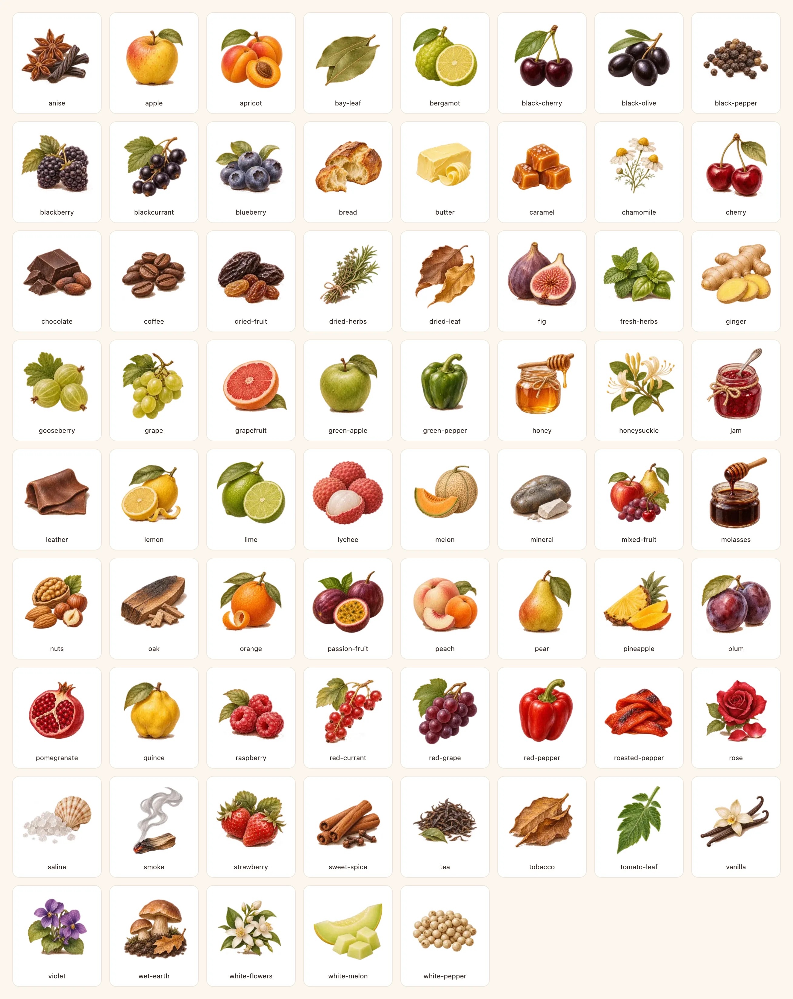

### Pairing dishes

Illustrate the food pairings on the AI profile.

- Web: `frontend-react/src/shared/assets/profile-art/dishes/`
- App: `frontend-mobile/assets/images/profile-art/dishes/`

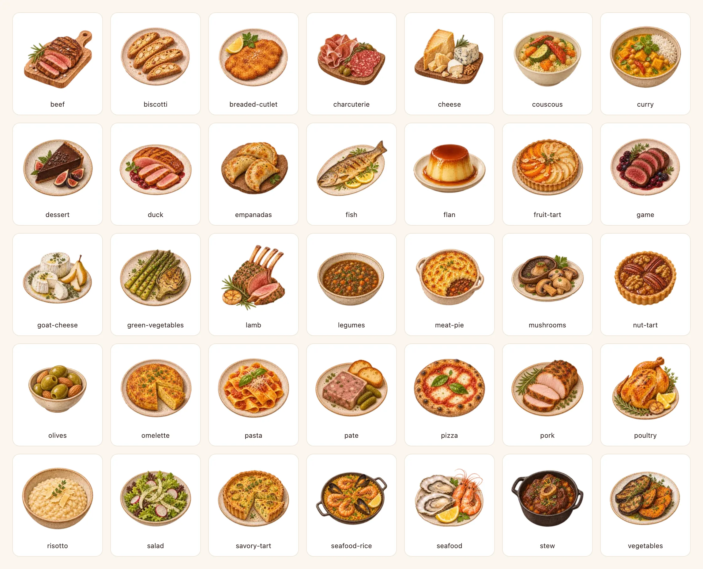

### Serving

Recommended glass, decanting (decanter or open bottle) and cellaring in the
serving section of the AI profile; each box shows its illustration above the
title and text.

- Web: `frontend-react/src/shared/assets/profile-art/serving/`
- App: `frontend-mobile/assets/images/profile-art/serving/`

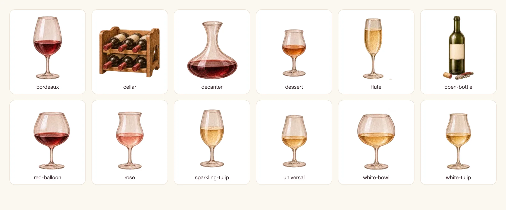

### Wine color

Watercolor brushstroke mask that shapes the color swatch of the AI profile
(also on the admin page). Color and reflections are painted in code; see
[the reflection sheet](imagery.md).

- Web: `frontend-react/src/shared/assets/wine-colors/stroke.webp`
- App: `frontend-mobile/assets/images/wine-colors/stroke.webp`

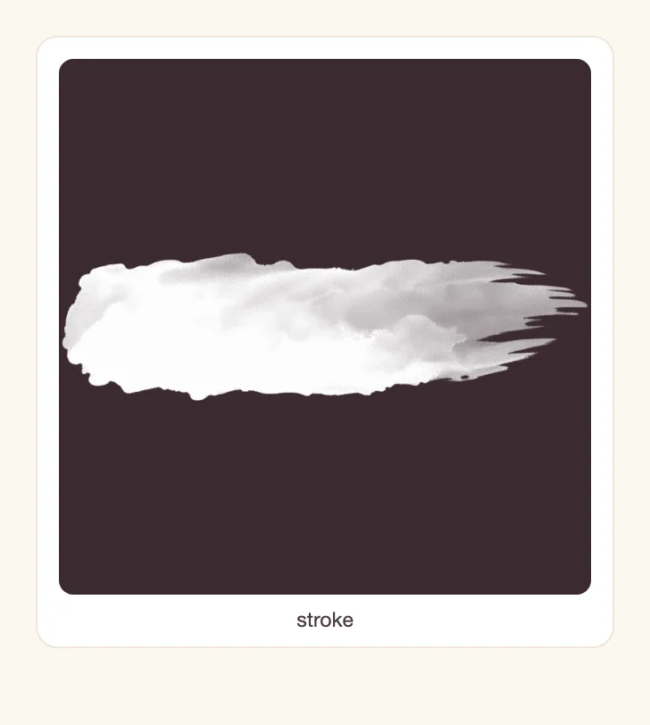

### AI loading scenes

Layered pieces of the animated scenes shown while a profile or a comparison is
generated (`AiProfileLoadingSteps` and `CompareLoadingSteps` on the web,
`WineProcessScene` in the app). The cork, cage, corkscrew and one wisp are also
reused in the uncorking animation of the rating.

- Web: `frontend-react/src/shared/assets/loading/`
- App: `frontend-mobile/assets/images/loading/`

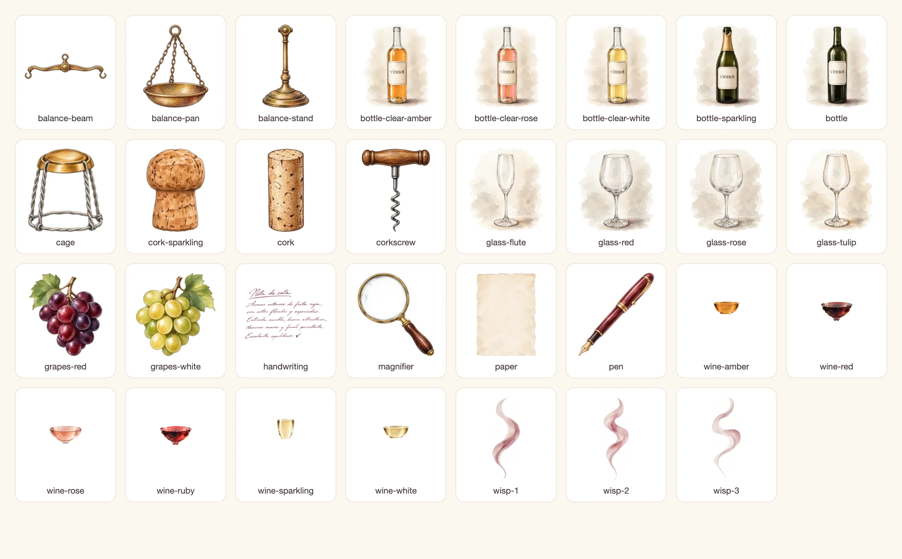

## Ratings and seals

### Rating glasses, wine and bottles

Glass, wine and bottle layers of the glass rating and the pour-to-rate control,
chosen by wine type. They appear in the review form and list and on cellar
cards.

- Web: `frontend-react/public/images/rating/`
- App: `frontend-mobile/assets/images/rating/`

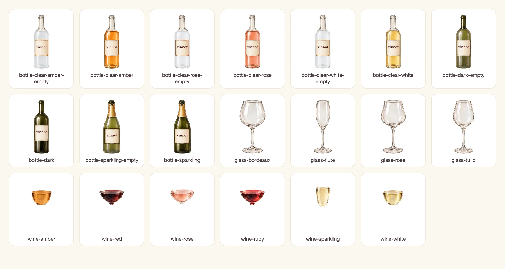

### Tier seals

The seal of each points tier: in the user badge on the web and on the points
screen of the app.

- Web: `frontend-react/public/images/emblems/`
- App: `frontend-mobile/assets/images/emblems/`

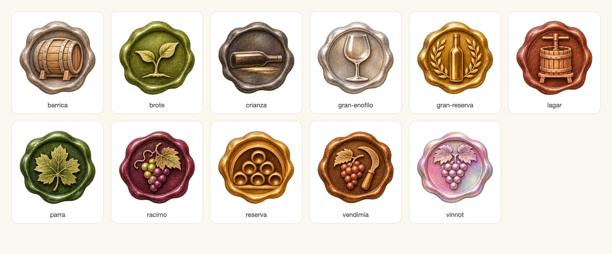

## States and covers

### Error, empty and fallback illustrations

Error pages (403, 404, 429, 500, 503, timeout, offline), empty states (no
wines, tickets, reviews or notifications; empty cellar), fallback covers for
events, wineries and routes, and the legal, privacy and cookie pages. The files
are identical in both apps.

- Web: `frontend-react/src/shared/assets/illustrations/`
- App: `frontend-mobile/assets/images/illustrations/`

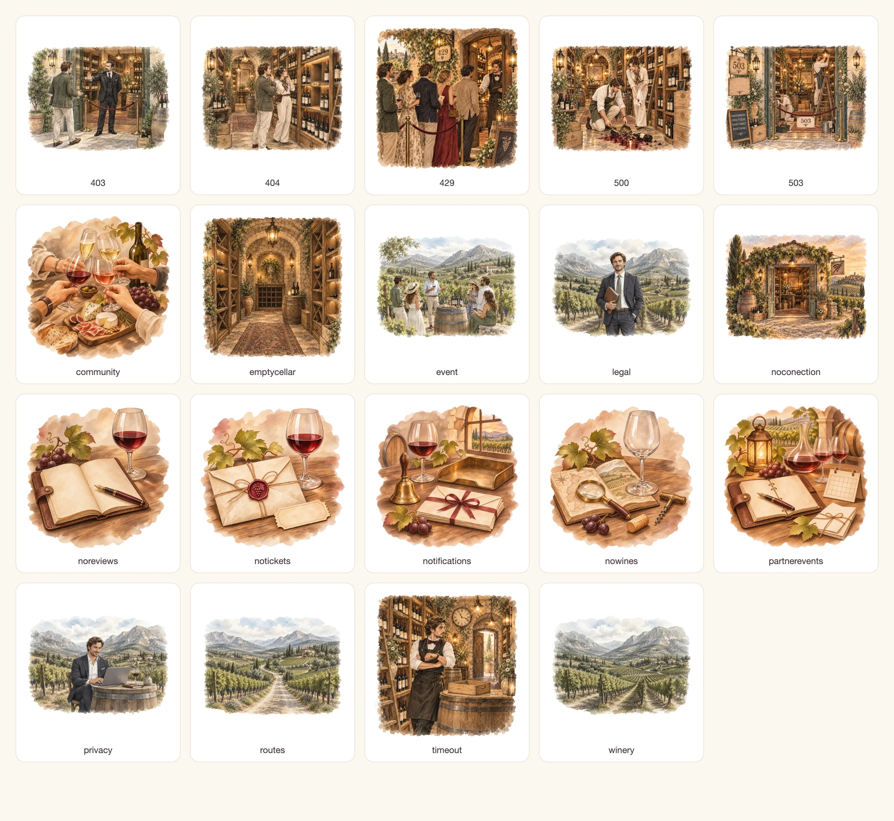

### Route covers

On the web, the details of a route without an image show one of these photos
at random. The app uses the routes illustration instead.

- Web: `frontend-react/src/shared/assets/routes/`

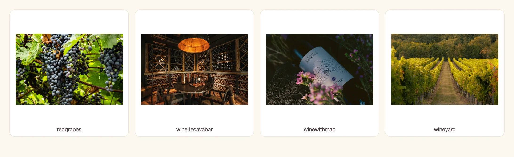

### Fallback bottle

The bottle shown when a wine has no photo (dark or light by wine color). It is
also the image of the web's mock data.

- Web: `frontend-react/public/images/mock/`
- App: `frontend-mobile/assets/images/mock/`

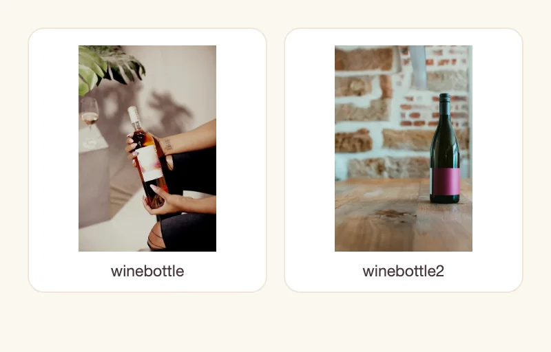

## Home and welcome

### Wine type glasses

Shortcuts to reds, whites, rosés and sparkling wines on the home page.

- Web: `frontend-react/src/shared/assets/glasses/`
- App: `frontend-mobile/assets/images/common/`

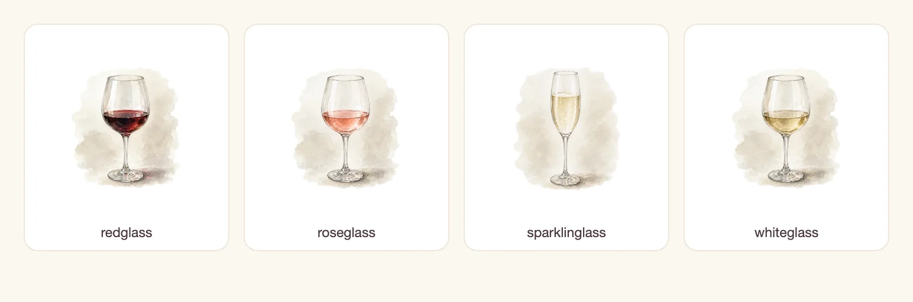

### Home hero

At the top of the home page; on the web also in the sign-in editorial panel. On
the web it is `home-hero.webp` and is preloaded in `index.html`; in the app it
is `common/main.webp`.

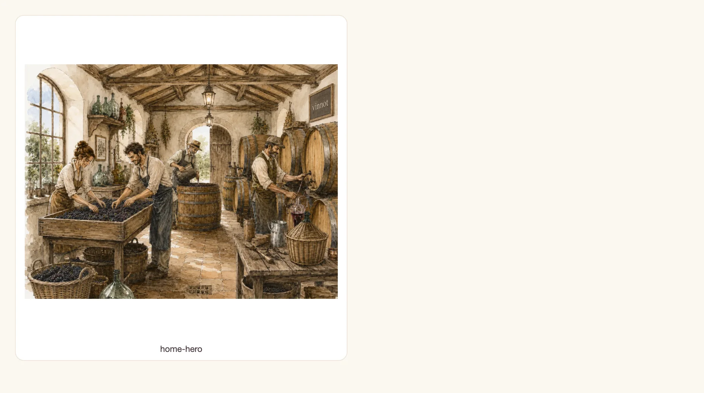

### App welcome

Watercolor vineyard on the app's onboarding welcome screen.

- App: `frontend-mobile/assets/images/onboarding/vineyard.webp`

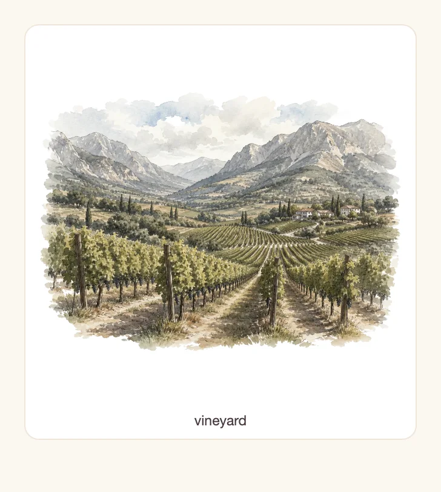

### Social patches

Decorative shapes behind the social links in the web footer, in rotation.

- Web: `frontend-react/src/shared/assets/social/`

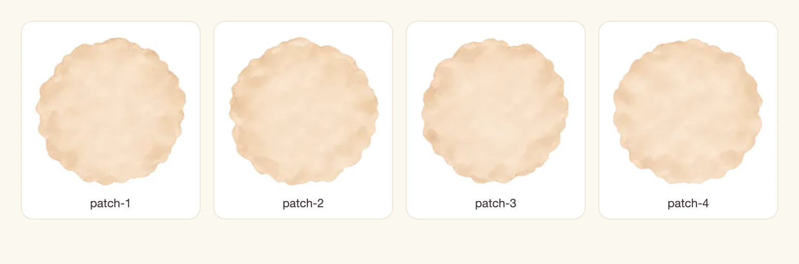

## Brand and external channels

### Mark and wordmark

The Vinnot glass mark and wordmark in the header and the brand lockup, the
grape loading mark, the app launch screen and the watermark of the shared-link
page.

- Web: `frontend-react/public/images/brand/`
- App: `frontend-mobile/assets/brand/`

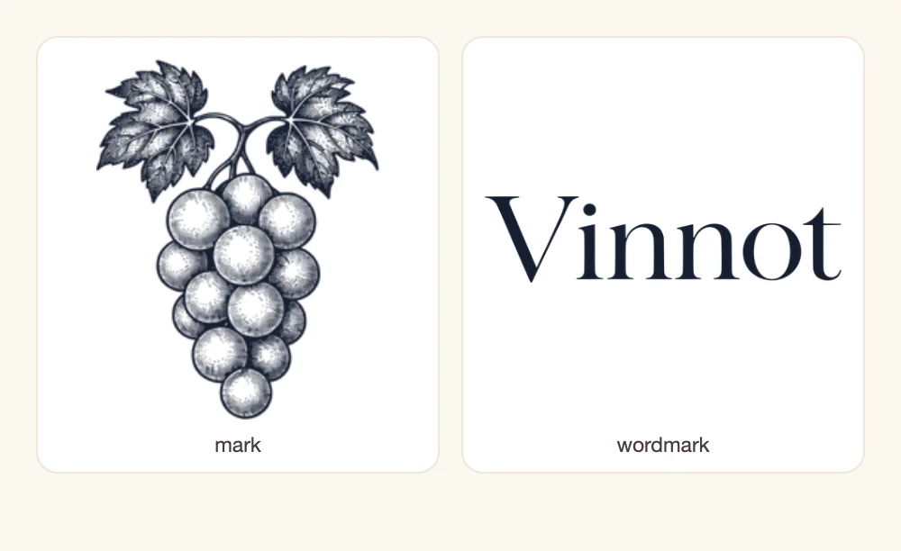

### App icon and splash

Store and home-screen icon, Android adaptive icon foreground, Android
notification silhouette (white, shown on a dark tile), native splash screen and
the Expo web favicon. `frontend-mobile/app.config.ts` configures them.

- App: `frontend-mobile/assets/`

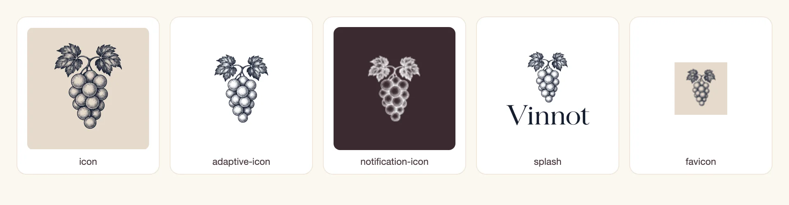

### Web favicon

`frontend-react/public/favicon.png` is the tab icon and the icon of the admin
notification preview.

### Email

Hero image of every branded email (verification, password reset, events, wine
submissions). It is a PNG because email clients do not reliably show WebP. The
backend uses it from the public web.

- Web: `frontend-react/public/images/email/winery-v1.png`

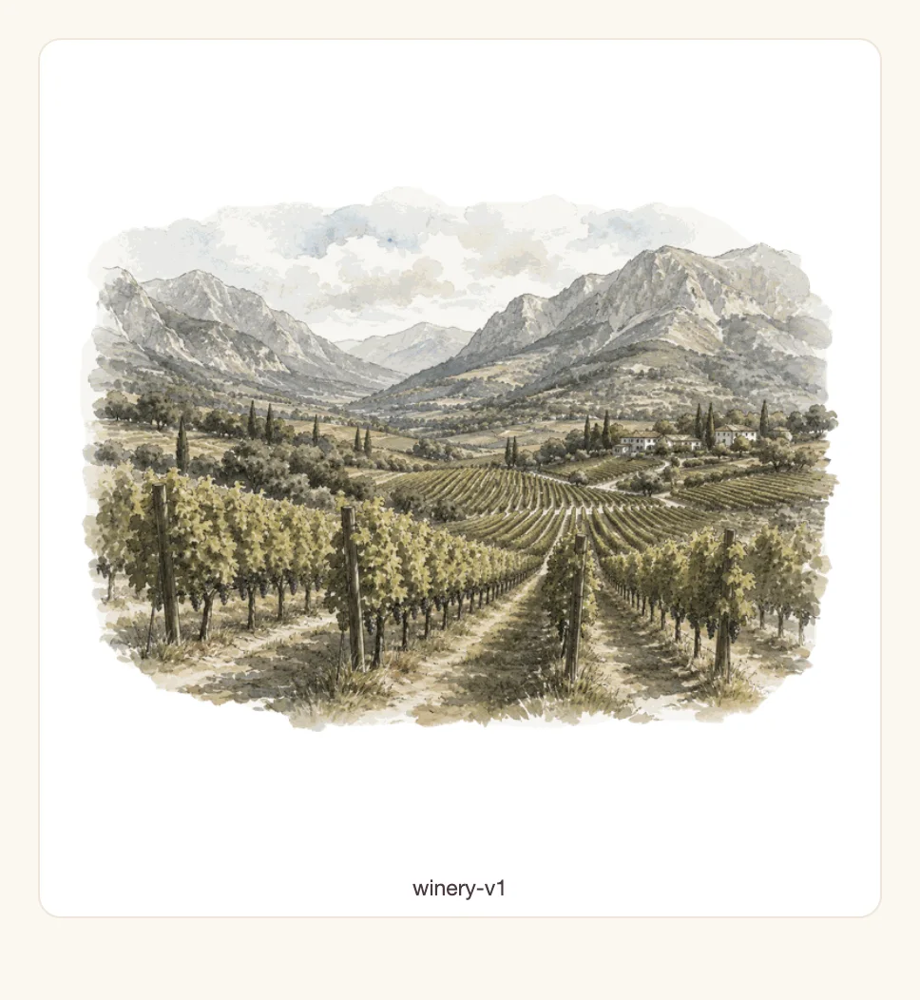

### Shared links

Logo, store badges and fallback preview (Open Graph) of the page the backend
serves for shared links. The store badges also appear on the web label scan
page.

- Web: `frontend-react/public/share-assets/`

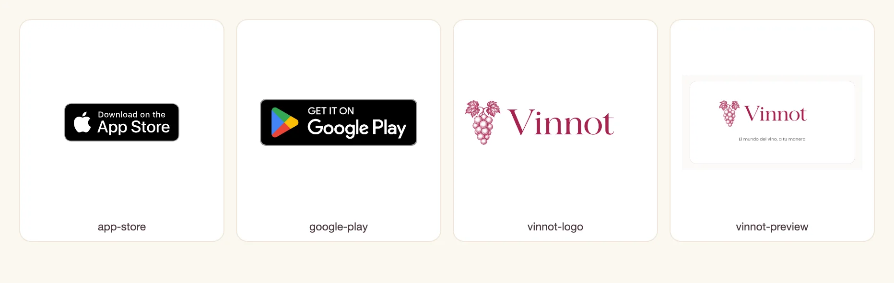

## Source files and unused files

These files are not shown in the app. They have no sheet.

| Files | Status |
|---|---|
| `frontend-mobile/assets/images/common/*.png` (19), `winery/*.jpg` (4), `mock/*.jpg` (2) | Masters: `scripts/optimize-static-artwork.py` builds the illustrations, route covers, fallback bottles and email hero from them. |
| `frontend-react/public/images/icons/`, `frontend-mobile/assets/images/icons/` (79 Reshot SVGs) | Unused in both apps. |
| `frontend-mobile/assets/images/illustrations/*.svg` (4 vector logos) | Unused. |
| `frontend-mobile/assets/brand/splash.svg`, `adaptive-icon-foreground.svg` | Unused. |
| `frontend-react/public/favicon.svg`, `icons.svg` | Unused (Vite template leftovers). |
