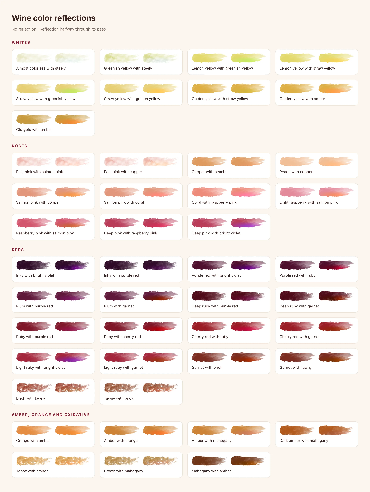
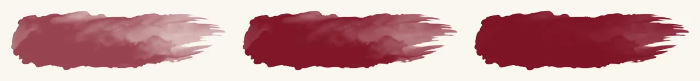

# Illustration, brand and imagery

Vinnot's art is **watercolor raster on a transparent background**. It sets the
mood of a state or a section; the UI around it carries the information. This
page covers the illustration rules, the asset pipeline, the illustrated states,
the AI loading scenes and the brand marks.

Part of the [visual system](visual-system.md).

## Rules

| Do | Don't |
|---|---|
| Use the shared illustrations from `illustrations.ts` on each platform | Import the PNG masters from `frontend-mobile/assets/images/common` in UI code |
| Keep transparent WebP with the master's proportions | Flatten art onto a white or colored rectangle |
| Treat state art as decorative (`alt=""`, no accessible label) and put the meaning in the title | Write text inside an illustration |
| Use one illustration per state or empty screen | Stack illustrations or use them as list decoration |
| Keep catalog and user photos remote, behind `ImageWithFallback` | Bundle catalog photos in the app or the web build |

## Asset pipeline

[`scripts/optimize-static-artwork.py`](../../../../scripts/optimize-static-artwork.py)
builds every bundled derivative from the editable masters; `--check` verifies
them without rewriting.

| Asset | Master | Derivative | Budget checked |
|---|---|---|---|
| 13 state and section illustrations | `frontend-mobile/assets/images/common/<name>.png` (transparent) | `frontend-mobile/assets/images/illustrations/<name>.webp`, byte-identical copy in `frontend-react/src/shared/assets/illustrations/` | WebP RGBA, longest side ≤ 960 px, < 260 kB, transparent edge, same aspect ratio as the master, identical web/app bytes |
| Category glasses (red, white, rosé, sparkling) | `frontend-mobile/assets/images/common/*glass.webp` | byte-identical copies in `frontend-react/src/shared/assets/glasses/` | — |
| Seals (11 tiers) | art approved in #455 | `frontend-mobile/assets/images/emblems/<slug>.webp` and `frontend-react/public/images/emblems/<slug>.webp` (`brote` … `vinnot`) | Transparent WebP, 256 × 256 |
| Rating glasses, wines and bottles | art approved in #455 | `frontend-mobile/assets/images/rating/` and `frontend-react/public/images/rating/`: `glass-{bordeaux,rose,tulip,flute}`, `wine-{red,ruby,rose,white,amber,sparkling}` (same canvas as their glass), `bottle-{dark,clear-white,clear-rose,clear-amber,sparkling}` | Transparent WebP, 360 px high |
| Route photos | `frontend-mobile/assets/images/winery/*.jpg` | `frontend-react/src/shared/assets/routes/*.webp`, 1280 × 960 | — |
| Email hero | `common/winery.png` | `frontend-react/public/images/email/winery-v1.png`, indexed PNG 720 × 540 | < 180 kB, transparent |

Consumers:

- Web imports through [`src/shared/illustrations.ts`](../../../../frontend-react/src/shared/illustrations.ts);
  Vite emits content-hashed URLs that the CDN caches immutably.
- App imports through [`src/shared/illustrations.ts`](../../../../frontend-mobile/src/shared/illustrations.ts);
  Metro bundles them, so offline and error states render without a download.
- Email uses PNG because email clients do not support WebP uniformly. Version
  the file name when the art changes, publish the web assets before the backend
  that references them, and keep the old `/images/illustrations/winery.jpg`
  object in the bucket for historical emails.

The 31 AI loading layers (`frontend-mobile/assets/images/loading/*.webp`) are
not produced by the script. The web keeps byte-identical copies in
[`frontend-react/src/shared/assets/loading/`](../../../../frontend-react/src/shared/assets/loading);
change both copies together.

## Illustration catalog

| Key | File | Used for |
|---|---|---|
| `forbidden` | `403.webp` | 403 state |
| `notFound` | `404.webp` | 404 state and not-found pages |
| `rateLimit` | `429.webp` | 429 state |
| `server` | `500.webp` | unknown server error |
| `unavailable` | `503.webp` | 502 / 503 state |
| `offline` | `noconection.webp` | network error |
| `timeout` | `timeout.webp` | timeout / 504 |
| `emptyCellar` | `emptycellar.webp` | empty cellar |
| `noWines` | `nowines.webp` | wine search with no results |
| `noTickets` | `notickets.webp` | no tickets yet |
| `noReviews` | `noreviews.webp` | no reviews yet, invite the first one |
| `community` | `community.webp` | community lists with nothing to show |
| `partnerEvents` | `partnerevents.webp` | organizer with no events yet |
| `notifications` | `notifications.webp` | empty notification inbox |
| `event`, `route`, `winery`, `legal`, `privacy` | `event.webp`, `routes.webp`, `winery.webp`, `legal.webp`, `privacy.webp` | section and legal pages |

## Illustrated states

`IllustratedState` renders one illustration, a title and a description for a
state kind; `QueryErrorState` adds the retry. Both platforms share the
classification in `resolveIllustratedState`
([web](../../../../frontend-react/src/presentation/feedback/illustratedState.ts),
[app](../../../../frontend-mobile/src/presentation/feedback/illustratedState.ts)).
The web keeps the copy in `stateCopy`; the app reads it from the locale files
(`illustratedState.<kind>.title` / `.description`, through
`illustratedStateCopyKeys`), so it follows the app language.

| Condition | Kind | Illustration | Retry in `QueryErrorState` |
|---|---|---|---|
| HTTP 401 | `session` | none | no |
| HTTP 403 | `forbidden` | 403 | no |
| HTTP 404 | `notFound` | 404 | no |
| HTTP 429 | `rateLimit` | 429 | yes |
| code `TIMEOUT` or HTTP 504 | `timeout` | timeout | yes |
| HTTP 502 or 503 | `unavailable` | 503 | yes |
| code `NETWORK_ERROR` | `offline` | no connection | yes |
| anything else | `server` | 500 | yes |

The retry button stays disabled while the error carries a future `retryAt`
(`useRetryDeadline`).

Sizes: the web art is `max-h-40` compact and `max-h-64 sm:max-h-72` full,
inside a `max-w-2xl` column; the app art is 150 pt compact and 240 pt full,
inside a 640 pt column. Compact is for a failed block inside a page; full is
for a whole route.

Empty lists on the web use `EmptyState illustration="<key>"` (art `h-40
sm:h-48`, decorative): wine search `noWines`, reviews `noReviews`, my tickets
`noTickets`, organizer events `partnerEvents`, community lists `community`,
events `event`, routes `route`, wineries `winery`, cellar `emptyCellar`.

Empty lists in the app use `EmptyState illustration="<key>"` (art 180 pt high,
`contentFit="contain"`, decorative and hidden from screen readers; the title is
a header). It replaces the icon well: wine search, winery wines and wine detail
`noWines` (`server` when the search fails), cellar `emptyCellar`, reviews
`noReviews`, my tickets `noTickets`, events and event detail `event`, routes and
route detail `route`, wineries `winery`, organizer events `partnerEvents`,
community and moderation lists `community`, notification history
`notifications`. Every illustration has a transparent background, so it sits on
the screen color without a white box.

## AI loading scenes

Applies to the web and the app. While an AI wine profile or a comparison is
generated, both play a watercolor journey instead of a spinner. The app files:

| Part | File |
|---|---|
| Card, heading, step counter and step list | [`WineProcessJourney.tsx`](../../../../frontend-mobile/src/presentation/features/wine/WineProcessJourney.tsx) |
| Progress ring (176 pt) and scene timing | [`WineProcessScene.tsx`](../../../../frontend-mobile/src/presentation/features/wine/WineProcessScene.tsx) |
| Watercolor layers on a 128 pt stage | [`WineProcessSceneArt.tsx`](../../../../frontend-mobile/src/presentation/features/wine/WineProcessSceneArt.tsx) |
| Look per wine type | [`wineSceneLook.ts`](../../../../frontend-mobile/src/presentation/features/wine/wineSceneLook.ts) |
| Stage intervals and minimum duration | [`wineProcessTiming.ts`](../../../../frontend-mobile/src/presentation/features/wine/wineProcessTiming.ts) |
| Visibility after the answer | [`useProcessJourneyVisibility.ts`](../../../../frontend-mobile/src/presentation/hooks/useProcessJourneyVisibility.ts) |

Web files, one shared component used by `AiProfileLoadingSteps` and
`CompareLoadingSteps`:

| Part | File |
|---|---|
| Card, eyebrow, title, ring, current step and step list | [`AiProcessScene.tsx`](../../../../frontend-react/src/presentation/components/features/wine/aiProcess/AiProcessScene.tsx) |
| Scene layers, motion tracks, look per wine type | [`aiProcessScenes.ts`](../../../../frontend-react/src/presentation/components/features/wine/aiProcess/aiProcessScenes.ts) |
| Drawing and CSS keyframes per part | [`AiProcessSceneArt.tsx`](../../../../frontend-react/src/presentation/components/features/wine/aiProcess/AiProcessSceneArt.tsx) |

The web ports the app's composition: the same layers on a 128 px stage inside
a 176 px ring, the same gestures. Each part's motion is sampled into CSS
`@keyframes`, so every part (cork, corkscrew, stream, wine level, wisps, pen,
balance, magnifier, bubbles) moves on its own.

Scenes:

- AI profile: `uncork`, `visual`, `bouquet`, `taste`, `report`.
- Comparison: `compare`, `structure`, `contrast`, `recommendation`. The web
  comparison has five steps (keys `compare.steps.*`): `uncork`, `compare`,
  `structure`, `contrast`, `recommendation`.

The scenes follow the wine type, read from the API code in any casing (`ROSE`
and `rose` are the same wine); in a comparison each glass follows its own
wine:

| Wine type | Glass | Wine | Bottle | Grapes |
|---|---|---|---|---|
| red (default while the type is unknown) | bordeaux | red | dark | red |
| fortified | bordeaux | ruby | dark | red |
| rosé | rosé | rosé | clear | red |
| white | tulip | white | clear | white |
| orange, dessert | tulip | amber | clear | white |
| sparkling | flute | sparkling | sparkling (cork pops) | white |

Timing rules:

- A profile stage stays 1.8 s on screen; a comparison stage 2.5 s on the app
  and 2.2 s on the web (five steps). The last stage stays at least 3.2 s on the
  app.
- After a successful answer the journey stays visible until its minimum
  duration (10.4 s for the profile, 10.7 s for the comparison) so every stage
  reads. A failure hides it at once (`cancel`). The web shows the journey while
  the request is pending and has no minimum duration.
- While the answer is pending on the last step, `report` and `recommendation`
  replay their gesture after a pause.
- With reduced motion each scene shows its final pose and the ring jumps to the
  current step (web: `useReducedMotion`, followed live).
- The card is a `progressbar` with the title and the current step as its label
  and the step number as its value (web: `aria-valuetext` "02 / 05 · step").

## Brand marks

| Mark | Web | App |
|---|---|---|
| Grape cluster + wordmark | [`VinnotBrand.tsx`](../../../../frontend-react/src/presentation/components/brand/VinnotBrand.tsx): PNGs in `public/images/brand/` used as CSS masks tinted with `currentColor` | [`VinnotBrand.tsx`](../../../../frontend-mobile/src/presentation/features/auth/VinnotBrand.tsx): `assets/brand/mark.png` and `wordmark.png` |
| Proportions | mark 338 : 431, wordmark 702 : 171 | same |
| Loading mark | [`GrapeLoadingMark.tsx`](../../../../frontend-react/src/presentation/components/brand/GrapeLoadingMark.tsx), used by `Spinner size="lg"` | [`WineGlassMark.tsx`](../../../../frontend-mobile/src/presentation/components/brand/WineGlassMark.tsx) with `animated`, used by the launch screen and wine results |

The loading mark paints the grapes upward from the base in a 3.4 s cycle,
holds the full color and fades before repeating. It is decorative, never a
measure of request progress, and runs only while something loads; headers,
footers and installed icons stay static. Reduced motion shows the complete
static mark. Launcher icons and the native splash cannot run it.

The owner-supplied SVG masters stay intact (`frontend-mobile/assets/brand/*.svg`).

## Wine color brushstroke

The AI profile's visual analysis shows a watercolor brushstroke in the color its
text describes: the main color across the body of the stroke and the rim color
toward its tail, the way wine looks in a glass tilted over a white background.
The color line is free text written for each wine (profile-v13 varies its
wording and opening), and the backend reads it into codes:

- `visualColorTone`: the main hue. A line that opens with the hue takes it from
  the text before the first comma or "with": "pale yellow with greenish
  highlights" is straw with a green reflection. A line that opens with the
  light, the glass, the tears or the rim ("A thin violet rim frames an almost
  black core") takes it from the first clause about the core, or else from the
  first hue clause that is not about the rim or the reflections.
- `visualColorIntensity`: how deep the core reads, `PALE`, `MEDIUM` or `DEEP`,
  from the main hue or the clause right after it. Any natural wording counts:
  pale, light, translucent, watery, "deja ver el fondo de la copa"; medium,
  "capa media"; deep, intense, dark, opaque, almost black, "capa alta", "no deja
  ver el fondo". Mixed steps lean to their side ("media-baja" is pale,
  "medium-high" is deep). It is null when the core names no depth; the swatch
  then keeps its base stroke.
- `visualRimTone`: the first later nuance that names another tone of the same
  wine family ("with tawny reflections at the rim"). A tone the line gives the
  core is not the rim: in "straw yellow with a slightly more golden core than
  rim, lemon reflections" the rim is lemon, not gold. When there is none, the
  rim is the same color, more diluted.
- `visualReflectionTones`: every tone the nuances name, in text order ("with
  violet reflections and tawny hints" → violet, then tawny). Copper is tawny on
  reds and ambers, amber on whites and copper pink on rosés.
- `visualHighlights`: whether the line names a play of light (reflections,
  glints, rim, brightness, hints).

The brushstroke goes from the main hue in the body to the rim tone at the tail.
When the line names reflections, a soft wash of the reflection's color runs along
the lower edge of the stroke from left to right, like the edge of the wine taking
on that tone when the glass is tilted; when it names several ("violet reflections
and tawny hints"), each pass shows the next one, one every 4.2 s, after the 0.9 s
in which the stroke paints itself. The wash tints the hue and keeps the watercolor
shading, so it also shows on light whites and rosés; violet is painted a little
lighter, with soft light, so it reads as the violet of wine and not as paint. When
the line names only brightness and no other tone, the wash is the same hue,
lighter. With reduced motion the wash stays still in the middle of the stroke.

Every combination current profiles use, with the stroke without a reflection
and with the reflection halfway through its pass:

When the line names no hue, no stroke is shown and only the text remains.
A hue the line rules out ("without brick tones", "no old-gold tones") is not
painted. When the line opens with adjectives that name no hue ("Deep, nearly
opaque purple core…"), the main hue is the first one it names. Translucent
lightens the hue unless the line gives a medium depth; black cherry and dark
cherry are deep ruby. A light or pale raspberry or strawberry pink ("rosa
frambuesa claro", "very pale strawberry pink") is light raspberry, not the full
raspberry. Old gold ("oro viejo") is its own deeper, browner gold, in the core or
at the rim. Chestnut shows as mahogany on ambers and as tawny on reds; magenta
shows as violet on reds and as raspberry on rosés.

Place, age and winemaking bring finer hues, each with its own tone: near-black
inky reds from high altitude or Tannat, a bright young violet (unlike the dark
purple), plum, brick on old reds (redder than tawny); almost colorless and steely
whites from cool climates, topaz on aged sweet whites, brown on aged whites and
generosos (lighter than mahogany, which keeps Pedro Ximénez); orange skin-contact
wines and dark amber; and copper, coral, peach and deep rosés. Black cherry
("cereza negra") stays deep ruby and cherry stays cherry; a "rosa cereza claro"
is a deep rosé.

| Code | Tone | Example text |
| --- | --- | --- |
| `WHITE_WATER` | Almost colorless, watery | Water-white, almost colorless with green glints |
| `WHITE_STEEL` | Steely or silvery greenish | Steely pale lemon with silver glints |
| `WHITE_GREEN` | Pale greenish yellow | Pale greenish yellow |
| `WHITE_LEMON` | Lemon yellow | Pale lemon yellow with green glints |
| `WHITE_STRAW` | Straw yellow | Straw yellow with greenish highlights |
| `WHITE_GOLD` | Golden yellow | Intense golden yellow |
| `WHITE_OLD_GOLD` | Old gold | Old gold with amber glints |
| `WHITE_TOPAZ` | Topaz, aged sweet or late-harvest whites | Topaz gold with amber glints |
| `ORANGE` | Orange, skin-contact wines | Deep orange with copper glints |
| `AMBER` | Amber | Copper-gold amber with golden glints |
| `AMBER_DARK` | Dark amber | Dark amber with a mahogany rim |
| `WHITE_BROWN` | Brown, aged whites and generosos | Light brown with amber glints |
| `MAHOGANY` | Mahogany or ebony | Dark mahogany with an olive-green rim |
| `ROSE_PALE` | Pale pink | Pale pink with bright highlights |
| `ROSE_COPPER` | Copper or onion skin | Pale copper pink with onion-skin glints |
| `ROSE_SALMON` | Salmon | Pale salmon pink with copper glints |
| `ROSE_PEACH` | Peach or apricot | Pale peach pink with an apricot rim |
| `ROSE_CORAL` | Coral | Pale coral pink |
| `ROSE_RASPBERRY_LIGHT` | Light or pale raspberry or strawberry pink | Pale raspberry pink with a salmon rim |
| `ROSE_RASPBERRY` | Raspberry, strawberry or cherry pink | Medium raspberry pink |
| `ROSE_DEEP` | Deep pink or clarete | Deep pink with violet glints |
| `RED_VIOLET_BRIGHT` | Bright young violet | Bright violet-purple with a magenta rim |
| `RED_PURPLE` | Purple red | Deep purple-red |
| `RED_INKY` | Near-black, inky | Almost black purple with a vivid violet rim |
| `RED_PLUM` | Plum | Deep plum red with a ruby rim |
| `RED_RUBY_LIGHT` | Light ruby | Light ruby red |
| `RED_CHERRY` | Cherry red | Medium cherry red with a ruby rim |
| `RED_RUBY` | Medium ruby | Medium-intensity ruby red |
| `RED_RUBY_DEEP` | Deep ruby, black cherry or dark cherry | Deep ruby red with violet highlights |
| `RED_GARNET` | Garnet | Garnet red with an orange rim |
| `RED_BRICK` | Brick, orange-tinged old reds | Brick red with an orange rim |
| `RED_TAWNY` | Tawny | Tawny brick red with an amber rim |

The stroke is a watercolor mask (720 × 208 px, white with transparency following
the pigment density) over a gradient from the main color to the rim color. Every
wine uses the same brush shape; `strokeFor` in `shared/wineColorPalette.ts` picks
how much pigment it carries. The light and dense masks are the base mask with less
or more pigment, so all three cover exactly the same outline:

| Load | File | When |
| --- | --- | --- |
| Light: a watery, transparent wash | `wine-colors/stroke-light.webp` | `PALE`; without a named depth, `WHITE_WATER`, `WHITE_STEEL`, `WHITE_GREEN` and `ROSE_PALE` |
| Medium | `wine-colors/stroke.webp` | `MEDIUM`, and every other tone without a named depth |
| Dense: a loaded, almost opaque stroke | `wine-colors/stroke-dense.webp` | `DEEP`; without a named depth, `RED_INKY`, `RED_RUBY_DEEP`, `MAHOGANY` and `AMBER_DARK` |

 Each code has a fixed pigment and reflection glint in
`shared/wineColorPalette.ts`, the same on the web and in the app; their hue order
follows the Wine Folly color-of-wine chart, with saturation and lightness tuned to
read on the cream cards (garnet leans orange, inky is a very dark violet, brown
sits between amber and mahogany). The web uses a
CSS mask; the app uses a Skia alpha mask. When it appears, the stroke paints
itself left to right in 0.9 s, unless the system asks for reduced motion. It
shows 240 px wide on the web and 220 pt in the app, and its alternative text is
the color line.

## AI profile illustrations

Each AI profile section has its own watercolor illustration, with no paper
behind it, so that only the object changes when it rotates, not the card:

- **Aromatic profile:** primary and secondary aromas appear one at a time in the
  same spot (raspberry, dried herbs, black pepper…), every 4.5 s, with a soft
  fade: the leaving one is gone before the next appears, and the aroma's name
  below.
- **Flavors:** the same with primary and secondary flavors. The palate structure
  bars fill from zero when they appear.
- **Pairings:** the dishes rotate the same way (lamb, roast chicken, risotto…).
- **Serving:** each box shows its illustration on top with its title and text
  centered below: the thermometer rising to the recommended temperature (0 to
  25 °C scale), the suggested glass, the decanter when decanting helps and the
  cellar when there is aging potential.

The backend classifies the profile texts and sends `profileArt` with one code per
illustration (see [AI architecture](../../modules/ai/architecture.md)). A
descriptor without a code shows no drawing, never a wrong one. The illustration
must show what the text says, qualifiers included: "roasted red pepper" shows
roasted red pepper strips, not a green bell pepper, "apricot" an apricot, not a
peach, and a pumpkin risotto shows no mushrooms. For dishes, the form of the dish
(pizza, empanada, pâté, rice, risotto, curry, tart, pasta) wins over its filling:
"lamb empanada" is an empanada. A dish with no faithful illustration
(cheesecake, fruit salad) shows nothing. A red, black or red-variety
grape ("red grape", "uva Corvina", "ripe Barbera grape") is a red grape, never
the green one; black or dark cherry is a near-black cherry, white pepper is not
black pepper, and a meat pie, omelette, breaded cutlet (milanesa, schnitzel) or
venison is its own dish, not the steak or lamb its filling names. A white or
honeydew melon is not the orange cantaloupe, and a goat cheese named with its age
or milk in between ("queso semiduro de cabra") is goat cheese. The illustrations are
decorative: the text already names each aroma, flavor and dish, so they are
hidden from screen readers.

The clients list only codes with a bundled drawing and drop any other code, so
a descriptor shows no drawing rather than a wrong one. A new code needs its art in
`profile-art/` and its key in `wine.profile-art.ts` on each platform (and the
static import in the mobile `profileArt.ts`).

There are 69 notes (fruits, flowers, herbs, spices, earth, oak, sweet notes and
a mixed fruit for a generic "fruits"), 35 dishes (mushrooms and olives included)
and 12 serving pieces: 9 glasses (flute, sparkling tulip, red balloon, Bordeaux,
white tulip, broad white bowl, rosé, dessert or fortified, and universal tasting
glass), the decanter, a freshly uncorked bottle (when decanting is not needed)
and the cellar, in `profile-art/{notes,dishes,serving}/` as 192 px
transparent WebP. They show at 96 px on the web and 88 pt in the app. With
reduced motion there is no rotation or animation: a still row of up to 4
illustrations on the web and 3 in the app, and the thermometer and bars appear
already filled.

## Social media

The web footer links Vinnot's official Instagram, Facebook, Threads and TikTok
profiles (`shared/config/socialProfiles.ts`). Each official logo is drawn
unmodified, in the text's wine color, on an illustrated cream patch in the same
watercolor style. The links open in a new tab and their accessible name is
"Vinnot on <network>".

## Photos

Catalog, winery, event and user images are remote. Render them with
`ImageWithFallback`
([web](../../../../frontend-react/src/presentation/components/ui/ImageWithFallback.tsx),
[app](../../../../frontend-mobile/src/presentation/components/ui/ImageWithFallback.tsx)):
the fallback keeps the frame size so the layout does not jump. The web shows a
placeholder image, then a wine-50 surface if that also fails; the app shows a
wine-tinted surface.

## Transactional email

The backend applies one template,
[`branded-message.html`](../../../../backend/src/main/resources/email/branded-message.html):
burgundy banner, PNG logo, vineyard art, editorial heading, system body text
and an informational footer. Text and actions never depend on images or
advanced CSS. See [account and profile](../../modules/users/architecture.md#transactional-email-presentation)
for the contract, languages and local previews.
