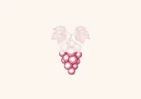
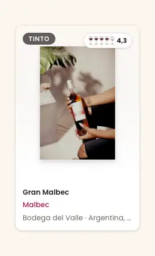
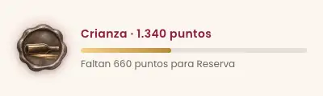
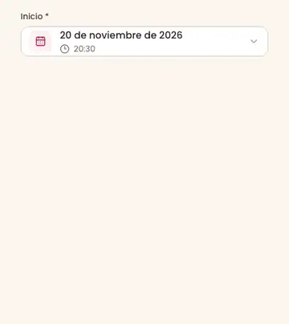
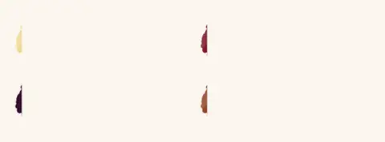
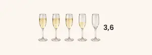
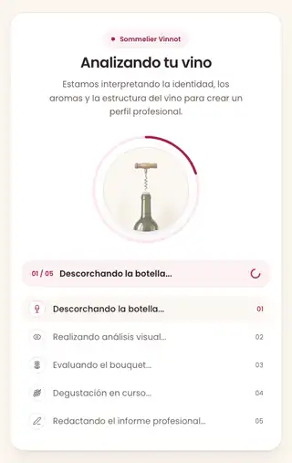
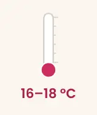
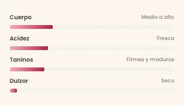
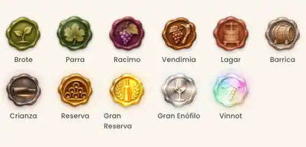

# Motion catalog

Every animation of the web (`frontend-react`) and the app (`frontend-mobile`),
grouped by purpose: what moves, where, what starts it, how long it takes, what
happens under reduced motion and where the code lives. The previews are
recordings of the real web components; when an animation is shared, the web
recording stands for both platforms and the entry states the app's own timings
where they differ. The [foundations](foundations.md#motion) keep the motion
principles and tokens.

Part of the [visual system](visual-system.md).

## Principles

1. **Motion explains a change of state.** It shows that something is loading,
   arrived, left or changed value. It never fakes progress or completion: the
   loaders are decorative cycles, never a percentage.
2. **Short for controls, calm for content.** Controls answer in 110–240 ms;
   content entrances take 300–1000 ms; decorative loops last seconds.
3. **One motion vocabulary on both platforms.** A shared animation keeps its
   timing on the web and the app unless the platform imposes its own (native
   stacks, `Modal`, `ActivityIndicator`).
4. **Reduced motion is honored.** With the system setting on, movement stops
   and every element shows its final state. The only exception is the app's
   `ActivityIndicator`: like Apple's own activity indicators, it keeps spinning
   because it is essential progress feedback.

## Tokens

| Platform | Where | What it defines |
|---|---|---|
| Web | [`globals.css`](../../../../frontend-react/src/shared/assets/styles/globals.css) | `transition-default` (150 ms, `cubic-bezier(0.4, 0, 0.2, 1)`) and every shared keyframe (grape loader, wine color swatch, profile art, thermometer, palate bars) |
| Web | Tailwind utilities | `duration-*`, `ease-*`, `animate-pulse` (2 s), `animate-spin` (1 s) and the `motion-reduce:` variant |
| App | [`motion.ts`](../../../../frontend-mobile/src/shared/theme/motion.ts) | `durations`, `easings`, `motionPresets`, `springConfigs` (listed in [foundations](foundations.md#motion)) |

Reading the tables: **Platform** says where the animation runs (Web, App or
Both); **Reduced motion** describes what the user sees when the system asks for
less motion. On the app, Reanimated 4 follows that setting by default
(`ReduceMotion.System`): entering animations and `withTiming` or `withSpring`
values jump to their final state. The rows say "Reanimated default" for that
case.

## 1. Loading and skeletons

*L1 Grape paint loader.*

*L2 Skeleton.*

| # | Animation | Platform | Where and trigger | Duration and easing | Reduced motion | Source |
|---|---|---|---|---|---|---|
| L1 | Grape paint loader | Both | `PageLoader` and `Spinner size="lg"` (web), `WineGlassMark` (app), while a page or a large block loads | Web: 3.4 s `linear` loop; a clip reveals the mark from the base to the leaves, holds and fades. App: 3400 ms `linear` loop, same cycle | Full static mark | [`GrapeLoadingMark.tsx`](../../../../frontend-react/src/presentation/components/brand/GrapeLoadingMark.tsx), [`globals.css`](../../../../frontend-react/src/shared/assets/styles/globals.css), [`WineGlassMark.tsx`](../../../../frontend-mobile/src/presentation/components/brand/WineGlassMark.tsx) (copy in [`features/auth`](../../../../frontend-mobile/src/presentation/features/auth/WineGlassMark.tsx)) |
| L2 | Skeleton | Both | `Skeleton` placeholders while a list or card loads | Web: `animate-pulse`, 2 s loop. App: opacity loop of 1200 ms (600 ms each way, default `Animated` ease-in-out) | Still block. The app reads the setting once, when the skeleton mounts | [`Skeleton.tsx`](../../../../frontend-react/src/presentation/components/ui/Skeleton.tsx), [`Feedback.tsx`](../../../../frontend-mobile/src/presentation/components/ui/Feedback.tsx) |
| L3 | Small spinners | Both | Web: `Button` loading, `Spinner` `sm`/`md`, `EntityPicker`, the admin route geocoder and the AI step label. App: `ActivityIndicator` | Web: `animate-spin`, 1 s `linear`. App: native indicator | Web: stops (`motion-reduce:animate-none`). App: keeps spinning, as essential progress feedback | [`Button.tsx`](../../../../frontend-react/src/presentation/components/ui/Button.tsx), [`Spinner.tsx`](../../../../frontend-react/src/presentation/components/ui/Spinner.tsx), [`EntityPicker.tsx`](../../../../frontend-react/src/presentation/components/ui/EntityPicker.tsx), [`AdminRouteStopsSection.tsx`](../../../../frontend-react/src/presentation/components/features/admin/route-form/AdminRouteStopsSection.tsx), [`AiProcessScene.tsx`](../../../../frontend-react/src/presentation/components/features/wine/aiProcess/AiProcessScene.tsx) |
| L4 | Cover image placeholder | Web | `CoverImage` while its source is pending | `animate-pulse`, 2 s loop | Still | [`CoverImage.tsx`](../../../../frontend-react/src/presentation/components/features/media/CoverImage.tsx) |
| L5 | Admin dashboard cards | Web | Metric cards while the dashboard loads | `animate-pulse`, 2 s loop | Still | [`AdminDashboardPage.tsx`](../../../../frontend-react/src/presentation/pages/admin/AdminDashboardPage.tsx) |
| L6 | "Few left" badge | Web | Event detail hero when few tickets remain | `animate-pulse`, 2 s loop | Still | [`EventDetailsHero.tsx`](../../../../frontend-react/src/presentation/pages/events/EventDetailsHero.tsx) |

## 2. Feedback

*F1 Notice and toast.*

*F8 Card hover.*

*F9 Tier-up celebration.*

*F10 Points bar shine.*

| # | Animation | Platform | Where and trigger | Duration and easing | Reduced motion | Source |
|---|---|---|---|---|---|---|
| F1 | Notice and toast | Both | A toast appears after an action; inline notices (`AlertBanner`) on mount | Enter 240 ms, `translateY -8 → 0` with fade. Exit 180 ms, `translateY → -4` with fade. Web: enter `cubic-bezier(.2,.7,.3,1)`, exit `ease-in`. App: same timings, translate `Easing.out(cubic)` for both | Appears and leaves without movement. The app follows changes to the setting live | [`feedback.css`](../../../../frontend-react/src/presentation/components/feedback/feedback.css), [`ToastContainer.tsx`](../../../../frontend-react/src/presentation/components/feedback/ToastContainer.tsx), [`ToastProvider.tsx`](../../../../frontend-mobile/src/presentation/providers/ToastProvider.tsx) |
| F2 | Control transitions | Web | Color, border and shadow changes on hover and focus: `Button`, fields, `Pagination`, the notice close button | 150 ms; `transition-default` and Tailwind default `cubic-bezier(0.4, 0, 0.2, 1)`; the notice close button uses `ease` | Unchanged: color changes, no movement (the notice close button drops its transition) | [`globals.css`](../../../../frontend-react/src/shared/assets/styles/globals.css), [`buttonStyles.ts`](../../../../frontend-react/src/presentation/components/ui/buttonStyles.ts) |
| F3 | Press scale | App | `Button` scales to 0.96, `PressableCard` to 0.98, on press in; back to 1 on release | 120 ms (`motionPresets.*.duration`), Reanimated default easing; `Button` adds an impact haptic, `PressableCard` a selection haptic | Reanimated default: no scale; haptics stay | [`Button.tsx`](../../../../frontend-mobile/src/presentation/components/ui/Button.tsx), [`Card.tsx`](../../../../frontend-mobile/src/presentation/components/ui/Card.tsx) |
| F4 | Spring press | App | `MotionPressable` (home tiles, wine routes, admin user rows) scales to 0.975 | Spring: damping 18, stiffness 260, mass 0.7 | Reanimated default: no scale | [`MotionPressable.tsx`](../../../../frontend-mobile/src/presentation/components/ui/MotionPressable.tsx) |
| F5 | Field focus glow | App | `TextField` glow and border on focus and blur | Focus 200 ms, blur 150 ms, Reanimated default easing | Reanimated default: glow appears without fading | [`TextField.tsx`](../../../../frontend-mobile/src/presentation/components/ui/TextField.tsx) |
| F6 | Vintage field list | App | `VintageField` chevron turns and the option list fades on open | Chevron 180 ms; list in 160 ms, out 120 ms | Chevron flips at once; list without fade | [`VintageField.tsx`](../../../../frontend-mobile/src/presentation/components/ui/VintageField.tsx) |
| F7 | Hover rise and press scale | Web | `RatingStars` star grows to 110 % on hover; home hero buttons rise 2 px; the points seal button grows to 1.04; sidebar links and home tiles shrink on press (`active:scale`) | Stars 150 ms; hero buttons 300 ms; seal button 0.2 s `ease`; press 200–300 ms | Hero buttons, home tiles and the seal button stay in place; the star still grows on hover, without a transition; the sidebar link press scale still animates | [`RatingStars.tsx`](../../../../frontend-react/src/presentation/components/ui/RatingStars.tsx), [`HomePage.tsx`](../../../../frontend-react/src/presentation/pages/public/HomePage.tsx), [`userBadge.css`](../../../../frontend-react/src/presentation/components/features/points/userBadge.css), [`AppSidebar.tsx`](../../../../frontend-react/src/presentation/components/layout/AppSidebar.tsx) |
| F8 | Card hover | Web | Wine and event cards lift 4 px, wine route cards 6 px, cellar cards only deepen their shadow; the image or bottle grows to 105 % | Lift 300 ms `ease-out`; image 500 ms `ease-out` | No lift and no zoom, in every card | [`WineCard.tsx`](../../../../frontend-react/src/presentation/components/features/wine/WineCard.tsx), [`EventCard.tsx`](../../../../frontend-react/src/presentation/components/features/event/EventCard.tsx), [`WineRouteCard.tsx`](../../../../frontend-react/src/presentation/components/features/wineRoute/WineRouteCard.tsx), [`CellarWineCard.tsx`](../../../../frontend-react/src/presentation/components/features/cellar/CellarWineCard.tsx) |
| F9 | Tier-up celebration | Both | The first time a points tier is reached, a full-screen card reveals the new seal | Web: seal reveal 0.9 s `cubic-bezier(.2,.9,.25,1.2)` from `scale(.4) rotate(-12deg)`, then the seal loops (D11). App: `Modal` fade, seal `ZoomIn` spring (damping 14), copy fades in after 350 ms, success haptic | Web: 0.4 s fade, still seal. App: seal fades in, copy without delay, still seal | [`userBadge.css`](../../../../frontend-react/src/presentation/components/features/points/userBadge.css), [`PointsCelebrationHost.tsx`](../../../../frontend-react/src/presentation/components/features/points/PointsCelebrationHost.tsx), [`TierCelebration.tsx`](../../../../frontend-mobile/src/presentation/features/points/TierCelebration.tsx) |
| F10 | Points bar shine | Web | Progress bar to the next tier (`PointsTierSummary`: profile and points page) | Gold shine 3.2 s `linear` loop; width change 0.6 s `ease` | No shine, width changes at once | [`userBadge.css`](../../../../frontend-react/src/presentation/components/features/points/userBadge.css), [`PointsTierSummary.tsx`](../../../../frontend-react/src/presentation/components/features/points/PointsTierSummary.tsx) |

## 3. Navigation and sheets

*N8 Sidebar drawer.*

*N10 Date and time popover.*

| # | Animation | Platform | Where and trigger | Duration and easing | Reduced motion | Source |
|---|---|---|---|---|---|---|
| N1 | Stack push | App | Pushing a screen: `slide_from_right` in the main, wine and event stacks; the platform default push in the routes, admin and partner stacks | Native stack default | Fade instead of slide | `frontend-mobile/app/(app)/_layout.tsx`, `app/(app)/(tabs)/wines/_layout.tsx`, `app/(app)/(tabs)/events/_layout.tsx`, `app/(app)/(tabs)/routes/_layout.tsx`, `app/(app)/admin/_layout.tsx`, `app/(app)/partner/_layout.tsx`, [`reducedMotion.ts`](../../../../frontend-mobile/src/presentation/components/ui/motion/reducedMotion.ts) |
| N2 | Auth stack | App | Login, register and recovery screens: `slide_from_bottom` | Native stack default | Fade instead of slide | `frontend-mobile/app/(auth)/_layout.tsx` |
| N3 | Root and onboarding stacks | App | Root navigator and onboarding: `fade` | Native stack default | Unchanged (a fade) | [`RootNavigator.tsx`](../../../../frontend-mobile/src/presentation/navigation/RootNavigator.tsx), `frontend-mobile/app/(onboarding)/_layout.tsx` |
| N4 | Dialog modals | App | React Native `Modal` with `animationType="fade"`: reauthentication, delete account, notification confirmation, image crop, tier-up | Platform default | Unchanged (a fade) | [`ReauthenticationDialog.tsx`](../../../../frontend-mobile/src/presentation/features/auth/ReauthenticationDialog.tsx), [`DeleteAccountDialog.tsx`](../../../../frontend-mobile/src/presentation/features/user/DeleteAccountDialog.tsx), [`NotificationConfirmDialog.tsx`](../../../../frontend-mobile/src/presentation/features/admin/notifications/NotificationConfirmDialog.tsx), [`ImageCropModal.tsx`](../../../../frontend-mobile/src/presentation/components/features/media/ImageCropModal.tsx) |
| N5 | Sheet modals | App | React Native `Modal` with `animationType="slide"`: filter sheet, admin detail, points welcome card, cellar review | Platform default | Fade instead of slide ([`reducedMotion.ts`](../../../../frontend-mobile/src/presentation/components/ui/motion/reducedMotion.ts)) | [`FilterSheet.tsx`](../../../../frontend-mobile/src/presentation/components/ui/FilterSheet.tsx), [`AdminDetailSheet.tsx`](../../../../frontend-mobile/src/presentation/features/admin/AdminDetailSheet.tsx), [`PointsWelcomeCard.tsx`](../../../../frontend-mobile/src/presentation/features/points/PointsWelcomeCard.tsx), [`CellarReviewSheet.tsx`](../../../../frontend-mobile/src/presentation/features/cellar/CellarReviewSheet.tsx) |
| N6 | Bottom sheet | App | `BottomSheetModal` (`@gorhom/bottom-sheet`): forms and detail overlays | Library default snap animation | The library follows the system setting (Reanimated) | [`AppProviders.tsx`](../../../../frontend-mobile/src/presentation/providers/AppProviders.tsx) |
| N7 | Map camera | App | Events map recenters on the selection; the location picker moves to the chosen point | Events 450 ms; location picker 250 ms | Unchanged (native map camera) | [`EventsScreen.tsx`](../../../../frontend-mobile/src/presentation/screens/events/EventsScreen.tsx), [`LocationPickerMap.tsx`](../../../../frontend-mobile/src/presentation/components/features/location/LocationPickerMap.tsx) |
| N8 | Sidebar drawer | Web | Menu button below `lg`: the drawer slides in from the left over a blurred backdrop; 150 ms later the links enter one by one | Drawer 300 ms `ease-out`; backdrop 300 ms; links 300 ms each, 50 ms apart, from `translateX(-16px)` | Drawer and links appear at once, without slide or stagger | [`AppSidebar.tsx`](../../../../frontend-react/src/presentation/components/layout/AppSidebar.tsx) |
| N9 | Modal backdrop | Web | `Modal` and `ConfirmDialog` mount with their backdrop | The backdrop declares `transition-opacity`; the dialog has no entrance animation | Unchanged | [`Modal.tsx`](../../../../frontend-react/src/presentation/components/ui/Modal.tsx) |
| N10 | Date and time popover | Web | Event form date field opens its calendar | 140 ms `ease-out`, from `translateY(-4px) scale(0.98)` with fade; closes at once | Opens without movement | [`EventDateTimeField.css`](../../../../frontend-react/src/presentation/components/features/event/EventDateTimeField.css) |
| N11 | Smooth scroll | Web | Wine search, wine routes and nearby events scroll to the top on page change; wine detail scrolls to reviews; compare scrolls to the journey | Browser smooth scroll | Instant scroll (`auto` or `instant`) | [`useWineSearchViewModel.ts`](../../../../frontend-react/src/presentation/pages/wines/useWineSearchViewModel.ts), [`useWineRoutesViewModel.ts`](../../../../frontend-react/src/presentation/pages/wine-routes/useWineRoutesViewModel.ts), [`useEventsNearbyViewModel.ts`](../../../../frontend-react/src/presentation/pages/events/useEventsNearbyViewModel.ts), [`useWineDetailsViewModel.ts`](../../../../frontend-react/src/presentation/pages/wines/useWineDetailsViewModel.ts), [`WineComparePage.tsx`](../../../../frontend-react/src/presentation/pages/wines/WineComparePage.tsx) |

## 4. Data visuals

*D1 and D2 Wine color stroke and reflection sheen, one brush per depth.*

*D3 Rating glass bubbles.*

*D4 Pour bottle rating, with the ghost demo and a drag.*

*D5 AI process journey.*

*D6 Rotating vignette.*

*D7 Single art appear.*

*D8 Serving thermometer.*

*D9 Palate and score bars.*

*D11 Seal effects, every tier.*

| # | Animation | Platform | Where and trigger | Duration and easing | Reduced motion | Source |
|---|---|---|---|---|---|---|
| D1 | Wine color stroke paint | Both | AI profile color line: the brushstroke paints itself from left to right when it appears | 900 ms `cubic-bezier(.3,.7,.3,1)`; the app matches | Full stroke, no paint | [Imagery: wine color brushstroke](imagery.md#wine-color-brushstroke) |
| D2 | Reflection sheen | Both | After the paint, a wash of each named reflection tone runs along the lower edge of the stroke, one tone per pass | 4.2 s per tone `cubic-bezier(.45,0,.4,1)`, starting after 900 ms; the app matches | A fixed wash, no movement | [Imagery: wine color brushstroke](imagery.md#wine-color-brushstroke) |
| D3 | Rating glass bubbles | Both | `GlassRating` with flutes (sparkling wine), glasses of 28 px or more filled above 15 % | 1.8 s loop, four bubbles 0.45 s apart. Web `ease-in`; app `Easing.in(quad)` | No bubbles | [`rating.css`](../../../../frontend-react/src/presentation/components/ui/rating/rating.css), [`RatingGlass.tsx`](../../../../frontend-react/src/presentation/components/ui/rating/RatingGlass.tsx), [`RatingGlasses.tsx`](../../../../frontend-mobile/src/presentation/features/wine/rating/RatingGlasses.tsx) |
| D4 | Pour bottle rating | Both | Review form: opened unrated, the bottle uncorks by itself; while the browser or device has rated fewer than three times, a see-through bottle demonstrates the drag twice; dragging tilts the bottle and pours into the glasses | Uncork 2200 ms `linear`; lift and settle 420 ms; tilt 350 ms `cubic-bezier(.3,.7,.3,1)`; pour hold 260 ms; stream fade 180 ms. Web: glass fill 0.09 s, stream dash 0.35 s loop, slider 0.12 s, demo cycle 3.7 s. App: level 220 ms, step 110 ms, demo cycle 3.4 s | Open from the start, no demo, values change at once | [`PourRating.tsx`](../../../../frontend-react/src/presentation/components/ui/rating/PourRating.tsx), [`pourGeometry.ts`](../../../../frontend-react/src/presentation/components/ui/rating/pourGeometry.ts), [`rating.css`](../../../../frontend-react/src/presentation/components/ui/rating/rating.css), [`RatingPourControl.tsx`](../../../../frontend-mobile/src/presentation/features/wine/rating/RatingPourControl.tsx) |
| D5 | AI process journey | Both | While the AI writes a profile or a comparison: one scene per step, a ring that fills, the step list | Scene in 450 ms (web `cubic-bezier(.33,1,.68,1)` with `scale(.97)`; app `FadeIn` 450, `FadeOut` 250); ring 900 ms (app `Easing.out(cubic)`); gesture 1600–3000 ms `linear` after 120 ms; last step replays: rest 1600 ms, erase 700 ms; bubbles 1500 ms. Steps change every 1.8 s (profile) or 2.2 s web, 2.5 s app (comparison) | Every part at its final pose; ring and scenes change without movement | [`AiProcessScene.tsx`](../../../../frontend-react/src/presentation/components/features/wine/aiProcess/AiProcessScene.tsx), [`aiProcessScene.css`](../../../../frontend-react/src/presentation/components/features/wine/aiProcess/aiProcessScene.css), [`aiProcessScenes.ts`](../../../../frontend-react/src/presentation/components/features/wine/aiProcess/aiProcessScenes.ts), [`WineProcessScene.tsx`](../../../../frontend-mobile/src/presentation/features/wine/WineProcessScene.tsx), [`WineProcessSceneArt.tsx`](../../../../frontend-mobile/src/presentation/features/wine/WineProcessSceneArt.tsx) |
| D6 | Rotating vignette | Both | AI profile notes and pairings: one illustration at a time in the same spot | A new vignette every 4500 ms. Web: fade and scale `0.97 → 1 → 0.99` across the interval, `ease-in-out`. App: 1300 ms change, the old one leaves before the new one appears, `Easing.inOut(sin)` | Up to four (web) or three (app) vignettes side by side, still | [`RotatingVignette.tsx`](../../../../frontend-react/src/presentation/components/ui/RotatingVignette.tsx), [`globals.css`](../../../../frontend-react/src/shared/assets/styles/globals.css), [`RotatingVignette.tsx`](../../../../frontend-mobile/src/presentation/features/wine/profileArt/RotatingVignette.tsx) |
| D7 | Single art appear | Web | AI profile serving illustration and a vignette list of one item | 500 ms `ease-out`, `scale(.92) → 1` with fade | Appears at once | [`globals.css`](../../../../frontend-react/src/shared/assets/styles/globals.css), [`AiProfilePage.tsx`](../../../../frontend-react/src/presentation/pages/wines/AiProfilePage.tsx) |
| D8 | Serving thermometer | Both | AI profile serving section: the mercury rises to the serving temperature | Web: 1200 ms `cubic-bezier(.3,.7,.3,1)` after 200 ms. App: 1200 ms `Easing.out(cubic)`, no delay | Mercury at its level | [`ServingThermometer.tsx`](../../../../frontend-react/src/presentation/components/ui/ServingThermometer.tsx), [`ServingThermometer.tsx`](../../../../frontend-mobile/src/presentation/features/wine/profileArt/ServingThermometer.tsx), [`useAppearProgress.ts`](../../../../frontend-mobile/src/presentation/features/wine/profileArt/useAppearProgress.ts) |
| D9 | Palate and score bars | Both | AI profile palate scores fill from the left | Web: 900 ms `cubic-bezier(.3,.7,.3,1)` scale, plus a 700 ms width transition. App: 900 ms `Easing.out(cubic)` | Bars at their value | [`AiProfilePage.tsx`](../../../../frontend-react/src/presentation/pages/wines/AiProfilePage.tsx), [`AiProfileSections.tsx`](../../../../frontend-mobile/src/presentation/features/wine/AiProfileSections.tsx) |
| D10 | Bar width transitions | Web | Bars that change width: wine comparison, taste profile, event capacity (card and detail), profile stats, password strength | Compare 1000 ms `ease-out`; taste 700 ms; capacity 500 ms (card) and 700 ms `ease-out` (detail); stats 500 ms; password 500 ms | Width changes at once | [`WineComparePage.tsx`](../../../../frontend-react/src/presentation/pages/wines/WineComparePage.tsx), [`WineTasteProfile.tsx`](../../../../frontend-react/src/presentation/components/features/wine/WineTasteProfile.tsx), [`EventCard.tsx`](../../../../frontend-react/src/presentation/components/features/event/EventCard.tsx), [`EventDetailsSidebar.tsx`](../../../../frontend-react/src/presentation/pages/events/EventDetailsSidebar.tsx), [`UserProfileStatsTab.tsx`](../../../../frontend-react/src/presentation/pages/user/UserProfileStatsTab.tsx), [`RegisterPasswordWithStrength.tsx`](../../../../frontend-react/src/presentation/pages/public/RegisterPasswordWithStrength.tsx) |
| D11 | Seal effects | Both | `UserBadge` wax seals. `loop` mode (profile, celebration, points page) plays forever; `list` mode plays one burst when the seal appears and again every 8–16 s while visible. Web seals of 60 px or more tilt toward the pointer; app seals marked `interactive` follow touch | Per tier, below. Tilt 0.25 s `ease-out`. Sparkles only on seals of 40 px or more | Still seal with a fixed highlight | [`userBadge.css`](../../../../frontend-react/src/presentation/components/features/points/userBadge.css), [`UserBadge.tsx`](../../../../frontend-react/src/presentation/components/features/points/UserBadge.tsx), [`sealMotion.ts`](../../../../frontend-react/src/presentation/components/features/points/sealMotion.ts), [`UserBadge.tsx`](../../../../frontend-mobile/src/presentation/features/points/UserBadge.tsx), [`SealCanvas.tsx`](../../../../frontend-mobile/src/presentation/features/points/SealCanvas.tsx), [`sealEffects.ts`](../../../../frontend-mobile/src/presentation/features/points/sealEffects.ts) |

Seal effects by tier (the same cycles on the web and the app):

| Tier | Effect | Cycle |
|---|---|---|
| Brote | sway | 4.2 s |
| Parra | sway, breathing scale and a green glow | 4.6 s |
| Racimo | breathing; the grapes ripen from green to purple; a dew drop shines | 5 s |
| Vendimia | glint along the knife, one sparkle | 3.8 s |
| Lagar | breathing and a soft sweep | 6.5 s |
| Barrica | metallic sweep over the hoops | 4.2 s |
| Crianza | satin sheen and a wine halo | 4.8 s |
| Reserva | gold sheen and a gold halo | 4.4 s |
| Gran Reserva | slow gold rays, halo, looping sheen, gold foil, three sparkles | rays 26 s, halo 3.6 s, sheen 2.8 s, foil 8 s |
| Gran Enófilo | rotating chrome, sweep, cool halo, five sparkles | chrome 6 s, sweep and halo 3.4 s |
| Vinnot | holographic foil that follows the pointer, color sweep, glitter, rainbow halo, six sparkles, rising particles | foil and halo 7 s, color 5.5 s, sheen 3.2 s, glitter 1.6 s |

## 5. Decorative and onboarding

*O1 Home hero reveal.*

| # | Animation | Platform | Where and trigger | Duration and easing | Reduced motion | Source |
|---|---|---|---|---|---|---|
| O1 | Home hero reveal | Web | Home page load: title, text and buttons rise 24 px and fade in; 600 ms later the sections follow | 1000 ms each, text 200 ms and buttons 500 ms later; sections 1000 ms with 0–300 ms delays | Final state at once | [`HomePage.tsx`](../../../../frontend-react/src/presentation/pages/public/HomePage.tsx), [`useHomeViewModel.ts`](../../../../frontend-react/src/presentation/pages/public/useHomeViewModel.ts) |
| O2 | Login and register card | Web | The card grows from 95 % and fades in on load | 700 ms | Appears at once | [`LoginPage.tsx`](../../../../frontend-react/src/presentation/pages/public/LoginPage.tsx), [`RegisterPage.tsx`](../../../../frontend-react/src/presentation/pages/public/RegisterPage.tsx) |
| O3 | Home entrance | App | Home screen mount: hero fade, then copy, buttons and sections drop in (`FadeInDown`) in a stagger | 360–700 ms each, delays 60–440 ms; list items 32–70 ms apart | Reanimated default: no entrance | [`HomeScreenView.tsx`](../../../../frontend-mobile/src/presentation/features/home/HomeScreenView.tsx), [`HomeScreenView.parts.tsx`](../../../../frontend-mobile/src/presentation/features/home/HomeScreenView.parts.tsx) |
| O4 | Onboarding welcome | App | Welcome screen: illustration, copy and actions fade and rise | 450–600 ms, delays 120–360 ms | Reanimated default: no entrance | `frontend-mobile/app/(onboarding)/welcome.tsx` |
| O5 | Auth layout | App | Login and register: brand fade, title and form drop in | 380–520 ms, delays 90 and 160 ms | Reanimated default: no entrance | [`AuthLayout.tsx`](../../../../frontend-mobile/src/presentation/features/auth/AuthLayout.tsx) |
| O6 | Launch screen | App | Startup: mark fades, brand drops in | 350 ms; 420 ms after 180 ms | Reanimated default: no entrance | [`VinnotLaunchScreen.tsx`](../../../../frontend-mobile/src/presentation/features/auth/VinnotLaunchScreen.tsx) |
| O7 | Browse header | App | Wines, events and routes headers drop in on mount | 420 ms `FadeInDown` | Reanimated default: no entrance | [`BrowseScreenHeader.tsx`](../../../../frontend-mobile/src/presentation/components/layout/BrowseScreenHeader.tsx) |
| O8 | Wine results | App | Search results rise in (`FadeInUp`), the first seven staggered | 340 ms, 45 ms apart | Reanimated default: no entrance | [`WineResultsList.tsx`](../../../../frontend-mobile/src/presentation/features/wine/WineResultsList.tsx) |
| O9 | Image fade-in | App | `expo-image` images fade in when they load (`ImageWithFallback`, home and feedback art) | 220 ms by default, 180 ms for fallbacks and art | No fade (transition 0) | [`ImageWithFallback.tsx`](../../../../frontend-mobile/src/presentation/components/ui/ImageWithFallback.tsx) |

## Adding an animation

- Give it a purpose from the principles; decoration alone is not a reason.
- Take durations and easings from the tokens, or name a new token.
- Define its reduced-motion state in the same change and check it with the
  system setting on.
- Add its row here, in both languages, with a preview when it is specific to
  Vinnot.
