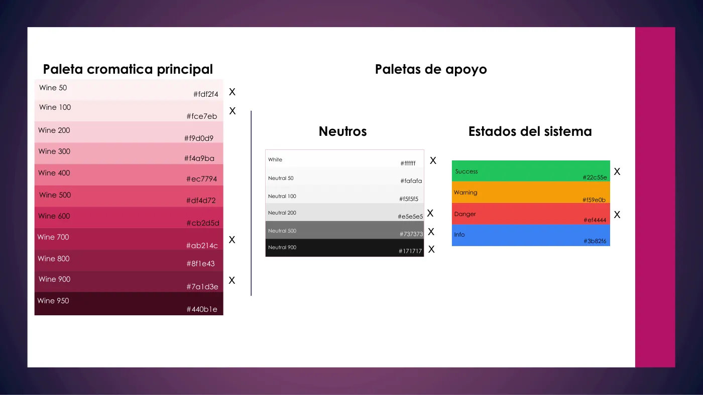
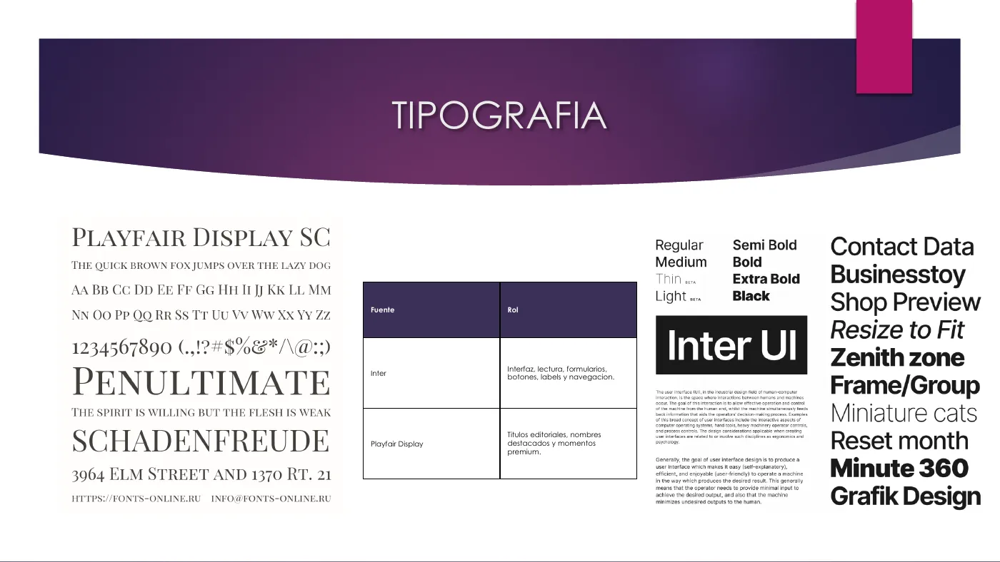
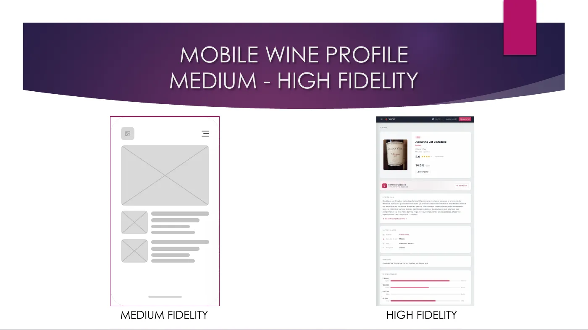
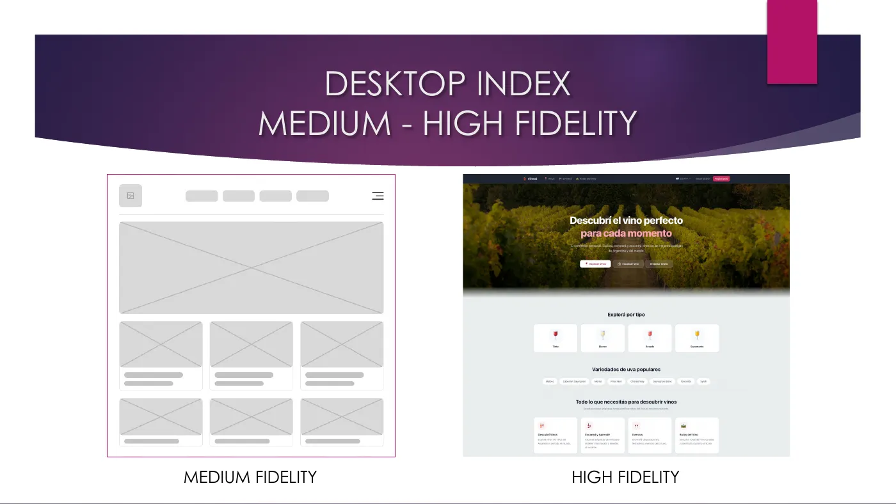
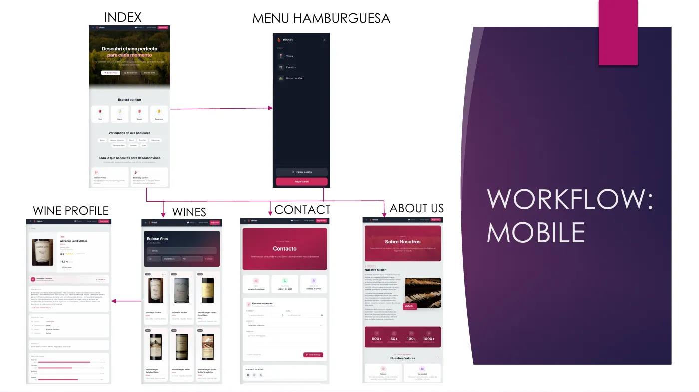

# Original design

> **Historical document.** This page records the first design and is not
> maintained against the code; some statements about current use, such as the
> fonts, are outdated. The current guide is the [visual system](visual-system.md).

Vinnot's first design, made before the website and the app were built. It sets the reference devices, the menu, low, medium and high fidelity wireframes, the flows between screens, the palette, the typography, the iconography and the cards. The [visual system](visual-system.md) describes the design the code uses today.

[Download the full document (PDF, 73 pages, Spanish)](files/vinnot-original-design.pdf)

## Document contents

| Section | What it sets |
|---|---|
| Kinds of web | Context: from web 1.0 to 5.0 |
| Devices | Reference resolutions. Mobile: iPhone 17 (2622 × 1206), Motorola Signature (2780 × 1264), Samsung S26 (1080 × 2340). Tablet: iPad Pro 13 (2752 × 2064), Moto Pad 2026 (1600 × 2560), Samsung Tab S11 (2960 × 1848). Desktop: MacBook Air 15" (2880 × 1864), Galaxy Book Pro 15.6" (1920 × 1080), Moto Book 60 14" (2880 × 1800) |
| Hamburger menu | Navigation references |
| Wireframes | Home, Wines, Wine page, Contact and About us on mobile, tablet and desktop, from low to high fidelity |
| Workflows | How those screens connect on each device |
| Elements | Colors, typography, iconography and cards |

## Palette

The Wine palette, from Wine 50 to Wine 950, is the same one the website and the app use today ([`tailwind.css`](../../../../frontend-react/src/shared/assets/styles/tailwind.css)). Wine 700 (`#ab214c`) is the main brand color.

## Typography

The original design picked Inter for the interface and Playfair Display for editorial titles. Today the website and the app use a single family, Poppins, for all text, titles included. On the website it is loaded by [`globals.css`](../../../../frontend-react/src/shared/assets/styles/globals.css) (weights 400 to 700) and [`tailwind.css`](../../../../frontend-react/src/shared/assets/styles/tailwind.css) (`--font-sans`); in the app, by [`_layout.tsx`](../../../../frontend-mobile/app/_layout.tsx) with `@expo-google-fonts/poppins` and [`typography.ts`](../../../../frontend-mobile/src/shared/theme/typography.ts). Neither Inter nor Playfair Display remains in the code.

Why Poppins:

- **One family on web and app.** The same text looks the same in the browser, on iOS and on Android, and fewer font files are loaded.
- **Legible at small sizes.** It is a geometric sans with open letters and a generous x-height, which reads well in labels, prices and buttons on phone screens.
- **Hierarchy through weights, not another family.** Titles go from 500 to 700 and body text uses 400 and 500, so the editorial tone does not depend on a serif.
- **Free.** It is licensed under the SIL Open Font License, with no cost or usage limits for the website and the store apps.

## From wireframe to high fidelity

## Mobile flow

