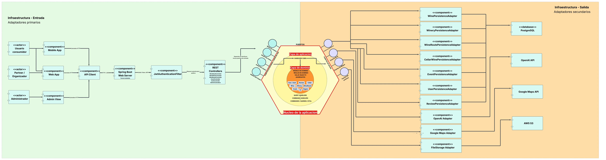
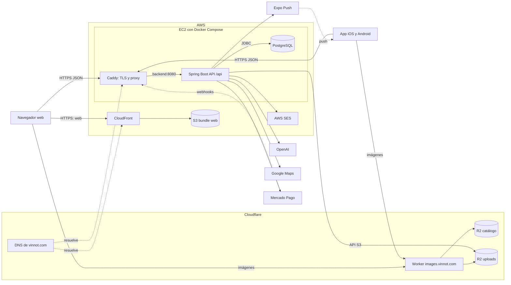
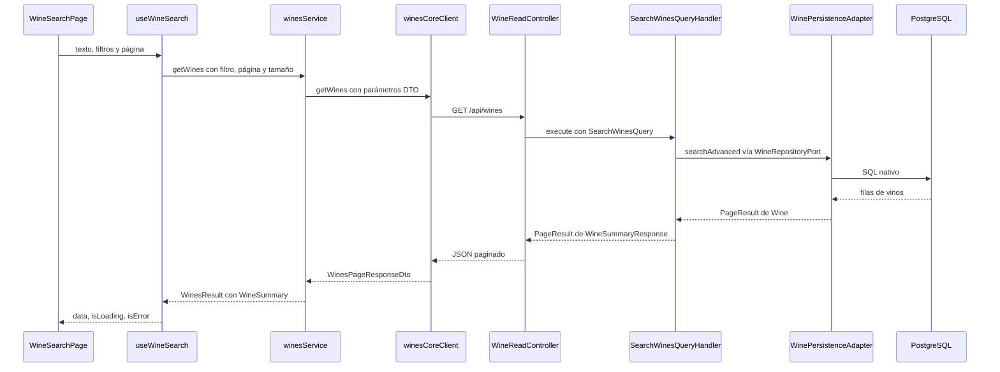

# Arquitectura del sistema

Vista general de cómo se conectan el backend, la web, la app móvil y la
infraestructura. El detalle de cada parte sigue en sus capítulos:
[backend](../backend/architecture/overview.md),
[web](../frontend-web/architecture/overview.md),
[app móvil](../frontend-mobile/architecture/overview.md) e
[infraestructura](../infra/architecture/aws-deployment.md).
El catálogo de [tecnologías](technologies/README.md) lista todo lo que usa Vinnot.
Los diagramas de clases del dominio están en el
[Modelo de dominio UML](../backend/diagrams/domain-class-model.md), y las tablas, en el
[DER detallado por contexto](../backend/diagrams/relational-model.md).

## Diagrama de arquitectura

[Abrir el diagrama en tamaño completo](./img/architecture-overview.webp)

A la izquierda están los adaptadores de entrada: la web y la app llaman a la API
por HTTP, Spring Boot recibe la petición, `JwtAuthenticationFilter` valida el
token y los controllers REST invocan los puertos de entrada. En el centro está el
núcleo: casos de uso, handlers CQRS y el dominio. A la derecha están los
adaptadores de salida: persistencia en PostgreSQL, OpenAI, Google Maps y
almacenamiento de archivos.

Es una vista simplificada con los módulos principales. En el código:

- El almacenamiento de imágenes es Cloudflare R2, al que se accede con la API
  compatible con S3 ([`R2FileStorageService`](../../../backend/src/main/java/com/vinnot/shared/infrastructure/storage/R2FileStorageService.java)).
- La administración no es una aplicación aparte: vive dentro de la web y de la app.
- También hay adaptadores de salida para Mercado Pago (pagos), AWS SES (correos) y
  Expo (notificaciones push).
- Hay más módulos que los dibujados: legal, comunidad, notificaciones, pagos,
  compartir, soporte, partner, actividad (`activity`, vistas de detalle y
  aperturas de la app) y engagement (`engagement`, planificación de push
  personalizados). Partner sólo expone HTTP sobre los casos de uso de eventos;
  los demás tienen sus adaptadores de persistencia. La lista completa está en
  [límites modulares](../backend/architecture/module-boundaries.md).

## Mapa del sistema

Así se conectan las piezas en producción. Cada entorno usa un host EC2 propio
con los mismos tres contenedores: Caddy, el backend y PostgreSQL.

[Ver diagrama de «Mapa del sistema» completo](https://images.vinnot.com/docs/diagrams/v1/es/architecture-readme-ae71e18717ef.svg)

La web y la app no comparten servidor: la web es un bundle estático que sirve
CloudFront, y ambas llaman a la misma API por HTTPS. Las imágenes no se leen a
través de la API: el navegador y la app las piden a `images.vinnot.com`.

| Componente | Qué hace | Dónde se documenta |
|---|---|---|
| Web | SPA React servida desde S3 por CloudFront; llama a la API definida en `VITE_API_BASE_URL` | [Arquitectura web](../frontend-web/architecture/overview.md) |
| App | App Expo para iOS y Android; llama a la API definida en `EXPO_PUBLIC_API_BASE_URL` y recibe notificaciones push | [Arquitectura de la app](../frontend-mobile/architecture/overview.md) |
| Cloudflare DNS y proxy | Autoridad DNS de `vinnot.com`; `api.vinnot.com` pasa por el proxy de Cloudflare, con WAF y rate limiting, hacia la IP del host (pendiente de aplicar) | [Despliegue AWS](../infra/architecture/aws-deployment.md#poner-cloudflare-delante-de-la-api) |
| CloudFront y S3 | Entregan el bundle web con caché en el borde | [Despliegue AWS](../infra/architecture/aws-deployment.md) |
| Caddy | Termina TLS, agrega cabeceras de seguridad y reenvía a `backend:8080` | [Despliegue AWS](../infra/architecture/aws-deployment.md) |
| Spring Boot API | Backend modular hexagonal/CQRS bajo el context path `/api` | [Arquitectura backend](../backend/architecture/overview.md) |
| PostgreSQL | Contenedor en el mismo host con volumen persistente; esquema gestionado por Flyway | [Modelo de datos](../backend/data/database-model.md) |
| Worker y R2 | `images.vinnot.com` entrega el catálogo compartido y las imágenes públicas de usuarios; el backend escribe los uploads con la API compatible con S3 | [Imágenes de catálogo](../infra/operations/catalog-images-r2.md) e [imágenes de usuarios](../infra/operations/user-images-r2.md) |
| Servicios externos | OpenAI (perfiles IA, escaneo de etiquetas, moderación), Google Maps (distancias de rutas), Mercado Pago (checkout y webhooks), AWS SES (correo) y Expo Push (notificaciones) | [Mapas del sistema backend](../backend/diagrams/system-map.md) |

## Recorrido de una petición

Ejemplo: un usuario busca vinos en la web. La petición recorre todas las capas y
la respuesta vuelve mapeada a modelos de dominio del frontend.

[Ver diagrama de «Recorrido de una petición» completo](https://images.vinnot.com/docs/diagrams/v1/es/architecture-readme-4c7c2a9fb7d8.svg)

1. **Página.** [`WineSearchPage`](../../../frontend-react/src/presentation/pages/wines/WineSearchPage.tsx)
   está montada en la ruta `wines` y sólo renderiza. Su view model
   [`useWineSearchViewModel`](../../../frontend-react/src/presentation/pages/wines/useWineSearchViewModel.ts)
   guarda texto, filtros y página, los sincroniza con la URL y llama al hook de consulta.
2. **Hook de presentación.** [`useWineSearch`](../../../frontend-react/src/presentation/hooks/queries/wine/useWineSearch.ts)
   aplica un debounce de 400 ms, ignora textos de menos de dos caracteres y usa
   TanStack Query con la clave `queryKeys.wines.search`.
3. **Servicio de aplicación.** [`winesService.getWines`](../../../frontend-react/src/application/services/wines.service.ts)
   convierte el filtro de dominio en parámetros de API con `mapFilterToParams`
   ([`wines.service.helpers.ts`](../../../frontend-react/src/application/services/wines.service.helpers.ts)).
4. **Cliente de infraestructura.** [`winesCoreClient.getWines`](../../../frontend-react/src/infrastructure/api/clients/wines.core.client.ts)
   hace `GET /wines` con la instancia Axios de [`http.ts`](../../../frontend-react/src/infrastructure/http/http.ts),
   cuya base es `VITE_API_BASE_URL`. La petición llega por Caddy al backend.
5. **Controller.** [`WineReadController.search`](../../../backend/src/main/java/com/vinnot/wine/infrastructure/web/controller/WineReadController.java)
   atiende `GET /wines` bajo el context path `/api`, acota la paginación con
   [`PublicWineCatalogAccessPolicy`](../../../backend/src/main/java/com/vinnot/wine/infrastructure/web/policy/PublicWineCatalogAccessPolicy.java)
   y construye un [`SearchWinesQuery`](../../../backend/src/main/java/com/vinnot/wine/application/query/model/SearchWinesQuery.java).
6. **Puerto de entrada.** El controller depende de
   [`SearchWinesUseCase`](../../../backend/src/main/java/com/vinnot/wine/application/port/in/SearchWinesUseCase.java),
   implementado por [`SearchWinesQueryHandler`](../../../backend/src/main/java/com/vinnot/wine/application/query/handler/SearchWinesQueryHandler.java).
7. **Handler.** Llama a `searchAdvanced` del puerto de salida
   [`WineRepositoryPort`](../../../backend/src/main/java/com/vinnot/wine/application/port/out/WineRepositoryPort.java)
   y después carga las bodegas de la página en una sola consulta con `WineryQueryPort`.
8. **Adaptador de persistencia.** [`WinePersistenceAdapter`](../../../backend/src/main/java/com/vinnot/wine/infrastructure/persistence/adapter/WinePersistenceAdapter.java)
   delega en [`WineSearchNativeRepository`](../../../backend/src/main/java/com/vinnot/wine/infrastructure/persistence/search/WineSearchNativeRepository.java),
   que arma SQL nativo para PostgreSQL: listado simple sin filtros, sólo filtros, o
   texto con niveles de coincidencia y similitud `pg_trgm`.
9. **Vuelta al dominio.** Las entidades JPA se convierten en `Wine` con
   [`WinePersistenceMapper`](../../../backend/src/main/java/com/vinnot/wine/infrastructure/persistence/mapper/WinePersistenceMapper.java),
   y el handler proyecta cada uno a
   [`WineSummaryResponse`](../../../backend/src/main/java/com/vinnot/wine/application/query/response/WineSummaryResponse.java)
   dentro de un [`PageResult`](../../../backend/src/main/java/com/vinnot/shared/domain/valueobject/PageResult.java).
   El controller devuelve ese JSON.
10. **Mapeo en el frontend.** El cliente resuelve las URLs de imágenes y devuelve el
    DTO crudo. El servicio mapea cada ítem con `mapWineSummaryFromDto`
    ([`wine.mappers.summary.ts`](../../../frontend-react/src/domain/wine/wine.mappers.summary.ts))
    y la paginación con `mapWinesPagination`.
11. **Render.** [`WineResultsGrid`](../../../frontend-react/src/presentation/components/features/wine/WineResultsGrid.tsx)
    muestra carga, error con reintento, estado vacío o las tarjetas `WineCard`;
    la página agrega la paginación.

La app sigue la misma cadena con sus propias piezas. La pantalla
`app/(app)/(tabs)/wines/index.tsx` usa
[`useWinesBrowseViewModel`](../../../frontend-mobile/src/presentation/features/wine/useWinesBrowseViewModel.ts)
y [`useWineCatalogPagination`](../../../frontend-mobile/src/presentation/features/wine/useWineCatalogPagination.ts).
El hook [`useWines`](../../../frontend-mobile/src/presentation/hooks/queries/wine/useWines.ts)
pide la operación `wine.list` a RTK Query ([`api.ts`](../../../frontend-mobile/src/presentation/store/api.ts)),
que la resuelve en [`queryHandlers.ts`](../../../frontend-mobile/src/application/operations/queryHandlers.ts)
con [`winesService.getWines`](../../../frontend-mobile/src/application/services/wines.service.ts).
El servicio llama a [`winesClient.getWines`](../../../frontend-mobile/src/infrastructure/api/clients/wines.client.ts),
que hace el mismo `GET /wines`, y la pantalla renderiza con
[`WineResultsList`](../../../frontend-mobile/src/presentation/features/wine/WineResultsList.tsx).
