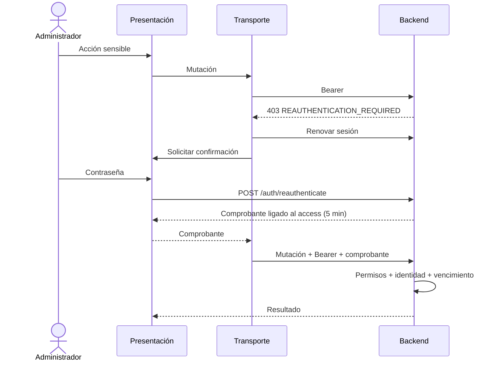
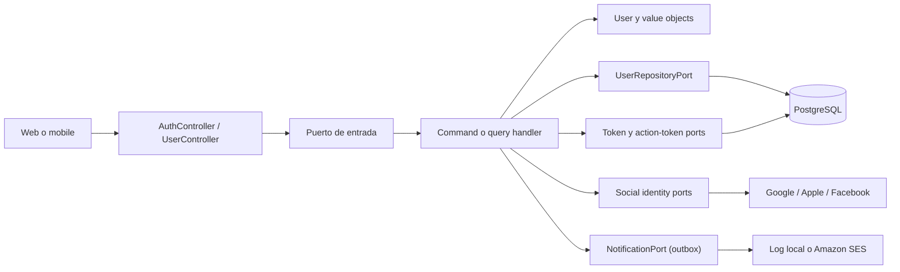
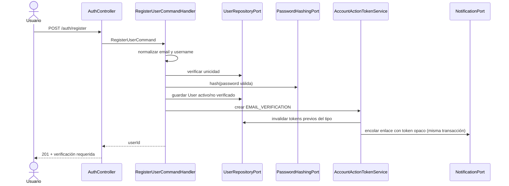
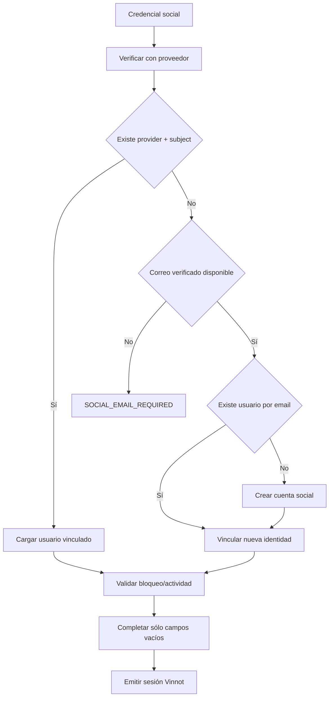
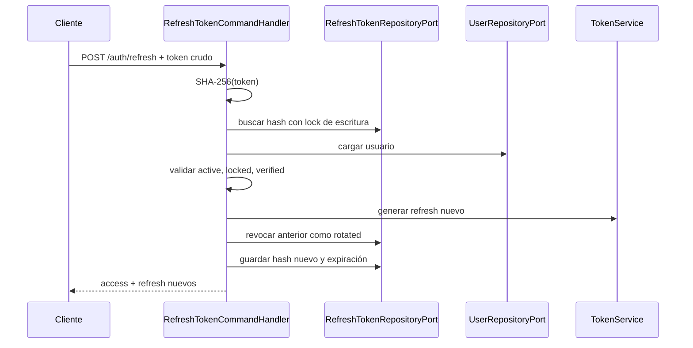

# Autenticación, identidad y ciclo de cuenta

## Sesión de navegador y reautenticación administrativa

El adapter `BrowserAuthController` expone POST `/auth/web/login`,
`/auth/web/social`, `/auth/web/refresh` y `/auth/web/logout`. Reutiliza los
mismos casos de uso, hashing, rotación y revocación que el transporte nativo.
No duplica reglas de identidad. JSON contiene access/tokenType/expiresIn/user,
nunca refresh; logout devuelve 204. Sin cookie ni credencial legacy, el refresh
del navegador devuelve 204 vacío sin Set-Cookie: es un arranque anónimo normal.
Una credencial presente inválida conserva 422 `INVALID_TOKEN`; el transporte
nativo no cambia. Todas sus respuestas exitosas usan Cache-Control: no-store.
Los cuerpos de petición usan JSON; un Content-Type no admitido devuelve 415
`UNSUPPORTED_MEDIA_TYPE`, sin ejecutar el caso de uso ni modificar la cookie.

La cookie `__Host-vinnot-refresh` es host-only, Path=/, HttpOnly, Secure y
SameSite=Strict, con duración derivada de `jwt.refresh-expiration`. No se
comparte mediante Domain entre subdominios. Los pares web/API de vinnot.com y
dev.vinnot.com/api-dev.vinnot.com son same-site pero cross-origin: el cliente
habilita credentials y el servidor exige Origin exacto autorizado y
`X-Vinnot-Web-Session: 1` en las cuatro operaciones. Origen ausente o ajeno
se rechaza antes del caso de uso. Cookies duplicadas se rechazan, no se elige
una arbitrariamente. CORS no reemplaza esta comprobación.

En perfil local HTTP, `app.auth.browser-cookie-secure=false` utiliza
`vinnot-refresh` sin Secure. Fuera de local la propiedad predeterminada es
true; no debe deshabilitarse para solucionar errores de TLS o dominios.
Los endpoints `/auth/login|social|refresh|logout` siguen disponibles para
native: Bearer y refresh en cuerpo, persistido mediante SecureStore. La API
de producto no autentica requests por cookie: requiere Bearer.

La migración web acepta un refresh legacy en el cuerpo sólo cuando no hay
cookie. La rotación invalida ese token y emite la cookie. Una renovación
fallida no borra cookies: evita que una respuesta anterior elimine una sesión
posterior. El cierre revoca el refresh y expira la cookie.

### Confirmación reciente del administrador

POST `/auth/reauthenticate` exige sesión, Bearer vigente y exactamente una
credencial: `{ "password": ... }` o `{ "provider": "GOOGLE"|"APPLE", "token":
..., "nonce"?: ... }`. Ambas o ninguna producen 400 de validación. El handler
vuelve a comprobar en persistencia una identidad activa, desbloqueada y
verificada (de cualquier rol) antes de validar la credencial. Devuelve
`{proof}` con no-store.

Con proveedor, `ReauthenticateCommandHandler` verifica el ID token de Google o
el identity token de Apple con el mismo `SocialIdentityVerifierPort` del login
social (firma JWKS, issuer, audiencia configurada, vencimiento y nonce de Apple
cuando se envía). El subject verificado debe ser una `SocialIdentity` ya
vinculada al usuario autenticado; una identidad de otra cuenta, no vinculada,
vencida, de otra audiencia o inválida responde el mismo 401 `AUTH_FAILED` que
una contraseña incorrecta, sin revelar si la identidad existe. Facebook no se
acepta: su credencial es un access token, no un ID token con audiencia. La
frescura queda acotada por el vencimiento del propio proveedor (Google: una
hora; Apple: diez minutos); no se exige una ventana `iat` adicional porque
Google Sign-In nativo puede devolver un ID token en caché.

`ReauthenticationProofPort` separa el caso de uso del comprobante firmado.
El adapter usa una clave derivada con propósito independiente, subject del
usuario, hash del Authorization actual y vencimiento de cinco minutos. No es
un access token; no permite autenticarse ni elevar permisos. Sólo se acepta
en `X-Admin-Reauthentication`, ligado al mismo usuario y credencial actual.
Rotar access exige obtener un comprobante nuevo.

`AdminSensitiveActionInterceptor` exige este comprobante para mutaciones de
`/admin/users/**`, mutaciones de `/admin/notifications/**` salvo la vista previa
de anuncios, mutaciones de `/admin/app-versions/**`, DELETE bajo `/admin/**` y DELETE de vinos, bodegas, eventos
y rutas por ID cuando el actor es ADMIN. Para toda persona titular de una
cuenta también lo exige en POST `/users/me/email-change` y DELETE
`/users/me/permanent`; la desactivación (`DELETE /users/me`) y el cambio de
contraseña (que ya pide la contraseña actual) no lo exigen. Los permisos y ownership originales
siguen aplicándose; el comprobante no los sustituye. Lectura y edición normal
de catálogo no abren un desafío. La ausencia o invalidez produce 403
`REAUTHENTICATION_REQUIRED`, antes de ejecutar la mutación. El endpoint de
confirmación comparte el límite de intentos de credenciales.

Web y native renuevan access antes del diálogo, coordinan una sola confirmación
y reintentan la operación una vez. Cancelación o cambio de sesión descarta el
resultado tardío. Las cuentas exclusivamente sociales confirman con el
proveedor vinculado sin crear contraseña; `/auth/me` (`UserResponse`) y las
respuestas de sesión (`AuthenticatedUserResponse`) exponen `socialProviders`
para que los clientes ofrezcan sólo esas opciones. El diálogo mantiene el
formulario de contraseña y el enlace a recuperación porque el backend no
registra si una cuenta social estableció una contraseña.

[Ver diagrama de «Confirmación reciente del administrador» completo](https://images.vinnot.com/docs/diagrams/v1/es/backend-architecture-authentication-and-identity-41859cf3f9ed.svg)

## Propósito y alcance

Este documento describe la implementación vigente del módulo `user`: registro
con credenciales, verificación de correo, inicio de sesión local y social,
emisión y renovación de sesiones, recuperación de contraseña, cambio de correo,
onboarding, avatar y ciclo de vida de la cuenta. La matriz de acceso HTTP, roles,
permisos y rate limiting se detalla en
[Seguridad y autorización](security-and-authorization.md).

La implementación sigue una frontera hexagonal:

[Ver diagrama de «Propósito y alcance» completo](https://images.vinnot.com/docs/diagrams/v1/es/backend-architecture-authentication-and-identity-cf79266d6118.svg)

Los controllers traducen HTTP a comandos o queries. No verifican contraseñas,
no crean JWT y no consultan JPA. Los handlers coordinan reglas y puertos; el
dominio conserva invariantes; los adapters resuelven hashing, persistencia,
proveedores OAuth, almacenamiento y correo.

## Modelo de identidad

### Agregado `User`

`User` es la raíz del agregado de cuenta. Mantiene:

| Campo | Semántica |
|---|---|
| `id` | UUID estable y subject del access token |
| `username` | identificador público normalizado y único |
| `email` | correo normalizado y único |
| `password` | hash; nunca contraseña en texto plano |
| `passwordSet` | la contraseña guardada la eligió su titular; se expone como `hasPassword` |
| `firstName`, `lastName` | perfil editable |
| `profileImageUrl` | referencia a un avatar administrado o remoto |
| `roles` | conjunto no vacío de roles de dominio |
| `active` | permite distinguir cuenta habilitada de desactivación voluntaria |
| `locked`, `lockReason` | bloqueo administrativo y su motivo |
| `emailVerified` | prueba de control del correo actual |
| `onboardingCompleted` | finalización del perfil inicial |
| `lastLoginAt` | último inicio de sesión emitido con éxito |
| timestamps | creación y última modificación |

Las transiciones se realizan mediante métodos del agregado: `verifyEmail`,
`changeVerifiedEmail`, `changePassword`, `updateUsername`, `completeOnboarding`,
`activate`, `deactivate`, `lock`, `unlock`, `addRole` y `removeRole`. La última
operación impide dejar una cuenta sin roles.

### Value objects

- `Email` recorta espacios, normaliza a minúsculas y valida formato antes de
  entrar al agregado.
- `Username` recorta, normaliza con `Locale.ROOT`, exige entre 3 y 40 caracteres,
  permite letras minúsculas, números, punto, guion y guion bajo, y exige un
  carácter alfanumérico al inicio y al final.
- `Password` encapsula exclusivamente un hash. La política para texto plano
  exige 8 caracteres como mínimo, una mayúscula, una minúscula y un dígito.
- `Role` expresa roles reconocidos por el dominio Java; `Permission` representa
  autoridades granulares persistidas y se normaliza a mayúsculas.

La unicidad de email y username se valida en aplicación para ofrecer errores de
dominio y también en PostgreSQL para cerrar carreras concurrentes.

## Registro con credenciales

[Ver diagrama de «Registro con credenciales» completo](https://images.vinnot.com/docs/diagrams/v1/es/backend-architecture-authentication-and-identity-868096c4320d.svg)

El alta local crea el rol `USER`, marca el onboarding como completo y mantiene
`emailVerified=false` hasta consumir el enlace. El correo de verificación se
encola en la transacción del registro y lo entrega el worker del outbox
([notificaciones](../../modules/notifications/architecture.md)): una caída del proveedor de email ya no hace
fallar el registro, y el correo se reintenta.

La respuesta de registro no incluye sesión. El login local rechaza la cuenta
hasta que el correo quede verificado.

## Login local y reactivación

`LoginCommandHandler` busca de forma indistinta por email o username y utiliza
el mismo error `AUTH_FAILED` para usuario inexistente y contraseña incorrecta.
Esto evita exponer qué identificadores están registrados. Una identidad
inexistente igual ejecuta una comparación BCrypt contra un hash ficticio
constante (`LoginAttemptGuard`), así que el tiempo de respuesta tampoco revela
qué cuentas existen.

El orden de reglas es deliberado:

1. resolver la identidad;
2. rechazar un bloqueo temporal vigente con `ACCOUNT_TEMPORARILY_LOCKED`, sea cual sea la contraseña;
3. verificar el hash mediante `PasswordHashingPort` y contar el resultado (ver abajo);
4. rechazar una cuenta bloqueada;
5. si está desactivada, exigir `reactivate=true` antes de activarla;
6. exigir correo verificado;
7. emitir la sesión, registrar `lastLoginAt` y el evento de seguridad `LOGIN_SUCCEEDED`.

Una cuenta desactivada no se reactiva silenciosamente con una credencial válida.
El cliente debe mostrar la confirmación y repetir el login con intención
explícita. Una cuenta bloqueada administrativamente no admite esa reactivación.

### Bloqueo temporal del inicio de sesión

Después de 5 contraseñas incorrectas seguidas
(`app.security.login-lockout.max-failures`) la cuenta no puede iniciar sesión
con contraseña durante 15 minutos (`app.security.login-lockout.lock-duration`,
`PT15M`). Cubre `/auth/login`, `/auth/web/login` (el mismo handler) y la vía
con contraseña de `/auth/reauthenticate`. El login social no se ve afectado.

- El contador y el fin del bloqueo viven en `users.failed_login_attempts` y
  `users.login_locked_until` (V72). Son independientes del flag administrativo
  `locked`, que un administrador levanta a mano.
- `LoginAttemptPersistenceAdapter` los cambia con sentencias atómicas únicas
  cuyo `WHERE` revisa el bloqueo. PostgreSQL serializa los intentos sobre la
  fila y vuelve a evaluar la condición contra la última versión confirmada, así
  que los intentos en paralelo nunca pierden una cuenta, una ráfaga inicia un
  solo bloqueo y, mientras corre, nada lo cuenta ni lo limpia. JPA los mapea
  como solo lectura, así que guardar una cuenta cargada nunca los pisa.
- El login no es transaccional: BCrypt corre sin conexión tomada, para que una
  ráfaga de logins no agote el pool. `LoginAttemptRecorder` también corre fuera
  de transacción: cada conteo es una sentencia con autocommit, el bloqueo y su
  aviso se confirman juntos en `LoginLockStarter`, y los eventos se escriben
  directo. `AuthSessionIssuer` guarda el login y el refresh token en una
  transacción corta. Cada login usa a lo sumo una conexión a la vez.
- Una contraseña correcta limpia el contador, aunque una regla posterior (correo
  sin verificar, suspensión) rechace el login. Antes revisa en la base si un
  bloqueo empezó después de cargar la cuenta: en ese caso responde 423 y el
  bloqueo sigue. Restablecer la contraseña también
  lo limpia, porque el aviso de bloqueo le indica al titular que la restablezca.
- Mientras dura el bloqueo, cada intento responde HTTP 423
  `ACCOUNT_TEMPORARILY_LOCKED` con el encabezado `Retry-After` en segundos
  (`LoginLockoutExceptionHandler`). La respuesta es la misma con contraseña
  correcta o incorrecta.
- El intento que inicia el bloqueo encola el correo de seguridad
  `ACCOUNT_LOGIN_LOCKED` (es/en), una vez por bloqueo.

## Login social

El cliente obtiene una credencial del SDK nativo o web, pero el backend vuelve
a verificarla. `SocialIdentityVerifierPort` mantiene esa dependencia fuera del
caso de uso y `SocialIdentityVerifierAdapter` implementa reglas por proveedor:

| Proveedor | Verificación vigente |
|---|---|
| Google | firma con JWKS, expiración, issuer de Google y audiencia permitida |
| Apple | firma con JWKS, issuer, audiencia y nonce crudo o SHA-256 si se envía |
| Facebook | `debug_token`, coincidencia de app, validez, sujeto y consulta de perfil |

[Ver diagrama de «Login social» completo](https://images.vinnot.com/docs/diagrams/v1/es/backend-architecture-authentication-and-identity-bc99634dd1a5.svg)

La clave de vinculación es `(provider, providerSubject)`, no el texto de email.
Para un primer acceso, sólo se vincula por email si el proveedor lo certifica.
Los datos de nombre e imagen enriquecen campos vacíos y no pisan decisiones
posteriores del usuario. Una cuenta nueva social recibe un username temporal
`vinnoter-<sufijo>`, una contraseña aleatoria inutilizable y
`onboardingCompleted=false`.

Cuando un email certificado se vincula a una cuenta local existente cuyo email
todavía no estaba verificado, la contraseña local puede pertenecer a quien
pre-registró esa dirección. Antes de verificar y vincular, el handler la
reemplaza por un hash aleatorio inutilizable mediante `User.changePassword`, que
incrementa `sessionVersion` y revoca las credenciales de acceso y refresh
existentes. Una cuenta local verificada conserva su contraseña y sus sesiones.

## Emisión de sesión

`AuthSessionIssuer` es el punto común para login local y social:

1. registra el login en el agregado;
2. persiste el usuario;
3. genera 32 bytes aleatorios para el refresh token;
4. guarda únicamente su SHA-256 y fecha de expiración;
5. carga roles y permisos efectivos;
6. genera el access JWT;
7. construye una respuesta uniforme.

El access token incluye:

- `sub`: UUID del usuario;
- `email`: correo vigente;
- `roles`: autoridades `ROLE_*`;
- `permissions`: permisos granulares;
- `sessionVersion`: generación vigente de credenciales;
- `iat` y `exp`.

La configuración base usa 15 minutos para access tokens
(`JWT_EXPIRATION=900000`) y 7 días para refresh tokens
(`JWT_REFRESH_EXPIRATION=604800000`). Son defaults configurables, no constantes
de negocio.

El refresh token es opaco, no un JWT. El valor crudo sólo se entrega al cliente;
la base conserva el hash. Esto limita la utilidad de una lectura accidental de
la tabla de sesiones.

## Renovación, rotación y logout

[Ver diagrama de «Renovación, rotación y logout» completo](https://images.vinnot.com/docs/diagrams/v1/es/backend-architecture-authentication-and-identity-5615a80c30cb.svg)

Cada renovación rota el refresh token. El registro anterior conserva el motivo
`rotated` y la referencia al hash sucesor, lo que permite auditoría y evita
reutilización. Logout revoca ese token y sus sucesores conocidos con motivo `logout`.
Logout sin cuerpo sigue siendo idempotente, aunque no puede invalidar un token
que el servidor no recibió.

### Reutilización del refresh token

Un token rotado solo se acepta de nuevo por la recuperación idempotente: el mismo
`rotationId` deriva el mismo sucesor vigente. Cualquier otra presentación de un
token rotado y no vencido significa que dos partes tienen la misma sesión, así
que `RefreshTokenReuseResponder`, en su propia transacción:

- incrementa la generación de sesión, lo que termina todos los access y refresh;
- revoca la cadena de sucesores con motivo `reuse`;
- olvida los dispositivos push de la cuenta;
- registra `REFRESH_REUSE_DETECTED`.

El request igual falla con `INVALID_TOKEN`. Las renovaciones en paralelo de un
mismo token no son robo: la fila queda bloqueada mientras una la rota, y las
demás la encuentran rotada hace un instante. Una presentación dentro de
`app.security.refresh-reuse.grace-period` (`PT30S`) desde la rotación solo se
rechaza.

Contraseña, email confirmado, roles, bloqueo y desactivación incrementan la generación de sesión. Access y refresh anteriores dejan de autorizar. Reset/email/desactivación además eliminan filas de refresh. La renovación bloquea la fila por hash con PESSIMISTIC_WRITE y compara su generación con la cuenta; logout recorre los sucesores de rotación. Véase [contrato de sesiones](session-and-data-integrity.md#sesiones-versionadas).

## Tokens de acción de cuenta

Verificación de correo, recuperación de contraseña y cambio de email utilizan
`UserActionToken`, separado de las sesiones.

| Tipo | Vigencia base | Efecto al consumir |
|---|---:|---|
| `EMAIL_VERIFICATION` | 24 h | marca el correo actual como verificado |
| `PASSWORD_RESET` | 60 min | cambia el hash y revoca refresh tokens |
| `EMAIL_CHANGE` | 60 min | sustituye el correo verificado y revoca sesiones |

El servicio genera 32 bytes con `SecureRandom`, codifica Base64 URL-safe sin
padding y persiste sólo SHA-256. Antes de emitir uno nuevo, invalida los tokens
activos del mismo usuario y tipo. `consume` exige tipo correcto, vigencia y
ausencia de uso previo, y marca `usedAt` dentro de la transacción.

La validación de reset (`/auth/reset-password/validate`) es una consulta: devuelve
`VALID`, `USED`, `EXPIRED` o `INVALID` sin consumir el token. Los endpoints de
forgot-password y reenvío usan respuestas neutras para no revelar la existencia
ni el estado de una cuenta.

## Cambio de correo

El flujo valida que el correo propuesto sea distinto y no esté ocupado, pero no
modifica el agregado al solicitarlo. Emite un token `EMAIL_CHANGE` cuyo
`targetValue` conserva el nuevo correo.

Al confirmar:

1. consume el token de propósito correcto;
2. vuelve a comprobar la unicidad para cerrar la ventana concurrente;
3. cambia el correo y lo deja verificado;
4. revoca todas las sesiones renovables;
5. notifica al correo anterior.

La segunda comprobación es imprescindible: otro usuario podría registrar ese
correo entre la solicitud y la confirmación.

## Perfil, onboarding y avatar

El perfil autenticado se modifica siempre para el UUID del principal, no para un
ID enviado por el cliente. Username vuelve a pasar por el value object y se
valida su unicidad. Las cuentas sociales pueden confirmar o sustituir el username
temporal durante onboarding.

El avatar entra como multipart y se delega a `FileStoragePort`. El handler aplica
compensación:

- almacena la nueva imagen;
- actualiza el usuario;
- si falla la persistencia, solicita la limpieza de la imagen nueva;
- si todo termina bien, solicita la limpieza del avatar anterior;
- una falla de limpieza posterior se registra sin revertir un perfil válido.

La configuración selecciona el adapter local/S3/R2. El local escribe en
directorios administrados. R2 optimiza a WebP y el
wrapper transaccional agenda reconciliación y borrado durables. La UI sólo recibe
la URL resultante. [Contrato de uploads](../use-cases/uploads-and-reference-data.md).

## Desactivación y eliminación permanente

La desactivación es reversible: marca `active=false` y borra refresh tokens. El
login posterior requiere confirmación explícita para reactivar.

La eliminación permanente borra el agregado y deja que las foreign keys y el
adapter de limpieza resuelvan recursos relacionados. Si existe una identidad de
Apple, la política del proveedor exige reautenticación: el backend intercambia
el authorization code, valida que el subject sea el esperado y revoca el token
antes de borrar la cuenta. Una autorización perteneciente a otra identidad se
rechaza.

La eliminación del avatar administrado se programa después del commit para no
dejar la base apuntando a un usuario eliminado sólo a medias.

## Persistencia y secretos

Las tablas principales son `users`, `roles`, `permissions`, `user_roles`,
`role_permissions`, `social_identities`, `refresh_tokens` y
`user_action_tokens`. Los adapters mapean entidades JPA a modelos de dominio; los
handlers no importan repositorios Spring Data.

La columna `users.password` guarda un hash BCrypt con el costo por defecto de
Spring Security (10), porque el bean de
[SecurityConfig](../../../../backend/src/main/java/com/vinnot/shared/infrastructure/config/SecurityConfig.java)
se crea sin argumentos. La vista transversal está en
[Contraseñas y autenticación](../../security/passwords-and-authentication.md#hash-de-contraseñas).

Configuración sensible requerida según las funciones habilitadas:

- `JWT_SECRET` y duraciones de access/refresh;
- audiencias OAuth de Google y Apple;
- app ID y secret de Facebook;
- team, key, private key y redirect URIs para revocación Apple;
- proveedor de correo, remitente y región SES;
- base URL del frontend para enlaces;
- credenciales del storage remoto.

Los valores reales pertenecen al secret store del entorno. Los `.env.example`
sólo declaran nombres y defaults no sensibles.

## Fallos y códigos de dominio relevantes

| Código | Condición |
|---|---|
| `AUTH_FAILED` | identificador o contraseña inválidos |
| `EMAIL_NOT_VERIFIED` | login/refresh antes de verificar correo |
| `ACCOUNT_LOCKED` | bloqueo administrativo |
| `ACCOUNT_TEMPORARILY_LOCKED` | bloqueo temporal por contraseñas incorrectas repetidas (HTTP 423, `Retry-After`) |
| `ACCOUNT_DEACTIVATED` | falta confirmación de reactivación |
| `EMAIL_ALREADY_EXISTS` | conflicto de unicidad |
| `USERNAME_ALREADY_EXISTS` | conflicto de username |
| `WEAK_PASSWORD` | incumplimiento de política |
| `INVALID_TOKEN` | refresh ausente, vencido o revocado |
| `INVALID_OR_EXPIRED_TOKEN` | token de acción no consumible |
| `SOCIAL_EMAIL_REQUIRED` | proveedor sin correo certificado para alta/vínculo |
| `SOCIAL_LOGIN_NOT_CONFIGURED` | credenciales/audiencias ausentes |
| `APPLE_REAUTH_REQUIRED` | eliminación sin prueba reciente de Apple |

La traducción final a HTTP pertenece al manejador global de errores; el dominio
no conoce códigos de estado ni payloads web.

## Estrategia de pruebas

La cobertura relevante se distribuye por capa:

- dominio: normalización, reglas de password, roles y transiciones de `User`;
- aplicación: duplicados, estados de cuenta, rotación, consumo único, revocación
  masiva, vinculación social y compensaciones;
- adapters: hash BCrypt, JWT, persistencia, claims/audience/issuer, SES y storage;
- web: Bean Validation, principal autenticado, contratos y estados HTTP;
- integración: PostgreSQL real para unicidad y concurrencia, seguridad completa
  para rutas públicas/protegidas y multipart para avatar.

Casos críticos de regresión:

1. dos registros concurrentes no crean emails o usernames duplicados;
2. un refresh token rotado no vuelve a aceptarse;
3. un token de acción no se consume dos veces;
4. reset, email change y desactivación invalidan refresh tokens existentes;
5. una identidad social existente siempre resuelve por provider/subject;
6. un email social no verificado no vincula una cuenta local;
7. una cuenta Apple no se elimina sin revocación válida;
8. una falla al guardar el avatar no deja un objeto huérfano administrado.

## Semántica de sesión y entrega

Los access JWT se validan criptográficamente y contra el estado, roles y generación actual de la cuenta en cada request. No existe una denylist individual de access tokens. Logout revoca refresh y descendientes, pero no incrementa la generación global. Los buckets de rate limiting se mantienen por proceso.

La entrega de email se invoca síncronamente desde los casos de uso que la
requieren. El envío del proveedor y el commit PostgreSQL son operaciones
distintas; no constituyen una transacción distribuida.

## Referencias de código

- `backend/src/main/java/com/vinnot/user/domain`
- `backend/src/main/java/com/vinnot/user/application`
- `backend/src/main/java/com/vinnot/user/infrastructure`
- `backend/src/main/java/com/vinnot/shared/infrastructure/security`
- `backend/src/main/resources/db/migration`
- [Catálogo de API](api.md)
- [Errores, transacciones y consistencia](errors-transactions-and-consistency.md)

## Identidad y acuerdo contractual

La autenticación no equivale a aceptar términos. `RegisterUserCommandHandler`
valida `termsAcceptance` mediante `LegalAgreementUseCase` y registra la selección
en la transacción de alta. OAuth no sintetiza consentimiento. Web y native
consultan el estado antes del onboarding y del contenido autenticado; el rechazo
ofrece cerrar sesión sin impedir el acceso a soporte, privacidad y documentos.

La exigencia global del backend es opt-in para mantener compatibilidad durante
el rollout. Versiones, fechas, idempotencia y excepciones:
[aceptación contractual](../../modules/legal/architecture.md).

## Rotación nativa recuperable

`POST /auth/refresh` nativo acepta el UUID opcional `rotationId` junto con
`refreshToken`. El cliente persiste la operación antes de enviarla. El handler
bloquea el token padre y deriva un sucesor determinista con HMAC-SHA256 y separación
de dominio. Sólo se persisten hashes. Repetir la misma operación permite recuperar
únicamente el sucesor directo registrado, mientras el vencimiento original y el
sucesor sean válidos y pasen los controles de cuenta/estado/versión de sesión.
Un ID diferente, reutilización legacy sin ID, sucesores ya rotados/revocados o
logout se rechazan. Recuperar no escribe tokens ni extiende su vencimiento. El
flujo web por cookies permanece igual. Concurrencia y logout se prueban en PostgreSQL.
