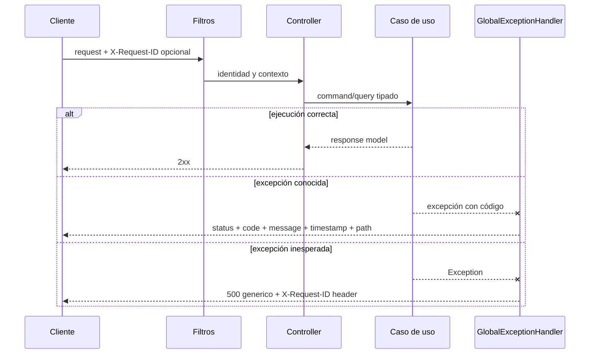

# Errores, transacciones y consistencia

## Objetivo

Este documento describe cómo el backend conserva invariantes desde que una
solicitud cruza HTTP hasta que se confirma en PostgreSQL, y cómo comunica fallos
sin filtrar detalles internos. Aplica a todos los módulos.

## Taxonomía de fallos

Mapeos declarados en GlobalExceptionHandler (MVC):
| Excepción / condición | HTTP | code |
|---|---|---|
| EntityNotFoundException | 404 | código de excepción |
| BusinessRuleViolationException: FORBIDDEN / REAUTHENTICATION_REQUIRED | 403 | mismo código |
| BusinessRuleViolationException: AUTH_FAILED | 401 | AUTH_FAILED |
| BusinessRuleViolationException: otros | 422 | código de excepción |
| DomainException: EMAIL_ALREADY_EXISTS / USERNAME_ALREADY_EXISTS / INVALID_SUBMISSION_TRANSITION / CONCURRENT_UPDATE | 409 | mismo código |
| DomainException: otros | 400 | código de excepción |
| MethodArgumentNotValidException | 400 | E1001 |
| HttpMessageNotReadableException / MethodArgumentTypeMismatchException / MissingServletRequestParameterException / MissingServletRequestPartException / IllegalArgumentException | 400 | INVALID_REQUEST |
| AccessDeniedException | 403 | FORBIDDEN |
| NoResourceFoundException | 404 | NOT_FOUND |
| HttpRequestMethodNotSupportedException | 405 | METHOD_NOT_ALLOWED |
| HttpMediaTypeNotSupportedException | 415 | UNSUPPORTED_MEDIA_TYPE |
| DataIntegrityViolationException | 409 | DUPLICATE_ENTRY |
| OptimisticLockingFailureException | 409 | CONCURRENT_UPDATE |
| ExternalServiceUnavailableException | 503 | código de excepción |
| Exception sin mapper específico | 500 | INTERNAL_ERROR |

Los filtros de autenticación, autorización de request y cuota operan antes de MVC y pueden escribir 401/403/429 por su propio mecanismo. La clasificación del advice depende de la clase y código, no de una descripción genérica como conflicto o input inválido. Por ejemplo, EVENT_OWNERSHIP como BusinessRuleViolationException se devuelve con 422.

ErrorResponse incluye timestamp, path, status, code, message y details opcional. Los clientes deciden por status/code; el texto es descriptivo. X-Request-ID se devuelve como header y se utiliza en MDC/logs.

## Frontera HTTP

[Ver diagrama de «Frontera HTTP» completo](https://images.vinnot.com/docs/diagrams/v1/es/backend-architecture-errors-transactions-and-consistency-3a10c1428d44.svg)

El controller valida DTO, convierte fechas/UUID y extrae el principal. No captura
excepciones para devolver `200` con un flag de error.

## Límites transaccionales

`@Transactional` en el método/clase de aplicación o adapter delimita la unidad de trabajo. No se infiere una transacción de que una clase se llame Handler. Controllers delegan sin abrirla; queries con readOnly mapean sus resultados dentro de ese alcance. `spring.jpa.open-in-view=false` evita depender de una sesión abierta durante serialización.

Generación IA separa llamada remota y persistencia del bundle; submit/review de vinos sí ejecutan reconocimiento, moderación o storage dentro de su orquestación anotada. Email y storage no se vuelven recursos transaccionales por ser llamados desde un método anotado. Véase la matriz por operación y [diagramas de consistencia](../diagrams/data-consistency.md).

## Consistencia por operación

### Crear una reseña

1. bloquea las estadísticas del vino mediante `WineCommandPort.lockRatingStats`;
2. consulta `existsByWineIdAndUserId` y rechaza una segunda reseña del mismo usuario/vino;
3. `Review.create` y `updateContent` validan el dominio y persiste la reseña `APPROVED`;
4. recalcula promedio/cantidad de reseñas `APPROVED` y actualiza el vino;
5. `CellarCommandPort.syncReviewToCellar` crea o actualiza rating/notas personales;
6. resuelve la proyección pública del autor y devuelve `ReviewResponse`.

Todas esas escrituras comparten la transacción. Una falla de estadísticas o cava
se propaga y revierte la operación. Las reseñas nuevas/editadas aportan al promedio público y su valoración personal
se sincroniza con la cava. Filas pendientes/rechazadas anteriores permanecen
fuera del promedio hasta publicarse. La comprobación
previa mejora el mensaje y el constraint `(wine_id, user_id)` protege la unicidad.
Las foreign keys conservan la integridad de usuario/vino.

### Registrar un evento

`Event` y `EventRegistration` se actualizan en una transacción para que reservar
cupo y crear la solicitud sean una sola decisión. Cancelar, expirar una reserva
o confirmar asistencia debe liberar/confirmar capacidad en el mismo límite.

### Publicar una propuesta de vino

Submit obtiene un advisory lock por nombre/bodega/añada antes del matching y la publicación. Review APPROVE_NEW adquiere el mismo tipo de lock sobre datos efectivos y vuelve a consultar el catálogo. La fila de submission se carga con findById; ese lock de identidad no es un lock de revisión por fila. Decisión, IDs y timestamps se guardan en PostgreSQL; promoción de archivos y notificación son operaciones externas.

### Generar contenido IA

La llamada paga se coordina con un lease PostgreSQL expirable, pero no mantiene
una transacción de negocio abierta durante la espera. El bundle `es`/`en` se
persiste como conjunto y sólo se considera completo cuando existen todos los
idiomas soportados.

Capturar una excepción de sincronización no prueba que una transacción pueda confirmar: el resultado final depende del estado transaccional del recurso. La unicidad de filas tampoco equivale por sí sola a idempotencia de toda la operación.

## Idempotencia y concurrencia

| Flujo | Mecanismo |
|---|---|
| Refresh de sesión | rotación/revocación del refresh token presentado |
| Logout | revocación segura aun cuando el access token siga hasta expirar |
| Generación IA normal | caché completa + lease single-flight |
| Regeneración IA | lease exclusivo y reemplazo del bundle |
| Like de reseña | verificación + constraint único usuario/reseña |
| Alta en cava | verificación + unicidad usuario/vino |
| Inscripción | verificación de registro activo + lock/consistencia de cupo |
| Submission | advisory lock por identidad en Submit/APPROVE_NEW + reconsulta |

No todos los `POST` son idempotentes. El contrato documenta cuándo reintentar es
seguro; el cliente no debe repetir automáticamente mutaciones después de un
timeout si no puede determinar el resultado.

## Mapeo y lazy loading

Las entidades JPA son modelos de persistencia. Los adapters reconstruyen dominio
y los handlers proyectan responses. Antes de retornar:

- colecciones lazy necesarias se obtienen con query/fetch apropiado;
- no se expone una entidad JPA al controller;
- IDs y datos derivados de otros módulos se resuelven por puertos;
- paginación se convierte a `PageResult`;
- el JSON de IA se copia a estructuras mutables/controladas cuando se orienta o
  enriquece.

## Rollback y side effects externos

Una transacción de base no puede revertir por sí sola un email enviado o un
objeto R2/S3 creado. El orden debe minimizar estados huérfanos:

1. validar todo lo posible sin efectos;
2. ejecutar proveedor/storage sólo cuando el caso sigue siendo viable;
3. persistir referencias y estado;
4. ante fallo posterior, aplicar compensación explícita si el puerto la admite;
5. registrar contexto suficiente sin secretos ni contenido sensible.

Capturar una excepción no revierte un efecto externo ya ejecutado ni demuestra
entrega garantizada.

## Contrato para frontends

Web y mobile normalizan errores en infraestructura. Presentación distingue, como
mínimo:

- sin conectividad;
- timeout;
- sesión expirada/`401`;
- prohibido/`403`;
- validación/`400`;
- conflicto/`409`;
- cuota/`429`, usando `Retry-After`;
- proveedor/`503`;
- error inesperado.

La UI puede traducir mensajes, pero conserva el código de dominio para decidir
acciones como reautenticar, corregir, reintentar o contactar soporte.

## Verificación

- tests unitarios de invariantes y transiciones;
- tests de handler para rollback lógico, propiedad y orden de puertos;
- tests de repository con PostgreSQL para constraints y locking;
- tests MVC para status, cuerpo y seguridad;
- `spring.jpa.open-in-view=false` en todos los perfiles relevantes;
- logs de errores con `requestId` y sin tokens, contraseñas o imágenes.

## Referencias

- `shared/infrastructure/web/GlobalExceptionHandler.java`
- `shared/infrastructure/web/HttpRequestLoggingFilter.java`
- `shared/infrastructure/config/SecurityConfig.java`
- `ai/application/service/AiGenerationCoordinator.java`
- `wine/infrastructure/persistence/adapter/PostgresWineSubmissionLockAdapter.java`
- [Observabilidad](observability.md)
- [Seguridad](security-and-authorization.md)

## Contratos de sesión y efectos

[Sesiones, publicación y efectos externos](session-and-data-integrity.md) define generación de credenciales, conflictos 409, locks, outbox y reintentos. El logger de email no imprime destinatarios, enlaces ni tokens; el proveedor IA registra tipos de excepción, no cuerpos de error externos.
