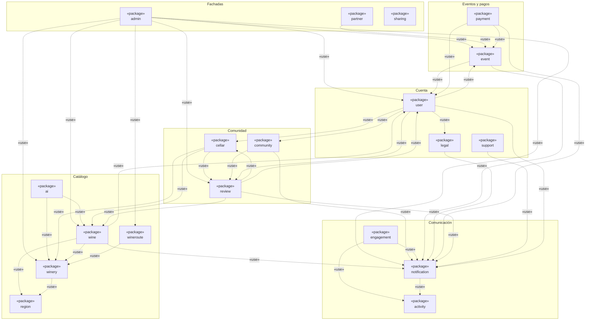
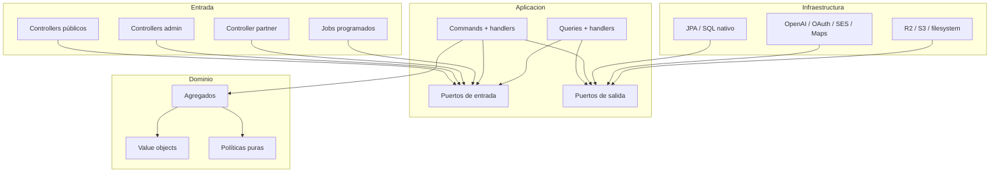
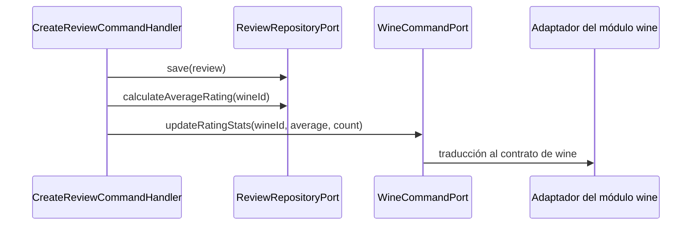

# Límites modulares y dependencias del backend

## Propósito

Este documento define la responsabilidad real de cada módulo de `com.vinnot`,
sus agregados, sus puertos y las dependencias admitidas. Complementa la
[arquitectura general](overview.md) con una vista que puede usarse para revisar
imports, ubicar una nueva regla de negocio y evitar que un módulo se convierta
en un conjunto de servicios acoplados por accidente.

La fuente de verdad es `backend/src/main/java/com/vinnot`. Los nombres de las
capas que aparecen aquí corresponden a paquetes y tipos existentes.

## Mapa de módulos

| Módulo | Responsabilidad | Núcleo de dominio | Integraciones relevantes |
|---|---|---|---|
| `wine` | Catálogo, búsqueda, ranking, escaneo y propuestas | `Wine`, `WineSubmission`, normalización y scoring de etiqueta | PostgreSQL, storage, moderación y reconocimiento visual |
| `winery` | Identidad del productor, ubicación y datos públicos | `Winery`, `Location`, `ContactInfo` | Regiones, geocodificación y catálogo de vinos |
| `review` | Reseñas públicas, comentarios y su publicación, likes y reputación agregada | `Review`, `ReviewPublication` | Usuarios, vinos y alta rápida en cava |
| `community` | Denuncias privadas, revisión y bloqueo entre cuentas | `CommunityReport`, `ContentTarget` | JDBC, visibilidad en reseñas/perfiles y puente a casos de uso de eliminación |
| `cellar` | Inventario personal y metadatos privados | `CellarWine` | Proyección del catálogo de vinos |
| `event` | Eventos, descubrimiento, cupos, pago manual, inscripciones y entradas | `Event`, `EventRegistration` y sus value objects | Ubicación, organizadores y automatización temporal |
| `payment` | Cuentas Mercado Pago de organizadores, checkout, conciliación, reembolsos y comprobantes | `CheckoutAttempt`, `OrganizerPayment`, `RefundIntent`, `SellerCredentials` | Puertos de salida de `event`/`user`, PostgreSQL y gateways `MercadoPago*Adapter` |
| `wineroute` | Rutas turísticas y paradas ordenadas | `WineRoute`, `RouteStop` | Bodegas y servicio de distancias |
| `user` | Identidad, sesión, perfil, roles y ciclo de cuenta | `User`, `SocialIdentity`, tokens de acción, `Role`, `Permission` | OAuth, JWT, email, storage y limpieza de recursos |
| `ai` | Perfiles y comparaciones bilingües, caché y single-flight | `WineAiProfile`, `WineComparison`, idiomas y par canónico | OpenAI o mock, PostgreSQL y catálogo de vinos |
| `region` | Países y regiones normalizados | `Country`, `Region` | PostgreSQL y filtros de catálogo |
| `admin` | Consultas y endpoints de back-office; la versión mínima admitida de la app móvil por plataforma | No posee agregados propios; value objects `AppPlatform` y `AppVersion` | Reutiliza puertos/casos de uso de los módulos gestionados; `AppMinimumVersionPort` (JDBC, V69) y el público `GET /app-versions/minimum` |
| `partner` | Superficie HTTP del organizador | No posee agregados propios | Reutiliza los casos de uso de `event` |
| `shared` | Primitivas y adaptadores verdaderamente transversales | Base de entidades, paginación, errores y coordenadas | Seguridad, archivos, correo, mapas y HTTP transversal |
| `support` | Consultas públicas durables | `SupportRequest` | Puerto de recepción, PostgreSQL y el puerto de notificaciones |
| `notification` | Correo y push salientes: solicitudes tipadas, entrega por outbox, plantillas, dispositivos push, preferencias y consentimiento, baja por enlace, anuncios de administradores y controles de push | `NotificationRequest`, `NotificationType`, `NotificationRecipient`, `PushRequest`, `PushDevice`, `NotificationPreferences`, `Announcement` | Outbox `external_effects`, resource bundles, SES o log para correo, Expo o log para push; registra aperturas de push en `activity` ([notificaciones](../../modules/notifications/architecture.md)) |
| `legal` | Publicaciones contractuales y aceptación explícita por cuenta | `TermsDocument`, `TermsSelection`, `TermsStatus` | Puertos de documentos/aceptación y PostgreSQL; registro depende de su puerto de entrada |
| `sharing` | Vistas previas públicas de vinos, eventos y rutas | `SharedContent`, `SharedContentKind` | Proyección JDBC mínima y HTML/Open Graph |
| `activity` | Señales de interacción: detalles abiertos, aperturas de la app y su ritmo | `ContentKind`, `ViewedContent`, `OpenHourHistogram`, `ActivityRhythm` | JDBC; `ReadActivitySignalsUseCase` para el planificador de push; `notification` registra aperturas de push con `RecordAppOpenUseCase` ([actividad](../../modules/activity/README.md)) |
| `engagement` | Planificación de push de engagement: candidatos por tipo, elección, presupuesto compartido, holdout y métricas | `EngagementCandidate`, `EngagementSelection`, `EngagementPolicy`, `EngagementDecision`, `EngagementHistory`, `Holdout`, `SendTime` | Señales de `activity` (`ReadActivitySignalsUseCase`), puertos de push de `notification` (`PushNotificationPort`, `PushPlanningUseCase`, `PushOpenUseCase`) y su `EngagementBudgetPort`; JDBC y jobs programados; `GET /admin/notifications/push/engagement` ([push de engagement](../../modules/notifications/architecture.md#push-de-engagement)) |

### Diagrama de paquetes

Cada paquete UML es un módulo `com.vinnot.<módulo>` y cada flecha punteada es
una dependencia «use»: el módulo de origen importa al menos un tipo del módulo
de destino. Las dependencias salen de los `import com.vinnot.` del código y se
agrupan por área sólo para leer el diagrama.



[Ver diagrama de «Diagrama de paquetes» completo](https://images.vinnot.com/docs/diagrams/v1/es/backend-architecture-module-boundaries-bebb31f94689.svg)

`shared` no aparece para no saturar el diagrama: casi todos los módulos lo usan
por sus primitivas, errores, paginación, seguridad y outbox, y su adaptador de
datos de referencia lee los tipos y estados de `event` y `wine`. `sharing` sólo
depende de `shared`, porque lee sus vistas previas con una proyección JDBC
propia. Algunas parejas se usan en ambos sentidos (`cellar`/`review`,
`user`/`review`, `user`/`event`): cada sentido llega a un puerto distinto del
otro módulo.

## Topología de dependencias



[Ver diagrama de «Topología de dependencias» completo](https://images.vinnot.com/docs/diagrams/v1/es/backend-architecture-module-boundaries-1a21711471ef.svg)

Las flechas representan dependencias de compilación deseadas. Un agregado no
debe importar un controller, un DTO web, JPA, Spring, Axios ni una API externa.
Infraestructura sí conoce aplicación y dominio porque implementa los contratos
definidos hacia adentro.

## Anatomía de un módulo con escritura

Todo módulo propietario de estado mutable usa esta forma. Un módulo
exclusivamente de lectura o una fachada como `admin` puede omitir agregado y
commands, pero conserva puertos y dirección de dependencias:

```text
<module>/
├── domain/
│   ├── model/
│   ├── valueobject/
│   └── service/
├── application/
│   ├── command/model/
│   ├── command/handler/
│   ├── query/model/
│   ├── query/handler/
│   ├── query/response/
│   └── port/{in,out}/
└── infrastructure/
    ├── persistence/{entity,mapper,repository}/
    ├── web/{controller,request}/
    └── <proveedor específico>/
```

No todos los módulos necesitan cada carpeta. La ausencia de una capa es válida
cuando el módulo sólo adapta otro caso de uso. Crear clases vacías para forzar
simetría no mejora la arquitectura.

## Contratos entre módulos

Un módulo no debería inyectar el repositorio concreto de otro módulo. Cuando
necesita información o una acción acotada define un puerto con el contrato
mínimo. Ejemplos vigentes:

- `cellar.application.port.out.WineQueryPort` obtiene la proyección necesaria
  para mostrar una entrada sin depender de `WineJpaRepository`.
- `review.application.port.out.WineCommandPort` actualiza estadísticas agregadas
  después de crear o borrar una reseña.
- `wineroute.application.port.out.WineryQueryPort` resuelve las bodegas que
  componen las paradas.
- `admin.application.port.out.*QueryPort` construye vistas administrativas sin
  mover reglas del módulo propietario al controller.
- `wine.application.port.out.WineCatalogReferencePort` resuelve referencias al
  publicar una propuesta de vino.
- Los servicios de aplicación de `payment` usan puertos de salida de `event`
  (`EventRepositoryPort`, `EventRegistrationRepositoryPort`, `PaidEventAvailability`)
  y `user.application.port.out.UserRepositoryPort`, e invocan las transiciones de
  proveedor de `EventRegistration`; `event` no importa `payment`.



[Ver diagrama de «Contratos entre módulos» completo](https://images.vinnot.com/docs/diagrams/v1/es/backend-architecture-module-boundaries-bdce1f2a1f07.svg)

El puerto evita una dependencia hacia una tecnología, pero no elimina por sí
solo el acoplamiento semántico. Debe exponer operaciones estables de negocio y
no reflejar toda la API del repositorio remoto.

## Agregados y límites de consistencia

- `Wine` controla sus datos de catálogo, flags y estadísticas materializadas.
- `WineSubmission` controla estados, evidencia, decisión y auditoría de una
  propuesta; publicar o fusionar requiere coordinación de aplicación.
- `Event` controla estado, capacidad y configuración de registro.
- `EventRegistration` controla el estado de una solicitud individual, sus
  reservas temporales y su pago.
- `WineRoute` controla orden y validez de las paradas y no puede publicarse sin
  al menos una.
- `Review` controla rating y contadores, mientras likes y comentarios tienen
  persistencia propia para imponer unicidad y autoría.
- `CellarWine` representa la relación única usuario-vino y sus datos privados.
- `User` controla estado de cuenta y perfil; tokens y sesiones tienen ciclos de
  vida independientes coordinados por aplicación.

Cuando una operación cruza agregados, el handler define el orden y el límite
transaccional. No se introducen referencias JPA navegables entre módulos sólo
para obtener cascadas automáticas.

## Adaptadores especializados

### Administración

`admin` es una fachada de entrada y lectura. Sus controllers aplican permisos de
back-office y delegan en casos de uso existentes o queries administrativas. No
posee una copia de `Wine`, `Event` o `User`.

### Partners

`PartnerEventController` traduce DTO específicos del organizador a
`CreateEventCommand`, `UpdateEventCommand`, `CancelEventCommand` y
`GetMyEventsQuery`. Propiedad y transiciones siguen perteneciendo a `event`.

### Proveedores externos

El proveedor concreto se selecciona en infraestructura. Por ejemplo,
`WineLabelRecognitionPort`, `FileStoragePort`, `NotificationPort` y
`SocialIdentityVerifierPort` mantienen el caso de uso independiente de OpenAI,
S3, SES, Google, Apple o Facebook. `PaymentProviderGateway`, `TicketCheckoutGateway`
y `SellerAuthorizationGateway` aíslan Mercado Pago.

## Reglas para agregar funcionalidad

1. Identificar el agregado propietario de la regla.
2. Modelar la intención como command/query o método de un puerto de entrada.
3. Mantener validaciones de forma en el request web y reglas de negocio en
   dominio/aplicación.
4. Definir un puerto de salida sólo si la aplicación necesita una dependencia
   externa o entre módulos.
5. Implementar el adaptador en infraestructura y mapear a tipos internos.
6. Agregar transacción en el punto de orquestación, no en el controller.
7. Replicar la disposición de carpetas en tests para toda lógica nueva.
8. Actualizar API, datos, seguridad, operación y caso de uso afectado.

## Señales de violación

- un controller importa `JpaRepository`, `EntityManager` o una entidad JPA;
- un agregado importa anotaciones Spring/JPA o DTO de transporte;
- una screen o página frontend llama directamente a Axios/fetch;
- un handler recibe `MultipartFile`, `HttpServletRequest` o `ResponseEntity`;
- un módulo consulta tablas de otro mediante SQL incidental cuando existe un
  puerto propietario;
- un adaptador devuelve su entidad de persistencia hacia aplicación;
- una regla de propiedad existe sólo en la UI;
- una clase `shared` contiene comportamiento específico de vinos o eventos.

## Archivos de referencia

- `backend/src/main/java/com/vinnot/*/application/port`
- `backend/src/main/java/com/vinnot/*/application/*/handler`
- `backend/src/main/java/com/vinnot/*/domain`
- `backend/src/main/java/com/vinnot/*/infrastructure`
- [Errores y transacciones](errors-transactions-and-consistency.md)
- [Estrategia de pruebas](../testing/strategy.md)
