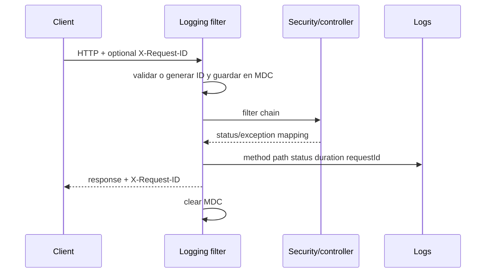

# Observabilidad del backend

## Objetivo

La observabilidad debe permitir responder: qué request falló, en qué etapa,
cuánto demoró, qué dependencia intervino y si el problema es aislado o sistémico,
sin registrar secretos ni imágenes. Se combinan logs estructurados, request ID,
health/metrics y métricas de negocio agregadas.

## Correlación HTTP

`HttpRequestLoggingFilter` acepta `X-Request-ID` sólo si cumple
`[A-Za-z0-9._-]{1,100}`; de lo contrario genera UUID. Lo agrega a MDC y al header
de respuesta. Registra método, path, status, duración y request ID. Omite OPTIONS,
health, Swagger y api-docs para reducir ruido.

El umbral lento es configurable (default 1000 ms): requests lentas se loguean en
WARN y status 5xx en ERROR. El filtro no debe imprimir body, Authorization,
cookies ni multipart.

[Ver diagrama de «Correlación HTTP» completo](https://images.vinnot.com/docs/diagrams/v1/es/backend-architecture-observability-b0effd3620dc.svg)

## Health y versión

- Actuator mantiene health básico público; los detalles y `/actuator/**` restantes
  requieren `ROLE_ADMIN`, incluso para usuarios autenticados y moderadores.
- `/health` es una respuesta pública simple del controller propio.
- `/version` expone metadata no sensible de build/version.

Health de contenedor debe probar dependencia suficiente para routing, pero no
ejecutar operaciones caras. Un health UP no certifica precisión de scan ni
latencia del catálogo.

## Métricas de escaneo/submissions

MicrometerWineLabelMetricsAdapter registra los siguientes instrumentos:
| Nombre | Tipo / tags | Punto de registro |
|---|---|---|
| vinnot.wine_label.scan.total | counter; outcome, visual_fallback | respuesta construida del handler |
| vinnot.wine_label.scan.duration | timer; outcome | mismo punto |
| vinnot.wine_label.scan.stage.duration | timer; stage, outcome=SUCCESS/FAILURE | retorno o RuntimeException de etapa medida |
| vinnot.wine_label.submission.total | counter; status | respuesta construida de submit |
| vinnot.wine_label.submission.duration | timer; status | mismo punto |

Los contadores totales no se incrementan para una excepción anterior al punto de respuesta. Una falla interna recuperada puede terminar como respuesta de negocio; los timers reflejan el resultado observado por su wrapper. No se agregan ID de vino/usuario, OCR o imagen a los tags.

## Taxonomía de etapas

El enum `WineLabelMetricsPort.ScanStage` contiene exactamente `LOCAL_CATALOG`, `VISUAL_RECOGNITION`, `VISUAL_WAIT` (espera del resultado de la búsqueda visual), `ENRICHED_CATALOG` y `CANDIDATE_VERIFICATION` (segunda llamada de visión que elige entre candidatas). Validación HTTP, upload de red y serialización no tienen una etapa de este enum; contribuyen a la duración HTTP del filtro. Scoring forma parte de las llamadas al matcher de catálogo. Los hints SQL y el timeout visual se describen en [escaneo](../../modules/wines/architecture.md).

## Logs de aplicación

Reglas:

- INFO para inicio/fin de operaciones relevantes sin payload sensible;
- WARN para degradación recuperada, timeout/fallback y requests lentas;
- ERROR para fallo no recuperado, con tipos de excepción y ubicación de código;
- no volcar cadenas de excepciones que puedan contener mensajes privados;
- usar IDs opacos y enums/causas, no datos personales;
- sanitizar mensajes de proveedores.

`GlobalExceptionHandler` y SES utilizan `SafeFailureDetails`: conserva hasta
cinco tipos y la primera ubicación Vinnot por causa, sin mensajes ni causas
serializadas. Los rechazos esperados registran el código, no el mensaje libre.
Maps registra clase de fallo o rechazo del proveedor, nunca URL, clave ni body.
Véase [protección de recursos](resource-protection.md).

## Diagnóstico por síntoma

| Síntoma | Primera evidencia | Siguiente corte |
|---|---|---|
| 5xx | request ID + exception mapping | logs handler/adapters |
| scan lento | stage timers | proveedor vs DB vs host |
| catálogo lento | request duration + query metrics | EXPLAIN/locks/connections |
| 401 masivo | auth endpoint/filter metrics | token rotation/clock/client |
| health caído | container/actuator | DB, memory, migrations |
| submission atascada | state + moderation metric | lease/lock/provider |

## SLO y alertas

Las métricas de disponibilidad, error y latencia son señales operativas. Su
instrumentación no demuestra por sí sola la existencia de dashboards o alertas
desplegados. La precisión de scan se evalúa mediante el benchmark funcional,
separada de la disponibilidad del servicio.

## Retención

En el runtime low-cost, Docker aplica rotación local acotada. Esta configuración
limita el uso de disco y la conservación local de logs; no constituye un archivo
histórico centralizado.

## Snapshot operativo local

`OperationalTelemetry` pertenece a infraestructura y utiliza Micrometer. El filtro
HTTP registra número de requests, errores 5xx, segundos acumulados y requests de
más de 5 s; una excepción que escapa del chain cuenta como error. Conserva las
exclusiones del logger y no agrega tags de URL/usuario. `OpenAiClient` cuenta cada
intento por un enum acotado: éxito, timeout, rate limit, cuota, proveedor, respuesta
inválida, cancelación y rechazos de admisión. Registrar una falla no cambia los
reintentos, reservas monetarias ni el contrato de retorno. SES cuenta fallos de
entrega transaccional sin destinatarios ni contenido.

`OperationalSnapshotWriter` toma esos contadores y métricas Hikari de conexiones
activas/máximas, espera y timeouts. Cada 60 s escribe un archivo 0600 con rename
atómico en `/tmp/vinnot-operations.json`; incluye esquema, timestamp y un UUID por
proceso para distinguir reinicios. No consulta entidades, proveedores ni secretos,
no expone un endpoint y no serializa todos los tags del registro de métricas.
Un fallo de archivo conserva la última versión, registra sólo el tipo de error y
no falla requests; el monitor detecta la antigüedad del snapshot.

`app.observability.snapshot.enabled=false` deshabilita el escritor; path e intervalo
son configurables bajo el mismo prefijo. Deshabilitarlo en un host monitorizado
genera una señal de telemetría ausente. El
[runbook operativo](../../infra/operations/observability-and-incidents.md)
define deltas, umbrales, permisos, alertas y límites de aceptación externa.

## Pruebas

Se verifican request ID válido/inválido, propagación de header, MDC limpiado,
paths omitidos, severidad por status/latencia y tags métricos sin cardinalidad
variable. Tests no deben depender de timestamps exactos.

## Evidencia

- `shared/infrastructure/web/HttpRequestLoggingFilter.java`
- `shared/infrastructure/web/controller/HealthController.java`
- `wine/infrastructure/metrics/*`
- configuración Actuator en `application*.yml`

## Contratos de sesión y efectos

[Sesiones, publicación y efectos externos](session-and-data-integrity.md) define generación de credenciales, conflictos 409, locks, outbox y reintentos. El logger de email no imprime destinatarios, enlaces ni tokens; el proveedor IA registra tipos de excepción, no cuerpos de error externos.
