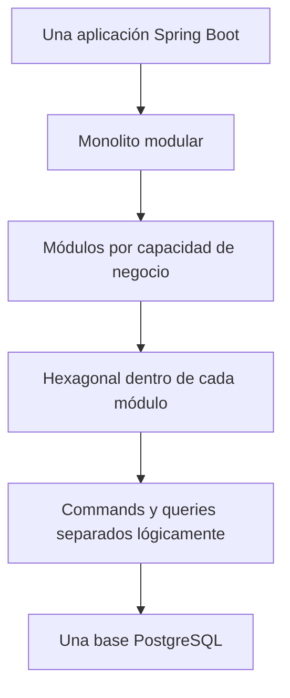
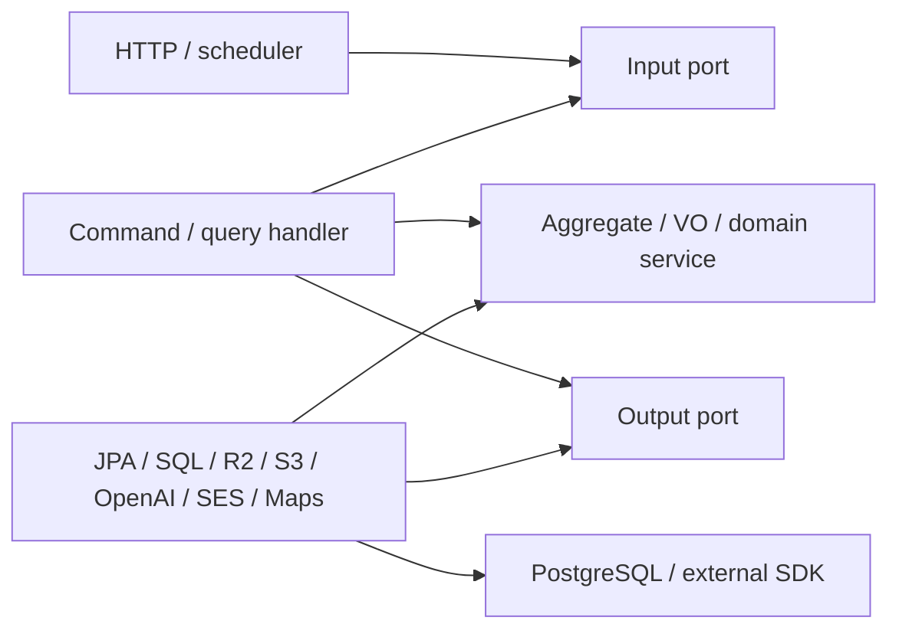
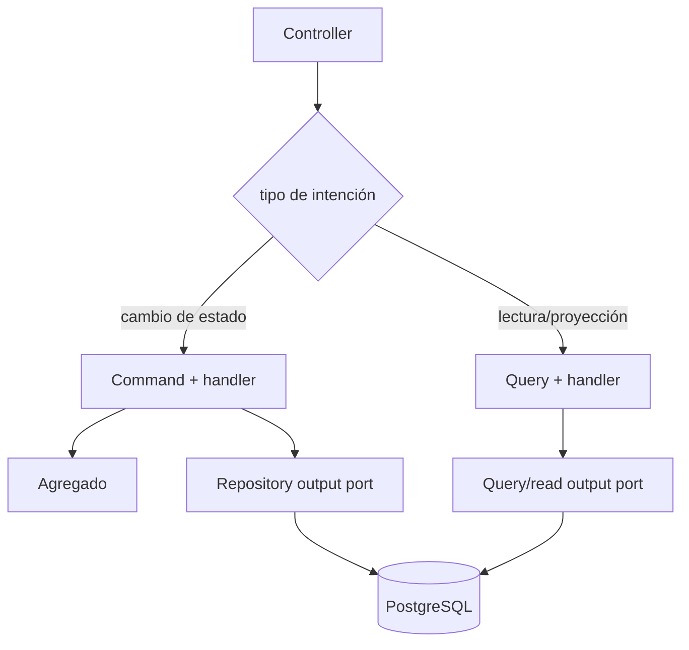
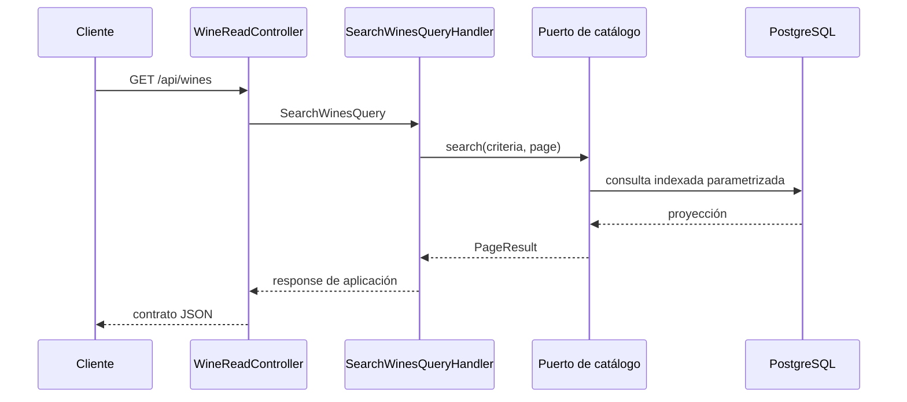
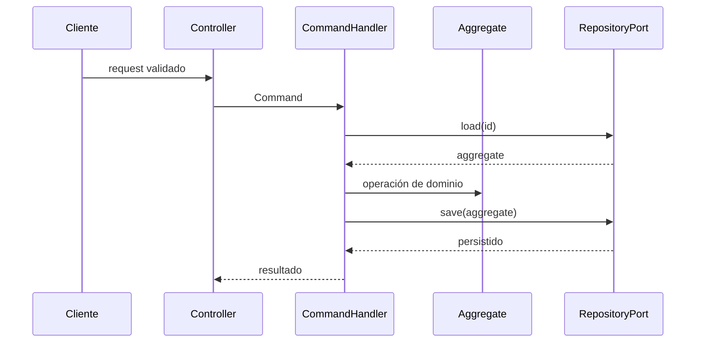

# Arquitectura del backend

## Clasificación arquitectónica exacta

El backend de Vinnot es un **monolito modular** desplegado como una única
aplicación Spring Boot y conectado a una única base PostgreSQL. “Monolito”
describe la unidad de compilación y despliegue; “modular” describe la separación
del código por capacidades de negocio.

Cada módulo con lógica propia organiza sus dependencias mediante **arquitectura
hexagonal (Ports and Adapters)**: dominio y aplicación definen contratos hacia
adentro; controllers, JPA, SQL y proveedores externos los implementan en el
borde. Hexagonal no es una alternativa a modular: se aplica dentro del monolito
modular.

La capa de aplicación usa **CQRS lógico**: commands y queries tienen modelos y
handlers distintos. No existen dos bases de datos, event sourcing ni un bus
distribuido. Ambos caminos usan PostgreSQL y comparten la transacción cuando el
caso de uso lo requiere.

[Ver diagrama de «Clasificación arquitectónica exacta» completo](https://images.vinnot.com/docs/diagrams/v1/es/backend-architecture-overview-d266ba47a348.svg)

## Unidades y límites

Los módulos principales son `wine`, `winery`, `review`, `cellar`, `event`,
`wineroute`, `user`, `ai`, `region`, `community`, `legal`, `support`, `payment`, `sharing`,
`notification`, `activity` y `engagement`. `support` es responsable de las
consultas públicas y delega su entrega durable en el outbox compartido.
`payment` administra cuentas Mercado Pago, checkout, conciliación y reembolsos
sobre inscripciones de `event`; `sharing` genera vistas previas HTML públicas de
vinos, eventos y rutas. `notification` es dueño de todo correo y push saliente:
plantillas, entrega por outbox, dispositivos push, preferencias, baja por enlace
y anuncios de administradores. `activity` registra qué detalles abre cada cuenta
y cuándo abre la app; `engagement` usa esas señales para planificar push
personalizados bajo un presupuesto compartido y los encola con los puertos de
`notification`.
`community` administra denuncias y bloqueos; `legal`, documentos contractuales y
aceptación versionada. La publicación de reseñas/comentarios, incluidas las decisiones sobre pendientes anteriores, pertenece a `review`. `admin` y `partner` son adapters/fachadas:
exponen operaciones para actores específicos y reutilizan casos de uso de los
módulos propietarios. `shared` contiene únicamente primitivas y adapters
transversales; no es un contenedor para reglas sin dueño.

| Concepto | Significado en Vinnot | No significa |
|---|---|---|
| módulo | límite de código y responsabilidad de negocio | servicio desplegable independiente |
| dominio | agregados, value objects, invariantes y políticas puras | entidades JPA o DTO HTTP |
| aplicación | commands, queries, handlers y puertos | controller o framework web |
| infraestructura | adapters HTTP, persistencia, seguridad y proveedores | lugar para reglas de negocio |
| puerto de entrada | contrato de un caso de uso invocado por un adapter conductor | endpoint HTTP |
| puerto de salida | necesidad expresada por aplicación hacia DB/proveedor/otro módulo | repositorio JPA concreto |
| CQRS | separación lógica de lectura y escritura | event sourcing o dos datastores |

## Hexágono por módulo

Vista de dependencias de código: el handler implementa el puerto de entrada; los adapters de salida implementan puertos de aplicación. Las interfaces no importan sus implementaciones.

[Ver diagrama de «Hexágono por módulo» completo](https://images.vinnot.com/docs/diagrams/v1/es/backend-architecture-overview-e076bbc7ce61.svg)

En runtime, la inyección enlaza driver → input port → handler → output port → adapter. La llamada sale hacia infraestructura, pero la dependencia de código del handler termina en la interfaz interna. Dominio no importa Spring, JPA, HTTP ni proveedores.

## Capas y responsabilidades

### Dominio

- agregados como `Wine`, `Event`, `EventRegistration`, `User` y `WineRoute`;
- value objects para dinero, coordenadas, estados, capacidad y fechas;
- invariantes que no requieren I/O;
- servicios puros de normalización y scoring.

El dominio no recibe `MultipartFile`, `ResponseEntity`, entidades JPA, prompts de
un SDK ni tipos de React.

### Aplicación

- modela intención mediante command/query;
- coordina agregados y puertos;
- establece orden, transacción y compensación;
- transforma dominio en responses de aplicación;
- decide fallback y errores de caso de uso.

Las anotaciones Spring presentes en handlers implementan wiring y límites
transaccionales. Esa integración de framework se limita a aplicación y no
autoriza imports de controllers, entidades JPA o clients concretos.

### Infraestructura

- controllers y requests HTTP;
- security filters y autorización de borde;
- entidades, repositories JPA, SQL nativo y mappers;
- adapters de R2/S3/filesystem, OpenAI/mock, OAuth, SES, Maps y Mercado Pago;
- configuración Spring, métricas y health.

La infraestructura valida forma de transporte y traduce errores tecnológicos;
no redefine invariantes del dominio.

## CQRS lógico

[Ver diagrama de «CQRS lógico» completo](https://images.vinnot.com/docs/diagrams/v1/es/backend-architecture-overview-13f04b3a5031.svg)

Commands cargan y modifican estado bajo invariantes. Queries pueden usar
proyecciones o SQL especializado y nunca mutan el dominio. La separación permite
optimizar `wine_catalog_search` sin trasladar SQL al controller ni inflar el
agregado `Wine`.

## Relaciones entre módulos

Aplicación expresa colaboraciones mediante puertos: cellar proyecta vinos con `WineQueryPort`; review actualiza estadísticas mediante `WineCommandPort`; wineroute resuelve bodegas por su contrato; admin reutiliza casos de uso de los módulos propietarios. Algunas colaboraciones de aplicación usan directamente puertos de otro módulo.

En infraestructura, `WinePersistenceAdapter` y `WineryPersistenceAdapter` usan repositorios/entidades de `region` para resolver referencias persistentes. Esa dependencia queda en los adapters y no convierte los modelos del dominio en entidades JPA. La topología sigue siendo un monolito modular sobre una PostgreSQL.

## Persistencia y transacciones

Flyway versiona PostgreSQL. Entidades JPA y SQL pertenecen a infraestructura. Los handlers/servicios anotados definen la unidad transaccional; los adapters pueden tener operaciones transaccionales propias. Controllers no abren transacciones y `spring.jpa.open-in-view=false` impide depender de una sesión abierta durante serialización.

S3, email y OpenAI no participan en el commit PostgreSQL. Avatar tiene compensación específica; generación IA coordina cache/lease sin una transacción de negocio durante la llamada al proveedor; submissions usan un advisory lock por identidad dentro de su orquestación transaccional. Notificar o mover un objeto es un efecto externo separado del commit. Véase [consistencia](errors-transactions-and-consistency.md).

## Flujo de lectura representativo

[Ver diagrama de «Flujo de lectura representativo» completo](https://images.vinnot.com/docs/diagrams/v1/es/backend-architecture-overview-4a932e02e3ff.svg)

## Flujo de escritura representativo

[Ver diagrama de «Flujo de escritura representativo» completo](https://images.vinnot.com/docs/diagrams/v1/es/backend-architecture-overview-fa7b475174b5.svg)

## Reglas obligatorias de dependencia

| Origen | Dependencias admitidas | Dependencias prohibidas |
|---|---|---|
| dominio | Java y tipos de dominio/shared puros | Spring, JPA, HTTP, storage, SDK externos |
| aplicación | dominio, commands/queries y puertos | controllers, entidades JPA, clients concretos |
| infraestructura | aplicación, dominio y frameworks | frontend; reglas nuevas que el dominio desconoce |
| controller | requests/mappers y puertos de entrada | SQL, JPA repositories, SDK de proveedor |

## Criterio para agregar funcionalidad

1. identificar el módulo y agregado propietario;
2. definir la intención como command/query o método de dominio;
3. ubicar validación de forma en web e invariantes en dominio/aplicación;
4. crear puerto de salida sólo para una dependencia necesaria;
5. implementar el adapter en infraestructura;
6. definir transacción, concurrencia, compensación y errores;
7. agregar tests en el path espejo;
8. actualizar API, datos, seguridad y documentación afectada.

## Evidencia en el repositorio

- `backend/src/main/java/com/vinnot/<module>/{domain,application,infrastructure}`;
- interfaces bajo `application/port/{in,out}`; `shared/application/port` también
  mantiene puertos transversales como `FileStoragePort` y `AccountAccessPort`
  directamente bajo `port/` sin división in/out, y `region` solo tiene `port/in`;
- handlers bajo `application/{command,query}`;
- adapters bajo `infrastructure`;
- migraciones en `backend/src/main/resources/db/migration`.

## Documentos relacionados

- [Límites modulares](module-boundaries.md)
- [API](api.md)
- [Errores y transacciones](errors-transactions-and-consistency.md)
- [Modelo de datos](../data/database-model.md)
- [Pruebas](../testing/strategy.md)
