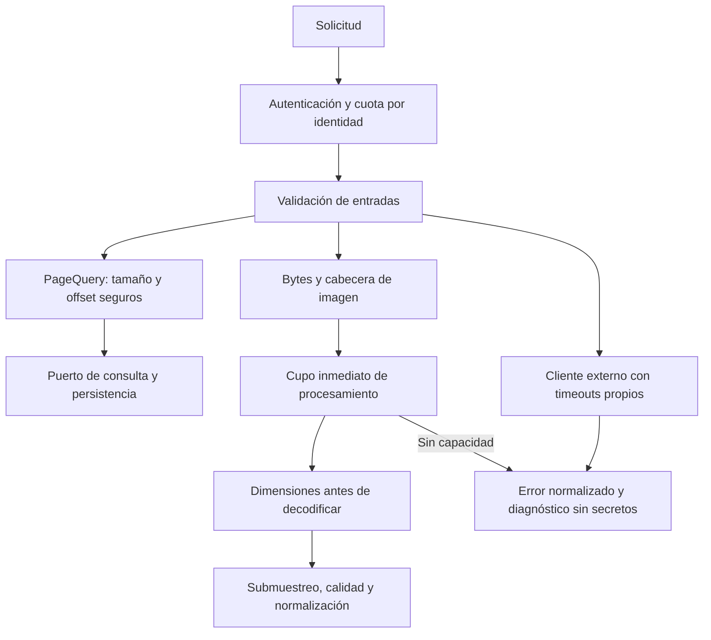
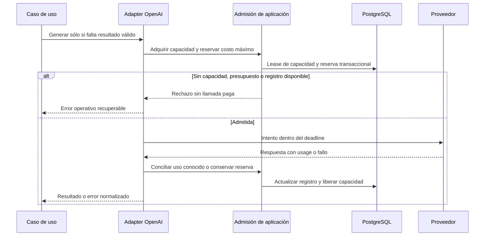

# Protección de recursos y transportes externos

## Distribución de responsabilidades

Los límites de paginación pertenecen al contrato de consulta y se validan antes
de construir un `Pageable`. La inspección de imágenes, el transporte HTTP y la
sanitización de logs pertenecen a infraestructura. Ninguno de esos mecanismos
introduce dependencias de Spring, ImageIO o HTTP en el dominio.

[Ver diagrama de «Distribución de responsabilidades» completo](https://images.vinnot.com/docs/diagrams/v1/es/backend-architecture-resource-protection-eae54a1c7df9.svg)

## Paginación

`PageQuery` exige `page >= 0`, `1 <= size <= 200` y que tanto el offset como
el extremo de la página entren en un entero de 32 bits. El cálculo usa `long`
antes de comparar. Una petición inválida produce `INVALID_PAGINATION` (422),
sin ejecutar la consulta paginada. El límite de 200 es un techo de
seguridad compartido, no el tamaño por defecto de las pantallas.

Los límites por superficie son:

| Superficie | Límite |
|---|---|
| Catálogo público de vinos | tamaño efectivo máximo 20, ventana de 500 resultados |
| Vinos similares públicos | máximo 10 |
| Discovery de eventos | tamaño entre 1 y 50; hasta 500 candidatos |
| Listado público de bodegas | tamaño efectivo máximo 20, ventana de 500 resultados |
| Búsqueda de eventos, próximos eventos y rutas publicadas | máximo 100; default 20 |
| Eventos admin/partner, inscripciones, rutas admin, usuarios, reseñas, cava y propuestas | techo de 200; defaults de pantallas 10–50 |
| Consultas que utilizan `PageQuery` | techo de 200; se conserva el tamaño solicitado válido |

Discovery acepta latitud entre -90 y 90, longitud entre -180 y 180 y radio
entre 0 y 500 km. Los tres valores deben ser finitos. Radio cero mantiene el
valor por defecto de 100 km. Una página posterior al último resultado retorna
una lista vacía con el total calculado; no desborda el índice de la lista.
Los filtros, el orden y el contenido de las páginas válidas no se transforman
por estos controles.

## Cuerpos JSON y colecciones

`JsonRequestResourceFilter` corre después de seguridad y antes de deserializar.
El JSON ordinario admite 1 MiB; `/admin/catalog-images` admite 8 MiB para el
contrato base64 existente de 7.000.000 caracteres. Se limita tanto la longitud
declarada como los bytes reales: sin Content-Length o con chunked tampoco se
lee más del máximo más un byte. El exceso responde 413
`REQUEST_BODY_TOO_LARGE`, con el contrato de error habitual.

La entrada JSON de imagen de catálogo admite dos solicitudes simultáneas por
instancia, sin cola. El permiso abarca lectura, deserialización y ejecución,
y se libera incluso si falla un controller o S3. Complementa el límite de
decodificación. Multipart conserva su lector y sus límites propios.

| Contenido mutable | Máximo |
|---|---:|
| Descripciones de catálogo, eventos, rutas y paradas | 20.000 caracteres |
| Instrucciones de pago de eventos | 5.000 caracteres |
| Notas de cava | 10.000 caracteres |
| Uvas/alérgenos | 50 elementos de hasta 100 caracteres |
| Tipos de vino recomendados en rutas | 50 elementos de hasta 50 caracteres |
| Paradas o IDs de bodegas en petición administrativa de ruta | 100 |
| `clearFields` de administración y de organizadores | 50 elementos de hasta 64 caracteres |

Los campos opcionales mantienen null y las semánticas de actualización parcial.
No se truncan ni completan valores para hacer pasar una validación. Búsquedas
y filtros de texto admiten 512 caracteres sin transformar coincidencias
parciales. Las opciones de orden de vinos y ASC/DESC se validan contra el
contrato declarado; esa validación no agrega ordenamientos nuevos.

## Frontera de confianza y operación

Caddy elimina `Forwarded` antes de reenviar y reemplaza los valores
`X-Forwarded-*` no confiables. Spring utiliza valores normalizados porque 8080
y 5432 permanecen privados y sólo el proxy publica HTTP/HTTPS. Cloudflare está
delante de la API: Caddy confía sólo en los rangos revisados de Cloudflare
(`trusted_proxies`), lee `CF-Connecting-IP` únicamente cuando el request viene de
ellos y envía a Spring un único `X-Forwarded-For` (`{client_ip}`) junto con
`X-Forwarded-Host`/`Proto` fijados por Caddy. Por eso
`RATE_LIMIT_TRUST_FORWARDED_FOR` es `true` en el compose desplegado. La misma
dirección queda en los eventos de seguridad (`security_events`). La cuota de HTTP por identidad es por JVM; capacidad y
registro monetario IA se comparten por DB.

La contabilidad IA comienza al habilitar V23; no importa consumo histórico de
OpenAI. Antes de activar el corte, el operador debe tener en cuenta lo ya
gastado. Si dev y producción usan bases separadas, se distribuyen sus límites
dentro del presupuesto total acordado, sin duplicarlo.

El pool JDBC espera hasta `DB_CONNECTION_TIMEOUT_MS=3000` para conseguir
conexión; `DB_VALIDATION_TIMEOUT_MS=1000` limita su comprobación. No reemplazan
los presupuestos SQL de cada consulta.

La cuota de credenciales por IP se complementa por cuenta: cinco contraseñas
incorrectas seguidas bloquean el inicio de sesión con contraseña durante 15
minutos (HTTP 423 con `Retry-After`), así que los intentos repartidos entre
muchas direcciones también se detienen. Véase
[bloqueo temporal del inicio de sesión](authentication-and-identity.md#bloqueo-temporal-del-inicio-de-sesión).

## Imágenes

`ImageResourceLimits` comparte el máximo de 24 millones de píxeles entre el
escáner y almacenamiento. La multiplicación de ancho por alto usa `long`.
`readBounded` consume como máximo 8 MiB más un byte de detección, incluso si
el tamaño declarado por el cliente es falso. Un exceso se rechaza antes de
escribir el objeto en disco o S3.

Los adapters de almacenamiento comprueban longitud real, firma, MIME y
dimensiones legibles. JPEG, PNG y GIF usan ImageIO; WebP conserva su soporte
mediante el plugin `imageio-webp` de TwelveMonkeys. La inspección de dimensiones
no decodifica el raster, no valida cada frame de una animación y no equivale a
un análisis antimalware. Los formatos admitidos no se amplían.

Escaneo y edición de catálogo mantienen JPEG/PNG y su normalización existente.
El escáner conserva sus requisitos de resolución, luminosidad y nitidez; una
imagen administrativa no necesita satisfacer condiciones de una fotografía
de cámara. El submuestreo ocurre antes de reservar el raster completo y la
imagen persistida conserva un lado mayor máximo de 1600 píxeles.

El procesamiento pesado comparte un semáforo por instancia de
`WineLabelUploadValidator`: dos operaciones por defecto. Un pedido espera hasta
2 segundos un permiso, porque decodificar lleva una fracción de segundo.
`IMAGE_PROCESSING_MAX_CONCURRENT` admite valores de 1 a 8. El permiso cubre
decodificación, análisis/normalización y liberación de buffers; siempre se
libera al completar o fallar. Si no se libera un permiso en esa espera, se
responde 503 con `IMAGE_PROCESSING_BUSY`. No se convierte la saturación en «vino no encontrado».

## Timeouts de transporte

| Configuración | Default | Alcance |
|---|---|---|
| `GOOGLE_MAPS_CONNECT_TIMEOUT` | `3s` | conexión de Directions |
| `GOOGLE_MAPS_READ_TIMEOUT` | `5s` | petición Directions completa, incluido el cuerpo |
| `SOCIAL_HTTP_CONNECT_TIMEOUT` | `3s` | conexión de Facebook, Apple y JWK |
| `SOCIAL_HTTP_READ_TIMEOUT` | `5s` | petición Facebook, Apple o JWK completa, incluido el cuerpo |

Se admiten presupuestos de 1 ms a 60 s. `DeadlineHttpRequestFactory` mantiene
el contrato de RestClient/RestTemplate y limita petición y respuesta a 1 MiB.
No sigue redirecciones ni agrega reintentos de aplicación. Espera el cuerpo
completo dentro del plazo y cancela la transferencia al vencer o interrumpirse;
la recepción de fragmentos no reinicia el reloj.

Además, `HttpOperationDeadline` delimita 15 s para verificar una identidad
social o revocar una autorización Apple: todas sus peticiones comparten el
tiempo restante, incluidos intercambio de código, JWK y revocación. El contexto
se restaura en `finally`, sin heredar presupuestos de una petición anterior.
El plazo del adapter no pretende medir la interacción humana del login ni el
resto del caso de uso de negocio. Maps y moderación usan instancias separadas
del mismo transporte; chat/visión conserva su cliente especializado.

Directions no se invoca con menos de dos o más de 27 paradas, coordenadas
ausentes/fuera de rango o sin clave. Conserva el resultado opcional: un fallo
retorna distancia no disponible, no una distancia inventada. No imprime la
URL de la petición, la clave ni el cuerpo del error del proveedor.

## Admisión, presupuesto y transporte IA

Los resultados válidos de caché se resuelven antes de contactar al proveedor.
`AiProviderAdmissionService` orquesta dos puertos: reutiliza
`AiGenerationLeasePort` para capacidad distribuida y usa `AiSpendingLedgerPort`
para reservas monetarias. El adapter OpenAI implementa transporte y precios;
los handlers y el dominio no dependen del SDK ni de SQL.

[Ver diagrama de «Admisión, presupuesto y transporte IA» completo](https://images.vinnot.com/docs/diagrams/v1/es/backend-architecture-resource-protection-290e372b7efd.svg)

| Variable | Default | Semántica |
|---|---:|---|
| `AI_MAXIMUM_CONCURRENT_REQUESTS` | 3 | intentos pagos simultáneos entre réplicas que comparten DB; rango 1–20; con 3 o más, el último cupo queda para los escaneos de etiquetas interactivos |
| `AI_INTERACTIVE_WAIT` | 4s | espera máxima de un pedido interactivo (escaneo de etiqueta) por un cupo libre |
| `AI_MONTHLY_LIMIT_USD` | 10 | ventana calendario mensual UTC |
| `AI_DAILY_LIMIT_USD` | 0 | ventana diaria UTC opcional; 0 desactiva sólo este límite adicional |
| `AI_PAID_CALLS_ENABLED` | true | pausa nuevas llamadas pagas sin invalidar caché |
| `AI_PROFILE_REFRESH_ENABLED` | true | regeneración en segundo plano de perfiles IA desactualizados; nunca corre en modo simulado |
| `AI_PROFILE_REFRESH_INTERVAL` | 2m | espera entre ejecuciones de la renovación |
| `AI_PROFILE_REFRESH_PROFILES_PER_RUN` | 1 | máximo de perfiles regenerados por ejecución; rango 1–20 |
| `AI_PROFILE_REFRESH_BUDGET_SHARE` | 0.5 | fracción de `AI_MONTHLY_LIMIT_USD` a partir de la cual la renovación se detiene en el mes |
| `OPENAI_CONNECT_TIMEOUT` | 10s | establecimiento de conexión |
| `OPENAI_READ_TIMEOUT` | 30s | operación de texto completa, incluidos intentos y pausas |
| `AI_IMAGES_ENABLED` | false | ilustraciones de redes con OpenAI; apagado usa la viñeta del pilar sin costo |
| `AI_IMAGES_MAX_COST_USD` | 0.25 | costo fijo que cada intento de imagen reserva y liquida contra los topes mensual y diario |
| `AI_IMAGES_TIMEOUT` | 110s | llamada de imagen completa con reintentos; como máximo 115 s para no pasar la concesión de 2 minutos |
| `AI_IMAGES_MAX_ATTEMPTS` | 2 | intentos de imagen; solo 429 y 5xx se reintentan, nunca un timeout ni una imagen rechazada |

El trabajo en segundo plano (perfiles, comparaciones, refresco) no tiene cola: sin
cupo se rechaza inmediatamente. Con tres o más cupos, el último queda reservado
para pedidos interactivos: un escaneo de etiqueta lo prueba primero y después
consulta todos los cupos hasta `AI_INTERACTIVE_WAIT` antes de responder 503
`AI_CAPACITY_EXCEEDED`.
Las leases `provider-capacity:<slot>` duran dos minutos, por encima del máximo
de 60 segundos de una operación OpenAI. Son distintas del single-flight por
vino/par, que conserva su espera finita para reutilizar una generación en curso.

V23 crea ventanas, reservas y su asociación. Un UPDATE condicional verifica
`spent + reserved + maximum <= limit` bajo transacción. El rechazo diario
revierte también la reserva mensual. Cada reintento reserva su propio costo.
La conciliación es idempotente y afecta las ventanas originales, aunque la
respuesta llegue después del cambio de día o mes.

La política tarifa `gpt-6-luna` (texto) y `gpt-4o-mini`/`gpt-4o-mini-2024-07-18`
(visión) con un único par conservador: USD 0,25 por millón de tokens de entrada
y USD 1,00 de salida, el tier aceptado más caro de esos modelos. El texto solicita
`service_tier=priority` (la respuesta informa `fast`); la visión solicita
`service_tier=default`. Sólo los tiers de `services.openai.pricing.service-tiers`
(`default,priority,fast`) concilian el uso real. Reserva el contexto de entrada completo (128.000
tokens) más la salida solicitada (hasta 16.384), sin estimaciones optimistas de
tokens de imagen. Modelos sin tarifa revisada no se ejecutan. Las propiedades
`services.openai.pricing.*` permiten actualizar precios y límites con el modelo.
[Fuente de precios](https://developers.openai.com/api/docs/pricing).

Con `usage` válido se libera la diferencia; la entrada cacheada se contabiliza
a tarifa ordinaria, de forma conservadora. Uso ausente, contradictorio, fuera
de límites o con modelo/tier no reconocidos conserva la reserva completa.
Timeout, caída del proceso y fallo de conciliación tampoco liberan dinero.
Una lease vencida sólo devuelve capacidad. La conciliación operativa requiere
evidencia del proveedor: no se deben borrar reservas para simular saldo.

El corte es por DB/entorno y por llamadas de este adapter, no un límite de
facturación de otras claves, herramientas, proyectos o entornos. Depende de
mantener las tarifas configuradas. AWS Budgets no limita OpenAI. La moderación
de contenido tiene adapter separado y no se registra como generación paga de
chat/visión.

La moderación de propuestas admite dos revisiones simultáneas por instancia,
antes de codificar la imagen. Sin capacidad se informa revisión automática
no disponible: nunca se marca contenido como seguro por saturación. El cupo
se libera al terminar o fallar, conservando la revisión manual. El plazo total
es 30 s, conexión hasta 10 s, petición hasta 12 MiB y respuesta hasta 1 MiB;
incluye descarga completa y no reintenta la revisión. Una respuesta sin un
booleano `flagged` válido tampoco aprueba contenido automáticamente.

El transporte no sigue redirecciones de credenciales. El deadline incluye
descarga del cuerpo, intentos y pausas; visión conserva el plazo específico del
escáner. Peticiones y respuestas se limitan a 12 MiB y 1 MiB respectivamente.
El máximo es tres intentos. Errores de facturación/cuota y HTTP permanentes no
se reintentan. Un 429 temporal o 5xx puede reintentarse dentro del plazo.
`Retry-After` se respeta como mínimo: si supera la espera admitida se devuelve
el fallo, sin reintento prematuro. Un timeout ambiguo no se reproduce
automáticamente. La interrupción cancela la espera HTTP y conserva el flag.

Los códigos `AI_CAPACITY_EXCEEDED`, `AI_BUDGET_EXHAUSTED`,
`AI_PAID_CALLS_PAUSED`, `AI_ADMISSION_UNAVAILABLE` y `AI_PRICING_UNAVAILABLE`
son fallos operativos, no «sin coincidencias». Perfiles/comparaciones guardados
siguen disponibles sin generar nuevas llamadas.

## Clientes AWS y eventos cercanos

S3 y SES usan clientes administrados y cerrados por Spring. Cada pool admite
20 conexiones: adquisición hasta 2 s, conexión hasta 3 s y socket hasta 10 s.
`AWS_API_CALL_TIMEOUT` es 15s y `AWS_API_ATTEMPT_TIMEOUT` es 12s; se exige
`10s <= attempt <= call <= 60s`. No se repiten automáticamente mutaciones de
resultado ambiguo. El plazo cubre una operación SDK, no un caso de uso con
varias operaciones ni todo el recorrido de un paginador S3.

`/events/nearby` valida coordenadas finitas, radio positivo hasta 500 km y
`PageQuery` antes de consultar. Conserva 500 candidatos y orden por distancia;
la página en memoria se calcula sin overflow. A diferencia de discovery,
radio cero no es un valor por defecto.

## Diagnóstico y compatibilidad

`SafeFailureDetails` conserva hasta cinco tipos de excepción y su primera
ubicación de código Vinnot. No concatena mensajes, causas serializadas ni
excepciones suprimidas. El borde HTTP mantiene método, ruta, estado, código y
request ID; SES no registra destinatario, asunto ni contenido del mensaje.

Los contratos de respuesta de login, archivos y catálogo no cambian. Estos
controles de admisión monetaria requieren V23. La configuración se
aplica al iniciar cada backend y puede diferir entre entornos. Las cuotas
por identidad y la coordinación de generaciones IA siguen sus contratos
documentados en [seguridad](security-and-authorization.md) y
[perfiles y comparaciones](../../modules/ai/architecture.md).
