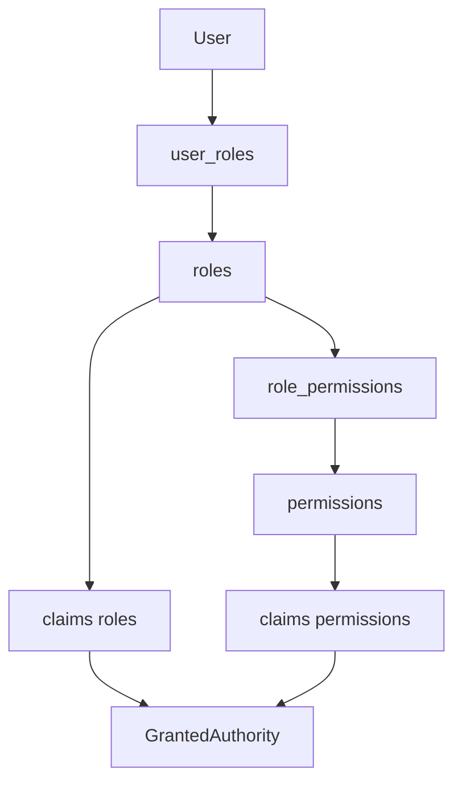

# Seguridad, autorización y protección de abuso

## Visibilidad de recursos por identidad

`ResourceReader` es un valor de dominio construido por el adapter a partir del
principal real: visitante, usuario identificado o personal de catálogo
(ADMIN/MODERATOR). No se acepta ese privilegio desde query/body. Los handlers
filtran antes de proyectar datos; recurso oculto e inexistente producen 404.

| Recurso | Lectura de publicado (con sesión) | Lectura privada autorizada |
|---|---|---|
| Vino | activo | createdBy, ADMIN, MODERATOR |
| Evento | publishedOnce y estado distinto de DRAFT | organizador, ADMIN, MODERATOR |
| Ruta | PUBLISHED | createdBy, ADMIN, MODERATOR |

Un evento publicado que se completa, pospone o cancela conserva su enlace.
Un borrador cancelado sin publicación previa permanece privado. Volver a DRAFT
oculta el detalle aunque exista historial de publicación. Las listas de eventos
mantienen sus filtros de descubrimiento; conservar un enlace no implica listar
eventos históricos como próximos.

La jerarquía geográfica de rutas se calcula sólo sobre PUBLISHED, al igual que
el catálogo de rutas. Las queries administrativas conservan sus filtros propios.
Los endpoints anidados de vino (AI profile, reviews, similar, label-image)
comprueban lectura mediante un interceptor MVC y un puerto de entrada; la
comparación comprueba ambos vinos antes de llamar al caso de uso. No se bloquea
el circuito privado de submissions por aplicar un wildcard general.

Las URLs de imágenes ya publicadas no se convierten en objetos privados al
desactivar un vino: esta regla controla respuestas de API, no revoca copias
públicas de medios. Quarantine mantiene su circuito autorizado independiente.

Las acciones sensibles ADMIN, y el cambio de email y el borrado permanente de la
propia cuenta de cualquier titular, añaden reautenticación reciente según
[el contrato de identidad](authentication-and-identity.md#admin-reauthentication).
`REAUTHENTICATION_REQUIRED` es 403, no inicia un ciclo automático de 401.

## Objetivo

La seguridad de Vinnot se implementa en capas complementarias. La frontera HTTP
autentica y aplica una política de acceso inicial; los casos de uso vuelven a
validar propiedad y estado; el dominio protege invariantes; PostgreSQL cierra
unicidad e integridad; los adapters validan archivos y proveedores externos.

Ninguna capa aislada constituye el modelo completo de autorización.

## Pipeline HTTP real

```mermaid
flowchart LR
    REQ["Request"] --> RID["Request ID + MDC"]
    RID --> CORS["CORS / Spring Security"]
    CORS --> JWT["JwtAuthenticationFilter"]
    JWT --> RATE["RateLimitingFilter"]
    RATE --> URL["Reglas por método y ruta"]
    URL --> METHOD["@PreAuthorize"]
    METHOD --> CTRL["Controller"]
    CTRL --> USECASE["Caso de uso + ownership"]
    USECASE --> DOMAIN["Invariantes"]
    DOMAIN --> RESPONSE["Respuesta o error normalizado"]
```

[Ver diagrama de «Pipeline HTTP real» completo](https://images.vinnot.com/docs/diagrams/v1/es/backend-architecture-security-and-authorization-fa323333bc0c.svg)

`HttpRequestLoggingFilter` tiene máxima precedencia: acepta un `X-Request-ID`
sólo si cumple `[A-Za-z0-9._-]{1,100}`; de otro modo genera UUID, lo guarda en
MDC y lo devuelve en el header. No registra bodies, tokens ni imágenes.

La API de negocio autentica mediante bearer y no usa una sesión HTTP de servidor.
El adapter `/auth/web/**` sí usa cookie de refresh: `BrowserSessionPolicy` exige
`Origin` de la lista explícita y `X-Vinnot-Web-Session: 1` antes de procesar la
operación, con cookie HttpOnly, `SameSite=Strict` y Secure en entornos remotos.
CSRF de Spring está deshabilitado; esta política de transporte de navegador es
parte del control vigente y se debe revisar al cambiar cookies, dominios u orígenes.
Véase [identidad](authentication-and-identity.md) para los contratos completos.

Los filtros de JWT y rate limiting deshabilitan su registro servlet automático
y se insertan una sola vez en `SecurityFilterChain`. El rate limiter ejecuta
después de JWT para poder usar `user:<uuid>` cuando hay identidad y `ip:<addr>`
para requests anónimos.

## Autenticación del bearer token

`JwtAuthenticationFilter` sólo procesa `Authorization: Bearer <token>`. Un token
válido debe tener firma HMAC correcta, estructura válida y no estar vencido. El
subject se convierte a UUID; roles y permisos se proyectan a authorities de
Spring Security:

- los cuatro valores admitidos por `Role` se proyectan como `ROLE_USER`,
  `ROLE_ADMIN`, `ROLE_MODERATOR` y `ROLE_PARTNER`;
- cada código de permiso cargado desde `role_permissions` se convierte en una
  authority sin prefijo, en mayúsculas, por ejemplo `WINE_UPDATE` o
  `EVENT_CREATE`;
- el principal disponible a controllers y handlers es el UUID serializado.

Un bearer ausente o inválido no produce autenticación. Si la ruta la requiere,
`RestAuthenticationEntryPoint` responde `401` con el contrato estándar y código
`AUTHENTICATION_REQUIRED`. Un usuario autenticado sin autoridad recibe `403`;
no se confunden ambos estados.

Antes de aceptar un JWT válido, el filtro consulta `AccountAccessPort`: la
cuenta debe existir, estar activa y desbloqueada, y sus roles actuales deben
coincidir con los claims. El adapter realiza una consulta indexada por UUID a
usuarios/roles sin hidratar agregados. Un cambio de roles, bloqueo, desactivación
o eliminación rechaza la siguiente solicitud con 401. `/auth/refresh` delega la
validación al flujo de refresh y no bloquea su ejecución por un access token
anterior; el caso de uso verifica el estado de la cuenta.

Los detalles criptográficos y de rotación se documentan en
[Autenticación e identidad](authentication-and-identity.md).

## Frontera pública y autenticada

`SecurityConfig` aplica deny-by-default mediante `anyRequest().authenticated()`.
Las excepciones públicas son explícitas:

| Superficie | Acceso |
|---|---|
| login, registro, refresh, recuperación y verificación | público |
| `/health`, `/version`, actuator health | público |
| OpenAPI (`/api-docs`, `/api-docs.yaml`, `/api-docs/**`) y Swagger UI (`/swagger-ui/**`, `/swagger-ui.html`, `/webjars/swagger-ui/**`) | usuario y contraseña del navegador de una cuenta ADMIN activa, verificada y sin bloqueo (cadena propia, `ApiDocumentationSecurityConfig`) |
| `/actuator/**` salvo health básico | sólo `ROLE_ADMIN`; detalles de health también ADMIN |
| GET términos vigentes/versionados; POST soporte | público |
| GET `/app-versions/minimum` | público, política de actualización de la app móvil |
| GET/HEAD `/share`, `/share/en`, `/share/*/*` y `/share/*/*/en` | público, vistas previas HTML de enlaces |
| POST `/payments/mercadopago/webhooks[/*]` | público, firma de Mercado Pago verificada |
| POST `/payments/mercadopago/connection/callback`; GET `/payments/receipt` | público, state de un solo uso o token de comprobante |
| GET avatar/etiqueta bajo `/uploads/**` | pública, filename validado |
| POST `/uploads/covers` | permiso de creación/edición por kind en el método |
| GET `/uploads/covers/{id}.webp` | visibilidad/ownership en el caso de uso, sin cache |
| GET grape types, regiones y reference data | autenticado |
| GET catálogo de vinos, bodegas, eventos y rutas | autenticado |
| GET perfil publicado `/users/{id}/profile` | autenticado |
| `/wines/submissions/**` | autenticado antes de evaluar `/wines/**` |
| `/admin/users` y `/admin/users/**` | sólo `ROLE_ADMIN` |
| `/admin/notifications/**` | sólo `ROLE_ADMIN` |
| `/admin/app-versions` y `/admin/app-versions/**` | sólo `ROLE_ADMIN` |
| `/admin/**` | `ROLE_ADMIN` o `ROLE_MODERATOR`; DELETE de catálogo sólo ADMIN |
| todo lo demás | autenticado |

El orden de matchers es parte de la seguridad. Submissions se declara antes del
wildcard de vinos; ambos exigen sesión. La lectura anónima devuelve 401 antes
de evaluar visibilidad/ownership. La política de contenido publicado no implica acceso anónimo.

El catálogo de vinos conserva una política de exposición del adapter web:

- tamaño máximo de página: 20;
- ventana máxima por búsqueda: 500 resultados;
- máximo de similares: 10;
- páginas negativas, tamaño no positivo o una ventana excedida producen error
  de dominio.

La política limita la superficie de catálogo, no los puertos internos ni los casos
de uso administrativos.

## Roles, permisos y propiedad

Vinnot combina RBAC y permisos granulares:

[Ver diagrama de «Roles, permisos y propiedad» completo](https://images.vinnot.com/docs/diagrams/v1/es/backend-architecture-security-and-authorization-fbb666a21daa.svg)

Los permisos se cargan al emitir o renovar sesión y quedan en el access token.
Cambiar permisos en base no modifica JWT ya emitidos; el cambio converge al
renovar o expirar la sesión.

### Roles de producto

| Rol | Intención actual |
|---|---|
| `USER` | catálogo, reseñas propias, cava y operaciones autenticadas comunes |
| `PARTNER` | creación y gestión propia de eventos además de capacidades base |
| `MODERATOR` | moderación de contenido según permisos sembrados |
| `ADMIN` | acceso global y superficie `/admin/**` |

El enum Java de roles operativos es `USER`, `PARTNER`, `MODERATOR` y `ADMIN`.
La autoridad efectiva de un endpoint se determina por SecurityConfig y su
PreAuthorize, no por el nombre funcional del rol.

### Permisos de cada rol

La tabla lista los 31 permisos que cada rol tiene en base, tal como quedan después
de [V76](../../../../backend/src/main/resources/db/migration/V76__remove_unused_roles_and_permissions.sql). La siembra está en [V2](../../../../backend/src/main/resources/db/migration/V2__seed_reference_data.sql); ninguna otra migración
agrega grants a `role_permissions`. V76 eliminó los roles sin uso
`ROLE_TOURISM_OPERATOR` y `ROLE_VERIFIED_EXPERT` y los permisos `ARTICLE_*`, y
se detiene si alguna cuenta todavía tiene uno de esos roles.
[UnusedRolesRemovalMigrationPostgresIntegrationTest](../../../../backend/src/test/java/com/vinnot/user/infrastructure/persistence/UnusedRolesRemovalMigrationPostgresIntegrationTest.java) verifica el resultado.

| Permiso | `USER` | `PARTNER` | `MODERATOR` | `ADMIN` | Comprobado en el backend |
|---|:-:|:-:|:-:|:-:|---|
| `WINE_READ` | ✓ | ✓ | ✓ | ✓ | no; solo viaja en el token |
| `WINE_CREATE` |  |  | ✓ | ✓ | sí, `hasAuthority` |
| `WINE_UPDATE` |  |  | ✓ | ✓ | sí, `hasAuthority` |
| `WINE_DELETE` |  |  |  | ✓ | sí, `hasAuthority` |
| `WINERY_READ` | ✓ | ✓ | ✓ | ✓ | no; solo viaja en el token |
| `WINERY_CREATE` |  |  | ✓ | ✓ | sí, `hasAuthority` |
| `WINERY_UPDATE` |  |  | ✓ | ✓ | sí, `hasAuthority` |
| `WINERY_DELETE` |  |  |  | ✓ | sí, `hasAuthority` |
| `EVENT_READ` | ✓ | ✓ | ✓ | ✓ | no; solo viaja en el token |
| `EVENT_CREATE` |  | ✓ | ✓ | ✓ | sí, `hasAuthority` |
| `EVENT_UPDATE` |  |  | ✓ | ✓ | sí, `hasAuthority` |
| `EVENT_UPDATE_OWN` |  | ✓ |  | ✓ | sí, `hasAuthority` |
| `EVENT_DELETE` |  |  |  | ✓ | sí, `hasAuthority` |
| `EVENT_DELETE_OWN` |  | ✓ |  | ✓ | sí, `hasAuthority` |
| `WINE_ROUTE_READ` | ✓ | ✓ | ✓ | ✓ | no; solo viaja en el token |
| `WINE_ROUTE_CREATE` |  |  | ✓ | ✓ | sí, `hasAuthority` |
| `WINE_ROUTE_UPDATE` |  |  | ✓ | ✓ | sí, `hasAuthority` |
| `WINE_ROUTE_UPDATE_OWN` |  |  |  | ✓ | sí, `hasAuthority` |
| `WINE_ROUTE_DELETE` |  |  |  | ✓ | no; solo viaja en el token |
| `WINE_ROUTE_DELETE_OWN` |  |  |  | ✓ | no; solo viaja en el token |
| `REVIEW_CREATE` | ✓ | ✓ | ✓ | ✓ | sí, `hasAuthority` |
| `REVIEW_UPDATE_OWN` | ✓ | ✓ | ✓ | ✓ | sí, `hasAuthority` |
| `REVIEW_DELETE` |  |  | ✓ | ✓ | sí, `hasAuthority` |
| `REVIEW_DELETE_OWN` | ✓ | ✓ | ✓ | ✓ | sí, `hasAuthority` |
| `USER_READ` |  |  | ✓ | ✓ | no; solo viaja en el token |
| `USER_UPDATE` |  |  |  | ✓ | no; solo viaja en el token |
| `USER_BAN` |  |  |  | ✓ | no; solo viaja en el token |
| `USER_DELETE` |  |  |  | ✓ | no; solo viaja en el token |
| `ROLE_ASSIGN` |  |  |  | ✓ | no; solo viaja en el token |
| `CELLAR_MANAGE_OWN` | ✓ | ✓ |  | ✓ | sí, `hasAuthority` |
| `ADMIN_DASHBOARD_READ` |  |  | ✓ | ✓ | no; solo viaja en el token |

Totales: `USER` 8, `PARTNER` 11, `MODERATOR` 18 y `ADMIN` 31 (todos).

Lo que conviene saber al leer la tabla:

- Los permisos efectivos de una cuenta son la unión de sus roles. Asignar un rol
  desde Admin conserva `ROLE_USER` ([`User.replaceRole`](../../../../backend/src/main/java/com/vinnot/user/domain/model/User.java)), así que una cuenta
  `MODERATOR`, `PARTNER` o `ADMIN` también recibe los permisos de `USER`.
- El rol `MODERATOR` por sí solo no tiene `CELLAR_MANAGE_OWN`. Todo
  [`/cellar`](../../../../backend/src/main/java/com/vinnot/cellar/infrastructure/web/controller/CellarController.java) exige ese permiso, de modo que una cuenta moderadora usa su
  cava gracias a `ROLE_USER`; sin ese rol no podría.
- Los permisos `*_READ`, `USER_*`, `ROLE_ASSIGN`, `ADMIN_DASHBOARD_READ`,
  `WINE_ROUTE_DELETE` y `WINE_ROUTE_DELETE_OWN` están sembrados pero ningún
  controller los comprueba. Las lecturas exigen sesión, no un permiso; la
  administración de usuarios, roles y el dashboard se protege con
  `hasRole('ADMIN')` o `hasAnyRole('ADMIN', 'MODERATOR')`; y el borrado de rutas
  del vino es `DELETE /admin/routes/{id}` con `hasRole('ADMIN')` en
  [`WineRouteAdminController`](../../../../backend/src/main/java/com/vinnot/admin/infrastructure/web/controller/WineRouteAdminController.java).
- `REVIEW_DELETE` se combina con el rol en la moderación de reseñas y comentarios:
  `hasAnyRole('ADMIN','MODERATOR') and hasAuthority('REVIEW_DELETE')`.

### Permisos usados en controllers

| Familia | Permisos relevantes |
|---|---|
| vinos | `WINE_CREATE`, `WINE_UPDATE`, `WINE_DELETE` |
| bodegas | `WINERY_CREATE`, `WINERY_UPDATE`, `WINERY_DELETE` |
| eventos | `EVENT_CREATE`, `EVENT_UPDATE`, `EVENT_UPDATE_OWN`, `EVENT_DELETE`, `EVENT_DELETE_OWN` |
| rutas | `WINE_ROUTE_CREATE`, `WINE_ROUTE_UPDATE`, `WINE_ROUTE_UPDATE_OWN` |
| reseñas | `REVIEW_CREATE`, `REVIEW_UPDATE_OWN`, `REVIEW_DELETE`, `REVIEW_DELETE_OWN` |
| cava | `CELLAR_MANAGE_OWN` |
| administración | catálogo/moderación ADMIN o MODERATOR; usuarios y DELETE de catálogo ADMIN |

### Ownership

PreAuthorize controla la autoridad; los casos de uso aplican la comprobación de recurso que muestra esta matriz. La presencia de una sesión por sí sola no describe el alcance de una query.

| Operación | Identidad / control efectivo |
|---|---|
| GET /cellar, /cellar/stats | UUID del principal |
| GET /cellar/user/{userId}[/stats] | CELLAR_MANAGE_OWN; UUID del path |
| PATCH/DELETE /cellar/{id} | principal y propietario de entrada |
| submissions propias | submittedBy = principal |
| revisión administrativa | ROLE_ADMIN o ROLE_MODERATOR |
| mutaciones partner/evento | organizador o excepción admin del command |
| editar reseña | autor o flag admin; reviewId del command |
| borrar comentario | autor o permiso global; commentId del command |
| confirmar/reportar pago | propietario de inscripción |

## Rate limiting

La protección usa Bucket4j con buckets almacenados en Caffeine. Cada política
tiene capacidad, cantidad de refill y período configurables:

| Política | Rutas principales | Default |
|---|---|---:|
| `credential` | login, social login, `/auth/web/login`, `/auth/web/social` y `/auth/reauthenticate` | 10/min |
| `account-action` | reset/verificación/cambio/eliminación de cuenta; POST callback de conexión Mercado Pago | 5/15 min |
| `registration` | registro | 5/h |
| `support` | POST soporte; comparte configuración con registration | 5/h |
| `report` | POST denuncias de comunidad (`/community/reports`) | 10/h |
| `refresh` | renovación | 60/min |
| `ai` | perfil, generación y comparación | 20/h |
| `wine-scan` | escaneo de etiqueta | 30/h |
| `wine-submission` | alta propuesta o imagen de etiqueta | 10/día |
| `media-upload` | POST portadas; misma configuración que wine-submission, contadores separados | 10/día |
| `wine-catalog` | GET bajo `/wines` | 60/min |
| `public-catalog` | GET/HEAD bodegas, eventos, rutas y `/share/**` | 180/min |
| `wine-catalog-daily` | mismas rutas que `wine-catalog`, además del límite por minuto | 1500/día |
| `public-catalog-daily` | mismas rutas que `public-catalog`, además del límite por minuto | 1500/día |
| `api-documentation` | OpenAPI y Swagger UI, por dirección, antes de validar credenciales | 30/min |
| `general` | resto | 300/min |

Son defaults operativos sobrescribibles por variables de entorno; por ejemplo,
`report` usa `RATE_LIMIT_REPORT_CAPACITY` (10), `RATE_LIMIT_REPORT_REFILL_TOKENS` (10)
y `RATE_LIMIT_REPORT_REFILL_PERIOD` (`1h`). No representan
planes comerciales ni una cuota contractual del producto.

Una respuesta limitada devuelve:

- HTTP `429`;
- `X-RateLimit-Limit`;
- `X-RateLimit-Remaining`;
- `Retry-After`;
- body normalizado con `RATE_LIMIT_EXCEEDED`.

Health, version y preflight `OPTIONS` no consumen bucket.

### Cupo diario del catálogo

Las dos políticas diarias limitan cuánto del catálogo puede leer una cuenta o una
dirección en un día, para que no se pueda copiar de forma masiva. Una persona que
navega nunca se acerca. Las cuentas ADMIN y MODERATOR quedan exentas, y los datos
propios (rutas que terminan en `/me` o `/mine`, como la inscripción que la web
consulta mientras un pago está pendiente) nunca cuentan. Cuando una
cuenta con sesión agota un cupo diario, la API responde 429 y bloquea la cuenta
mediante `AutomatedAccountSuspensionPort`, implementado por el módulo de usuarios:
es el mismo bloqueo permanente que una suspensión administrativa, con motivo
`TERMS_VIOLATION: Automatic suspension: daily catalog quota exceeded`, el email de
suspensión y los dispositivos push olvidados. La siguiente petición con esa sesión
se rechaza. Un administrador quita el bloqueo desde el panel de usuarios y el cupo
vuelve a empezar de cero. Una dirección anónima que lo agota solo recibe 429. Los
cupos usan `RATE_LIMIT_WINE_CATALOG_DAILY_*` y `RATE_LIMIT_PUBLIC_CATALOG_DAILY_*`.
Los contadores viven en la memoria del backend, así que un reinicio los reinicia.

### Identidad del bucket

- request autenticado: `user:<uuid>`;
- request anónimo: `ip:<remote-address>`;
- con `trust-forwarded-for=true`, se toma la dirección del último hop informado.

`X-Forwarded-For` sólo debe confiarse cuando el backend está detrás de proxies
controlados que reemplazan o limpian ese header. Habilitarlo directamente frente
a Internet permitiría evasión por spoofing.

La expiración ociosa de buckets debe ser al menos igual al período de refill más
largo. `RateLimitProperties` falla al iniciar si la configuración permitiría que
una expulsión de cache reseteara prematuramente una cuota.

### Alcance de los buckets

Los buckets viven en la JVM. Cada réplica mantiene su propio estado y refill;
la cuota configurada es por proceso. La identidad de cliente se resuelve mediante
la configuración de proxy y el principal disponible.

## CORS y exposición del navegador

CORS usa una allowlist exacta de `app.cors.allowed-origins`, métodos
`GET,POST,PUT,PATCH,DELETE,OPTIONS`, headers de request abiertos y credenciales
habilitadas. Se exponen `X-Request-ID`, los headers de rate limit y
`Retry-After`.

Implicancias:

- agregar un frontend requiere incorporar su origin exacto al entorno;
- no debe combinarse `allowCredentials=true` con `*` como origin;
- CORS protege navegadores, no reemplaza autenticación de API;
- apps nativas no dependen de CORS, pero sí de TLS y bearer tokens.

## Uploads y contenido no confiable

El upload general valida allowlist JPEG/PNG/GIF/WebP, tamaño hasta 8 MiB, firma/MIME y nombre/path. Avatar usa ese storage y coordina referencia del usuario y limpieza con su caso de uso; no realiza el mismo re-encode que etiquetas.

WineLabelUploadValidator admite JPEG/PNG, valida firma, decodifica y comprueba dimensiones/calidad. /scan recibe los bytes validados sin re-encode. Submissions y label-image invocan validateAndSanitizeForPersistence: generan JPEG RGB de hasta 1600 px de lado largo, sin copiar metadata fuente. La cuarentena tiene namespace y acceso administrativo propios. Moderación evalúa contenido, no reemplaza la validación estructural ni una decisión de identidad de catálogo.

Detalles: [uploads](../use-cases/uploads-and-reference-data.md) y [escaneo](../../modules/wines/architecture.md).

## Datos sensibles y logging

HttpRequestLoggingFilter registra método, path, status, duración y requestId, no bodies ni cabeceras Authorization. Ese alcance corresponde al filtro, no a todos los adapters de aplicación. Los adapters de email se seleccionan por configuración: el proveedor log solo registra que se solicitó un mensaje (sin destinatario, enlace ni token), mientras SES envía mediante su cliente. Su selección y los destinos de logs forman parte de la configuración del entorno.

Secretos se inyectan por entorno/secret store. Rotar JWT_SECRET cambia la clave con que se verifican access JWT y afecta tokens ya emitidos. Ejemplos y documentación no contienen valores reales de credenciales ni payloads de usuarios.

## Contrato de errores de seguridad

SecurityConfig y filtros pueden rechazar requests antes del controller. En MVC, AUTH_FAILED como BusinessRuleViolationException se mapea a 401; FORBIDDEN y REAUTHENTICATION_REQUIRED a 403; otros códigos de esa clase, incluidos errores de ownership específicos, a 422. DomainException normalmente produce 400; integridad de datos, 409; entidad ausente, 404. La cuota rechazada usa 429 y Retry-After. El contrato detallado y los campos reales están en [errores](errors-transactions-and-consistency.md). El cliente no debe renovar sesión repetidamente ante un error de permiso o de regla de negocio.

## Revisión de amenazas por flujo

| Amenaza | Control vigente |
|---|---|
| enumeración de usuarios | errores y mensajes neutros en login/forgot/resend |
| robo de base de sesiones | refresh y action tokens hasheados |
| replay de refresh | rotación y revocación |
| replay de enlace | token tipado, vencimiento y `usedAt` |
| Acceso por recurso | controles de la matriz de ownership por operación |
| escalamiento de rol | endpoints admin y handlers de asignación protegidos |
| token social forjado | verificación server-side de firma/issuer/audience/sujeto |
| upload disfrazado | MIME/firma; decodificación y re-encode en etiquetas persistidas |
| path traversal | nombre saneado y key/path generado por servidor |
| abuso de IA/costo | cuota específica por usuario/IP |
| extracción masiva de catálogo | page/window cap + cuota de lectura |
| Logging HTTP | filtro sin bodies ni Authorization |

## Pruebas obligatorias

### Configuración de rutas

Cada endpoint nuevo necesita casos para:

1. request anónimo;
2. token inválido o vencido;
3. usuario autenticado sin permiso;
4. propietario con permiso `*_OWN`;
5. usuario con permiso global;
6. admin cuando corresponda.

`SecurityConfigAccessTest` debe actuar como red de regresión de la frontera. Los
tests de controller no reemplazan los de ownership en handlers.

### Pruebas de rate limiting

- resolución exacta de política por método/path;
- separación entre buckets de usuario e IP;
- headers y body de `429`;
- exclusiones de health/docs/OPTIONS;
- validación de `bucket-idle-expiration`;
- `X-Forwarded-For` confiado y no confiado.

### Uploads

- MIME permitido con firma incorrecta;
- archivo truncado o no decodificable;
- límite exacto y exceso de tamaño;
- dimensiones extremas;
- re-encode sin metadata;
- rollback/compensación de storage;
- acceso de un usuario a media de otro.

## Checklist para una nueva operación

- [ ] El endpoint tiene acceso público o autenticado explícito.
- [ ] Declara el permiso granular o rol exacto exigido para el actor y la
  operación; no mezcla ownership propio con acceso administrativo.
- [ ] El handler valida ownership con el principal real.
- [ ] No acepta `userId` como sustituto de identidad.
- [ ] Tiene política de rate limit y costo definida.
- [ ] Sus errores preservan el contrato común.
- [ ] No registra secretos, bodies sensibles ni binarios.
- [ ] Si recibe archivos, valida contenido y aplica compensación.
- [ ] Tiene pruebas de acceso, ownership y abuso.
- [ ] La documentación ES/EN y el catálogo de API se actualizan juntos.

## Referencias

- `backend/src/main/java/com/vinnot/shared/infrastructure/config/SecurityConfig.java`
- `backend/src/main/java/com/vinnot/shared/infrastructure/security`
- `backend/src/main/java/com/vinnot/shared/infrastructure/storage`
- `backend/src/main/java/com/vinnot/wine/infrastructure/web/WineLabelUploadValidator.java`
- `backend/src/main/resources/application.yml`
- [Catálogo de API](api.md)
- [Autenticación e identidad](authentication-and-identity.md)
- [Observabilidad](observability.md)

## Contratos de sesión y efectos

[Sesiones, publicación y efectos externos](session-and-data-integrity.md) define generación de credenciales, conflictos 409, locks, outbox y reintentos. El logger de email no imprime destinatarios, enlaces ni tokens; el proveedor IA registra tipos de excepción, no cuerpos de error externos.
