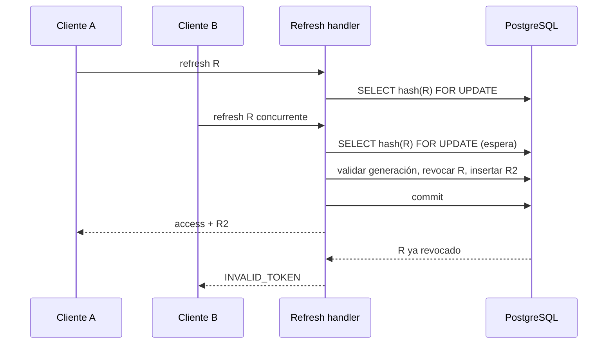
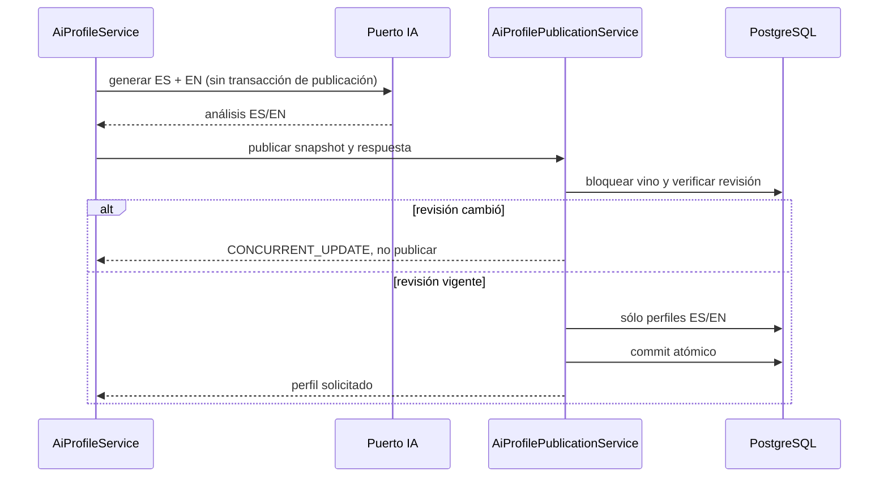
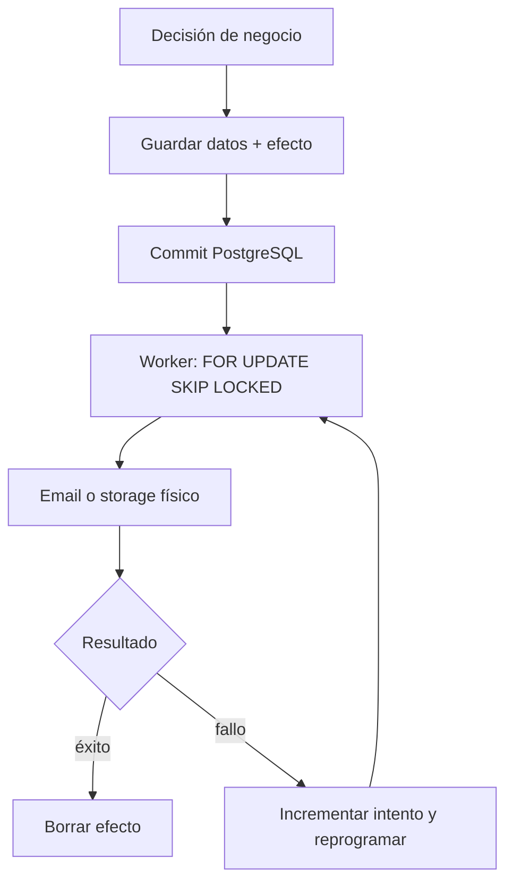
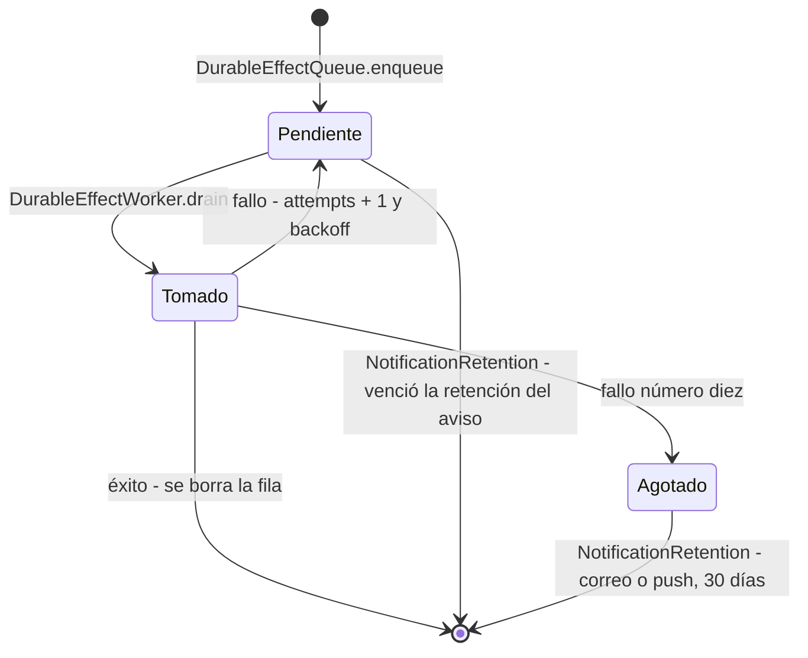

# Sesiones, publicación y efectos externos

## Responsabilidades y límites

Los casos de uso coordinan reglas y puertos; los adapters implementan locks,
versionado, SQL y almacenamiento. El dominio `User` mantiene la generación de
sesión sin depender de JWT/JPA. `Wine` y `User` transportan una revisión opaca;
sus entidades de persistencia implementan control optimista con `@Version`.
Un conflicto no se convierte en éxito ni en un recurso inexistente: responde
`409 CONCURRENT_UPDATE` y el cliente debe recargar antes de repetir la edición.

## Sesiones versionadas

`users.session_version` identifica la generación de credenciales. El access JWT
incluye `sessionVersion` y cada fila de `refresh_tokens` guarda su snapshot.
Cambiar contraseña, confirmar otro email, modificar roles, desactivar o bloquear
una cuenta incrementa la generación. Un JWT sin claim se interpreta como versión
0 por compatibilidad; no evita la consulta del estado actual de la cuenta.

`JwtAuthenticationFilter` consulta `AccountAccessPort` para comprobar existencia,
actividad, bloqueo, roles y generación. La firma válida y la fecha de expiración
no bastan si la cuenta cambió. La renovación compara también el snapshot del
refresh con el usuario vigente; una discrepancia devuelve `INVALID_TOKEN`.

[Ver diagrama de «Sesiones versionadas» completo](https://images.vinnot.com/docs/diagrams/v1/es/backend-architecture-session-and-data-integrity-b9047406ea9d.svg)

Logout con un token revoca también sus descendientes de rotación conocidos.
Así, un logout que espera el lock de una renovación no deja vivo al sucesor.
Logout sin token sólo confirma la operación: no identifica una sesión remota.
Logout no incrementa la generación global ni cierra otras sesiones; el access
JWT ya emitido puede durar hasta su expiración si no cambia la cuenta.

## Publicación de perfiles y comparaciones

Cada contenido nuevo incluye `_generation`, con `source` (`provider`, `mock` o
`manual`) y una huella SHA-256 del contexto/configuración. La procedencia histórica
`catalog` sigue siendo legible, pero ya no se genera una plantilla para pares escasos. Es metadata del
backend, no un campo confiado al proveedor. La comparación incorpora el prompt
completo y modelo; el perfil incorpora versión de prompt, modelo y datos enviados.

Un comando de generación reutiliza el perfil solicitado sólo si el bundle ES/EN
existe y su procedencia es compatible con el contexto actual; una edición manual
se reconoce explícitamente. La lectura `GET` y el estado de perfil conservan
acceso al contenido histórico sin llamadas pagas implícitas. Las comparaciones
exigen estructura válida y huella vigente en ambos idiomas. El cambio de idioma
no añade una llamada cuando existe un bundle reutilizable.

[Ver diagrama de «Publicación de perfiles y comparaciones» completo](https://images.vinnot.com/docs/diagrams/v1/es/backend-architecture-session-and-data-integrity-662756a2df59.svg)

Una falla de proveedor real no activa contenido simulado: retorna
`503 AI_PROFILE_UNAVAILABLE` o `503 AI_COMPARISON_UNAVAILABLE`. El generador mock
de perfiles se habilita únicamente con `AI_PROVIDER=mock`, no enriquece catálogo
y queda identificado como tal. Campos opcionales `null` representan ausencia de
información, no un error de parsing. La validación estructural no demuestra
exactitud factual; el prompt solicita análisis completo usando contexto y
conocimiento del modelo, distingue estimaciones sensoriales y consejos orientativos,
y prioriza los datos conocidos. Los scores estimados se conservan en el informe,
no se publican como mediciones del catálogo.
La publicación normal conserva traducciones editadas manualmente; una
regeneración forzada explícita sí reemplaza el bundle.

## Orden de escritura y agregados

| Operación | Coordinación | Invariante al commit |
|---|---|---|
| Confirmar, revisar o expirar inscripción | Evento antes de inscripción | Cupos e inscripción consistentes |
| Cancelar evento | Lock de evento y cancelación de inscripciones activas | Contadores liberados; no se simulan reintegros |
| Moderar propuesta | Lock de submission y comprobación `NEEDS_REVIEW` | Una decisión; competidor recibe conflicto |
| Crear/editar/eliminar reseña | Vino antes de reseña | Promedio/count derivados del conjunto persistido |
| Like/unlike | Lock de reseña | Contador y filas de likes coordinados |
| Eliminar cuenta | Usuario, vinos/eventos/reseñas afectados | Recalcular proyecciones tras cascadas |

`WineCommandAdapter` escribe sólo columnas de rating; las escrituras ORM de
catálogo no actualizan esas columnas. La sincronización de reseña a cava y la
actualización del rating pertenecen a la transacción del caso de uso: una falla
se propaga y revierte la operación. El borrado de cuenta bloquea primero el
usuario para impedir nuevas referencias FK durante el cálculo de afectados.
Las restricciones de PostgreSQL siguen siendo la última barrera de integridad.

## Outbox de efectos externos

`external_effects` almacena intentos durables de notificación y limpieza.
`DurableEffectQueue.enqueue` participa de la transacción de negocio. Un rollback
descarta también el efecto; el worker sólo ve filas confirmadas.

[Ver diagrama de «Outbox de efectos externos» completo](https://images.vinnot.com/docs/diagrams/v1/es/backend-architecture-session-and-data-integrity-0d05d5c6c1b1.svg)

### Ciclo de vida de una fila

[Ver diagrama de «Ciclo de vida de una fila» completo](https://images.vinnot.com/docs/diagrams/v1/es/backend-architecture-session-and-data-integrity-5a433a3c41c7.svg)

La tabla no tiene columna de estado: se deduce de `attempts`, `next_attempt_at` y
de si la fila existe.

Un drenado toma hasta `app.effects.batch-size` (20) filas vencidas en una
transacción corta que las arrienda (`next_attempt_at` avanza `app.effects.lease`,
15 minutos) y confirma, las ejecuta en hilos virtuales (como máximo
`app.effects.concurrency`, 4, a la vez) y sigue tomando hasta que no queda nada
vencido o se agota `app.effects.drain-budget` (60 s). Un handler transaccional
corre en su propia transacción, que además bloquea la fila; el handler de push
corre fuera de toda transacción, así ninguna conexión espera a Expo. Una fila que
dejó un worker caído vuelve a vencer cuando termina su arriendo. Los drenados
arrancan con un aviso de commit (V65, `DurableEffectWakeUp` escuchando
`external_effects`) y con el sondeo de `app.effects.poll-ms` (30 segundos por
defecto) como respaldo. El backoff empieza en 30 segundos y crece hasta una hora;
después de diez fallos la fila queda retenida. Un correo o push agotado nunca se
reenvía, porque pudo haber llegado, y se borra a los 30 días
(`app.notifications.exhausted-retention`). Guarda el tipo de excepción, no payloads,
destinatarios ni credenciales en logs. La entrega de correo es **al menos una
vez**: un crash entre el envío y el commit puede repetir una notificación. Los push
siguen las garantías de la
[arquitectura de notificaciones](../../modules/notifications/architecture.md#rendimiento-y-garantías-del-outbox).

`TransactionalFileStorageAdapter` decora el proveedor físico local/S3. Antes de
escribir una imagen registra en una transacción independiente una reconciliación
con demora de dos horas. Ese registro sobrevive al rollback de negocio. El worker
borra sólo objetos administrados que ya no estén referenciados. Para avatares
además exige una antigüedad mínima de una hora. La promoción copia la imagen;
la eliminación de cuarentena se realiza después del commit y de revalidar refs.
Un vino aprobado puede conservar su imagen aunque se elimine al usuario que
envió la propuesta: la referencia del catálogo impide su borrado.

Todos los emails usan este outbox a través del [módulo de notificaciones](../../modules/notifications/architecture.md)
(`NotificationEffectHandler`): acciones de cuenta, decisiones de propuestas, soporte
público y cambios de inscripción. Los cambios de inscripción siguen entrando por
`EventRegistrationEffectHandler`, que entrega el aviso al módulo dentro de la misma
transacción del worker. Ningún email de cuenta se envía de forma síncrona. La revocación Apple precede al borrado transaccional local y no forma
parte de una transacción distribuida.

## Persistencia y referencias

- `V17__version_account_sessions.sql`: generación de sesión y revisión de usuario.
- `V18__durable_external_effects.sql`: outbox e índice parcial de imágenes administradas.
- `V19__version_wine_catalog.sql`: revisión del catálogo.
- `shared/infrastructure/effects`: cola, worker y estrategias.
- `shared/infrastructure/storage`: decorator y verificación de referencias.
- `user/infrastructure/persistence/adapter/AccountDeletionIntegrity.java`: cascadas y proyecciones.
- [Autenticación](authentication-and-identity.md), [consistencia](errors-transactions-and-consistency.md),
  [modelo de datos](../data/database-model.md), [diagramas](../diagrams/data-consistency.md).
