# Modelo de datos y persistencia

## Historial de publicación de eventos

V22 añade `events.published_once BOOLEAN NOT NULL DEFAULT FALSE`. El dominio lo
activa al publicar y lo conserva en cancelación/finalización/posposición. La
lectura pública exige ese indicador y estado distinto de DRAFT. La migración
marca los eventos preexistentes no DRAFT para conservar enlaces históricamente
públicos; no reconstruye fechas de publicación desconocidas. Los borradores
nuevos cancelados sin publicación permanecen privados. La columna es aditiva;
el backend que aplica esta política debe desplegarse después de Flyway.

V44 añade `events.schedule_version BIGINT NOT NULL DEFAULT 0`. El dominio la
incrementa cuando cambian el inicio, el fin o el lugar legible, y los avisos de
cambio usan esa versión como clave. El binario anterior nunca la escribe y sigue
funcionando. V44 también redefine `enqueue_event_registration_change()` para que
una cascada de cancelación no encole la copia genérica al asistente: la
aplicación envía `EVENT_CANCELLED_ATTENDEE` en su lugar.

V45 añade `event_registrations.reminded_at` (nullable) y el índice parcial
`idx_event_registrations_reminder_pending` (`event_id`, confirmadas y sin
recordatorio). Registra el recordatorio del evento (#301) para enviarlo una sola
vez; la clave del outbox sola no alcanza, porque las filas entregadas se borran.
Marcarla no cambia `notification_version`, así que el trigger de inscripciones no
encola nada. Es aditiva: el binario anterior la ignora. V48 agrega del mismo modo
`reminded_soon_at` e `idx_event_registrations_soon_reminder_pending`, para el
recordatorio solo push de unas dos horas antes (#304). V49 agrega
`organizer_push_digests` (clave primaria `event_id` y `organizer_id`, ambas en
cascada, contadores `confirmed`, `requested`, `cancelled` y `due_at`; índices
sobre `due_at` y `organizer_id`):
resúmenes push abiertos del organizador, que se borran al enviarse. Tabla nueva: el
binario anterior la ignora. V50 agrega `user_event_areas` (#305): una fila por
usuario que activó "eventos cerca tuyo", con `region_id` (región del catálogo) o
`latitude`/`longitude` redondeadas a 0,1° (`numeric(4,1)`, unos 11 km), nunca
ambas (restricción check) ni una posición precisa; se borra en cascada con el
usuario y la región, con índices parciales sobre `region_id` y la ubicación
redondeada. V51 indexa `push_sends(user_id, category, sent_at)` para los límites
de push por categoría. V52 agrega `user_taste_affinities` (#306): por usuario,
una fila por uva (nombre normalizado y etiqueta más común) y por tipo de vino,
con `score` (promedio, de 0 a 5), `rated_wines` y `computed_at`; se reemplaza
cada noche desde las puntuaciones de reseñas y cava, se borra en cascada con el
usuario y tiene índice en `(kind, value)` para las coincidencias. V53 agrega
`review_publication_decisions.reason_code`, opcional (#307: el motivo predefinido
del rechazo que se le comunica al autor; las aprobaciones y las decisiones
anteriores no lo tienen). V54 agrega `moderation_digest_cursor`, una única fila
(`id = 1`) con `covered_until`, iniciada en la migración, para que el resumen del
equipo de moderación informe cada ventana de trabajo nuevo una sola vez. Ambos
cambios son aditivos. V55 agrega `review_like_summary_cursor` (#308): una fila por
frecuencia (`DAILY`, `WEEKLY`) con `covered_until`, iniciada en la migración, para
que cada resumen de "me gusta" informe una ventana una sola vez y nunca anuncie los
"me gusta" anteriores. Solo una tabla nueva. V56 agrega
`legal_terms_announcements` (#309): una fila por revisión de aceptación con
`last_user_id`, `started_at` y `completed_at`, el cursor del correo de
actualización de términos. Solo una tabla nueva. V57 amplía `users.lock_reason` a
300 caracteres para que una suspensión guarde su código de motivo antes de un
detalle de 255 caracteres (`CODE: detalle`). V58 agrega la columna opcional
`payment_accounts.reconnect_notified_for`: el vencimiento de credenciales de la
conexión cuyo organizador ya recibió el pedido de reconexión; se limpia cuando la
cuenta se reconecta o se renueva. Ambos cambios son aditivos. V61 agrega
`idx_wines_inactive_name_page`, un índice parcial por nombre (con `id`) de los vinos
inactivos, para el listado del equipo que incluye inactivos. V85 agrega
`idx_wines_inactive_name_trgm` e `idx_wineries_inactive_name_trgm`, índices GIN trigram
parciales sobre los nombres de vinos y bodegas inactivos, para el nivel fuzzy de la
búsqueda del equipo; son aditivos. V86 agrega los read models mantenidos por
triggers `wine_catalog_filter_search`, `wine_grape_search` y `wine_grape_keys` para
las búsquedas con filtros (ver más abajo); las tablas existentes no cambian. V62 agrega
`users.password_set` (`boolean NOT NULL`, default `true`): si la contraseña guardada
la eligió su titular. El relleno lo deja en `false` cuando la primera identidad social
se guardó junto con la cuenta, o se vinculó a una cuenta local que todavía no había
probado su email, y la persona no usó después un restablecimiento de contraseña. V63
agrega a `payment_refund_intents` el estado `REJECTED`, `rejection_reason` y
`rejections` (`integer NOT NULL`, default 0). Los tres cambios son aditivos.

V46 crea `push_devices` (token Expo push como clave primaria, `user_id` con
`ON DELETE CASCADE`, plataforma, idioma, fecha de alta y de última vez visto) e
`idx_push_devices_user`. Tabla nueva: el binario anterior nunca la usa.

V47 crea `push_sends` (`dedupe_key`, `user_id` con `ON DELETE CASCADE`,
`category`, `capped`, `sent_at`; clave primaria `(dedupe_key, user_id)`) y
`push_receipts` (`ticket_id`, `token`, `created_at`). `push_sends` permite que un
trabajo de push reintentado omita las cuentas que ya alcanzó y es lo que cuenta
el tope diario (se guarda 7 días); `push_receipts` guarda los tickets de Expo
hasta leer su recibo (se guarda 24 horas). Solo tablas nuevas.

V59 (#310) crea `push_type_switches` (`notification_type` como clave primaria,
`enabled`, `updated_at`, `updated_by` con `ON DELETE SET NULL`): el equipo activa o
desactiva cada tipo de push sin desplegar, y un tipo sin fila está activo. Cada
cambio queda en `push_type_switch_changes` (`id` secuencial, `notification_type`,
`previous_enabled`, `enabled`, `changed_by` con `ON DELETE SET NULL`,
`changed_by_email` y `changed_at`); el email conserva el registro después de borrar
la cuenta. `push_delivery_outcomes` (clave primaria `day, notification_type,
outcome`, con `count`) cuenta por día UTC las cuentas, o los mensajes de
dispositivo en el caso de `FAILED`, de cada tipo y resultado para las métricas del
equipo. V59 agrega además `push_receipts.notification_type`, opcional, para contar
un recibo fallido contra su tipo; las filas anteriores no lo tienen. Índices sobre
`changed_at DESC` y sobre las columnas de autor cuando tienen valor. Tablas nuevas y
una columna opcional: el binario anterior las ignora y sigue enviando todos los
tipos.

V60 (#310) crea `announcements`, un registro por envío manual del equipo (quién,
qué, cuándo y a cuántos destinatarios), que es también el cursor de su entrega por
lotes (`last_user_id`, `completed_at`). Guarda `kind` (`NEWS` o `SERVICE`), `test`,
los canales `send_email`/`send_push` (un `CHECK` exige al menos uno), la audiencia
opcional (`audience_language` `es`/`en`, `audience_region_id`,
`audience_country_id`, `audience_role` `PARTNER`/`MODERATOR`/`ADMIN`),
`destination`, títulos y cuerpos por idioma (un `CHECK` exige al menos un título),
`recipients`, `sent_by` con `ON DELETE SET NULL`, `sent_by_email` y `created_at`.
Región y país no tienen clave foránea: si desaparecen, nadie coincide en lugar de
ampliarse la audiencia. El `id` puede ser el id de solicitud del cliente, así un
pedido repetido encuentra el primero. Índices sobre los pendientes, `created_at
DESC` y `sent_by`. Solo una tabla nueva.

V65 (#405) agrega `push_devices.channels` (`boolean NOT NULL`, `false` por
defecto: la app creó los canales de Android por categoría),
`idx_push_devices_last_seen` para eliminar los dispositivos sin registrar durante
120 días, y el trigger `external_effects_wake_up`
(`notify_external_effect_due()`): insertar un trabajo que vence en el momento
ejecuta `pg_notify('external_effects', '')`, que se entrega al confirmar la
transacción, así el worker que escucha lo drena sin esperar su sondeo. Aditiva: el
binario anterior ignora la columna, el índice y los avisos.

V68 (#405) pone `push_devices.last_seen_at = greatest(last_seen_at, now())` en
todos los dispositivos existentes, una sola vez. Las versiones de la app anteriores
a #405 solo registran el dispositivo cuando cambia el token o el idioma, así que su
`last_seen_at` está viejo aunque se sigan usando, y la primera purga de 120 días
(V65) los borraría. Con este reinicio la retención empieza al desplegar; desde ahí
la app se registra en cada arranque en frío. Solo datos: el binario anterior lee la
misma columna. Efecto lateral: el planificador de engagement también toma la última
visita de una cuenta de sus dispositivos, así que durante unos 14 días después del
despliegue ninguna cuenta cuenta como ausente y el winback empieza 14 días más
tarde. Se acepta: sin el reinicio, los miembros activos con versiones viejas (que no
envían aperturas de la app) recibirían por error "Te extrañamos".

V69 (#428) crea `app_minimum_versions` (`platform` como clave primaria, `IOS` o
`ANDROID`; `minimum_version` opcional; `updated_at` y `updated_by` con
`ON DELETE SET NULL`, ambos vacíos hasta que se fija un valor por primera vez).
Guarda la versión más vieja de la app móvil que cada plataforma de tienda sigue
admitiendo; las versiones anteriores muestran la pantalla de actualización
obligatoria. Una plataforma sin fila, o con `minimum_version` vacío, no bloquea
ninguna versión. Un `CHECK` acepta solo `major.minor.patch`, cada parte de 1 a 4
dígitos. Cada cambio real queda en `app_minimum_version_changes` (`id` secuencial,
`platform`, `previous_minimum_version` y `minimum_version`, ambos vacíos para "sin
mínimo", `changed_by` con `ON DELETE SET NULL`, `changed_by_email` y `changed_at`);
el email conserva el registro después de borrar la cuenta. Guardar el mismo valor no
registra nada. Los cambios concurrentes de una plataforma esperan sobre su fila
(`SELECT … FOR UPDATE`). Hay índices sobre `changed_at DESC` y sobre las columnas de
autor cuando tienen valor. Solo tablas nuevas: el binario anterior las ignora.

V70 (#455) crea `user_points`, `user_point_awards`, `user_point_movements` y
`wine_label_scans`, el almacenamiento de [puntos y sellos](../../modules/gamification/README.md):
un registro de movimientos por persona (fuente, clave de origen, puntos y fecha; las
revocaciones son movimientos negativos y cada premio es único por persona, fuente y
clave de origen), el estado de cada persona (nivel celebrado y tarjeta de bienvenida) y
un registro nuevo de escaneos con coincidencia exacta por persona. La misma migración
calcula los puntos históricos desde los datos existentes con las mismas fuentes, claves
y topes diarios, no envía push, marca el nivel calculado como ya celebrado y deja
pendiente la tarjeta de bienvenida; los escaneos no tienen historial. La eliminación
definitiva de una cuenta borra sus puntos. V71 (#455) agrega
`cellar_wines.rating_decimal` (un decimal de 0.1 a 5.0) junto al entero `rating`
1–5, que se conserva, como cambio de expansión y contracción (ver `cellar_wines`).

V72 (#482) agrega a `users` el bloqueo temporal del inicio de sesión (ver más
abajo). V73 (#482) crea `security_events`, la auditoría de seguridad de las
cuentas (ver [Identidad y autorización](#security_events-v73)). Ambas son
aditivas: el binario anterior las ignora.

## Fuente de verdad y estrategia de evolución

El esquema productivo se administra exclusivamente mediante Flyway en
`backend/src/main/resources/db/migration`. La migración
`V1__baseline_schema.sql` representa el estado consolidado del esquema legado y
las versiones posteriores agregan identidad social, tokens de acción,
onboarding, workflow de eventos, submissions, cachés bilingües de IA y el read
model de búsqueda.

Reglas operativas:

1. una migración aplicada es inmutable;
2. todo cambio se incorpora en una nueva versión ordenada;
3. la entidad JPA debe mapear el estado final, no una versión intermedia;
4. constraints e índices forman parte de las reglas persistentes y se revisan
   junto con el caso de uso;
5. una migración pesada se prueba con volumen equivalente al catálogo real;
6. local/development validan y aplican Flyway al arrancar; producción aplica
   y valida migraciones con el runner separado y arranca con Flyway deshabilitado
   y validación JPA del esquema.

PostgreSQL habilita `unaccent` y `pg_trgm`. El primero permite normalización
lingüística; el segundo soporta similitud y búsqueda parcial indexada.

## Mapa global de relaciones

### Identidad y acceso

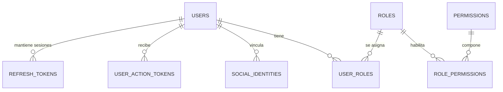

[Ver diagrama de «Identidad y acceso» completo](https://images.vinnot.com/docs/diagrams/v1/es/backend-data-database-model-24814c35bbbb.svg)

### Catálogo

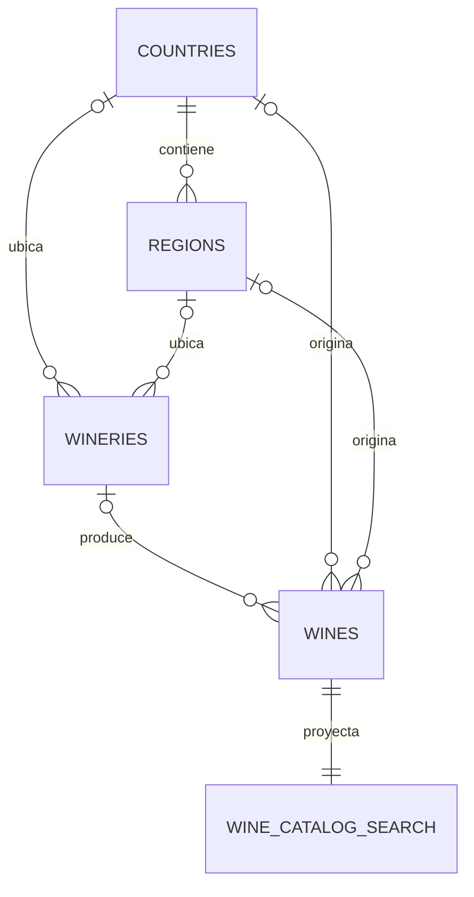

[Ver diagrama de «Catálogo» completo](https://images.vinnot.com/docs/diagrams/v1/es/backend-data-database-model-44e4162b0e3a.svg)

### Reseñas y cava

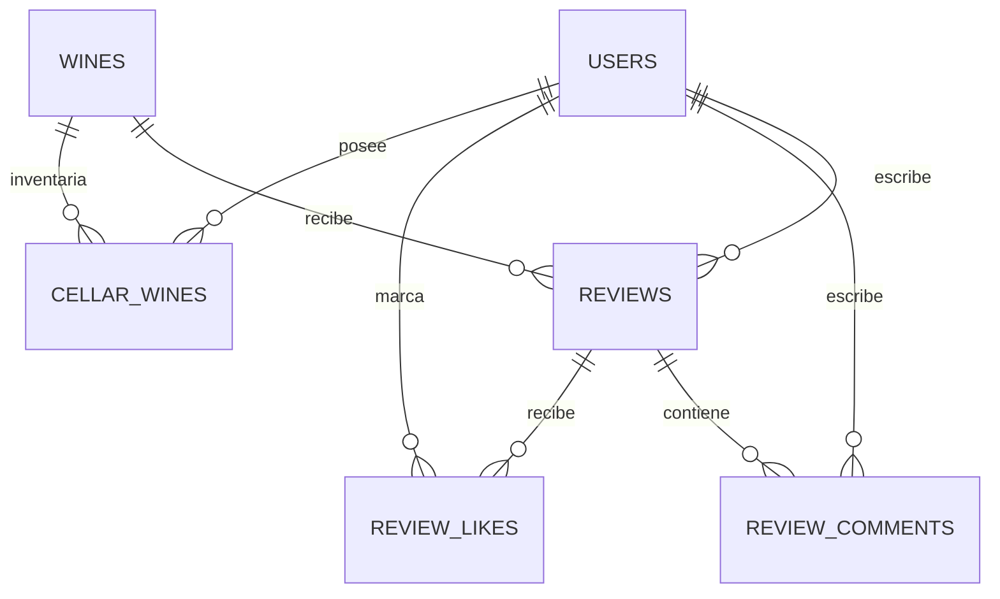

[Ver diagrama de «Reseñas y cava» completo](https://images.vinnot.com/docs/diagrams/v1/es/backend-data-database-model-fd76ca2e709b.svg)

### Eventos y pagos

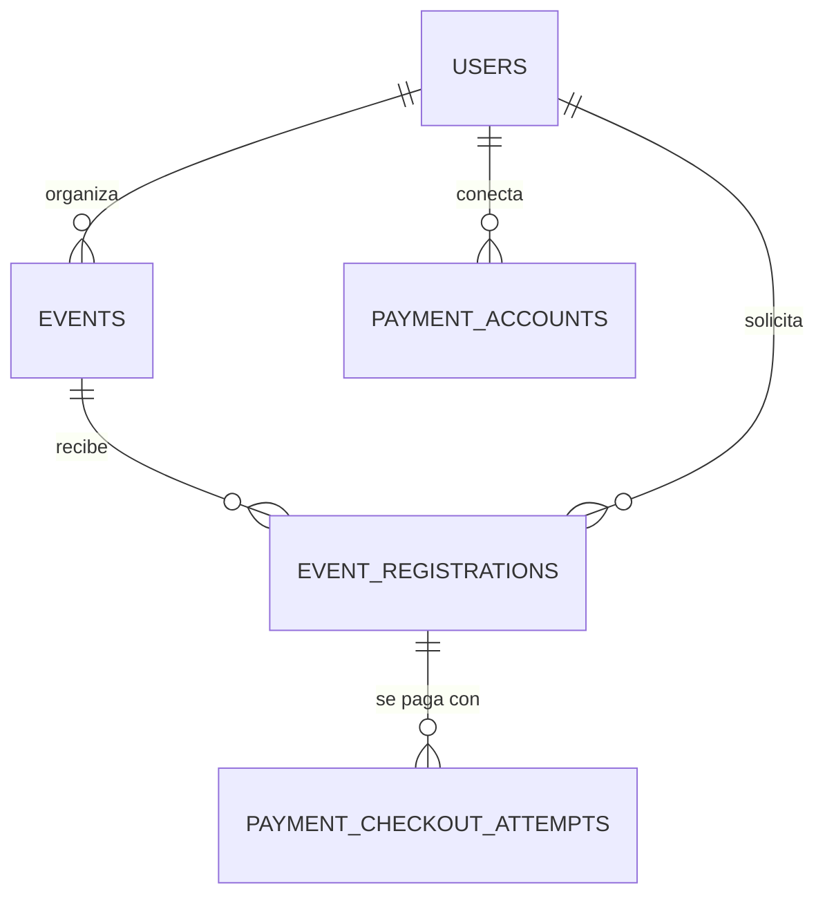

[Ver diagrama de «Eventos y pagos» completo](https://images.vinnot.com/docs/diagrams/v1/es/backend-data-database-model-2e60069b7b2b.svg)

### Rutas

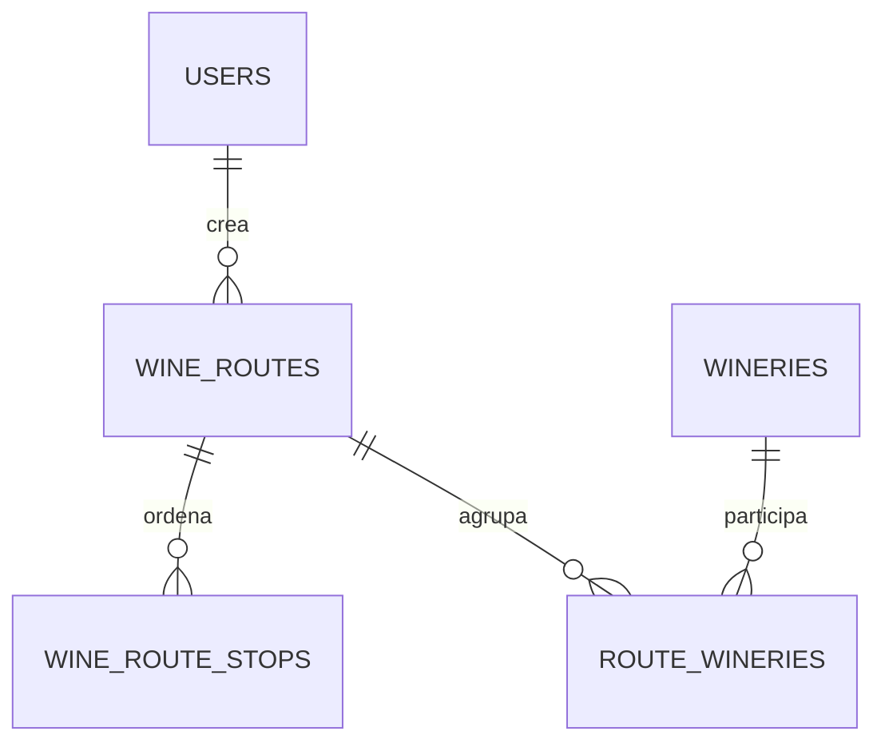

[Ver diagrama de «Rutas» completo](https://images.vinnot.com/docs/diagrams/v1/es/backend-data-database-model-07dc59a2f3d8.svg)

### IA y propuestas

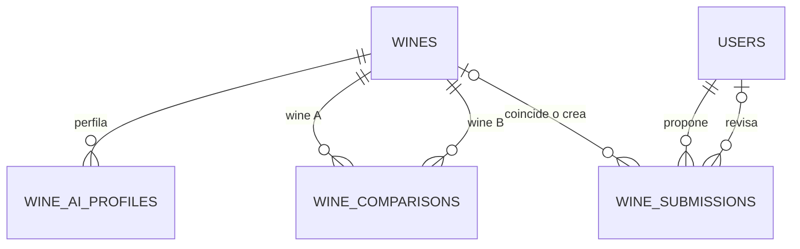

[Ver diagrama de «IA y propuestas» completo](https://images.vinnot.com/docs/diagrams/v1/es/backend-data-database-model-40646b4968c5.svg)

## Convenciones transversales

- Los agregados de negocio usan UUID.
- Los campos persistidos como `timestamp with time zone` se mapean a `Instant`
  en entidades/adapters Java; fechas sin hora conservan un tipo de fecha y no se
  convierten artificialmente a `Instant`.
- `created_at` y `updated_at` permiten trazabilidad básica; no reemplazan una
  bitácora de auditoría.
- Relaciones de composición usan normalmente `ON DELETE CASCADE`.
- Relaciones históricas que pueden sobrevivir a la entidad referenciada usan
  `ON DELETE SET NULL`.
- Los catálogos extensibles almacenan `code`, nombres ES/EN, `active` y
  `sort_order`.
- JSONB se reserva para estructuras variables o generadas, no para ocultar
  relaciones que necesitan integridad relacional.
- La capa de dominio no depende de entidades JPA; cada adapter convierte entre
  ambos modelos.

## Identidad y autorización

### `users`

Es la raíz persistente de identidad. Guarda email y username únicos, password
hasheado, nombre, avatar, flags `active`, `locked` y `email_verified`, motivo de
bloqueo, última autenticación, estado de onboarding y timestamps. V28 agrega
`phone_number`, privado y opcional, validado contra `^\+[1-9][0-9]{6,14}$`;
los usuarios existentes quedan sin número. V39 agrega `preferred_language`
(`varchar(8)`, default `es`, restringido a `es`/`en`) y `timezone`
(`varchar(64)`, identificador IANA, default `America/Argentina/Buenos_Aires`),
ambos `NOT NULL`; los usuarios existentes reciben los defaults. V62 agrega
`password_set` (`boolean NOT NULL`, default `true`), falso cuando la contraseña
guardada es un secreto aleatorio que nadie conoce. V72 agrega
`failed_login_attempts` (`integer NOT NULL`, default 0, `CHECK >= 0`) y
`login_locked_until` (`timestamptz`; vacío o pasado significa sin bloqueo): el
bloqueo temporal del inicio de sesión, independiente del flag administrativo
`locked`. Sólo las sentencias atómicas de `LoginAttemptPersistenceAdapter` las
escriben; JPA las mapea como solo lectura y nunca cambian la versión de la fila.

Existen restricciones únicas de email y username, además de índices lower-case
para las consultas normalizadas. La normalización principal se realiza en value
objects y handlers; los índices no sustituyen esa regla.

### `roles`, `permissions`, `user_roles`, `role_permissions`

Implementan RBAC con permisos granulares. `roles.name` y `permissions.code` son
únicos. `role_permissions` tiene PK compuesta. `user_roles` tiene índice único
`uq_user_roles_user_role` sobre `(user_id, role_id)`.

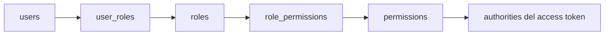

[Ver diagrama de «roles, permissions, user_roles, role_permissions» completo](https://images.vinnot.com/docs/diagrams/v1/es/backend-data-database-model-b18eba9e0665.svg)

### `social_identities`

Asocia un usuario con un subject verificado de Google, Apple o Facebook. Dos
unicidades protegen el modelo:

- `(provider, provider_subject)` impide que una identidad externa pertenezca a
  dos usuarios;
- `(user_id, provider)` limita una identidad por proveedor y usuario.

El email del proveedor es metadata; la identidad estable es provider + subject.

### `refresh_tokens`

Usa un ID secuencial interno y guarda sólo `token_hash`, nunca el token opaco.
Incluye expiración, revocación, motivo, hash del reemplazo, device info e IP. La
cadena `replaced_by_token_hash` permite observar rotación y detectar replay. Un
token rotado que vuelve a presentarse revoca su cadena de sucesores con motivo
`reuse` (#482).

### `security_events` (V73)

Una fila por evento de seguridad de una cuenta: `id` secuencial, `user_id`
(`ON DELETE SET NULL`), `event_type` (`varchar(40)` con un `CHECK` sobre los doce
tipos: `LOGIN_SUCCEEDED`, `LOGIN_FAILED`, `LOGIN_LOCKED`,
`REFRESH_REUSE_DETECTED`, `PASSWORD_CHANGED`, `PASSWORD_RESET`, `EMAIL_CHANGED`,
`ROLE_CHANGED`, `ACCOUNT_BANNED`, `ACCOUNT_UNBANNED`, `ACCOUNT_DELETED`,
`ACCOUNT_AUTO_SUSPENDED`), `ip_address` (45) y `user_agent` (256) opcionales, y
`created_at`. Los índices cubren `(user_id, created_at)` y `created_at` para la
purga diaria de filas con más de 180 días. Un login fallido con un identificador
inexistente se guarda sin `user_id`. `SET NULL` en lugar de `CASCADE`: eliminar
una cuenta quita en el acto el vínculo con la persona, y las filas desvinculadas
quedan hasta la purga como evidencia de ataques; una cascada borraría también el
propio evento de eliminación.

### `user_action_tokens`

Persisten hashes de tokens de un solo uso para verificación de email, reset de
password y cambio de email. Incluyen tipo, expiración, consumo y contexto de la
acción. El borrado en cascada elimina credenciales pendientes cuando desaparece
el usuario.

### `notification_preferences` y `marketing_consent_events` (V42)

`notification_preferences` guarda una fila por usuario, categoría y canal
(clave primaria `user_id, category, channel`), con restricciones `CHECK` sobre las
categorías y canales conocidos. Una fila ausente significa el valor por defecto
de la categoría. Solo se guardan categorías opcionales y promocionales.
`marketing_consent_events` es un historial de solo inserción de decisiones de
consentimiento (`granted`, `source`, `occurred_at`); un trigger rechaza las
actualizaciones, e `idx_marketing_consent_events_user (user_id, occurred_at
DESC)` sirve la consulta de la decisión vigente. Ambas se borran en cascada al
eliminar el usuario. V66 agrega `REMINDERS` a las categorías del `CHECK`. Una
fila ausente equivale a la categoría activada, también para las promocionales:
una cuenta sin decisión de marketing registrada cuenta como consentimiento
otorgado (#347).

### Señales de actividad (V66)

Cuatro tablas guardan las señales que personalizan las sugerencias y eligen la
hora de envío de los push ([actividad](../../modules/activity/README.md)). Todas
tienen `user_id` con borrado en cascada y se purgan en lotes a los 180 días.

| Tabla | Clave primaria | Contenido |
|---|---|---|
| `content_views` | `user_id, kind, entity_id, view_day` | Detalles abiertos: `kind` es `WINE`, `ROUTE`, `EVENT` o `WINERY` (`CHECK`), `entity_id` el UUID del contenido sin clave foránea, `views` cuántas veces se abrió ese día UTC y `last_viewed_at` la última. Una fila por día acota el crecimiento. Índices `(kind, view_day)` y `(view_day)` |
| `user_activity` | `user_id` | `last_active_at`, la última apertura registrada. También limita las aperturas a una cada 30 minutos con un upsert condicional |
| `app_opens` | `user_id, opened_at` | Aperturas registradas; su hora en `users.timezone` da la hora habitual de apertura. Índice `(opened_at)` |
| `push_opens` | `user_id, ref` | Push abiertos (`ref` hasta 180 caracteres, `type`, `opened_at`), uno por `ref`. Índice `(opened_at)` |

### Motor de engagement (V67)

El registro, las marcas de planificación y el lease del planificador de
engagement ([push de engagement](../../modules/notifications/architecture.md#push-de-engagement)).
Es aditiva: un binario anterior las ignora.

| Tabla | Clave primaria | Contenido |
|---|---|---|
| `engagement_sends` | `user_id, dedupe_key` | Una fila por push de engagement y cuenta (`notification_type`, `content_ref` de hasta 120 caracteres como `WINE:<id>`, `sent_at`, `holdout`), escrita por la entrega mientras tiene el bloqueo de reserva de la cuenta, así el presupuesto se cumple aunque compitan varios push. Las filas `holdout` registran un push que el grupo de medición habría recibido; no se envió nada. Se guarda un año (`app.engagement.ledger-retention`) y se borra en lotes de 5000. `user_id` en cascada. Índices `(user_id, sent_at DESC)`, `(user_id, content_ref)` cuando `content_ref` tiene valor, `(notification_type, sent_at)` y `(sent_at)` |
| `engagement_planning` | `user_id` | `planned_at`, cuándo el planificador planificó la cuenta por última vez; un upsert condicional la reclama una vez por día local. `user_id` en cascada |
| `engagement_planner_lease` | `name` | La única fila `planner` (`holder`, `lease_until`): una sola corrida del planificador a la vez entre instancias |

V67 también agrega `idx_users_timezone_id (timezone, id)`, el índice que recorren
las páginas por clave del planificador.

### `email_suppressions` (V43)

Direcciones que rebotaron de forma permanente o se quejaron. La clave primaria
`address_hash` es el SHA-256 en hexadecimal de la dirección recortada y en
minúsculas, así la tabla no guarda ningún correo legible. `reason` es
`HARD_BOUNCE` o `COMPLAINT` (`CHECK`) y conserva el primer motivo; `last_event_at`
registra el último evento. V43 agrega además
`idx_external_effects_exhausted_notifications (created_at)` para los jobs de
notificación agotados, que la retención borra a los 30 días.

## Catálogo de vinos

### `wines`

Almacena la identidad comercial y atributos del producto:

- `name`, `vintage`, `wine_type`, `style`;
- relaciones opcionales con bodega, país y región;
- `grapes` y `allergens` como JSONB;
- descripciones ES/EN;
- alcohol, temperatura, rango de precio;
- imagen principal, botella y URL externa;
- agregados de rating;
- destacado, activo y natural;
- conteos importados y mejor añada;
- maridaje y nombre SEO;
- scores de acidez, taninos, cuerpo y dulzor;
- autor de creación y timestamps.

El catálogo público filtra `is_active=true`. `created_by`, `country_id`,
`region_id` y `winery_id` usan `SET NULL` al borrar la referencia para no perder
el vino importado.

No existe una unicidad rígida `(name, winery, vintage)`: el catálogo proviene de
fuentes heterogéneas y la identidad requiere normalización/fuzzy matching. La
prevención de duplicados se implementa en los casos de uso y con locks
transaccionales durante submissions.

### `wineries`

Contiene identidad legal/comercial, slug único, textos ES/EN, ubicación,
contacto, multimedia, año, estado, claim, estadísticas importadas y relaciones
opcionales con país y región. Borrar una ubicación conserva la bodega mediante
`SET NULL`; borrar una bodega conserva el vino con `winery_id=NULL`.

### Catálogos y geografía

| Tabla | Identidad e invariantes |
|---|---|
| `wine_types` | `code` único, nombres ES/EN, activo, orden |
| `grape_types` | `name` único, nombre ES, categoría, activo |
| `countries` | `code` único |
| `regions` | `(name, country_id)` único; país obligatorio |
| `event_types` | `code` único, nombres ES/EN, activo, orden |
| `event_statuses` | igual que tipos más `is_terminal` |

### `wine_catalog_search`

Es un read model angosto, uno a uno con `wines`, creado para buscar en más de un
millón de filas sin inflar el heap ancho de la tabla principal. Contiene:

- `wine_id` como PK y FK cascade;
- `search_vector` con nombre de vino peso A y bodega peso B;
- `search_text` lower-case concatenando vino y bodega.

Dos triggers mantienen la proyección:

1. insert o cambio de nombre/bodega en `wines` hace upsert;
2. cambio del nombre de una bodega actualiza todos sus vinos.

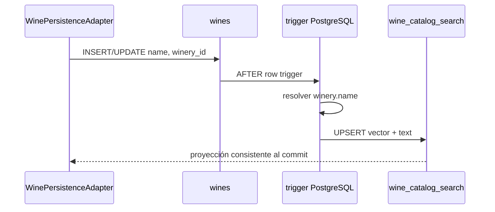

[Ver diagrama de «wine_catalog_search» completo](https://images.vinnot.com/docs/diagrams/v1/es/backend-data-database-model-6e5b9b6a0926.svg)

La búsqueda full-text usa GIN sobre `tsvector`; la similitud parcial usa GIN
trigram sobre `search_text`. Ver [Rendimiento de consultas](query-performance.md).

### `wine_catalog_filter_search`, `wine_grape_search` y `wine_grape_keys`

V86 agrega dos read models para las búsquedas con filtros, también uno a uno o uno a
muchos con `wines` y sincronizados por triggers en la misma transacción:

- `wine_catalog_filter_search`: `wine_id` (PK, FK cascade), `search_vector`,
  `search_text`, `name`, `is_active`, `winery_id`, `country_id`, `region_id`,
  `wine_type` y `grapes_text`, con un único GIN multicolumna sobre texto y filtros;
- `wine_grape_search`: una fila por vino y clave de uva (en minúsculas y sin
  espacios en los extremos), con el nombre del vino y sus atributos de filtro; PK
  `(wine_id, grape_key)`, FK cascade y un B-tree sobre `(grape_key, name, wine_id)`;
- `wine_grape_keys`: las claves de uva distintas, que solo se agregan.

Insertar un vino, o cambiar su nombre, bodega, actividad, país, región, tipo o uvas,
refresca ambos; renombrar una bodega refresca el texto de búsqueda de sus vinos. Las
claves foráneas se agregaron `NOT VALID` porque las filas se cargaron desde `wines`
con la tabla bloqueada; se aplican a cada fila nueva. Ver
[Rendimiento de consultas](query-performance.md#texto-con-filtros).

## Comunidad y cava

### `reviews`

Una restricción única `(wine_id, user_id)` permite una reseña por usuario y vino.
Guarda rating decimal, título, comentario, verificación, contadores de utilidad y
likes, más timestamps. Las FK a usuario y vino son cascade. V64 agrega la `vintage`
probada opcional (entero, CHECK 1800–2100, sin backfill), independiente de `wines.vintage`.

### `review_comments`

Cada comentario pertenece a una reseña y a un usuario. Ambos vínculos son
cascade. Se indexa por reseña y fecha para devolver conversaciones ordenadas.

### Estados de publicación y decisiones (V26)

`reviews` y `review_comments` incluyen `publication_status` con CHECK
`PENDING/APPROVED/REJECTED` y default `PENDING`; la migración conserva como
`APPROVED` los registros existentes. Los índices parciales por fecha/ID aceleran
la cola pendiente. Sólo las reseñas aprobadas participan en las estadísticas
públicas. El dominio escribe explícitamente `APPROVED` para reseñas nuevas (una edición mantiene `APPROVED` y devuelve a `PENDING` una pendiente o rechazada), y el adapter de comentarios para los comentarios nuevos; el default SQL no define esa política y ninguno de los dos cambios actualiza filas anteriores.

`review_publication_decisions` guarda tipo+ID sin FK al contenido,
revisor con `ON DELETE SET NULL`, estado final, motivo, revisión exacta y fecha.
Se indexa por revisor, objetivo y fecha de purga. La auditoría vence a los 90 días.

V25 agrega un índice parcial de casos cerrados en `community_reports` para la
purga horaria después de 90 días desde el cierre; sus acciones se eliminan por
cascade. Los casos abiertos se conservan. [Contrato de revisión y conservación](../../modules/community/architecture.md).

### `review_likes`

La unicidad `(review_id, user_id)` hace idempotente el like a nivel de datos y
protege carreras. Los contadores denormalizados en `reviews` deben actualizarse
en la misma transacción que la asociación.

### `cellar_wines`

Modela la relación entre usuario y vino con precio de compra, notas, rating y
timestamps. `(user_id, wine_id)` es único, por lo que una misma botella lógica
se representa como una entrada agregada y no como múltiples lotes. V64 agrega la
`vintage` probada opcional (entero, CHECK 1800–2100, sin backfill); una reseña con
añada la copia aquí. V71 (#455) agrega `rating_decimal numeric(2,1)` (CHECK
0.1–5.0), completada desde `rating`, y conserva `rating integer` con su CHECK 1–5
para que la revisión anterior del backend siga arrancando y funcionando. El backend
actual lee `rating_decimal` y escribe ambas columnas en cada guardado (`rating`
recibe el decimal redondeado hacia arriba desde .5, acotado entre 1 y 5, o null); la
sincronización desde la reseña conserva el decimal. Un trigger copia en
`rating_decimal` un puntaje entero escrito solo (por la revisión anterior) y no la
toca cuando se vuelve a escribir el mismo entero. Una migración posterior puede
eliminar `rating` y el trigger cuando ya no pueda ejecutarse ninguna revisión
anterior.

## Eventos e inscripciones

### `events`

Además de contenido, ubicación, precio, capacidad y organizador, almacena:

- `current_attendees` confirmados;
- `held_attendees` temporalmente reservados;
- moneda;
- deadline de registro;
- máximo de tickets por registro;
- aprobación manual o automática;
- requisito de confirmación del asistente;
- minutos de hold;
- instrucciones de pago;
- columna SQL `version` con default `0`; la coordinación del flujo usa locks `PESSIMISTIC_WRITE`;
- V40 `timezone` (`varchar(64)`, identificador IANA, `NOT NULL`): los eventos
  existentes toman el `users.timezone` de su organizador (o
  `America/Argentina/Buenos_Aires`), y un trigger `BEFORE INSERT` lo completa
  desde el organizador cuando un insert no lo indica. Los correos de eventos
  muestran las fechas en esta zona.

Constraints impiden holds negativos, uso de capacidad por encima de
`max_attendees`, tickets fuera de 1–20, hold fuera de 5–10080 minutos y modos de
aprobación desconocidos.

### `event_registrations`

Cada registro tiene UUID, cantidad de asistentes, contacto, acompañantes JSONB,
estado, estado/método de pago, importe, moneda, notas, expiración, timestamps de
cada decisión y `version`.

El estado sólo admite:
`REQUESTED`, `AWAITING_PAYMENT`, `AWAITING_ATTENDEE_CONFIRMATION`, `CONFIRMED`,
`WAITLISTED`, `REJECTED`, `CANCELLED` o `EXPIRED`.

El estado de pago sólo admite:
`NOT_REQUIRED`, `PENDING`, `REPORTED`, `APPROVED`, `REJECTED`, `PAY_AT_VENUE` o
`REFUNDED`.

Un índice único parcial sobre `(event_id, user_id)` impide más de una inscripción
activa pero permite conservar y repetir registros terminales. Índices de
expiración soportan el mantenimiento programado de holds.

Agregados posteriores:

- V31 `externally_managed_payment BOOLEAN NOT NULL DEFAULT false`: solo la
  preparación de checkout en servidor transfiere la autoridad de pago al
  proveedor; las inscripciones previas siguen siendo manuales.
- V34 `idx_event_registrations_attendee` sobre `(user_id, created_at DESC, id DESC)`
  soporta la lista de entradas del asistente.
- V35 `notification_version` (`bigint`, default `0`) y `notification_language`
  (`es|en`, default `es`). Un trigger `BEFORE` fija la versión en 1 al insertar
  y la incrementa cuando cambia `(status, payment_status)`; un trigger `AFTER`
  encola dos filas `EVENT_REGISTRATION_CHANGED` en `external_effects`
  (`ATTENDEE` y `ORGANIZER`) por cada versión nueva, deduplicadas por
  `event-registration:<id>:<version>:<recipient>`. Ninguna llamada a proveedores
  se ejecuta en la base.
- V40 `last_actor_id` (`uuid`, nullable, sin foreign key): el usuario que hizo
  el último cambio, escrito en cada guardado (NULL cuando no actuó un usuario).
  La función del trigger de V35 se reemplaza con el mismo tipo, claves y
  payload, pero omite la fila `ORGANIZER` cuando el cambio lo hizo el
  organizador o cuando una cancelación masiva del evento cancela la inscripción.

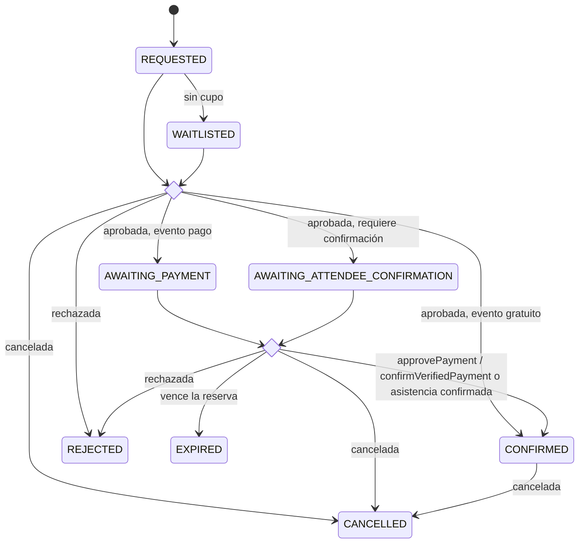

[Ver diagrama de «event_registrations» completo](https://images.vinnot.com/docs/diagrams/v1/es/backend-data-database-model-9853e702f4f4.svg)

## Pagos online (V29–V38)

El módulo `payment` persiste el estado de Mercado Pago separado del estado de
publicación de eventos y de inscripciones. Cuentas, intentos de conexión e
intentos de checkout llevan `environment`
(`SANDBOX` o `LIVE_PILOT` desde V33) para que los registros del piloto nunca
reemplacen los de sandbox. Las tablas no guardan datos del pagador ni de
tarjetas.

- `payment_accounts` (V29): autorización del organizador con PK
  `(owner_id, provider, environment)`; el proveedor solo admite `MERCADO_PAGO`.
  Guarda `pending_state_hash`, `seller_id`, tokens access/refresh cifrados y
  `expires_at`; un check exige que las columnas de credenciales estén todas
  presentes o todas ausentes. V34 agrega `renewal_lease_id`,
  `renewal_lease_until`, `renewal_retry_at`, `reconnect_required` y un índice
  parcial de renovación. La FK a usuario usa cascade.
- `payment_connection_attempts` (V29): OAuth pendiente con `state_hash` único,
  verifier cifrado y `expires_at`. V33 cambia la PK a `(owner_id, environment)`;
  V36 agrega `return_to_app` y un índice único `(state_hash, environment)`. La
  FK a usuario usa cascade.
- `payment_checkout_attempts` (V30): un intento inmutable por
  `(registration_id, provider, environment)`, con comprador, organizador,
  vendedor, título, precio unitario, cantidad 1–20, moneda `ARS`, total,
  comisión (`commission_amount`, `commission_basis_points`, `commission_policy`),
  expiración y estado `PREPARED|CREATING|READY|UNCERTAIN`. V30 fijaba el 3%
  (300, `VINNOT_3_PERCENT_V1`); V74 lo generaliza: puntos básicos entre 1 y 3000,
  `commission_amount = round(total_amount * commission_basis_points / 10000.0, 2)`
  y política `^VINNOT_[0-9]+(_[0-9]+)?_PERCENT_V[0-9]+$`. Cada fila conserva la
  política con la que se creó.
  Solo READY tiene `provider_reference` y `checkout_url`. V37 agrega
  `return_to_app` (solo destino de presentación). Índices parciales soportan la
  conciliación. V77 vuelve opcionales `buyer_id`, `organizer_id`,
  `registration_id` y `event_id`, y recrea sus FK
  (`payment_checkout_attempts_<columna>_fkey`) con `ON DELETE SET NULL`: al
  borrar una cuenta el intento queda y solo pierde esos vínculos.
- `payment_reconciliation_jobs` (V32): un job con lease por intento, con
  `next_check_at`, fallos y el tipo del último fallo. `next_check_at` usa dos
  centinelas: `-infinity` para un job despertado por un aviso (se toma primero) e
  `infinity` para un job estacionado (no se sondea hasta despertarlo). V38 agrega
  triggers en `event_registrations` (de CONFIRMED a otro estado) y `events` (a
  CANCELLED) que despiertan jobs de pagos acreditados; no cambia columnas ni datos.
- `payment_observations` (V32): evidencia de pagos del proveedor con clave
  `payment_id`, importe, comisión de aplicación, importe reembolsado, estado del
  proveedor (`PENDING`, `APPROVED`, `REJECTED`, `CANCELLED`, `REFUNDED`,
  `CHARGED_BACK`, `IN_MEDIATION`), `credited` y `needs_review`. El índice único
  parcial `idx_payment_one_credit` permite un único pago acreditado por intento,
  incluso tras una reversión.
- `payment_refund_intents` (V32): un reembolso por pago con estado
  `PREPARED|SENDING|UNCERTAIN|SUCCEEDED|REVIEW|REJECTED`; V63 agrega `REJECTED`,
  `rejection_reason` (código corto, hasta 64 caracteres) y `rejections` (cantidad de
  rechazos de Mercado Pago, la base de la clave de cada reintento).

Observaciones, reembolsos y jobs referencian intentos sin cascade, y los
intentos referencian inscripciones, eventos y usuarios con `SET NULL` (V77): el
historial financiero nunca se borra implícitamente. Si se borra la cuenta de un
comprador (sus inscripciones caen en cascada) o de un organizador (sus eventos e
inscripciones también), el intento y todo lo que cuelga de él se conservan como
historial financiero de la operación, sin vínculo a la cuenta borrada. La cuenta
de pagos del organizador (`payment_accounts`) sí se borra con la cuenta.

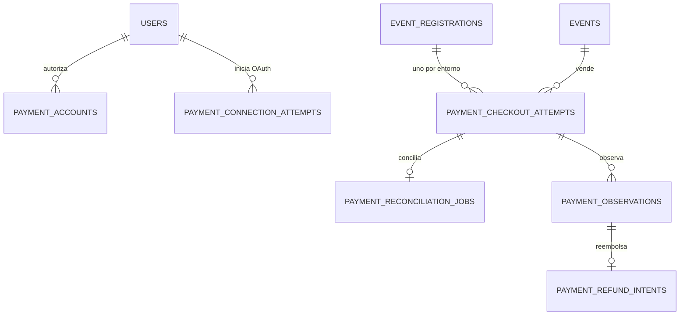

[Ver diagrama de «Pagos online (V29–V38)» completo](https://images.vinnot.com/docs/diagrams/v1/es/backend-data-database-model-d499a8682f7c.svg)

## Rutas enoturísticas

`wine_routes` guarda descripción, jerarquía geográfica textual, duración,
distancia, dificultad, multimedia, estado, tipos recomendados JSONB, mapa,
creador y timestamps.

`wine_route_stops` es la colección ordenada del agregado, con nombre,
descripción, tipo, dirección, coordenadas, `stop_order` y duración. La FK al
route es cascade y el índice `(wine_route_id, stop_order)` soporta lectura
ordenada.

`route_wineries` conserva la asociación muchos-a-muchos histórica entre rutas y
bodegas. El modelo actual de stops debe considerarse la representación rica; la
tabla de asociación no debe usarse para reconstruir detalles que sólo existen en
un stop.

## IA y coordinación distribuida

### `wine_ai_profiles`

Guarda `profile_json` por `(wine_id, language)`. El lenguaje se canoniza a `es`
o `en`; la unicidad evita dos versiones activas del mismo idioma. El JSONB
permite que el contrato sensorial evolucione sin convertir cada campo generado
en columna relacional.

### `wine_comparisons`

Guarda `comparison_json` por par canónico `(wine_a_id, wine_b_id, language)`.
Ambas FK son cascade. El servicio ordena UUIDs antes de persistir y revierte la
orientación al responder cuando el request llega B/A.

### `ai_generation_leases`

Es una tabla de coordinación efímera con `lock_key`, `owner_id` y `expires_at`.
Un `INSERT ... ON CONFLICT` permite que una sola instancia genere un bundle y
que las demás esperen/relean cache. El índice por expiración permite limpiar o
reemplazar leases vencidos.

### Registro de gasto IA (V23)

`ai_spending_windows` identifica ventanas UTC por `window_key` y mantiene
`reserved_usd` y `spent_usd` como NUMERIC(18,8) no negativos.
`ai_spending_reservations` guarda UUID, modelo, máximo reservado, costo observado
opcional, timestamps y estado PENDING, UNKNOWN o ACCOUNTED.
`ai_spending_reservation_windows` relaciona una reserva con sus ventanas; su
PK compuesta evita asociaciones duplicadas. Ambas referencias son FKs, sin
borrado en cascada: no se elimina historia contable por borrar un usuario.

La admisión usa transacciones cortas REQUIRES_NEW y bloqueo/actualización
condicional de ventanas en orden determinista. Una reserva rechazada revierte
todas sus ventanas. La conciliación bloquea la reserva, es idempotente y deja
reservado el costo desconocido. Una caída de proceso no libera presupuesto.
No se almacenan prompts, imágenes, tokens de autenticación ni IDs de usuario.

Estas tablas complementan las leases `provider-capacity:<slot>` de
`ai_generation_leases`; no cambian la unicidad de perfiles y comparaciones.
V23 es aditiva. Restaurar una versión que ignora este registro quitaría el
control de gasto de las llamadas nuevas aunque conserve las tablas.
[Política operativa](../architecture/resource-protection.md).

## Inventario y presupuestos de imágenes (V27)

`storage_operation_budgets` tiene PK `(scope, period)`, contadores `operations`
y `bytes_reserved` no negativos. Adapters JDBC reservan saldo en transacciones
independientes para que un rollback de negocio o fallo remoto no libere consumo
incierto. La tabla contabiliza límites globales por entorno y subidas por usuario.

`managed_cover_images` guarda UUID, `owner_id`, flag `ready`, provider
`local|s3|r2`, kind `EVENT|WINE_ROUTE`, URL única y fecha. El índice
`(owner_id, created_at)` permite inventario/limpieza. `r2_avatar_inventory` usa
`image_url` como PK, dueño y fecha, con el mismo índice por dueño/fecha.
Estas referencias de dueño no tienen FK a `users`: el inventario debe sobrevivir
al borrado/rollback del recurso hasta que la reconciliación retire el objeto.
No son tablas de catálogo ni cambian `wines.image_url` automáticamente.

La autorización y las referencias activas se revalidan contra usuarios, eventos,
rutas, vinos y submissions antes de entregar/retirar medios. No basta con
eliminar la fila de negocio o conocer una URL para borrar el objeto. Los adapters
son `JdbcCoverImageRegistry`, `R2AvatarInventory` y `R2OperationBudget`; la
limpieza usa el outbox durable. [Contrato](../use-cases/uploads-and-reference-data.md)
y [operación R2](../../infra/operations/user-images-r2.md).

## Submissions de vino

`wine_submissions` preserva la propuesta no confiable sin contaminar de inmediato
el catálogo. Incluye autor, identidad propuesta, atributos opcionales, URL de
imagen, estado, razón/confianza de revisión, vino coincidente, vino creado,
revisor y timestamps.

Estados permitidos:

- `PENDING`;
- `APPROVED`;
- `DUPLICATE`;
- `REJECTED`;
- `NEEDS_REVIEW`;
- `CHANGES_REQUESTED`.

`matched_wine_id` y `created_wine_id` usan `SET NULL`; `submitted_by` usa
cascade; `reviewed_by` usa `SET NULL`. `image_quarantined` distingue si la URL
todavía no puede exponerse públicamente.

Los índices cubren historia por usuario, bandeja por estado/fecha, lookup del
match, reviewer y búsquedas administrativas de nombre/bodega.

V41 agrega las referencias de catálogo `country_id`, `region_id` y `winery_id`
(claves foráneas a `countries`, `regions` y `wineries` con `ON DELETE SET NULL`, e
índices parciales cuando tienen valor) y `proposed_grapes` (`jsonb NOT NULL`,
default `[]`). El relleno vincula el país por nombre o código y la región dentro de
ese país, sin distinguir acentos ni mayúsculas; la bodega, solo cuando el nombre
coincide con una única bodega; y deja en `proposed_grapes` las uvas de `grapes` que
no existen en `grape_types`.

## Política de borrado referencial

| Relación | Acción | Motivo |
|---|---|---|
| usuario → sesiones/roles/tokens | cascade | credenciales sin dueño no sirven |
| usuario/vino → reseñas/cava | cascade | datos personales o dependientes |
| evento → registros | cascade | registros son parte del evento |
| vino → perfiles/comparaciones/search | cascade | contenido derivado |
| país/región/bodega → vino | set null | preservar catálogo importado |
| creador → vino | set null | preservar producto |
| revisor/match → submission | set null | preservar historial de propuesta |
| país/región/bodega → submission | set null | preservar la propuesta |
| autor → interruptores push/cambios/anuncios | set null | el email guardado conserva la auditoría |
| autor → versiones mínimas de la app/cambios | set null | el email guardado conserva la auditoría |
| usuario → eventos de seguridad | set null | el vínculo con la persona se va en el acto; las filas desvinculadas se purgan a los 180 días |
| usuario → cuentas de pago/intentos de conexión | cascade | credenciales sin dueño no sirven |
| inscripción/evento/usuario → intentos de checkout y evidencia de pago | no action | se conserva el historial financiero |

El cascade técnico no reemplaza las reglas de privacidad. Cada caso de uso de
borrado debe declarar e implementar una semántica única: desactivación,
anonimización o borrado físico. La cuenta propia y los vinos documentan su
comportamiento actual en sus respectivos casos de uso.

## Integridad entre dominio y base

Una regla crítica debe vivir en más de un nivel cuando cada nivel protege una
amenaza distinta:

- el value object entrega error temprano y lenguaje de dominio;
- el handler coordina ownership y concurrencia;
- la constraint protege contra otros writers y carreras;
- el índice único garantiza atomicidad;
- la prueba de integración demuestra el comportamiento real de PostgreSQL.

No todas las reglas caben en SQL. Transiciones complejas permanecen en el
agregado; la base restringe conjuntos cerrados y aritmética esencial.

## Datos locales e importación

Los dumps y datasets grandes son inputs locales ignorados por Git. Un dump
externo no se ejecuta directamente sobre la base destino porque puede incluir
DDL destructivo o configuración incompatible. El script
`scripts/import_vinnot_dump_data.sh` usa staging, transforma y carga dentro del
esquema gobernado por Flyway.

`scripts/import_wines.py` es otro procedimiento: importa JSON de bodegas/vinos
mediante `psycopg2`, con `--wineries-dir` y `--wines-dir` (por defecto,
`docs/wineries/` y `docs/wines/`, ignorados por Git). Recibe `DB_HOST`, `DB_PORT`,
`DB_NAME`, `DB_USER` y **`DB_PASS`** desde el entorno privado. Inserta y completa
datos existentes, con commits por fases/lotes; no ofrece dry-run ni rollback de
toda la corrida. Probarlo en una copia descartable y respaldar el destino antes
de usarlo. Genera UUID nuevos para las altas: dos importaciones independientes
no garantizan IDs iguales entre ambientes. No usarlo para sincronizar imágenes
dev/prod; ese proceso exige snapshots y conciliación de identidad del
[runbook de catálogo R2](../../infra/operations/catalog-images-r2.md).

Para validar una importación:

1. verificar checksums y encoding del origen;
2. restaurar en staging;
3. normalizar IDs y relaciones;
4. ejecutar conteos y checks de huérfanos;
5. cargar por lotes en la base objetivo;
6. refrescar/analisar proyecciones e índices;
7. comparar muestras funcionales desde la API.

## Checklist para modificar el esquema

1. Identificar agregado propietario y caso de uso consumidor.
2. Diseñar cardinalidad, nullabilidad, delete policy y concurrencia.
3. Agregar una migración nueva; nunca editar historia aplicada.
4. Prever backfill antes de hacer `NOT NULL`.
5. Crear índices de manera compatible con el tamaño de la tabla.
6. Actualizar JPA, mapper, adapter y puertos afectados.
7. Probar base limpia y upgrade desde la versión anterior.
8. Ejecutar tests con PostgreSQL real, no sólo H2/mocks.
9. Inspeccionar `EXPLAIN (ANALYZE, BUFFERS)` de queries críticas.
10. Actualizar este documento, API y runbooks si cambia operación.

## Archivos fuente de referencia

- `backend/src/main/resources/db/migration/*.sql`;
- `*/infrastructure/persistence/entity/*JpaEntity.java`;
- `*/infrastructure/persistence/repository/*Repository*.java`;
- `infra/aws-low-cost/docker-compose.yml`;
- `scripts/import_vinnot_dump_data.sh`.

## Diagramas relacionales por contexto

El [DER detallado](../diagrams/relational-model.md) distingue claves primarias,
foráneas, relaciones opcionales, unicidad compuesta y reglas de borrado.

## Versiones de agregados y outbox

users.session_version y refresh_tokens.session_version coordinan revocación. users.revision y wines.revision implementan control optimista. external_effects es una cola técnica sin FK a la entidad eliminable: su payload conserva los identificadores necesarios para reconciliar luego del borrado.

| Columna | Contrato |
|---|---|
| id | UUID PK |
| kind | estrategia de handler |
| deduplication_key | UNIQUE |
| payload | JSONB |
| attempts | intentos fallidos |
| next_attempt_at | próxima elegibilidad |
| last_error_type | clase de error, sin contenido sensible |
| created_at | timestamptz |

El índice parcial pendiente cubre next_attempt_at, id para attempts < 10; el índice parcial de wines.image_url limita las verificaciones a etiquetas administradas. [Protocolo](../architecture/session-and-data-integrity.md).

## Consultas públicas de soporte

`support_request_receipts` contiene UUID como PK, huella SHA-256 en
`content_hash` (64 caracteres) y `created_at`. No almacena nombre, correo ni
texto. El índice de `created_at` soporta expiración a 30 días. El mensaje
pendiente vive en `external_effects` como notificación y se descarta a los 7 días
si no se entregó; el índice parcial por `created_at WHERE kind = 'SUPPORT_REQUEST'`
solo sirve a las filas anteriores al módulo de notificaciones.
Recepción y enqueue son atómicos, sin FK a usuarios porque el contacto permite
visitantes. [Contrato](../../modules/support/architecture.md).

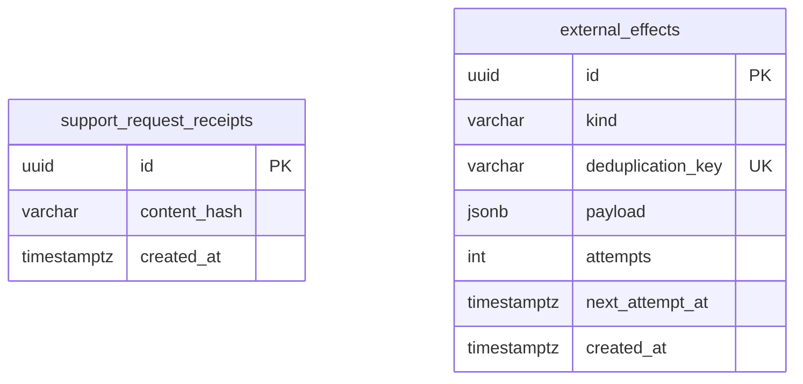

[Ver diagrama de «Consultas públicas de soporte» completo](https://images.vinnot.com/docs/diagrams/v1/es/backend-data-database-model-04d4822fbfcc.svg)

El vínculo es la clave lógica `support:<UUID>`, no una relación FK: el trabajo
se elimina al entregar mientras el recibo conserva la deduplicación.

## Evidencia contractual

V21 incorpora `legal_documents` y `user_legal_acceptances`. La relación con
`users` elimina evidencia al borrar definitivamente la cuenta. Una FK compuesta
vincula cada aceptación con versión, revisión, idioma y huella exactos; la clave
cuenta/tipo/revisión impide duplicados. No se infieren aceptaciones históricas.

[DER, índices, triggers y semántica de revisión](../../modules/legal/architecture.md#modelo-relacional).
