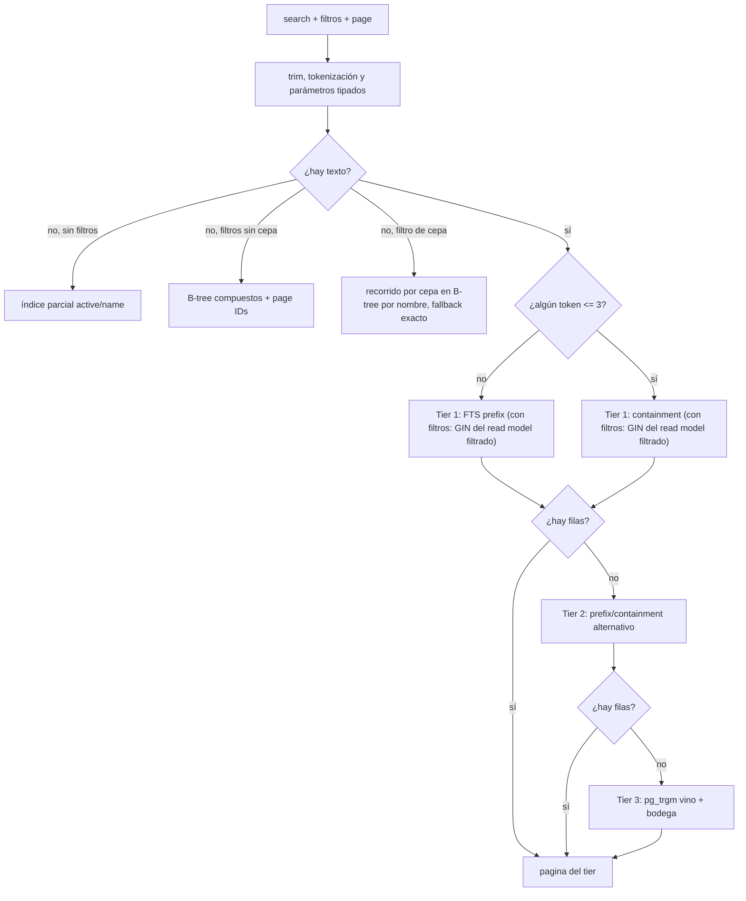
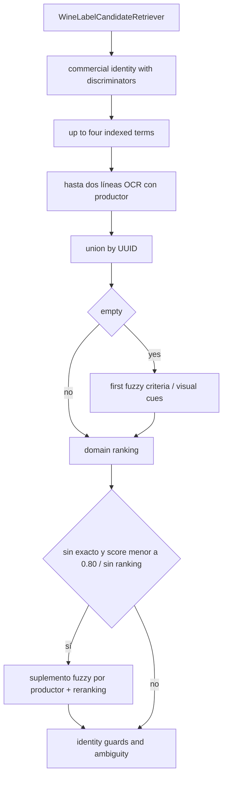

# Rendimiento de consultas e indexación

## Objetivo

La optimización se diseña desde la consulta real y su cardinalidad. Una columna
“importante” no justifica por sí sola un índice: deben coincidir el predicado, el
orden, la selectividad, el patrón de join y la forma de paginación.

Las fuentes de verdad son, en conjunto:

- handlers y puertos de consulta;
- `WineSearchNativeRepository` y repositorios Spring Data;
- migraciones `V3`, `V4`, `V14`, `V15`, `V16`, `V61`, `V85` y `V86`;
- planes `EXPLAIN (ANALYZE, BUFFERS)` sobre PostgreSQL;
- pruebas/benchmarks reproducibles con volumen representativo.

Las mediciones concretas se publican como artefactos de aceptación reproducibles;
este documento define el método estable para producir y evaluar evidencia nueva.

## Pipeline de búsqueda del catálogo

La búsqueda pública conserva la expectativa de producto: desde tres caracteres
debe recuperar coincidencias de nombre de vino y bodega, admite múltiples
palabras, filtros y errores tipográficos razonables. Para evitar que toda query
pague el costo fuzzy, se usa una cadena escalonada.



[Ver diagrama de «Pipeline de búsqueda del catálogo» completo](https://images.vinnot.com/docs/diagrams/v1/es/backend-data-query-performance-0e583eeed8bc.svg)

### Tier prefix

Construye un `to_tsquery('simple', 'token:* & ...')` contra
`wine_catalog_search.search_vector`. El nombre de vino tiene peso A y la bodega
peso B. La relevancia agrega un bonus cuando el nombre completo coincide. El GIN
de vector produce candidatos antes de cargar filas anchas.

### Tier containment

Usa `search_text LIKE '%token%'` por cada palabra. Es importante para fragmentos
cortos y compatibilidad de UX. El texto está normalizado y tiene índice trigram;
los valores se pasan como parámetros, no se interpolan en SQL.

### Tier fuzzy

Se ejecuta sólo si las etapas más selectivas no devolvieron contenido. Combina
dos branches limitados:

- similitud contra `wines.name` con base 1.0;
- similitud contra `wineries.name` con base 0.75.

Los índices trigram de nombres son parciales: `idx_wines_active_name_trgm` e
`idx_wineries_active_name_trgm` (V3) cubren filas activas e
`idx_wines_inactive_name_trgm` e `idx_wineries_inactive_name_trgm` (V85), inactivas.
El catálogo público lee solo filas activas. La búsqueda del equipo
(`includeInactive=true`) divide cada branch en uno de filas activas y otro de
inactivas, unidos con `UNION ALL`, para que cada uno use su índice parcial. Un único
branch sobre todas las filas comparaba cada nombre del catálogo, superaba el timeout
de 3000 ms y la búsqueda sin resultados respondía 500.

Los IDs se agrupan por máxima relevancia y recién entonces se hidratan las
entidades. El orden es relevancia descendente, nombre e ID, sobre el conjunto de candidatos seleccionado.

### Texto con filtros

Cuando una búsqueda con texto también lleva filtro de tipo, bodega, país, región o
uva, cada tier toma sus candidatos de `wine_catalog_filter_search` (V86) en lugar de
unir `wine_catalog_search` con `wines`. Ese read model repite el vector y el texto de
búsqueda y agrega el nombre del vino, `is_active`, `winery_id`, `country_id`,
`region_id`, `wine_type` y `grapes_text` (el JSON de uvas como texto). Un único GIN
multicolumna, `idx_wine_catalog_filter_search` (con `btree_gin`), indexa el vector,
los trigramas del texto de búsqueda, del nombre del vino y de las uvas, y los cuatro
filtros de igualdad, de modo que PostgreSQL cruza texto y filtros dentro del índice y
lee solo las filas que coinciden:

- los nombres de país y región se resuelven a ids antes del recorrido
  (`country_id = ANY(ARRAY(SELECT ...))`), lo que los vuelve condiciones del índice;
- el filtro de uva conserva su significado, `grapes_text ILIKE '%valor%'`;
- el tier tolerante a errores compara el nombre del vino del read model y une los
  nombres de bodega similares con las filas filtradas del read model;
- cada candidato lleva el nombre de su vino, así la página se ordena por relevancia,
  nombre e ID antes de cargar solo sus vinos.

Las consultas anteriores dejaban que PostgreSQL recorriera todos los vinos de un país
y consultara el catálogo por cada uno, o leyera todas las coincidencias de texto y
todas las filas del filtro. En producción (#531) «merlot» en Argentina superó el
presupuesto de 2000 ms y respondió 500; sobre una copia del catálogo con la forma de
producción leía hasta 162.000 páginas y ahora lee unas 640. Las búsquedas sin filtros
conservan sus consultas anteriores.

### Consultas sin texto

Sin filtros se obtienen primero IDs/nombres activos ordenados y luego se hace
join por PK para hidratar sólo la página. Para el total se usa `pg_class.reltuples`
como estimación y se cae a `COUNT(*)` sólo si la estimación no está disponible.

Con filtros se solicitan `pageSize + 1` filas para calcular `hasNext` sin pagar
un count exacto sobre millones de vinos. El `total` del `PageResult` es entonces
una estimación mínima compatible con navegación incremental, no una promesa de
cardinalidad exacta.

### Filtro de uva sin texto

Un filtro de uva sin texto pagina los vinos por nombre a través de
`wine_grape_search` (V86): una fila por vino y clave de uva, siendo la clave la uva
en minúsculas y sin espacios en los extremos, con el nombre del vino y sus atributos
de filtro. `wine_grape_keys` guarda las claves distintas. El repositorio:

1. resuelve las claves que coinciden con el filtro con `grape_key ILIKE '%valor%'`,
   la versión por elemento del anterior `CAST(grapes AS TEXT) ILIKE '%valor%'`: un
   valor con comillas, comas, espacios iniciales o `null` ya no coincide con el texto
   JSON entre elementos;
2. recorre cada clave por nombre con `idx_wine_grape_search_name_page`
   (`grape_key, name, wine_id`, con los atributos de filtro incluidos), hasta 4000
   entradas por clave, y verifica los otros filtros en la entrada del índice;
3. une las primeras `offset + size + 1` coincidencias de cada clave, que contienen la
   página, y las ordena por nombre e ID.

Así, una uva común lee las entradas de una página en lugar de un bitmap con pérdida
sobre todos los vinos de esa uva seguido de un ordenamiento (sobre la copia con la
forma de producción, Cabernet Sauvignon pasó de 69.800 páginas a 14). Cuando una clave
llega al límite del recorrido con menos coincidencias, los otros filtros son escasos
dentro de esa uva: la página sale entonces del conjunto filtrado exacto de
`wine_catalog_filter_search`. Ese conjunto es chico cuando los otros filtros son
escasos; una página más allá de las primeras 4000 entradas de una uva también toma
este camino y lee la uva completa (página 210 de una uva común: cerca de 1,3 s). El
conjunto exacto todavía compara la uva sobre el texto JSON, así que un valor con
comillas puede coincidir distinto ahí que en las páginas recorridas. Los filtros sin uva conservan
sus índices compuestos por nombre.

### Mantenimiento de los read models

Triggers sobre `wines` y `wineries` mantienen ambos read models en la misma
transacción que la escritura, para cualquier camino de escritura:

- insertar un vino, o cambiar su nombre, bodega, actividad, país, región, tipo o
  uvas, hace upsert de su fila en `wine_catalog_filter_search` y reemplaza sus filas
  de `wine_grape_search`; las claves nuevas se agregan a `wine_grape_keys`;
- guardar una entidad que reescribe valores sin cambios no los refresca;
- renombrar una bodega refresca el vector y el texto de búsqueda de sus vinos;
- borrar un vino se propaga en cascada a ambos read models.

Las claves nunca se borran de `wine_grape_keys`: una clave sin vinos no coincide con
nada.

## Contrato filtro–índice

| Predicado/orden runtime | Soporte principal |
|---|---|
| activo + nombre | índice parcial `idx_wines_active_name_page` |
| texto + tipo, bodega, país, región o uva (todos los tiers) | GIN multicolumna `idx_wine_catalog_filter_search` sobre `wine_catalog_filter_search` |
| uva sin texto + nombre, con o sin otros filtros | `idx_wine_grape_search_name_page`; las combinaciones escasas caen a `idx_wine_catalog_filter_search` |
| listado del equipo con inactivos, sin filtros | `idx_wines_active_name_page` más el índice parcial `idx_wines_inactive_name_page` |
| tier fuzzy del equipo con inactivos | branches activos por `idx_wines_active_name_trgm` e `idx_wineries_active_name_trgm`, inactivos por `idx_wines_inactive_name_trgm` e `idx_wineries_inactive_name_trgm` |
| activo + país + nombre | `idx_wines_active_country_name_page` |
| activo + región + nombre | `idx_wines_active_region_name_page` |
| activo + tipo + nombre | `idx_wines_active_type_name_page` |
| país + región + tipo + nombre | índice compuesto parcial equivalente |
| activo + rating | `idx_wines_active_type_rating` y rating/popular |
| destacados | índice parcial `idx_wines_active_featured_only` |
| identidad vino/bodega | GIN vector y trigram de `wine_catalog_search` |
| bodega activa + nombre | B-tree de orden + trigram de nombres |
| evento público por ventana | `(status, end_date, start_date)` |
| registros de evento | evento/estado/fecha y usuario/estado/fecha |
| holds vencidos | índice parcial por `expires_at` |
| reseñas de vino | vino/fecha, likes y rating |
| comentarios | reseña/fecha |
| rutas publicadas por geografía | estado/país/región y jerarquía |
| submissions | estado/updated, usuario/created, nombre/bodega trigram |

Una modificación en `WHERE`, `JOIN`, `ORDER BY`, nullabilidad o distribución de
datos obliga a revisar el índice. Que un índice exista no implica que el planner
lo use.

## Matching de etiquetas

El recuperador de aplicación usa primero identidad comercial cuando hay discriminadores, hasta cuatro vistas indexadas y hasta dos líneas OCR complementarias combinadas con productor. Une por UUID. Una unión vacía dispara el primer criterio fuzzy. Una unión con candidatos pero sin ranking utilizable o suficientemente fuerte puede disparar un suplemento fuzzy por productor. El SQL recupera candidatos; no decide EXACT_MATCH.

### Consultas y pesos

| Método | Selección | Hint por consulta |
|---|---|---|
| findByCommercialIdentity | containment de producto y discriminadores | 1500 ms |
| findByIndexedIdentity | FTS sobre a lo sumo 2000 coincidencias + vinos de las 50 bodegas más parecidas | 750 ms |
| findByFuzzyMatch | ILIKE sobre a lo sumo 2000 nombres de vino + pg_trgm o ILIKE sobre bodega (las 50 más parecidas) | 1500 ms |
| findByProducerIdentity | ILIKE y FTS sobre a lo sumo 500 bodegas cada uno, las 5 más parecidas por palabras completas | 750 ms |
| findByVisualCues | tipo/uva/añada, sin términos legibles | 1500 ms |

Fuzzy compara cada término con ambos campos; su score SQL pondera mejor similitud de vino 0,55 y bodega 0,35, más añada 0,05, uva 0,05 y tipo 0,03 si hay evidencia. El prefilter conserva al menos 200 candidatos o cinco veces el límite solicitado; la selección final se ordena por match_score e ID. Las ramas indexadas tienen LIMIT antes del orden exterior: el desempate final ordena candidatos ya recuperados, no certifica selección exhaustiva. Una palabra común ("malbec", "reserva") coincide con gran parte del catálogo; ordenar todas las coincidencias leía cientos de MB de disco y superaba el hint en producción (2,8 a 8,3 s). Por eso la rama FTS ordena a lo sumo 2000 coincidencias (el doble del límite antes de descartar vinos inactivos) y la rama de vino de fuzzy busca el término con ILIKE sobre a lo sumo 2000 nombres, sin el operador `%` sobre `wines.name`, que recorría la tabla (3,4 a 4,9 s). Con menos de 2000 coincidencias el resultado no cambia; la tolerancia a errores de tipeo queda en la rama de bodega. Una frase genérica de etiqueta ("Single Vineyard", "Bodega") también se parece a miles de nombres de bodega: unir los vinos de las 1.877 bodegas parecidas a "Single Vineyard" tardaba 4,4 s en producción. Por eso ambas ramas de bodega expanden en vinos solo las 50 bodegas más parecidas (empates por ID). Sobre 75 etiquetas reales del catálogo y frases genéricas, el top 60 quedó idéntico salvo empates entre bodegas igual de parecidas en palabras sueltas ("Reserva", "Chateau", "Domaine"), y nunca se perdió el vino esperado.



[Ver diagrama de «Consultas y pesos» completo](https://images.vinnot.com/docs/diagrams/v1/es/backend-data-query-performance-73da19a6eec5.svg)

Los timeouts de etiqueta se traducen a WineLabelCatalogSearchTimeoutException y el retriever decide continuar. Los hints pertenecen a cada consulta enviada; la aplicación verifica por separado un deadline monotónico compartido entre etapas y consultas. El timeout del suplemento opcional conserva sugerencias utilizables, pero un fallo de catálogo sin recuperación no es NO_MATCH. Los detalles de OCR, alias, scoring y respuesta se mantienen en [escaneo backend](../../modules/wines/architecture.md).

## Evitar N+1 y filas anchas

- Las páginas de catálogo seleccionan IDs antes de hidratar `wines.*`.
- El detalle de ruta usa fetch explícito de stops.
- Los likes de múltiples reseñas se consultan con `reviewId IN (...)`, no una
  query por fila.
- Los conteos de comentarios se agregan por review ID.
- Las respuestas administrativas usan proyecciones/adapters de consulta cuando
  no necesitan un agregado completo.
- El dashboard cuenta por módulo y no materializa entidades.

Cada relación lazy debe evaluarse desde el punto de serialización. Un controller
no debe depender de que una sesión Hibernate permanezca abierta; la proyección se
construye dentro del adapter/handler transaccional.

## Paginación y orden determinista

La policy del controller de vinos valida página/tamaño y limita la ventana pública; `PageQuery` transporta parámetros y `PageMapper` construye Pageable. No se deduce una validación universal de todos los módulos por usar esos tipos.

Browse y búsqueda filtrada sin texto ordenan por nombre. Los tiers textuales ordenan la salida por relevancia, nombre e ID. PREFIX/CONTAINMENT limitan candidatos antes del orden externo; FUZZY ordena también sus ramas. El primer tier con contenido en la página solicitada determina la respuesta. Estas consultas no mantienen un snapshot entre requests ni unen todos los tiers.

La lectura de size+1 produce un total mínimo para navegación; browse usa estimación reltuples con fallback COUNT. La API pública recorta ese total a 500. Interpretar el campo como estimación/ventana, no como conteo exacto global. Véase [contrato de búsqueda](../../modules/wines/architecture.md).

## Timeouts y degradación

Los hints JPA expresan budgets por clase de operación:

| Operación | Budget actual |
|---|---:|
| label fuzzy/commercial/visual | 1500 ms |
| label fallback indexado/productor | 750 ms |
| catálogo prefix/sin texto | 2000 ms |
| catálogo containment/fuzzy fallback | 3000 ms |

El timeout es un límite de protección, no un objetivo de latencia. Aumentarlo sin
inspeccionar el plan puede convertir una degradación aislada en saturación de
pool. Todo fallback debe preservar semántica suficiente y dejar telemetría para
distinguir “sin resultados” de “query degradada”.

## Estadísticas del planner

`V16` aumenta estadísticas donde la distribución combinada lo requiere y ejecuta
`ANALYZE`. Después de una importación masiva o reconstrucción del read model se
debe actualizar estadística. Una base con estadísticas obsoletas puede elegir
sequential scans aun cuando exista el índice correcto.

En el host de bajo costo PostgreSQL está configurado con memoria acotada:
`shared_buffers=96MB`, `effective_cache_size=768MB`, `work_mem=2MB` y máximo 20
conexiones. Las consultas deben funcionar bajo ese presupuesto; un sort/hash que
parece barato en una workstation puede volcar a disco en runtime.

## Método de análisis

Para cada query crítica:

```sql
EXPLAIN (ANALYZE, BUFFERS, VERBOSE, SETTINGS)
SELECT ...;
```

Revisar:

- estimated rows versus actual rows;
- index scan, bitmap scan o sequential scan;
- buffers hit/read/dirtied;
- sort method y spill a disco;
- loops de nodos internos;
- filas removidas por filtro;
- tiempo de planning y execution;
- parámetros y selectividad de un caso real.

No se ejecuta `EXPLAIN ANALYZE` de un `UPDATE/DELETE` productivo sin envolverlo en
una transacción reversible o usar una copia representativa.

## Gates de aceptación

Las pruebas semánticas verifican resultados; los benchmarks verifican costo. Un
gate serio debe incluir:

- catálogo vacío, pequeño y de volumen real;
- términos exactos, prefijos, tres caracteres, múltiples palabras y typos;
- nombre de vino y de bodega;
- filtros aislados y combinados;
- páginas iniciales y profundas;
- etiquetas argentinas, globales, negativas y repetidas;
- p50/p95/p99 y tasa de timeout;
- exact match, recall top-3 y falsos positivos;
- estabilidad entre repeticiones;
- evidencia del plan y versión de esquema.

La latencia no puede optimizarse degradando la exactitud. Escaneo y búsqueda
manual tienen métricas separadas porque sus contratos y budgets son distintos.

## Antipatrones prohibidos

- `LOWER(column)` sin índice de expresión equivalente en paths críticos;
- `%term%` sobre una tabla masiva sin trigram;
- count exacto en cada página cuando no lo exige el producto;
- ordenar una fila ancha antes de limitar IDs;
- fetch lazy desde el serializer;
- concatenar input del usuario en SQL;
- índices redundantes “por si acaso”;
- timeouts globales crecientes para ocultar un plan malo;
- benchmark sólo en memoria/H2;
- cachear respuestas sin estrategia de invalidación.

## Checklist de cambio

1. Capturar la consulta y parámetros reales.
2. Ejecutar plan antes del cambio.
3. Confirmar volumen, cardinalidad y distribución.
4. Diseñar query e índice conjuntamente.
5. Preservar orden y resultados del contrato.
6. Probar migración y costo de construcción del índice.
7. Ejecutar tests con PostgreSQL y benchmark.
8. Comparar planes antes/después.
9. Revisar write amplification y espacio del índice.
10. Actualizar documentación y alertas.

## Auditoría de contratos y límites de búsqueda (#165)

La auditoría del 2026-10-01 sigue controller → query → handler → puerto →
`WineSearchNativeRepository`, y los mappers de ambos clientes. No incorpora
optimizaciones, índices ni cambios de ranking o conteos.

| Entrada | Comportamiento observado |
|---|---|
| texto, tipo, bodega, país, región y uva | El handler transmite estos filtros al puerto; los browse actuales exponen texto/tipo/país/región/uva |
| añada, precio mínimo/máximo, rating mínimo, destacados y orden | Controller/query aceptan los campos, pero `SearchWinesQueryHandler` no los transmite a `searchAdvanced`; no representan filtros efectivos de ese endpoint |
| arrays de filtros frontend | Los mappers seleccionan el primer valor en varios campos; no hay contrato general multiselección |
| orden frontend | Web transforma precio/rating a nombres backend; mobile omite `createdAt`. El handler no aplica esos órdenes |
| texto sólo no latino o puntuación | `parseSearchWords` descarta tokens sin caracteres ASCII aceptados por `\p{Alnum}`; sin tokens consulta como browse, conservando filtros |
| acentos | Prefix elimina caracteres fuera de ese patrón; containment conserva el token original. El caso `Éxito` recupera la coincidencia por fallback, sin garantizar normalización Unicode uniforme |
| candidatos y páginas | PREFIX/CONTAINMENT limitan antes de ordenar; browse empata sólo por nombre. No se garantiza estabilidad entre requests ni exhaustividad por el desempate externo |
| totales | size+1 es un mínimo para navegación; reltuples estima toda la tabla y puede incluir inactivos. La ventana del controller sigue limitada a 500 |

**Bug corregido con autorización:** PREFIX concatenaba el último predicado con
`LIMIT`, formando por ejemplo `:wineryIdLIMIT`. Se agregó únicamente el espacio
separador. `WinePersistenceAdapterPostgresIntegrationTest` reproduce texto +
bodega, dos páginas, IDs distintos y total del fixture; también caracteriza
acentos, puntuación y texto no latino en PostgreSQL real local.

Los campos aceptados pero ignorados son una discrepancia del contrato backend,
no evidencia de un control visible roto en los browse actuales. Parser, orden,
totales y URL parcial son limitaciones verificadas que requieren una decisión
separada antes de cambiar comportamiento. Los tests de índices y EXPLAIN locales
no acreditan latencia ni estabilidad a volumen productivo. No se hizo carga en AWS.

Fuentes: `wine/infrastructure/web/controller/WineReadController.java`,
`wine/application/query/model/SearchWinesQuery.java`,
`wine/application/query/handler/SearchWinesQueryHandler.java` y
`wine/infrastructure/persistence/search/WineSearchNativeRepository.java` bajo
`backend/src/main/java/com/vinnot/`; `wines.service.helpers.ts` en web y
`wines.service.ts` en mobile bajo sus servicios de aplicación.
