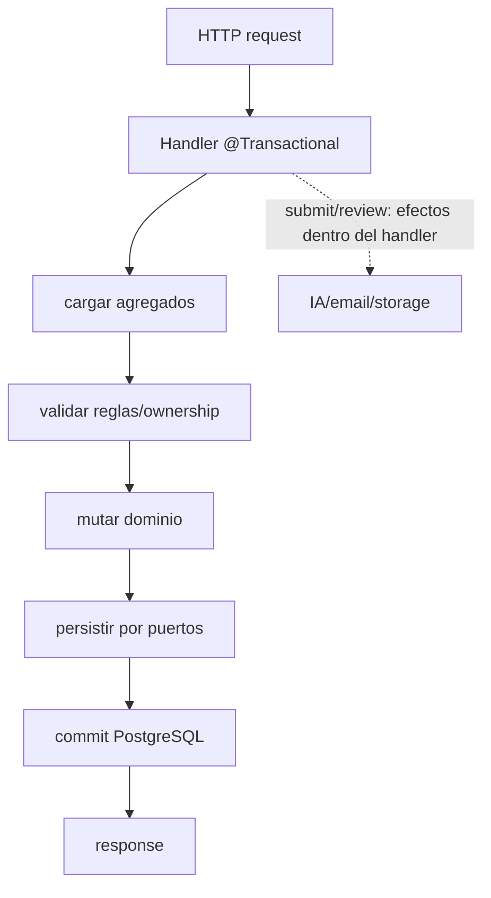
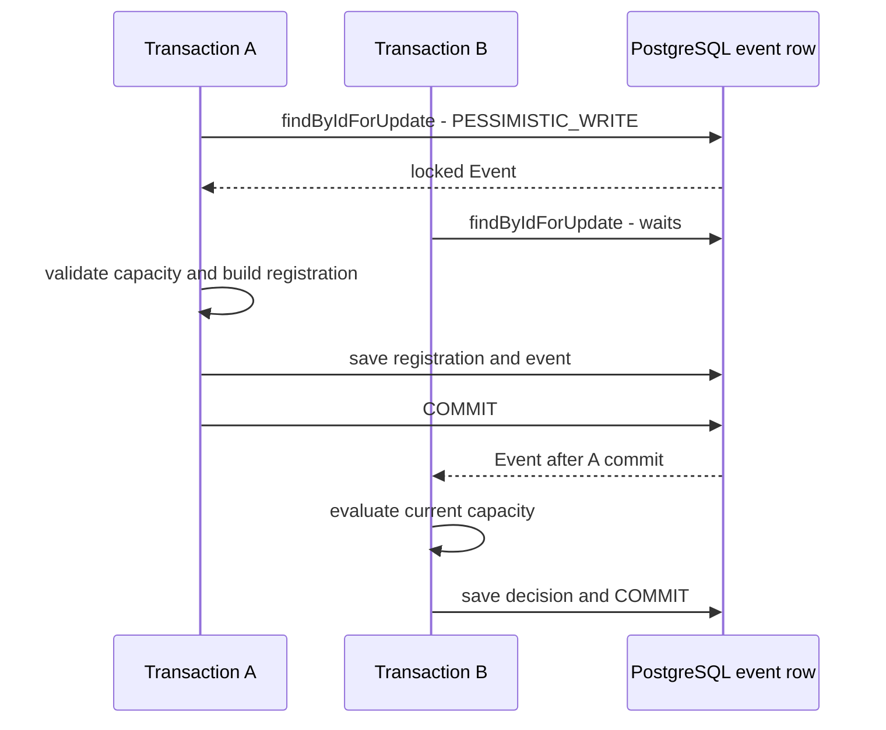
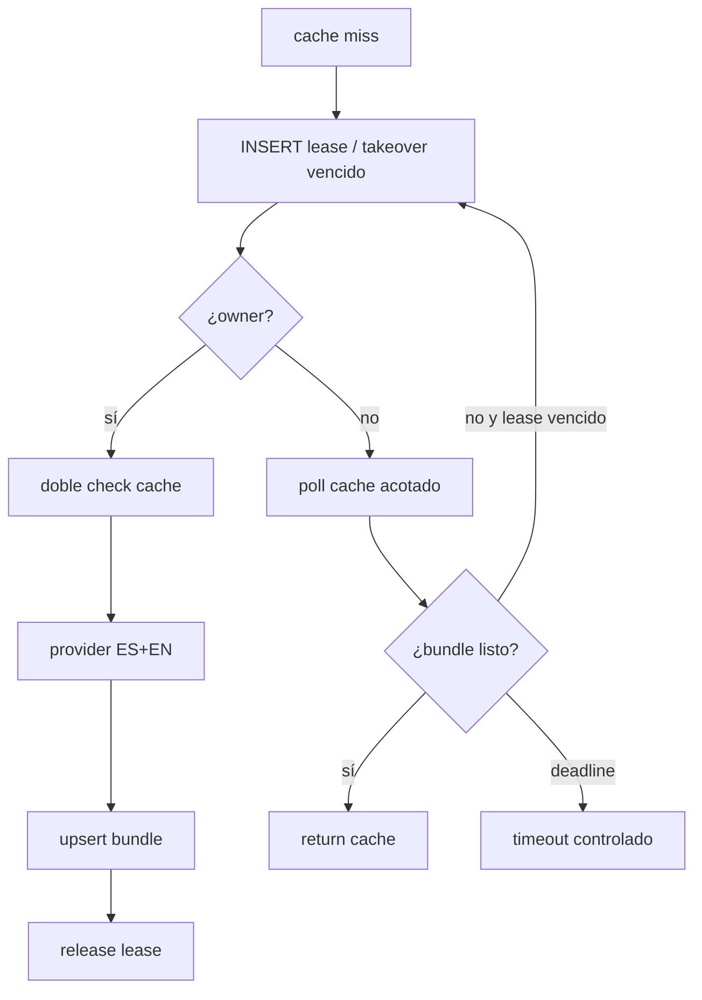
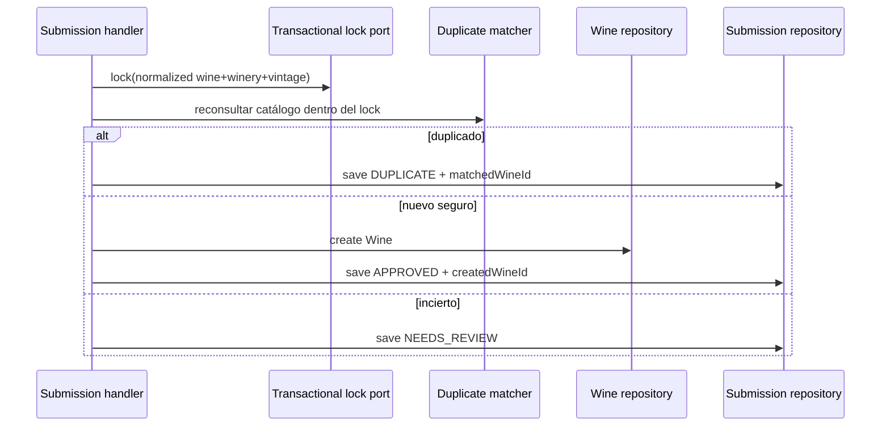
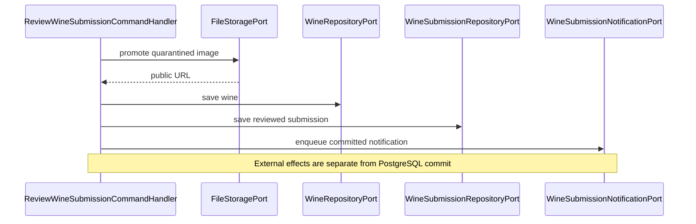

# Datos, locks y consistencia

## Límites transaccionales

[Ver diagrama de «Límites transaccionales» completo](https://images.vinnot.com/docs/diagrams/v1/es/backend-diagrams-data-consistency-bf55c9bd602e.svg)

Los handlers anotados definen la transacción; el proxy realiza commit tras su
retorno normal. Submit/review ejecutan reconocimiento, moderación, storage o
notificación durante esa orquestación. El coordinador IA y la limpieza de avatar
de cuenta tienen límites propios descritos en sus casos de uso.

## Capacidad de eventos bajo concurrencia

[Ver diagrama de «Capacidad de eventos bajo concurrencia» completo](https://images.vinnot.com/docs/diagrams/v1/es/backend-diagrams-data-consistency-2cc32188a433.svg)

La secuencia representa dos altas que bloquean el mismo Event. No hay columna @Version involucrada. Las constraints protegen contadores >= 0 y current_attendees + held_attendees <= max_attendees cuando existe máximo. Revisión, confirmación y expiración toman evento antes de inscripción. La expiración usa una transacción corta por hold.

## Single-flight de IA

[Ver diagrama de «Single-flight de IA» completo](https://images.vinnot.com/docs/diagrams/v1/es/backend-diagrams-data-consistency-617938c225bc.svg)

El lease expira para recuperarse de crash. La key diferencia perfil por vino y
comparación por par canónico. Una comparación sin bundle reutilizable requiere
respuesta validada del proveedor incluso para pares escasos; no genera una
plantilla de catálogo. Un fallo de generación no publica un bundle parcial.

## Coordinación de identidad de submissions

[Ver diagrama de «Coordinación de identidad de submissions» completo](https://images.vinnot.com/docs/diagrams/v1/es/backend-diagrams-data-consistency-7e34cac28dce.svg)

El recheck es obligatorio incluso si el scan anterior no encontró match: otro
request pudo crear el vino entre ambas operaciones.

## DB versus storage

[Ver diagrama de «DB versus storage» completo](https://images.vinnot.com/docs/diagrams/v1/es/backend-diagrams-data-consistency-60eb895c021d.svg)

Promoción copia la imagen. TransactionalFileStorageAdapter registra reconciliación antes de escribir y encola borrados; el worker verifica referencias y ejecuta cleanup tras commit. Todos los emails, incluidos los de cuenta, pasan por el [módulo de notificaciones](../../modules/notifications/architecture.md), que los escribe en el mismo outbox dentro de la transacción de negocio; ninguna transacción de negocio espera al proveedor de email. PostgreSQL y storage no comparten una transacción distribuida.

## Consistencia de la proyección de búsqueda

Los triggers actualizan `wine_catalog_search` dentro de la misma transacción que
el vino o el nombre de bodega. Por eso el read model es consistente al commit,
sin un consumidor asíncrono que introduzca lag.

## Reglas de revisión

- documentar isolation/locking cuando una regla depende de concurrencia;
- usar unique/check constraints como última barrera;
- no capturar `OptimisticLockException` como “no encontrado”;
- no hacer side effects irreversibles antes de validaciones;
- garantizar idempotencia de retries;
- observar tiempo esperando locks y tasa de conflictos;
- probar con dos transacciones reales, no sólo mocks.

## Sesiones y publicación

Las secuencias de refresh concurrente, publicación atómica y outbox están en [sesiones y efectos externos](../architecture/session-and-data-integrity.md).
