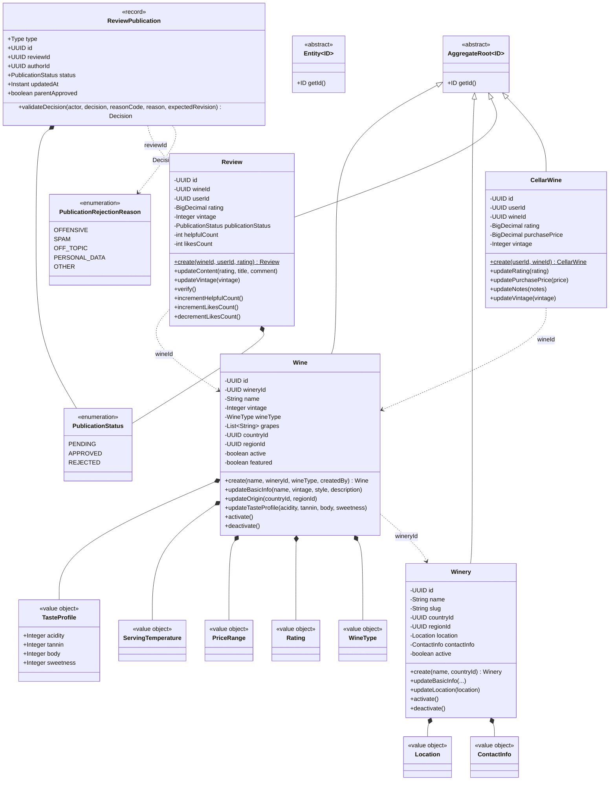
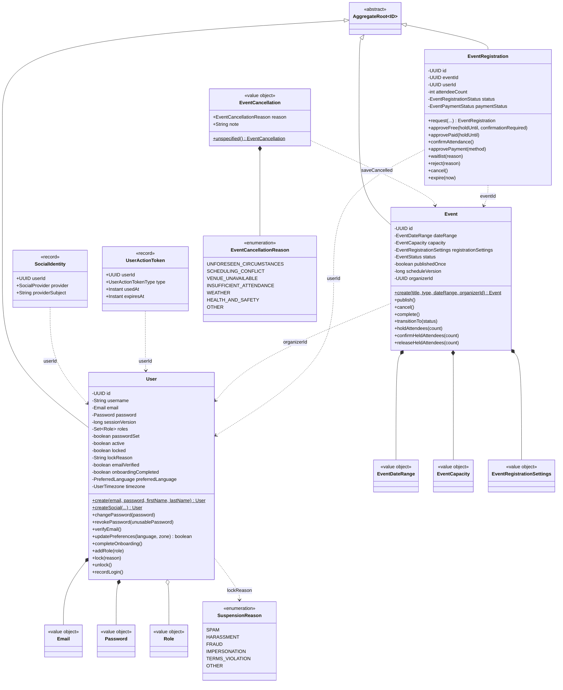
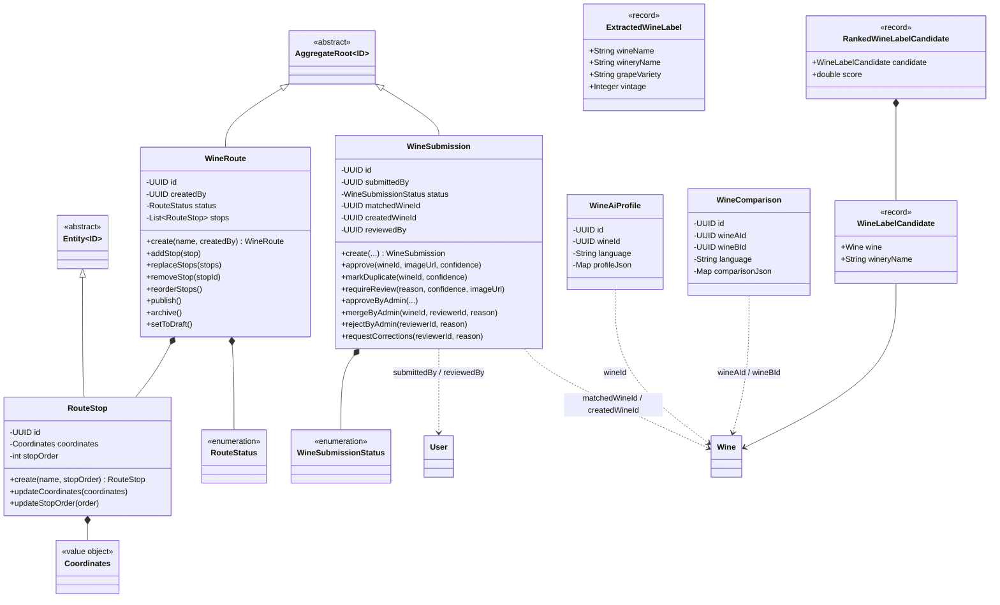
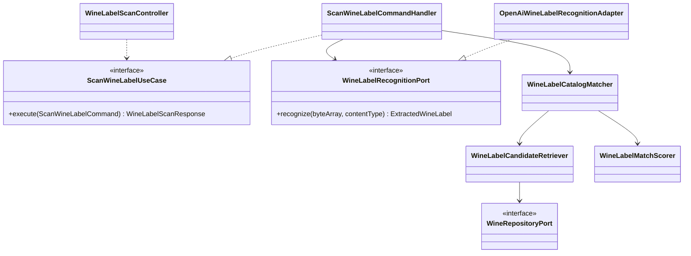
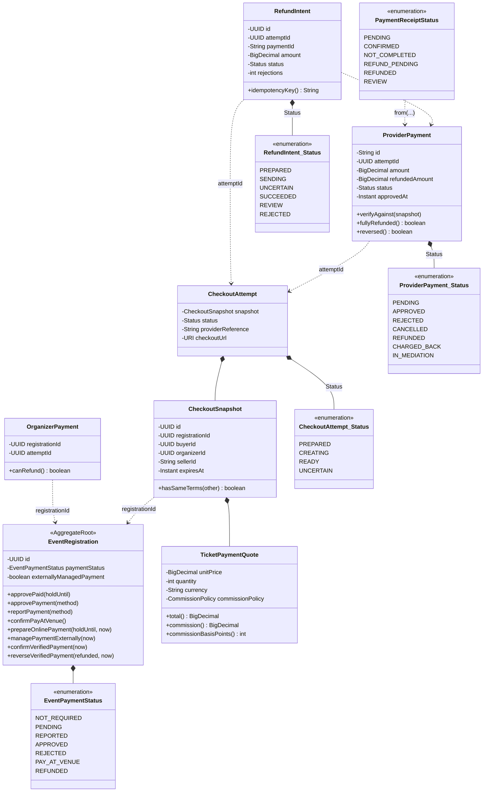
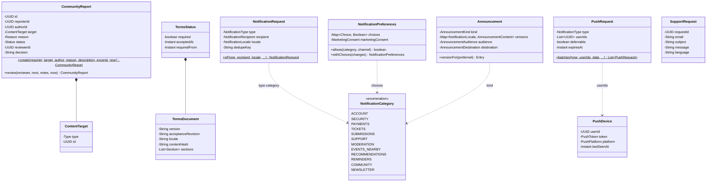
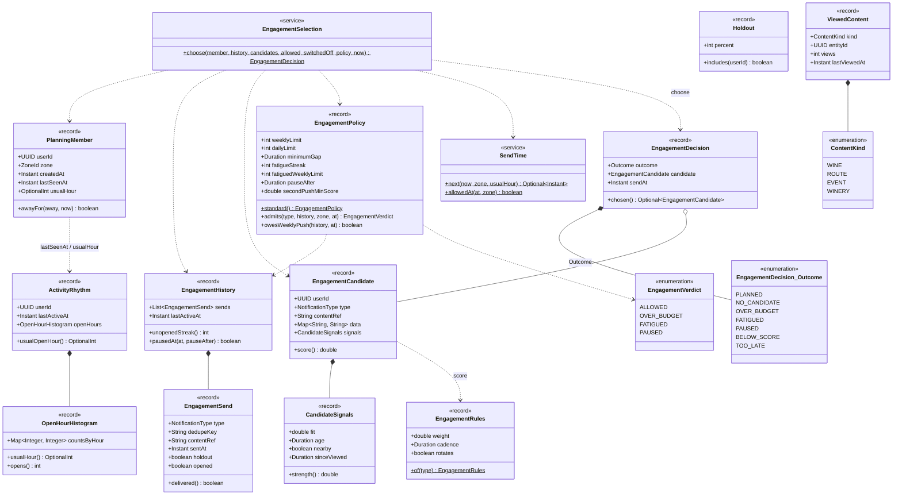

# Modelo de dominio UML

## Alcance y notación

Estos diagramas de clases representan el modelo de dominio implementado en
`backend/src/main/java/com/vinnot`. No representan entidades JPA ni tablas. Su
objetivo es mostrar agregados, entidades, value objects, comportamientos y
dependencias de identidad entre módulos.

- `AggregateRoot` y `Entity` son abstracciones de dominio compartidas.
- Una composición (`*--`) indica que el agregado posee el ciclo de vida del
  objeto en memoria.
- Una dependencia punteada (`..>`) indica que el modelo conserva un UUID o usa
  un tipo de otro concepto; no implica navegación JPA entre agregados.
- Se omiten getters, builders y campos de proyección para mantener legible el
  modelo. Los atributos y operaciones incluidos son los que expresan identidad,
  invariantes o transiciones relevantes.

## Fundamentos, catálogo y comunidad

[Ver diagrama de «Fundamentos, catálogo y comunidad» completo](https://images.vinnot.com/docs/diagrams/v1/es/backend-diagrams-domain-class-model-ddb7b886d63b.svg)

`Wine`, `Winery`, `Review` y `CellarWine` pertenecen a módulos distintos. Las
dependencias entre ellos se resuelven en casos de uso mediante puertos; el
diagrama no autoriza referencias directas entre repositorios o entidades JPA.
Una reseña nueva nace con `PublicationStatus.APPROVED`; `ReviewPublication` es
la vista común de reseñas y comentarios que un moderador decide, y un rechazo
lleva un `PublicationRejectionReason`. `vintage` en `Review` y `CellarWine` es la
añada opcional que la persona probó, independiente de la añada del vino del
catálogo.

## Identidad y eventos

[Ver diagrama de «Identidad y eventos» completo](https://images.vinnot.com/docs/diagrams/v1/es/backend-diagrams-domain-class-model-1d904310f025.svg)

La capacidad se protege en el agregado `Event`; el estado de la solicitud y del
pago vive en `EventRegistration`. Los IDs conectan agregados sin convertir el
modelo en un grafo mutable único. `publishedOnce` se explica en
[máquinas de estado](domain-state-machines.md#eventos); `scheduleVersion` sólo
crece y cuenta los cambios que se avisan a los asistentes (inicio, fin o el
lugar tal como se lee, nombre y dirección), así identifica cada aviso de cambio.
`EventCancellation` es el motivo de una cancelación, que
`EventCancellationService.saveCancelled` guarda con el evento. En `User`,
`passwordSet` indica si la persona eligió la contraseña y una suspensión es
`lock` con `lockReason` = código de `SuspensionReason` o `CODIGO: detalle`
([ejes de la cuenta](domain-state-machines.md#cuenta-ejes-independientes)).

## Rutas, submissions e IA

[Ver diagrama de «Rutas, submissions e IA» completo](https://images.vinnot.com/docs/diagrams/v1/es/backend-diagrams-domain-class-model-86cd31c4bed7.svg)

Los perfiles y comparaciones son modelos de contenido persistido del módulo
`ai`; la generación, el lease y el cache se coordinan en aplicación e
infraestructura. El matching de etiquetas usa modelos y servicios puros del
módulo `wine`, mientras los adapters de OCR/visión permanecen fuera del dominio.

## Colaboración de aplicación: escaneo

Este UML complementa las clases de dominio con una colaboración de aplicación
concreta. La realización apunta desde el handler/adapter hacia su interfaz;
las dependencias apuntan al tipo utilizado. No representa el orden temporal,
que está en el [flujo de escaneo](../../modules/wines/architecture.md).

[Ver diagrama de «Colaboración de aplicación: escaneo» completo](https://images.vinnot.com/docs/diagrams/v1/es/backend-diagrams-domain-class-model-a1851891c215.svg)

El controller adapta multipart; el handler orquesta y mide; el matcher aplica
normalización/ranking; el retriever utiliza el puerto de catálogo; el scorer
permanece en dominio; el adapter visual implementa el contrato externo. El
handler también utiliza `WineLabelScanPolicy` y `WineLabelMetricsPort`, omitidos
del gráfico para mantener una vista legible.

## Pagos

[Ver diagrama de «Pagos» completo](https://images.vinnot.com/docs/diagrams/v1/es/backend-diagrams-domain-class-model-fd184b63d3e6.svg)

Los tipos del módulo `payment` son records inmutables: un cambio de estado crea
un registro nuevo en el servicio o en la persistencia. La inscripción
(`EventRegistration`, módulo `event`) es el único agregado que cambia por el
pago. `CheckoutAttempt.Status`, `ProviderPayment.Status` y `RefundIntent.Status`
son enums anidados en su record: el gráfico los nombra `CheckoutAttempt_Status`,
`ProviderPayment_Status` y `RefundIntent_Status` porque Mermaid no admite el
nombre calificado `CheckoutAttempt::Status` de UML; el atributo `status` de cada
record es de ese tipo anidado. `OrganizerPayment` es
una vista de lectura para el organizador. Los estados se describen en
[Pagos](../../modules/payments/README.md) y en [máquinas de estado](domain-state-machines.md#pago-de-una-inscripción).

## Comunidad, legal, notificaciones y soporte

[Ver diagrama de «Comunidad, legal, notificaciones y soporte» completo](https://images.vinnot.com/docs/diagrams/v1/es/backend-diagrams-domain-class-model-e443a8d1bd3b.svg)

Estos módulos tampoco tienen agregados: sus tipos de dominio son records
inmutables y la orquestación vive en servicios de aplicación y puertos.
`CommunityReport.review` devuelve una denuncia nueva y aplica las reglas de
moderación. `ContentTarget` apunta por UUID a contenido de otros módulos
(reseña, comentario, usuario, evento o ruta). Los bloqueos entre usuarios, la
aceptación de términos y los interruptores de push existen solo como puertos y
adaptadores, sin clase de dominio. `NotificationType` define la categoría de
cada aviso; la categoría decide si es transaccional, opcional o promocional.

## Engagement y actividad

[Ver diagrama de «Engagement y actividad» completo](https://images.vinnot.com/docs/diagrams/v1/es/backend-diagrams-domain-class-model-003c0d31fa12.svg)

Los tipos de `engagement` y `activity` son records inmutables sin agregado: la
corrida del planificador los arma en `EngagementPageService` y guarda el
resultado por puertos. `EngagementSelection.choose` filtra los candidatos de la
cuenta por categoría y tipo permitidos, cadencia y límite de categoría, elige el
mejor puntaje (`EngagementRules.weight` por la fuerza de `CandidateSignals`) y
pide a `EngagementPolicy` el veredicto del presupuesto. `SendTime` fija la hora
de envío entre las 09:00 y las 21:59 locales; sin hora posible el resultado es
TOO_LATE. `Holdout` separa un porcentaje estable de cuentas por hash del UUID.
`PlanningMember` se arma con `ActivityRhythm`: su última apertura y su hora
habitual. `ViewedContent` alimenta las fuentes de candidatos de vinos vistos sin
reseña y de reactivación. `EngagementDecision.Outcome` es un enum anidado,
nombrado como los de pagos. El flujo completo está en
[push de engagement](../../modules/notifications/architecture.md#push-de-engagement)
y en [actividad](../../modules/activity/README.md).

## Relación con otros diagramas

- [DER y modelo relacional](../data/database-model.md)
- [Máquinas de estado](domain-state-machines.md)
- [Mapa modular y corte hexagonal](system-map.md)
- [Consistencia, locks y caches](data-consistency.md)
