# Máquinas de estado del dominio

## Alcance

Las vistas distinguen estados persistidos, flags independientes y pasos de protocolo. Las flechas representan métodos existentes; no implican que todas las pantallas expongan esas acciones. Las tablas precisan las guardias que no caben en el gráfico.

## Eventos

`publishedOnce` es independiente del estado: se activa al publicar y no se
borra al cancelar, posponer o completar. La lectura pública exige este flag y
estado distinto de DRAFT. Por eso cancelar un borrador nuevo no lo publica,
pero cancelar un evento publicado conserva su enlace histórico. V22 inicializa
los no DRAFT legacy para preservar los enlaces ya expuestos.

Recorrido habitual; la tabla posterior define las llamadas admitidas por el agregado:

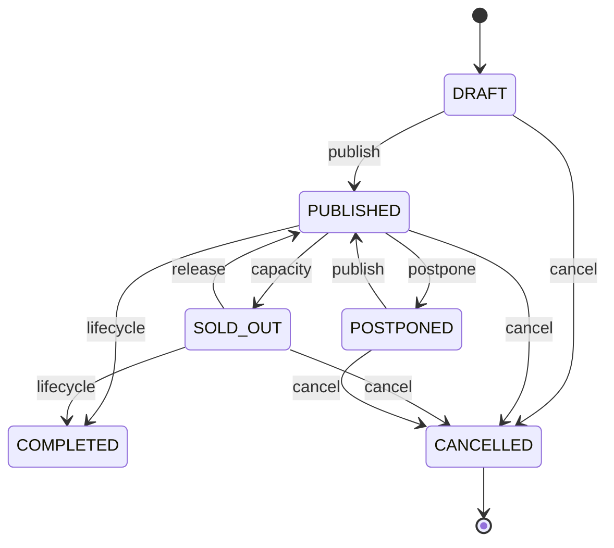

[Ver diagrama de «Eventos» completo](https://images.vinnot.com/docs/diagrams/v1/es/backend-diagrams-domain-state-machines-5163bf32b834.svg)

CANCELLED es terminal: ninguna transición gestionada sale de él (`CANNOT_PUBLISH`,
`CANNOT_DRAFT`, `CANNOT_POSTPONE`, `CANNOT_COMPLETE`), así que un evento cancelado
no puede completarse y luego volver a publicarse.

| Método | Guardia del agregado | Resultado |
|---|---|---|
| `publish` | status != CANCELLED | PUBLISHED |
| `cancel` | status != COMPLETED | CANCELLED |
| `complete` | status != CANCELLED (`CANNOT_COMPLETE`) | COMPLETED |
| `transitionTo(DRAFT)` | status != CANCELLED | DRAFT |
| `transitionTo(POSTPONED)` | status != CANCELLED && status != COMPLETED | POSTPONED |
| `transitionTo(SOLD_OUT)` | no admitido manualmente | INVALID_EVENT_STATUS |

La actualización de capacidad asigna SOLD_OUT si se agota; al liberar cupos cambia SOLD_OUT a PUBLISHED. El enum EventStatus no contiene ARCHIVED. El mantenimiento completa eventos vencidos mediante una actualización masiva del repositorio, no mediante una invocación de Event.complete por fila.

## Inscripciones y pago

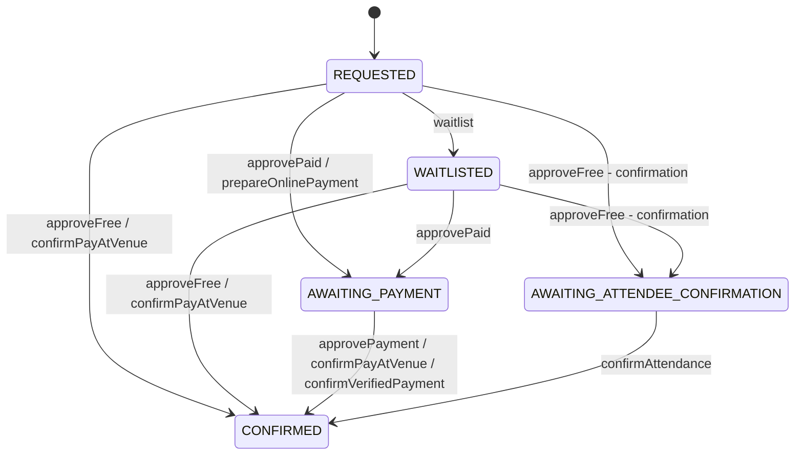

[Ver diagrama de «Inscripciones y pago» completo](https://images.vinnot.com/docs/diagrams/v1/es/backend-diagrams-domain-state-machines-69d3d3253e91.svg)

El gráfico separa aprobación/confirmación de las salidas terminales para evitar
cruces entre todas las flechas. Estas salidas se definen en la tabla:

| Operación | Estado de origen | Destino |
|---|---|---|
| `reject` | REQUESTED, WAITLISTED, AWAITING_PAYMENT, AWAITING_ATTENDEE_CONFIRMATION | REJECTED |
| `cancel` | cualquiera de los anteriores o CONFIRMED | CANCELLED |
| `expire` | AWAITING_PAYMENT o AWAITING_ATTENDEE_CONFIRMATION, hold vencido | EXPIRED |
| `reverseVerifiedPayment` | inscripción gestionada por el proveedor; sin guarda de estado previo | CANCELLED, pago REFUNDED o REJECTED |

approvePaid, approveFree y waitlist exigen REQUESTED o WAITLISTED; confirmPayAtVenue acepta REQUESTED, AWAITING_PAYMENT o WAITLISTED. reject acepta estados no terminales distintos de CONFIRMED; cancel acepta cualquier estado no terminal. EXPIRED, REJECTED y CANCELLED son terminales. Confirmar asistencia o aprobar pago exige un hold vigente. Aprobar pago confirma directamente, sin una segunda confirmación del asistente.

Pago es un eje separado: NOT_REQUIRED para gratuito; PENDING al solicitar pago; REPORTED al informar TRANSFER, QR o MERCADO_PAGO; APPROVED al aprobar; PAY_AT_VENUE al confirmar CASH. REJECTED y REFUNDED solo los asigna `reverseVerifiedPayment`. Reportar pago conserva AWAITING_PAYMENT.

## Pago de una inscripción

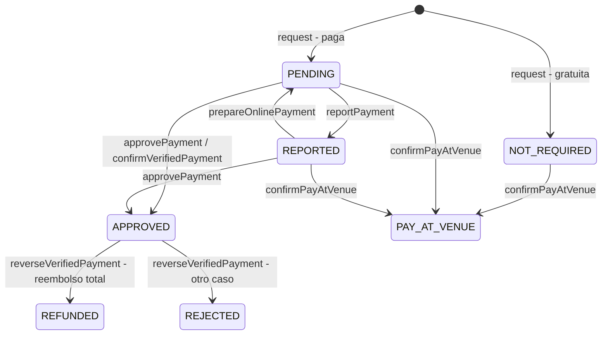

[Ver diagrama de «Pago de una inscripción» completo](https://images.vinnot.com/docs/diagrams/v1/es/backend-diagrams-domain-state-machines-fc97e52a80c6.svg)

`approvePaid` deja el pago en PENDING. `approvePayment`, `reportPayment` y
`confirmPayAtVenue` no miran el estado de pago previo, solo el de la inscripción
y que el pago no lo gestione el proveedor. `reverseVerifiedPayment` tampoco tiene
guarda de origen; el gráfico muestra el caso real, un pago aprobado que el
proveedor informa como devuelto, contracargado o en mediación.

Transiciones dirigidas por el proveedor (Mercado Pago, módulo `payment`): `prepareOnlinePayment` aprueba REQUESTED como pago o devuelve a PENDING un pago REPORTED manualmente; luego exige AWAITING_PAYMENT, pago PENDING y hold vigente, y marca la inscripción como gestionada externamente con método MERCADO_PAGO. Desde ese momento approvePayment, reportPayment y confirmPayAtVenue fallan con PAYMENT_PROVIDER_VERIFICATION_REQUIRED. `confirmVerifiedPayment` exige autoridad del proveedor y la misma elegibilidad, y asigna CONFIRMED/APPROVED tras la verificación en servidor. `reverseVerifiedPayment` (reembolso, contracargo o mediación informados por el proveedor) asigna CANCELLED con REFUNDED si el reembolso es total y REJECTED en otro caso.

Los handlers coordinan held_attendees/current_attendees dentro de la transacción con repositorios PESSIMISTIC_WRITE y constraints de capacidad. Véase [consistencia](data-consistency.md) y [eventos](../../modules/events/architecture.md#backend).

## Intento de checkout

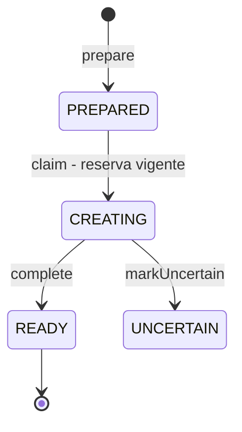

[Ver diagrama de «Intento de checkout» completo](https://images.vinnot.com/docs/diagrams/v1/es/backend-diagrams-domain-state-machines-02d76f70e84d.svg)

`CheckoutAttempt.Status` es un enum anidado del record `CheckoutAttempt`; los
cambios los hace `PostgresCheckoutAttemptStore` con un `UPDATE` condicionado al
estado anterior, así dos solicitudes no crean dos checkouts.
`DispatchTicketCheckoutService` reclama un intento PREPARED cuya reserva no
venció (`claim`), crea el checkout en Mercado Pago y lo guarda como READY. Si la
respuesta falla o no se puede confirmar, el intento queda UNCERTAIN: una falla
no prueba que el checkout no exista. Un intento READY devuelve su URL guardada;
uno CREATING o UNCERTAIN no crea otro. La conciliación busca los intentos
CREATING y UNCERTAIN y lee sus pagos en el proveedor; no cambia el estado del
intento.

## Pago informado por el proveedor

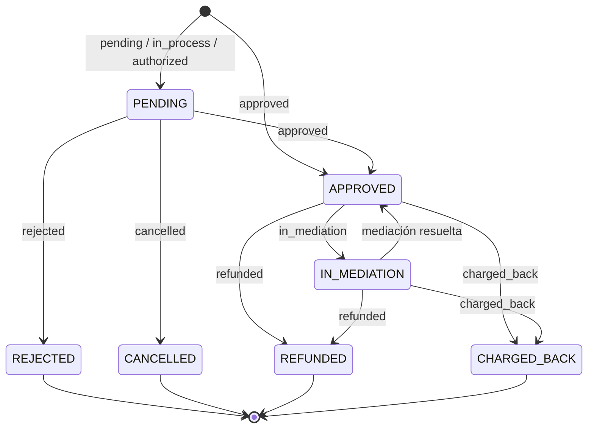

[Ver diagrama de «Pago informado por el proveedor» completo](https://images.vinnot.com/docs/diagrams/v1/es/backend-diagrams-domain-state-machines-b32da25763e9.svg)

Vinnot no cambia `ProviderPayment.Status`: `MercadoPagoPaymentAdapter` traduce el
estado que informa Mercado Pago y `ApplyProviderPaymentService` aplica cada
lectura. El libro de pagos descarta una lectura más vieja que la guardada, una
con menos monto devuelto o una que deja de estar revertida. Un pago está
revertido cuando el reembolso es total o hubo contracargo; revertido, REJECTED y
CANCELLED son finales para la conciliación (`ReconciliationSchedule.isFinal`).
APPROVED confirma la inscripción si el pago es el acreditado. Un reembolso
parcial, REFUNDED, CHARGED_BACK o IN_MEDIATION invocan
`reverseVerifiedPayment`; si el pago no quedó revertido, la entrada queda en
revisión.

## Intención de reembolso

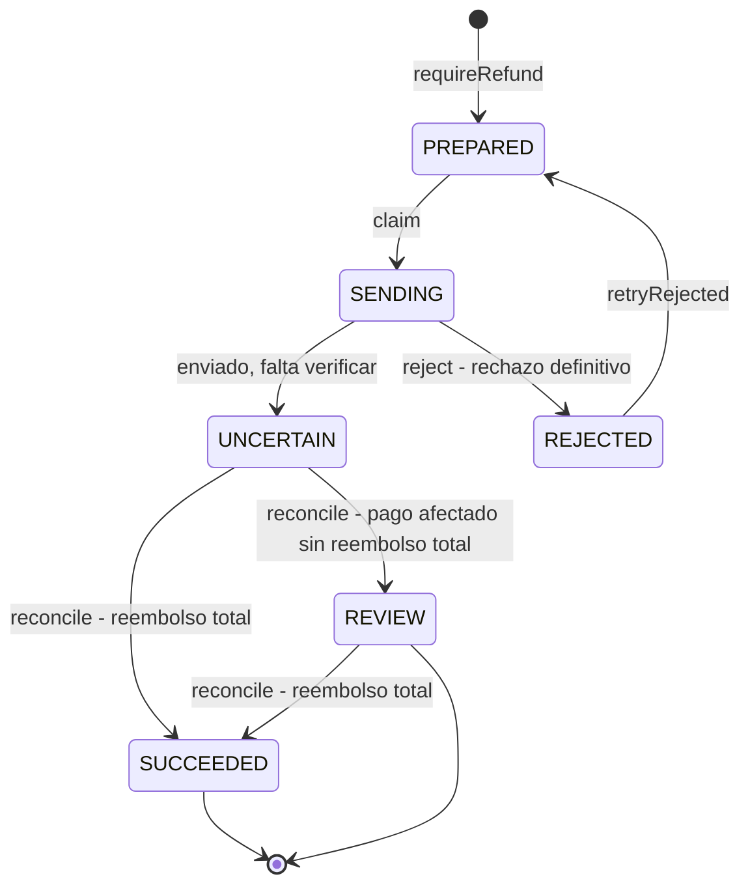

[Ver diagrama de «Intención de reembolso» completo](https://images.vinnot.com/docs/diagrams/v1/es/backend-diagrams-domain-state-machines-f6a6cf8164f3.svg)

`RefundIntent.Status` es un enum anidado del record `RefundIntent`;
`PostgresRefundStore` hace cada cambio con un `UPDATE` condicionado.

| Operación | Origen | Destino | Quién la invoca |
|---|---|---|---|
| `requireRefund` | sin intención para ese pago | PREPARED | `ApplyProviderPaymentService` y `RequestPaymentRefundService` |
| `claim` | PREPARED | SENDING | `ReconcilePaymentsService`, sólo con el pago todavía APPROVED y sin devolución |
| `uncertain` | SENDING | UNCERTAIN | `ReconcilePaymentsService` después de enviar, aun con respuesta 2xx |
| `reject` | SENDING | REJECTED, suma `rejections` | `RefundRejectionRecorder`, cuando Mercado Pago rechaza y el pago no se devolvió por otra vía |
| `retryRejected` | REJECTED | PREPARED | `RequestPaymentRefundService`, cuando el organizador lo pide de nuevo |
| `reconcile` | cualquiera salvo SUCCEEDED | SUCCEEDED o REVIEW | `ApplyProviderPaymentService` con cada lectura del pago |

El gráfico muestra el recorrido habitual; `reconcile` también cierra una
intención PREPARED, SENDING o REJECTED cuando el pago ya figura devuelto. Un
rechazo avisa sólo al organizador, una vez por rechazo, con `idempotencyKey`
distinta en el reintento.

## Submissions de vino

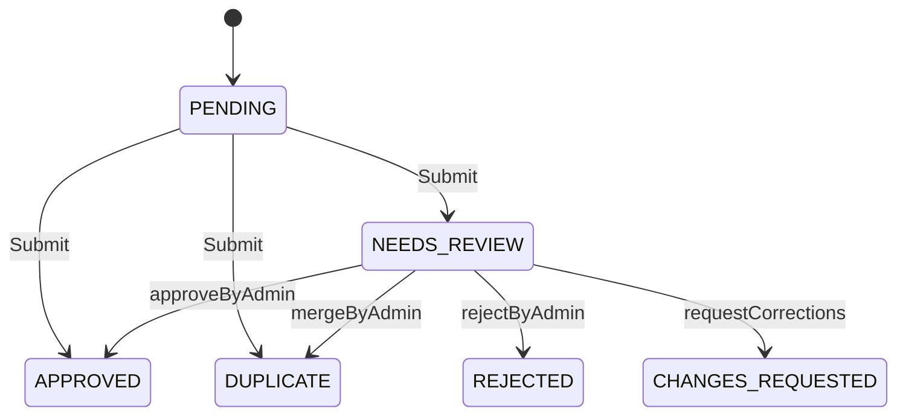

[Ver diagrama de «Submissions de vino» completo](https://images.vinnot.com/docs/diagrams/v1/es/backend-diagrams-domain-state-machines-a5cc30549e33.svg)

Este gráfico representa el circuito de submit/review. El agregado también expone reject desde PENDING, pero el handler de alta no lo usa como rama automática. Las decisiones administrativas exigen NEEDS_REVIEW, reviewer y motivo; registran reviewedBy, reviewedAt y updatedAt. CHANGES_REQUESTED es consultable por el usuario. No se aplican decisiones administrativas a estados ya decididos.

## Sesiones y tokens

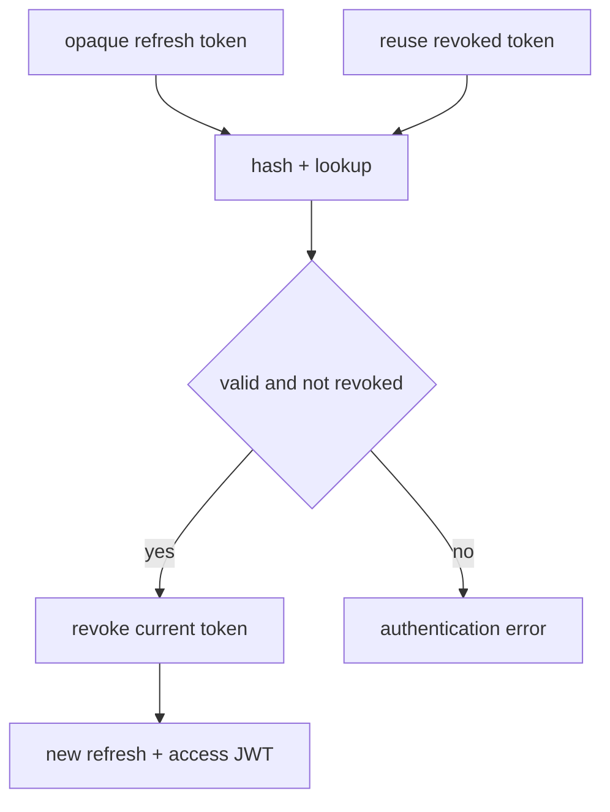

[Ver diagrama de «Sesiones y tokens» completo](https://images.vinnot.com/docs/diagrams/v1/es/backend-diagrams-domain-state-machines-3ebe679eeeca.svg)

Vigencia/revocación son propiedades de la fila, no un enum ACTIVE/REPLAYED. El gráfico describe una ejecución de renovación, no exclusión entre solicitudes concurrentes. Tokens de acción de cuenta tienen un consumo separado con lock de fila. Un access JWT ya emitido conserva su propia expiración.

## Tokens de acción de cuenta

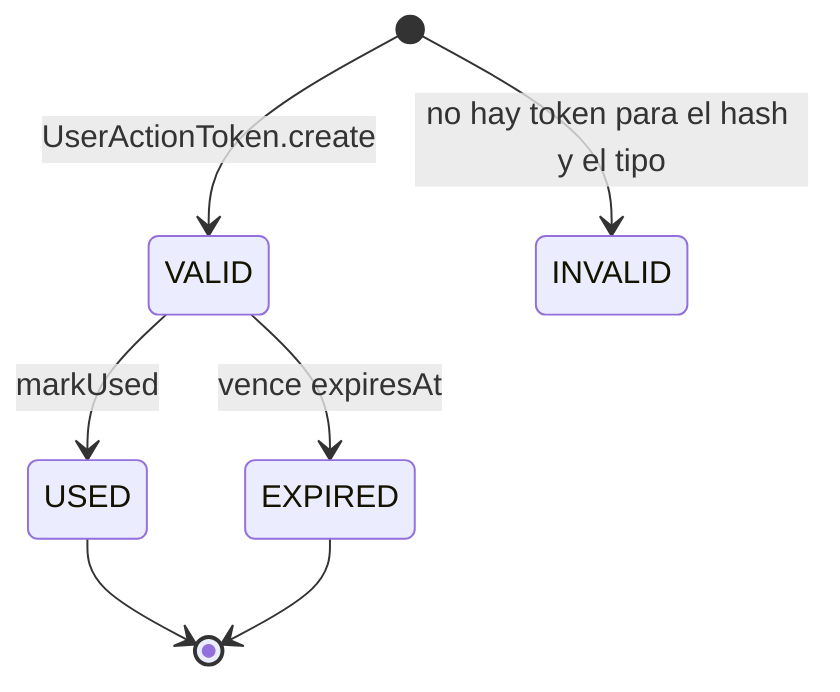

[Ver diagrama de «Tokens de acción de cuenta» completo](https://images.vinnot.com/docs/diagrams/v1/es/backend-diagrams-domain-state-machines-363192dd3006.svg)

`UserActionTokenStatus` no se guarda: `AccountActionTokenService.getStatus` lo
calcula al leer el token. USED se evalúa antes que EXPIRED, así que un token usado
nunca figura vencido. El único cambio de estado del dominio es `markUsed`, que
exige `isUsableAt`.

## Denuncias de la comunidad

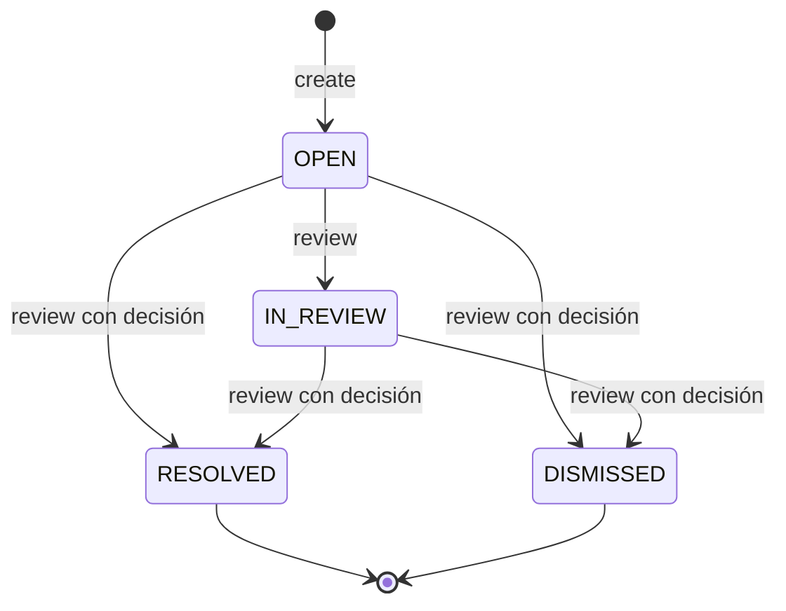

[Ver diagrama de «Denuncias de la comunidad» completo](https://images.vinnot.com/docs/diagrams/v1/es/backend-diagrams-domain-state-machines-cfffdcf7d9a7.svg)

`CommunityReport.review` devuelve una denuncia nueva. RESOLVED y DISMISSED son
terminales y nunca se vuelve a OPEN (`REPORT_TRANSITION`). Quien tomó la denuncia
es el único que puede seguir revisándola (`REPORT_ASSIGNED`); no puede ser quien
denunció ni el autor del contenido (`REPORT_CONFLICT_OF_INTEREST`). Cerrar exige
una decisión escrita (`REPORT_DECISION_REQUIRED`). Quitar el contenido denunciado
también la resuelve.

## Publicación de reseñas y comentarios

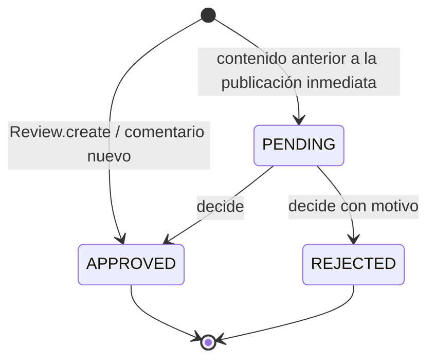

[Ver diagrama de «Publicación de reseñas y comentarios» completo](https://images.vinnot.com/docs/diagrams/v1/es/backend-diagrams-domain-state-machines-f7dcd7c76127.svg)

Las reseñas y los comentarios nuevos se publican al crearse
(`PublicationStatus.APPROVED`). PENDING sólo queda en contenido anterior, que
un moderador decide con `DecideReviewPublicationCommandHandler`;
`ReviewPublication.validateDecision` aplica las guardias:

| Guardia | Código |
|---|---|
| quien decide no es el autor | `PUBLICATION_SELF_REVIEW` |
| el contenido está PENDING y la decisión no es PENDING | `PUBLICATION_TRANSITION` |
| el contenido no cambió desde que se leyó | `PUBLICATION_CHANGED` |
| aprobar un comentario exige la reseña aprobada | `PUBLICATION_PARENT_PENDING` |
| rechazar exige un `PublicationRejectionReason` o una nota; aprobar no lleva motivo; la nota tiene hasta 2000 caracteres | `PUBLICATION_REASON` |

Sólo el contenido APPROVED cuenta en el promedio del vino y aparece para los
demás; su autor sigue viendo el propio.

## Rutas enoturísticas

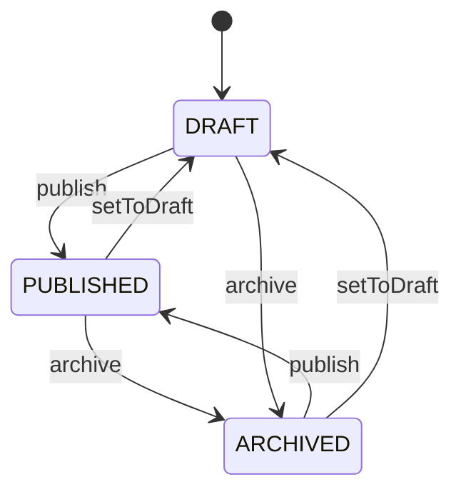

[Ver diagrama de «Rutas enoturísticas» completo](https://images.vinnot.com/docs/diagrams/v1/es/backend-diagrams-domain-state-machines-6a61dd80c002.svg)

publish exige una lista de paradas no vacía. archive y setToDraft asignan estado sin guardia sobre el anterior; repetir la asignación está admitido.

## Cuenta: ejes independientes

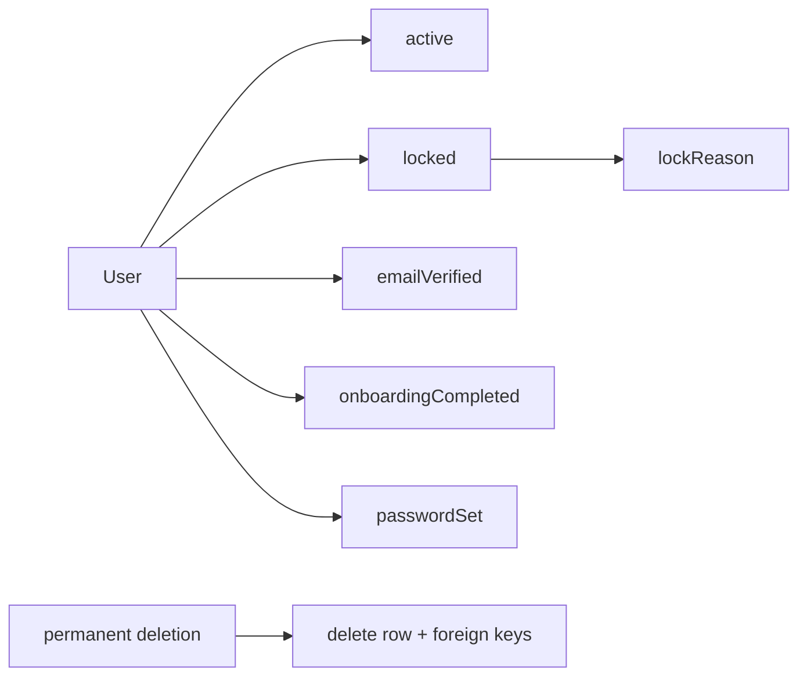

[Ver diagrama de «Cuenta: ejes independientes» completo](https://images.vinnot.com/docs/diagrams/v1/es/backend-diagrams-domain-state-machines-7cbfadcecd87.svg)

No existe un enum ACTIVE_VERIFIED: una cuenta puede estar verificada e inactiva, o verificada y bloqueada. Reactivar, verificar email y completar onboarding modifican flags distintos.

`passwordSet` (V62) indica si la contraseña guardada la eligió la persona. Una
cuenta creada por un inicio de sesión social, o una local sin email verificado
cuya contraseña se revocó al vincular un proveedor, guarda el hash de un secreto
aleatorio y `passwordSet = false`: los clientes ofrecen crear una contraseña en
lugar de cambiarla. `changePassword` lo pone en true y `revokePassword`, en false.

Suspender una cuenta es `lock`: `locked = true`, `sessionVersion` sube y cierra
las sesiones, y `lockReason` guarda el código de `SuspensionReason` solo o
`CODIGO: detalle` cuando hay una nota (por ejemplo `SPAM: enlaces repetidos`).
Sin código se usa OTHER. Reactivar es `unlock`, que borra `lockReason`.

Las condiciones de autenticación se describen en [identidad](../architecture/authentication-and-identity.md).

## Fuentes

Rutas relativas a `backend/src/main/java/com/vinnot/`:

- `event/domain/model/Event.java`, `EventRegistration.java`, `event/domain/valueobject/EventStatus.java`, `EventRegistrationStatus.java`, `EventPaymentStatus.java`.
- `event/infrastructure/persistence/jpa/EventJpaRepository.java`.
- `payment/application/service/EventCheckoutReservationService.java`, `ApplyProviderPaymentService.java`, `DispatchTicketCheckoutService.java`, `ReconcilePaymentsService.java`, `RequestPaymentRefundService.java`, `RefundRejectionRecorder.java`, `ReconciliationSchedule.java`.
- `payment/domain/model/CheckoutAttempt.java`, `ProviderPayment.java`, `RefundIntent.java`; `payment/infrastructure/persistence/PostgresCheckoutAttemptStore.java`, `PostgresRefundStore.java`; `payment/infrastructure/gateway/MercadoPagoPaymentAdapter.java`.
- `review/domain/model/PublicationStatus.java`, `ReviewPublication.java`, `Review.java`; `review/application/command/handler/DecideReviewPublicationCommandHandler.java`.
- `user/domain/model/UserActionToken.java`, `user/application/service/AccountActionTokenService.java`, `community/domain/model/CommunityReport.java`.
- `wine/domain/model/WineSubmission.java`, `wineroute/domain/model/WineRoute.java`.
- `user/domain/model/User.java`, `user/domain/valueobject/SuspensionReason.java`, `user/application/command/handler/BanUserCommandHandler.java`, `user/application/command/handler/RefreshTokenCommandHandler.java`.
