# DER detallado por contexto

## Notación y alcance

Este DER describe el esquema acumulado de Flyway V1–V89. Presenta columnas
relevantes para identidad, relaciones e invariantes; el diccionario completo de
atributos está en el [modelo de datos](../data/database-model.md) y en las
migraciones. No es un diagrama de clases JPA.

`PK` = clave primaria; `FK` = clave foránea; `UK` = unicidad individual.
Un comentario `NULL` indica columna opcional. Las claves únicas compuestas se
explican debajo de cada bloque, sin marcar cada columna como única por separado.
`||` indica exactamente uno; `|o`, cero o uno; `o{`, cero o muchos.
Tablas ancla repetidas en varios bloques representan la misma tabla física.

## Identidad y credenciales

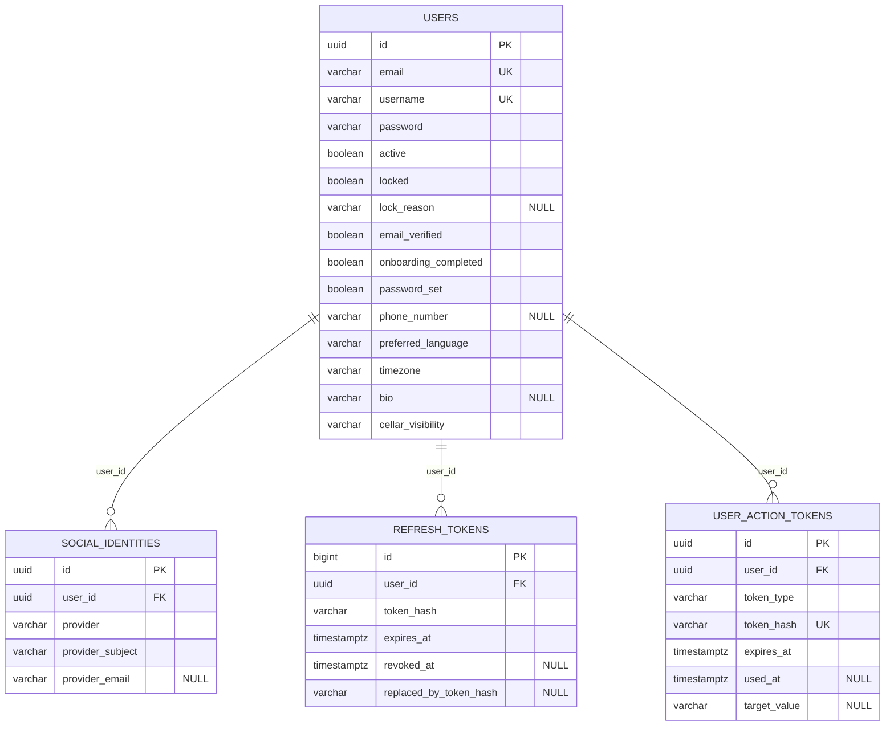

[Ver diagrama de «Identidad y credenciales» completo](https://images.vinnot.com/docs/diagrams/v1/es/backend-diagrams-relational-model-eaf8c8cab1af.svg)

Todos los enlaces a usuario de este bloque usan `ON DELETE CASCADE`. Identidad social tiene unicidad compuesta `(provider, provider_subject)` y `(user_id, provider)`. El token de acción guarda `used_at`, no un enum de estado. `target_value` se agrega en V7 para el cambio de email. V57 amplía `lock_reason` a 300 caracteres. Refresh guarda hash y referencia al hash reemplazante; esa referencia es texto, no FK. V87 agrega la `bio` pública de `users` (hasta 160 caracteres, opcional) y `cellar_visibility` (`varchar(20) NOT NULL`, por defecto PUBLIC, CHECK PUBLIC, FOLLOWERS o PRIVATE); ver [Social y perfil de gustos](#social-y-perfil-de-gustos-v87v89).

## Autorización

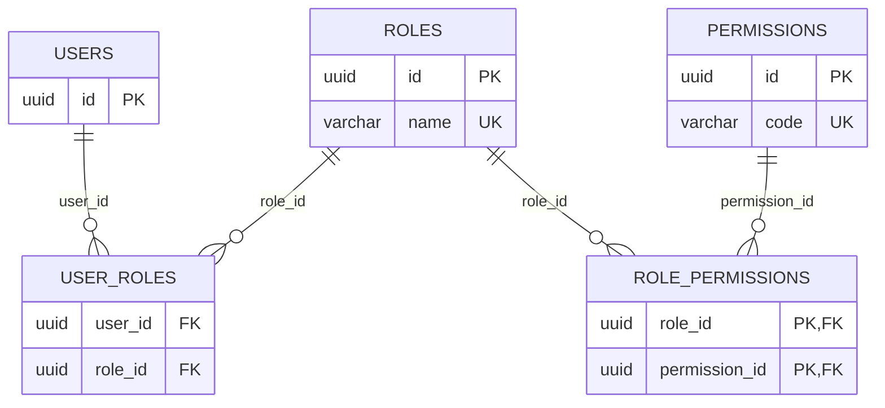

[Ver diagrama de «Autorización» completo](https://images.vinnot.com/docs/diagrams/v1/es/backend-diagrams-relational-model-e4c9f095fc58.svg)

`role_permissions` tiene PK compuesta. `user_roles` tiene índice único `(user_id, role_id)` incorporado en V15; no se representa como PK. Todas las FKs de las asociaciones son CASCADE. Los permisos cargados para emitir authorities se describen en [seguridad](../architecture/security-and-authorization.md).

## Geografía y catálogo

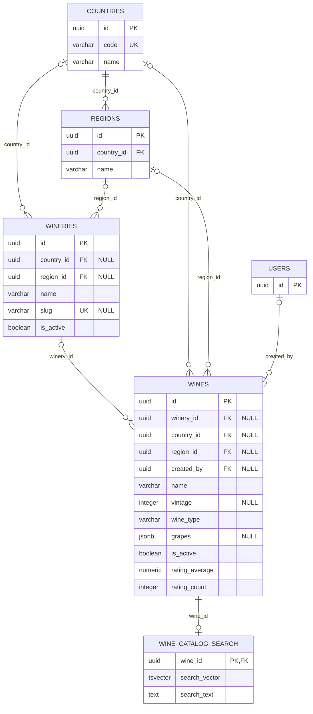

[Ver diagrama de «Geografía y catálogo» completo](https://images.vinnot.com/docs/diagrams/v1/es/backend-diagrams-relational-model-db8bbc28fc03.svg)

`regions(name, country_id)` es único. Borrar país elimina sus regiones; vínculos de vinos y bodegas con país/región, vino con bodega y vino con creador se ponen en NULL. El read model se elimina por CASCADE con el vino. La FK permite cero o una proyección por vino; backfill y triggers mantienen una fila por vino durante las escrituras ordinarias. `wine_type` y las uvas JSONB no son FKs a catálogos.

## Comunidad y cava

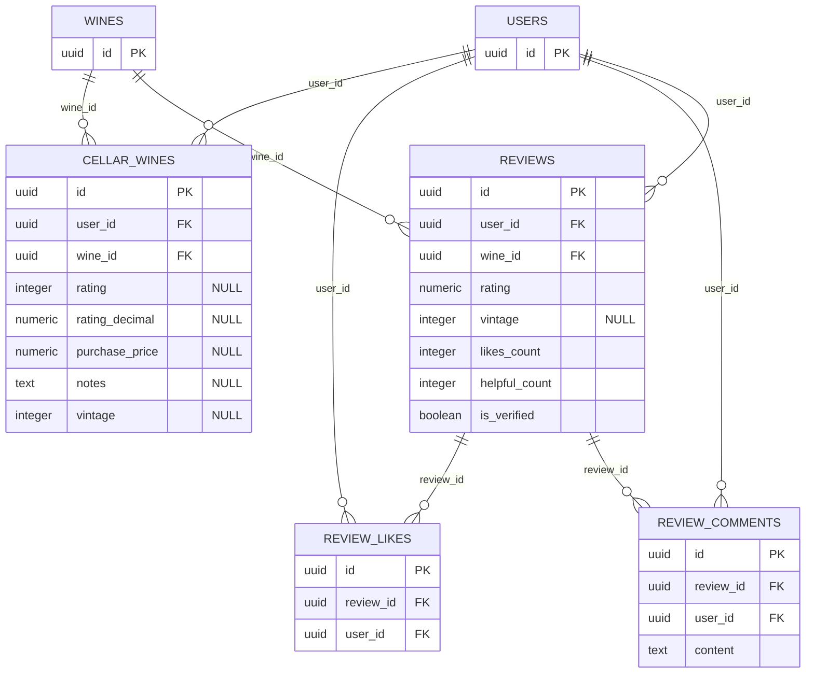

[Ver diagrama de «Comunidad y cava» completo](https://images.vinnot.com/docs/diagrams/v1/es/backend-diagrams-relational-model-9012f62031fb.svg)

Todas estas FKs son CASCADE. Claves únicas compuestas: reseña `(wine_id, user_id)`, like `(review_id, user_id)` y cava `(user_id, wine_id)`. El rating de cava es opcional y el de reseña obligatorio; ambos van de 0.1 a 5.0 con un decimal (el de cava vive en `rating_decimal`, que agrega V71 en #455; el entero `rating` 1–5 se conserva y se escribe junto a él para la revisión anterior del backend). Ambas tablas guardan una `vintage` probada opcional (V64) con CHECK 1800–2100. Contadores y promedio son datos derivados coordinados por casos de uso, no relaciones adicionales.

## Eventos e inscripciones

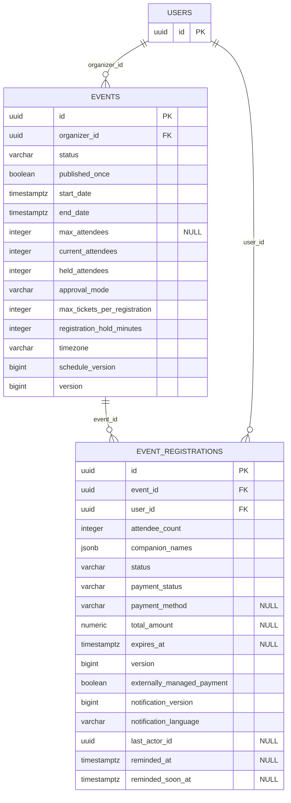

[Ver diagrama de «Eventos e inscripciones» completo](https://images.vinnot.com/docs/diagrams/v1/es/backend-diagrams-relational-model-09b1a26a986f.svg)

Todas las FKs son CASCADE. V8 reemplaza la PK `(event_id, user_id)` original por `id`. El índice único parcial `uk_event_registrations_active_user` cubre REQUESTED, AWAITING_PAYMENT, AWAITING_ATTENDEE_CONFIRMATION, CONFIRMED y WAITLISTED. Permite historial terminal del mismo usuario/evento. Las columnas SQL `version` existen; el mecanismo usado por los repositorios del flujo es `PESSIMISTIC_WRITE`. Estados y pagos tienen CHECK independientes; ver [máquinas de estado](domain-state-machines.md). V40 agrega `events.timezone` y `last_actor_id`, sin FK; V44, `schedule_version`; V45 y V48, los recordatorios `reminded_at` y `reminded_soon_at`.

## Rutas y paradas

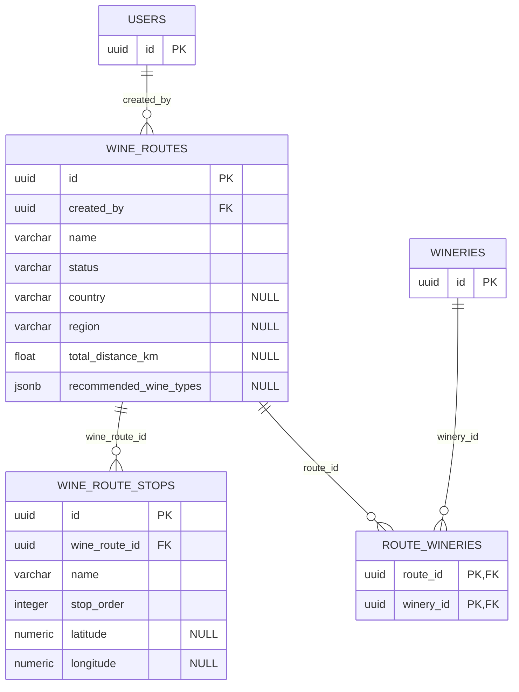

[Ver diagrama de «Rutas y paradas» completo](https://images.vinnot.com/docs/diagrams/v1/es/backend-diagrams-relational-model-a8c49df0b8a7.svg)

Todas las FKs son CASCADE. País y región de ruta son textos, no IDs geográficos. `wine_route_stops` no tiene FK a bodega: representa una parada con datos propios. `route_wineries` es una asociación separada con PK compuesta; no reemplaza el orden ni los atributos de las paradas.

## Propuestas y contenido generado

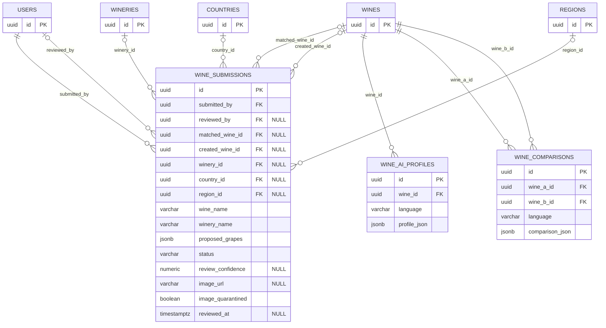

[Ver diagrama de «Propuestas y contenido generado» completo](https://images.vinnot.com/docs/diagrams/v1/es/backend-diagrams-relational-model-5a99d81b2c69.svg)

Autor de submission: CASCADE; revisor y vinos resultantes: SET NULL. V41 agrega país, región y bodega del catálogo, también SET NULL, y `proposed_grapes`, las uvas que no están en `grape_types`. Confianza admite NULL o [0,1]. Perfil es único por `(wine_id, language)` y comparación por `(wine_a_id, wine_b_id, language)`; sus FKs son CASCADE. La aplicación canonicaliza el par antes de persistir. `owner_id` del lease es el identificador de la ejecución coordinada, no una FK a usuario. La fila de lease no contiene el resultado IA ni bytes de imagen.

### Coordinación sin relación a usuarios

`ai_generation_leases` no tiene FKs; su independencia se representa en esta tabla:

| Columna | Tipo | Restricción |
|---|---|---|
| `lock_key` | varchar(255) | PK |
| `owner_id` | uuid | NOT NULL, identificador de ejecución |
| `expires_at` | timestamptz | NOT NULL, índice de expiración |

## Reservas monetarias IA

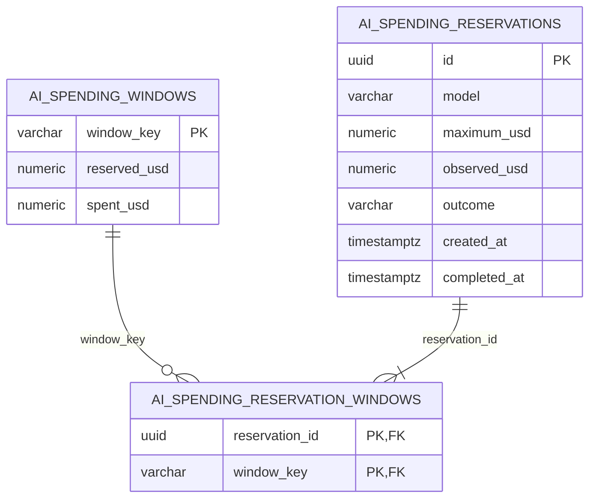

[Ver diagrama de «Reservas monetarias IA» completo](https://images.vinnot.com/docs/diagrams/v1/es/backend-diagrams-relational-model-38f405abb9f8.svg)

V23 impone cantidades no negativas y estados PENDING, UNKNOWN o ACCOUNTED.
Las reservas monetarias son durables; las leases de capacidad son temporales.
No existen FKs desde este registro hacia usuarios ni contenido del catálogo.

## Catálogos sin FK de negocio

`wine_types`, `event_types` y `event_statuses` tienen `id UUID` como PK, `code`
único, etiquetas `name_es`/`name_en`, `active` y `sort_order`; los estados agregan
`is_terminal`. `grape_types` tiene PK `id`, nombre único, `name_es`, `category`
y `is_active`. Se consultan como referencia; las columnas de tipo/estado de
negocio y la lista JSONB de uvas no se relacionan con ellos mediante FK.

## Trazabilidad

- V1: tablas base, PK/FK, unicidad y acciones de borrado.
- V5–V7: identidades sociales, tokens de acción, onboarding y email objetivo.
- V8–V9: inscripciones, restricciones de capacidad y ubicación del evento.
- V10–V11: submissions, revisor, cuarentena y estados.
- V12–V13: idiomas canónicos, comparación y leases.
- V14–V16: read model, índices y estadísticas de búsqueda.
- V28: teléfono privado del usuario.
- V29–V38: pagos online, inscripciones gestionadas por el proveedor, índice de asistente, notificaciones de inscripción, canales de retorno y triggers que despiertan la conciliación.
- V39: idioma preferido y zona horaria del usuario.
- V40: zona horaria del evento y usuario que actuó en cada cambio de inscripción.
- V41: referencias de catálogo (país, región, bodega) y uvas propuestas en submissions.
- V42–V43: preferencias de notificación, historial de consentimiento de marketing y supresiones de email.
- V44: versión de horario del evento y avisos de cancelación.
- V45, V48: recordatorios de inscripción.
- V46–V47, V51: dispositivos push, envíos deduplicados, tickets de recibo e índice por categoría.
- V49: resúmenes push del organizador.
- V50: área de eventos cercanos del usuario.
- V52: afinidades de gusto por uva y tipo.
- V53: código de motivo de las decisiones de publicación.
- V54–V55: cursores de los resúmenes de moderación y de "me gusta".
- V56: cursor del correo de actualización de términos.
- V57: motivo de suspensión de hasta 300 caracteres.
- V58: aviso de reconexión de la cuenta de pagos.
- V59: interruptores por tipo de push, su historial y resultados diarios de entrega.
- V60: anuncios del equipo.
- V61: índice de vinos inactivos para el listado del equipo.
- V62: contraseña elegida por su titular.
- V63: reembolsos rechazados.
- V64: añada probada en reseñas y cava.
- V65: canales push del dispositivo, retención de dispositivos y aviso que despierta el outbox.
- V66: señales de actividad y categoría REMINDERS.
- V67: motor de engagement e índice de zona horaria de usuarios.
- V68: reinicio único de `push_devices.last_seen_at`.
- V69: versión mínima de la app por plataforma y su historial de cambios.
- V78–V81: agente de redes sociales (días del vino, pilares, publicaciones, media y texto bilingüe); ver [Marketing en redes](../../modules/marketing/README.md#datos).
- V82: publicaciones por red, métricas diarias, cuentas conectadas con tokens cifrados, aprobación automática por pilar y registro de publicación.
- V83: pilares que se pueden apagar.
- V84: seis pilares refinados y `HUMOR` inactivo.
- V85: índices trigram de nombres de vinos y bodegas inactivos para la búsqueda tolerante a errores del equipo.
- V86: read models de búsqueda con filtros (`wine_catalog_filter_search`, `wine_grape_search`, `wine_grape_keys`) mantenidos por triggers.

Fuentes: `backend/src/main/resources/db/migration/`. Los índices y presupuestos
SQL se explican en [rendimiento de consultas](../data/query-performance.md).
La dirección de dependencias de código se describe en el
[UML de dominio](domain-class-model.md) y el [mapa del sistema](system-map.md).

## Control de sesión y efectos externos

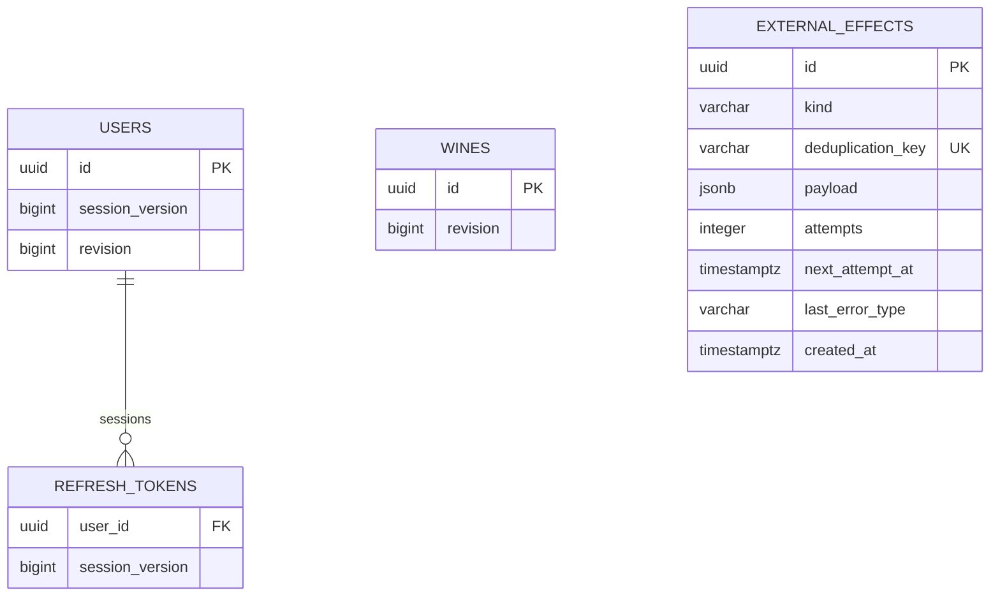

[Ver diagrama de «Control de sesión y efectos externos» completo](https://images.vinnot.com/docs/diagrams/v1/es/backend-diagrams-relational-model-1f72df54a46a.svg)

EXTERNAL_EFFECTS no lleva FK al recurso de negocio: debe sobrevivir a su eliminación para limpiar referencias externas.

## Evidencia contractual

V21 incorpora `legal_documents` y `user_legal_acceptances`. La relación con
`users` elimina evidencia al borrar definitivamente la cuenta. Una FK compuesta
vincula cada aceptación con versión, revisión, idioma y huella exactos; la clave
cuenta/tipo/revisión impide duplicados. No se infieren aceptaciones históricas.

[DER, índices, triggers y semántica de revisión](../../modules/legal/architecture.md#modelo-relacional).

## Comunidad y evidencia privada (V24)

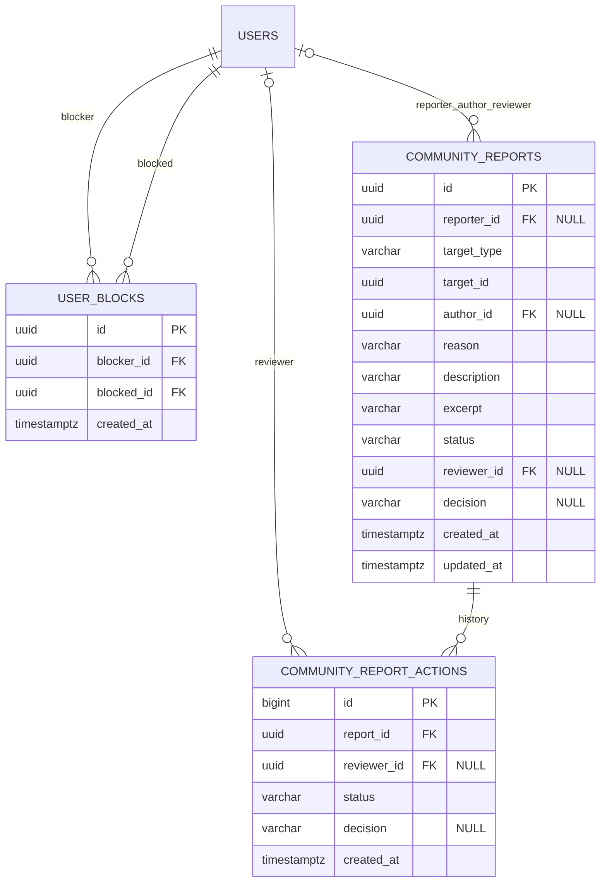

[Ver diagrama de «Comunidad y evidencia privada (V24)» completo](https://images.vinnot.com/docs/diagrams/v1/es/backend-diagrams-relational-model-7599bd3b8e12.svg)

El par de bloqueo es único y no permite autobloqueo. La unicidad parcial de denuncia comprende `(reporter_id, target_type, target_id)` en OPEN/IN_REVIEW. `target_id` es polimórfico, sin FK: eliminar contenido no elimina la evidencia del caso. Las tres relaciones opcionales de usuarios a denuncias corresponden a FKs distintas, con ON DELETE SET NULL; los bloqueos usan CASCADE.

## Decisiones de publicación (V26)

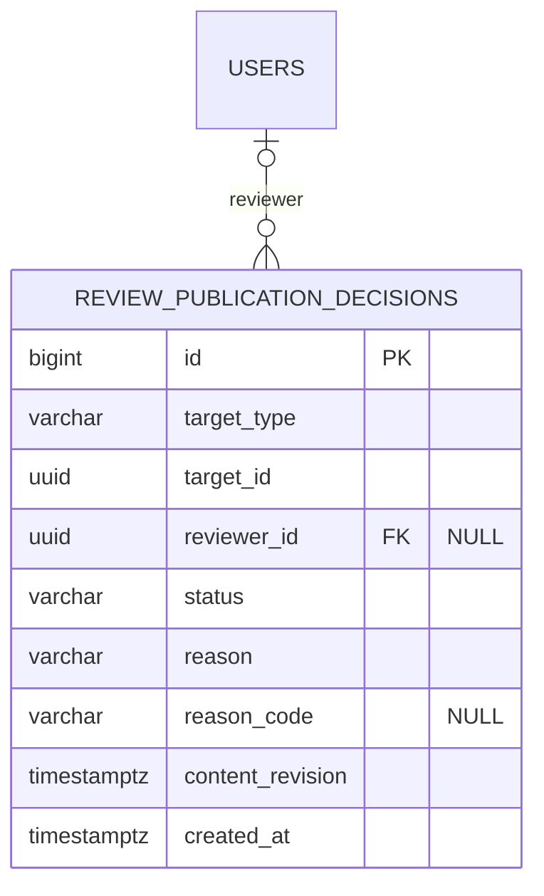

[Ver diagrama de «Decisiones de publicación (V26)» completo](https://images.vinnot.com/docs/diagrams/v1/es/backend-diagrams-relational-model-63c344d89ff6.svg)

`target_type/target_id` identifica una reseña o comentario sin FK para preservar la decisión tras el borrado del contenido. La purga horaria elimina decisiones vencidas a los 90 días; los estados actuales se guardan en `reviews.publication_status` y `review_comments.publication_status`. V53 agrega `reason_code` opcional, con CHECK OFFENSIVE, SPAM, OFF_TOPIC, PERSONAL_DATA u OTHER.

## Inventario y presupuestos de imágenes (V27)

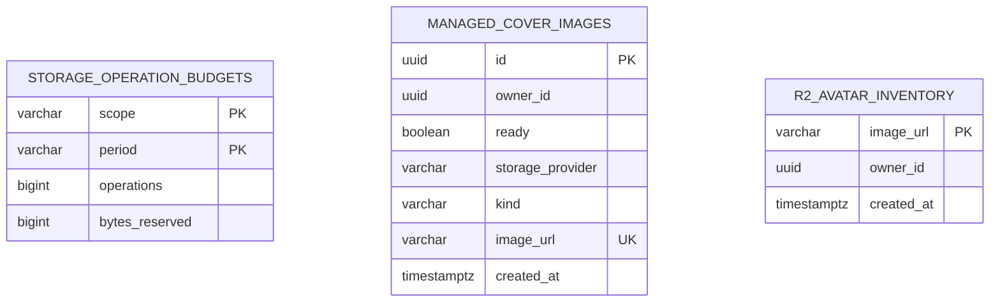

[Ver diagrama de «Inventario y presupuestos de imágenes (V27)» completo](https://images.vinnot.com/docs/diagrams/v1/es/backend-diagrams-relational-model-d0ebb4f60963.svg)

Estas tablas no definen FKs a usuarios/eventos/rutas. Los owners y URLs se
revalidan en adapters para conservar limpieza durable después de cascadas o
rollback. PK/constraints/índices provienen de `V27__managed_image_storage.sql`.
[Inventario y presupuestos](../data/database-model.md#inventario-y-presupuestos-de-imágenes-v27).

## Pagos online (V29–V38)

```mermaid
erDiagram
    USERS { uuid id PK }
    EVENTS { uuid id PK }
    EVENT_REGISTRATIONS { uuid id PK }
    PAYMENT_ACCOUNTS {
        uuid owner_id PK
        varchar provider PK
        varchar environment PK
        varchar seller_id "NULL"
        text access_token_ciphertext "NULL"
        timestamptz expires_at "NULL"
        boolean reconnect_required
        timestamptz reconnect_notified_for "NULL"
    }
    PAYMENT_CONNECTION_ATTEMPTS {
        uuid owner_id PK
        varchar environment PK
        varchar state_hash UK
        timestamptz expires_at
        boolean return_to_app
    }
    PAYMENT_CHECKOUT_ATTEMPTS {
        uuid id PK
        uuid registration_id FK
        uuid event_id FK
        uuid buyer_id FK
        uuid organizer_id FK
        varchar environment
        numeric total_amount
        numeric commission_amount
        integer commission_basis_points
        varchar commission_policy
        varchar status
        varchar provider_reference "NULL"
        boolean return_to_app
    }
    PAYMENT_RECONCILIATION_JOBS {
        uuid attempt_id PK
        timestamptz next_check_at
        integer failures
    }
    PAYMENT_OBSERVATIONS {
        varchar payment_id PK
        uuid attempt_id FK
        numeric amount
        numeric refunded_amount
        varchar status
        boolean credited
        boolean needs_review
    }
    PAYMENT_REFUND_INTENTS {
        uuid id PK
        uuid attempt_id FK
        varchar payment_id UK
        numeric amount
        varchar status
        varchar rejection_reason "NULL"
        int rejections
    }
    USERS ||--o{ PAYMENT_ACCOUNTS : owner_id
    USERS ||--o{ PAYMENT_CONNECTION_ATTEMPTS : owner_id
    EVENT_REGISTRATIONS ||--o{ PAYMENT_CHECKOUT_ATTEMPTS : registration_id
    EVENTS ||--o{ PAYMENT_CHECKOUT_ATTEMPTS : event_id
    USERS ||--o{ PAYMENT_CHECKOUT_ATTEMPTS : buyer_id
    PAYMENT_CHECKOUT_ATTEMPTS ||--o| PAYMENT_RECONCILIATION_JOBS : attempt_id
    PAYMENT_CHECKOUT_ATTEMPTS ||--o{ PAYMENT_OBSERVATIONS : attempt_id
    PAYMENT_CHECKOUT_ATTEMPTS ||--o{ PAYMENT_REFUND_INTENTS : attempt_id
    PAYMENT_OBSERVATIONS ||--o| PAYMENT_REFUND_INTENTS : payment_id
```

[Ver diagrama de «Pagos online (V29–V38)» completo](https://images.vinnot.com/docs/diagrams/v1/es/backend-diagrams-relational-model-5a97fb37e649.svg)

Solo las FKs a `users` de cuentas e intentos de conexión usan cascade; intentos
de checkout, observaciones e intentos de reembolso conservan el historial
financiero sin cascade. `(registration_id, provider, environment)` y
`(provider, environment, provider_reference)` son únicos en los intentos de
checkout; `idx_payment_one_credit` permite una sola observación acreditada por
intento. `environment` es `SANDBOX` o `LIVE_PILOT` (V33). V58 agrega
`reconnect_notified_for` y V63, el estado REJECTED con `rejection_reason` y
`rejections`. PK/constraints/índices provienen de `V29`–`V38`, `V58` y `V63`. [Datos de pagos](../data/database-model.md).

## Notificaciones y push (V42–V68)

### Preferencias, consentimiento y supresiones (V42–V43)

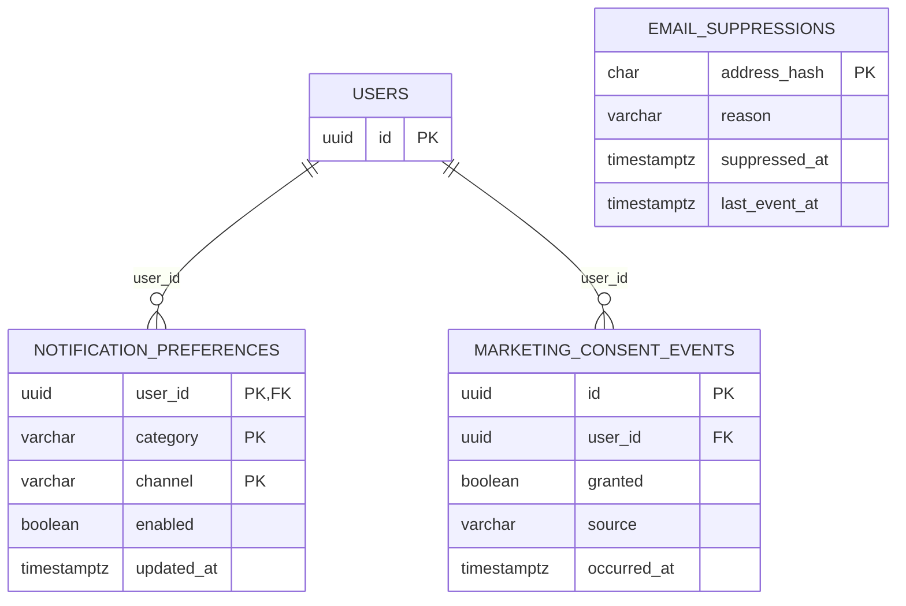

[Ver diagrama de «Preferencias, consentimiento y supresiones (V42–V43)» completo](https://images.vinnot.com/docs/diagrams/v1/es/backend-diagrams-relational-model-9b8441edb199.svg)

Las FKs a usuario son CASCADE. `notification_preferences` tiene PK compuesta `(user_id, category, channel)`; el CHECK de categoría admite EVENTS_NEARBY, COMMUNITY, RECOMMENDATIONS, NEWSLETTER y, desde V66, REMINDERS; el de canal, EMAIL o PUSH. Una fila ausente equivale al valor por defecto. `marketing_consent_events` es de solo inserción: un trigger rechaza UPDATE; `source` admite WEB, MOBILE o EMAIL_UNSUBSCRIBE. `email_suppressions` no tiene FK: `address_hash` es el SHA-256 de la dirección normalizada y `reason` admite HARD_BOUNCE o COMPLAINT.

### Dispositivos y entregas push (V46–V68)

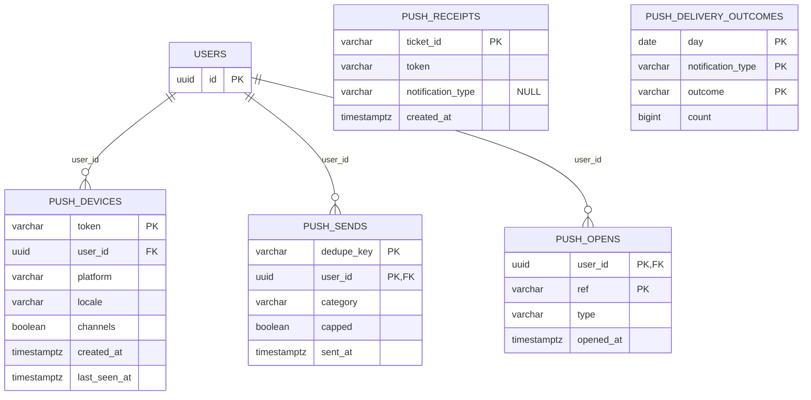

[Ver diagrama de «Dispositivos y entregas push (V46–V68)» completo](https://images.vinnot.com/docs/diagrams/v1/es/backend-diagrams-relational-model-5be85e9231b7.svg)

Las FKs a usuario son CASCADE. `platform` admite IOS o ANDROID y `locale`, es o en. PK compuestas: envío `(dedupe_key, user_id)`, apertura `(user_id, ref)` y resultado diario `(day, notification_type, outcome)`. `push_receipts.token` es texto, sin FK al dispositivo; V59 agrega su `notification_type` opcional. V51 indexa `push_sends(user_id, category, sent_at)`. V65 agrega `channels` y el índice de `last_seen_at` que usa la retención de 120 días; V68 reinicia `last_seen_at` una sola vez. `push_delivery_outcomes` cuenta por tipo, resultado y día UTC, sin FKs.

### Interruptores por tipo de push (V59)

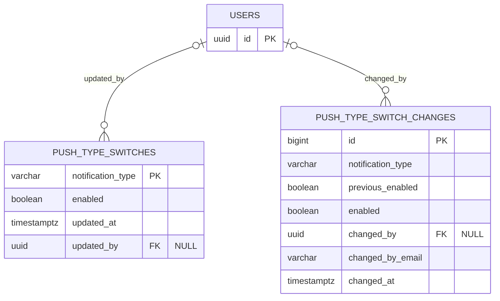

[Ver diagrama de «Interruptores por tipo de push (V59)» completo](https://images.vinnot.com/docs/diagrams/v1/es/backend-diagrams-relational-model-87268c486537.svg)

Ambas FKs a usuario son SET NULL. Un tipo sin fila en `push_type_switches` está activo. `push_type_switch_changes` es el historial de cambios: `notification_type` es texto sin FK al interruptor, y `changed_by_email` conserva el autor después del borrado de la cuenta.

### Anuncios y resúmenes (V49, V56, V60)

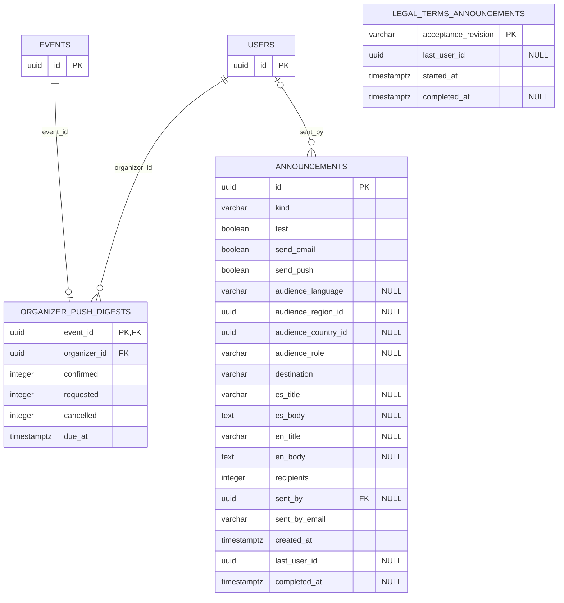

[Ver diagrama de «Anuncios y resúmenes (V49, V56, V60)» completo](https://images.vinnot.com/docs/diagrams/v1/es/backend-diagrams-relational-model-3a7ecdb819d5.svg)

`organizer_push_digests` tiene FKs CASCADE a evento y organizador, contadores con CHECK no negativo y se borra al enviarse. `announcements` registra cada envío del equipo y es el cursor de su entrega por lotes (`last_user_id`, `completed_at`): `kind` admite NEWS o SERVICE, un CHECK exige al menos un canal y al menos un título. `audience_region_id` y `audience_country_id` no tienen FK; `sent_by` es SET NULL y `sent_by_email` conserva el autor. `legal_terms_announcements` no tiene FKs: una fila por revisión de aceptación guarda el cursor del correo de actualización de términos.

## Áreas de eventos cercanos (V50)

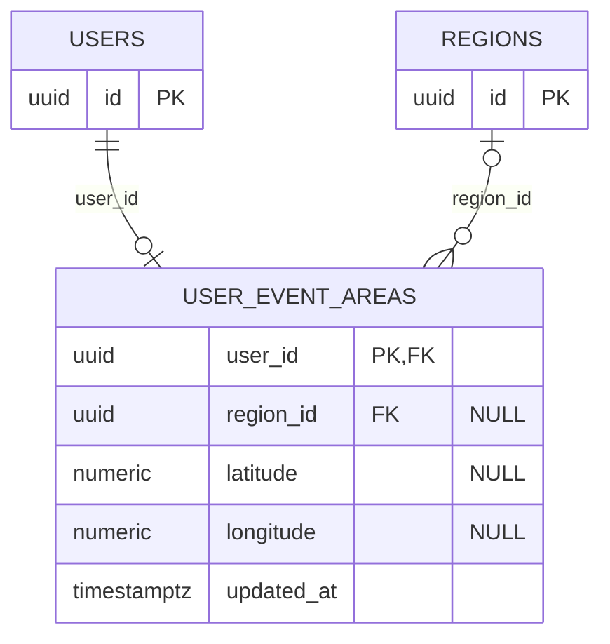

[Ver diagrama de «Áreas de eventos cercanos (V50)» completo](https://images.vinnot.com/docs/diagrams/v1/es/backend-diagrams-relational-model-0d07022dfb95.svg)

Ambas FKs son CASCADE. Un CHECK exige región o coordenadas, nunca ambas; las coordenadas son `numeric(4,1)`, redondeadas a 0,1°, con CHECK de rango. Hay índices parciales sobre `region_id` y sobre la ubicación.

## Engagement y actividad (V52, V66–V67)

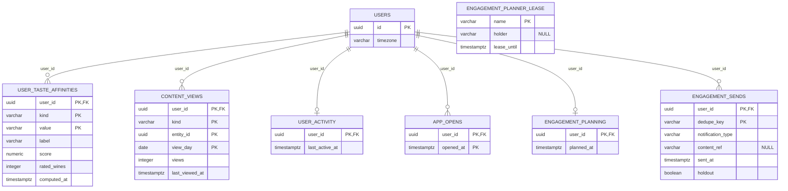

[Ver diagrama de «Engagement y actividad (V52, V66–V67)» completo](https://images.vinnot.com/docs/diagrams/v1/es/backend-diagrams-relational-model-87a111131e72.svg)

Todas las FKs a usuario son CASCADE. `user_taste_affinities` tiene PK `(user_id, kind, value)`, `kind` GRAPE o TYPE, `score` entre 0 y 5 y `rated_wines` positivo. `content_views` tiene PK `(user_id, kind, entity_id, view_day)`; `kind` admite WINE, ROUTE, EVENT o WINERY y `entity_id` es polimórfico, sin FK. `app_opens` tiene PK `(user_id, opened_at)` y `engagement_sends`, `(user_id, dedupe_key)`. `engagement_planner_lease` no tiene FKs: su única fila `planner` coordina el planificador entre instancias. V67 agrega `idx_users_timezone_id (timezone, id)`.

## Cursores de resúmenes (V54–V55)

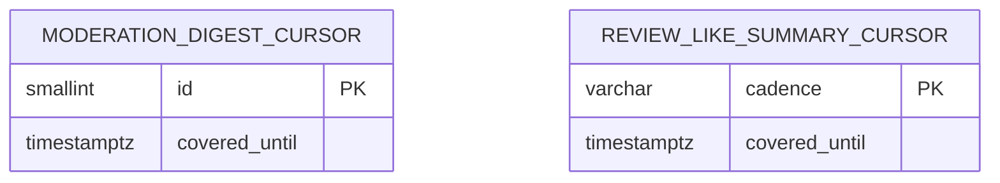

[Ver diagrama de «Cursores de resúmenes (V54–V55)» completo](https://images.vinnot.com/docs/diagrams/v1/es/backend-diagrams-relational-model-8501fce73e74.svg)

Sin FKs; la migración inserta las filas iniciales. `moderation_digest_cursor` tiene una única fila (CHECK `id = 1`); `review_like_summary_cursor`, una por `cadence` DAILY o WEEKLY.

## Versiones mínimas de la app (V69)

```mermaid
erDiagram
 USERS { uuid id PK }
 APP_MINIMUM_VERSIONS {
  varchar platform PK
  varchar minimum_version "NULL"
  timestamptz updated_at "NULL"
  uuid updated_by FK "NULL"
 }
 APP_MINIMUM_VERSION_CHANGES {
  bigint id PK
  varchar platform
  varchar previous_minimum_version "NULL"
  varchar minimum_version "NULL"
  uuid changed_by FK "NULL"
  varchar changed_by_email
  timestamptz changed_at
 }
 USERS |o--o{ APP_MINIMUM_VERSIONS : updated_by
 USERS |o--o{ APP_MINIMUM_VERSION_CHANGES : changed_by
```

[Ver diagrama de «Versiones mínimas de la app (V69)» completo](https://images.vinnot.com/docs/diagrams/v1/es/backend-diagrams-relational-model-0cc49c7565e6.svg)

Ambas FKs a usuario son SET NULL. `platform` admite IOS o ANDROID. Una plataforma sin fila, o con `minimum_version` NULL, no tiene mínima; la fila se crea con el primer cambio. Un CHECK limita `minimum_version` a `mayor.menor.parche`, de uno a cuatro dígitos por parte. `app_minimum_version_changes` es el historial de cambios: `platform` es texto sin FK a la fila actual, y `changed_by_email` conserva el autor después del borrado de la cuenta. Índices: `app_minimum_version_changes(changed_at DESC)` y los parciales de `updated_by` y `changed_by`.

## Publicación en redes (V82–V84)

```mermaid
erDiagram
 SOCIAL_POSTS {
  uuid id PK
  varchar status
  varchar pillar_code FK
  jsonb publishing "NULL"
 }
 CONTENT_PILLARS {
  varchar code PK
  smallint weight
  boolean auto_approve
  boolean active
 }
 SOCIAL_PUBLICATIONS {
  uuid id PK
  uuid post_id FK
  varchar network
  varchar status
  varchar external_id "NULL"
  text permalink "NULL"
  int attempts
  varchar error "NULL"
  timestamptz created_at
  timestamptz updated_at
  timestamptz published_at "NULL"
 }
 SOCIAL_POST_METRICS {
  uuid publication_id PK
  date captured_on PK
  bigint views "NULL"
  bigint reach "NULL"
  bigint likes "NULL"
  bigint comments "NULL"
  bigint saves "NULL"
  bigint shares "NULL"
  bigint follows "NULL"
  timestamptz captured_at
 }
 SOCIAL_ACCOUNTS {
  varchar network PK
  varchar account_id
  varchar display_name "NULL"
  text access_token_ciphertext
  text refresh_token_ciphertext "NULL"
  timestamptz access_expires_at "NULL"
  timestamptz refresh_expires_at "NULL"
  varchar status
  varchar last_error "NULL"
  uuid connected_by "NULL"
  timestamptz connected_at
  timestamptz updated_at
  timestamptz refresh_claimed_until "NULL"
 }
 CONTENT_PILLARS ||--o{ SOCIAL_POSTS : pillar_code
 SOCIAL_POSTS ||--o{ SOCIAL_PUBLICATIONS : post_id
 SOCIAL_PUBLICATIONS ||--o{ SOCIAL_POST_METRICS : publication_id
```

[Ver diagrama de «Publicación en redes (V82–V84)» completo](https://images.vinnot.com/docs/diagrams/v1/es/backend-diagrams-relational-model-5fdf7a8bfdbf.svg)

Las FKs `social_publications.post_id` y `social_post_metrics.publication_id` son `ON DELETE CASCADE`. `social_publications` tiene una fila por publicación y red (UNIQUE `post_id, network`, que también indexa la FK) e índices por `status` y `published_at`; CHECK de `network` (INSTAGRAM, FACEBOOK, THREADS, TIKTOK) y de `status` (QUEUED, PUBLISHING, PUBLISHED, DRAFT_SENT, FAILED). `social_post_metrics` guarda una foto por publicación y día (PK `publication_id, captured_on`); una métrica nula es una que la red no da. `social_accounts` tiene una fila por red conectada con OAuth (Threads y TikTok), CHECK de `network` y de `status` (CONNECTED, REFRESH_FAILED); los tokens se guardan cifrados con AES-256-GCM, `connected_by` es el id del administrador sin FK y `refresh_claimed_until` es el lease de renovación. V82 agrega `content_pillars.auto_approve` (`false`) y `social_posts.publishing` (JSONB `{startedAt, finishedAt, error}`, nulo hasta empezar); V83 agrega `content_pillars.active` (`true`); V84 inserta los pilares `TERROIR`, `WINEMAKING`, `HISTORY`, `REGION`, `TASTING` y `SERVICE`, reescribe los briefs de `QUIZ` y `CURIOUS_FACT` y apaga `HUMOR`. Las tres migraciones son aditivas.

## Social y perfil de gustos (V87–V89)

```mermaid
erDiagram
 USERS {
  uuid id PK
  varchar bio "NULL"
  varchar cellar_visibility
 }
 USER_FOLLOWS {
  uuid follower_id PK,FK
  uuid followee_id PK,FK
  timestamptz created_at
 }
 USER_TASTE_QUIZ {
  uuid user_id PK,FK
  varchar status
  jsonb answers "NULL"
  timestamptz updated_at
 }
 USER_TASTE_ADJUSTMENTS {
  uuid user_id PK,FK
  varchar trait PK
  smallint score
  timestamptz updated_at
 }
 USERS ||--o{ USER_FOLLOWS : follower_id
 USERS ||--o{ USER_FOLLOWS : followee_id
 USERS ||--o| USER_TASTE_QUIZ : user_id
 USERS ||--o{ USER_TASTE_ADJUSTMENTS : user_id
```

[Ver diagrama de «Social y perfil de gustos (V87–V89)» completo](https://images.vinnot.com/docs/diagrams/v1/es/backend-diagrams-relational-model-70494a1e7e66.svg)

Las tres tablas son del módulo de comunidad y referencian `users` con `ON DELETE CASCADE`. `user_follows` (V87) guarda un seguimiento asimétrico, sin aprobación: la PK `(follower_id, followee_id)` impide repetirlo, un CHECK impide seguirse a uno mismo, la PK sirve para «a quién sigo» e `idx_user_follows_followee (followee_id, created_at DESC)` para «quién me sigue», del más reciente al más antiguo. Un bloqueo de `user_blocks` ([Comunidad y evidencia privada](#comunidad-y-evidencia-privada-v24)) borra los seguimientos del par en ambos sentidos en la misma transacción; es una regla del caso de uso, no una FK. `user_taste_quiz` (V88) tiene una fila por miembro: `status` COMPLETED o SKIPPED y `answers` (objeto de clave de pregunta a clave de opción) presente si y solo si es COMPLETED, ambos con CHECK; sin fila, el test está pendiente. `user_taste_adjustments` (V89) guarda el puntaje manual del paladar, uno por miembro y rasgo: PK `(user_id, trait)`, CHECK de `trait` (ACIDITY, BODY, TANNIN o SWEETNESS) y de `score` (0 a 100); sin fila, el rasgo muestra su valor calculado. El perfil público combina estas tablas con `user_taste_affinities` ([Engagement y actividad](#engagement-y-actividad-v52-v66v67)) y con los perfiles IA de los vinos; ese cálculo no se persiste. Las tres migraciones son aditivas.
