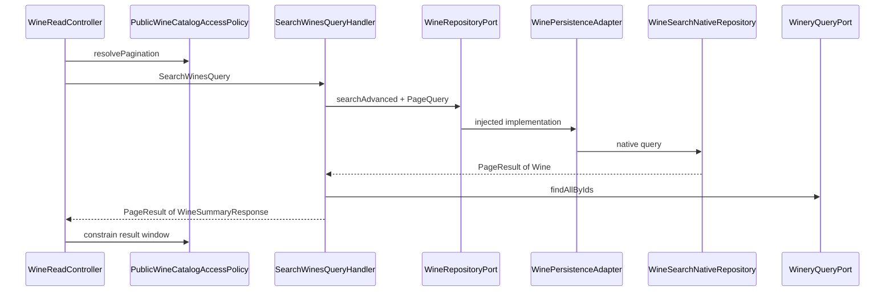
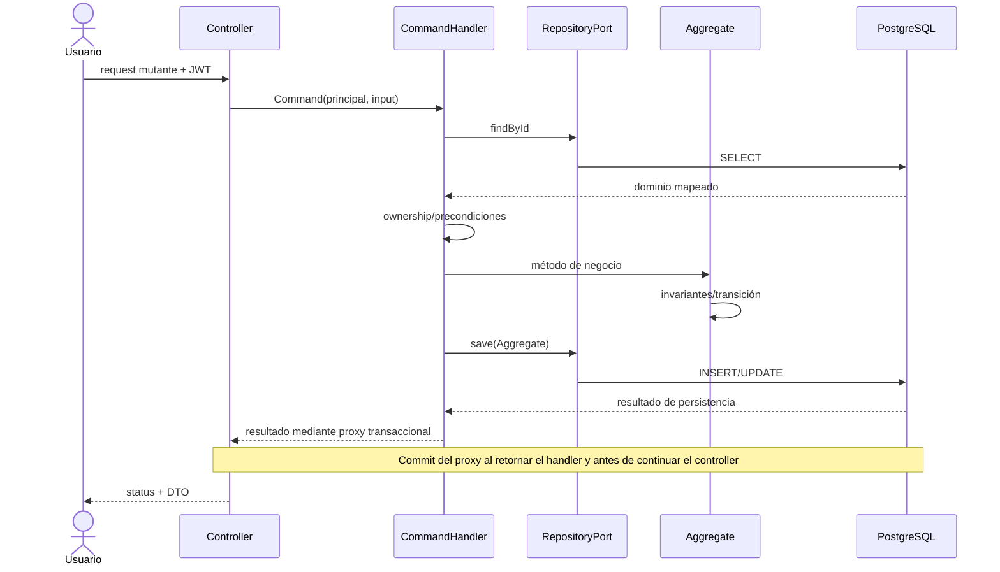
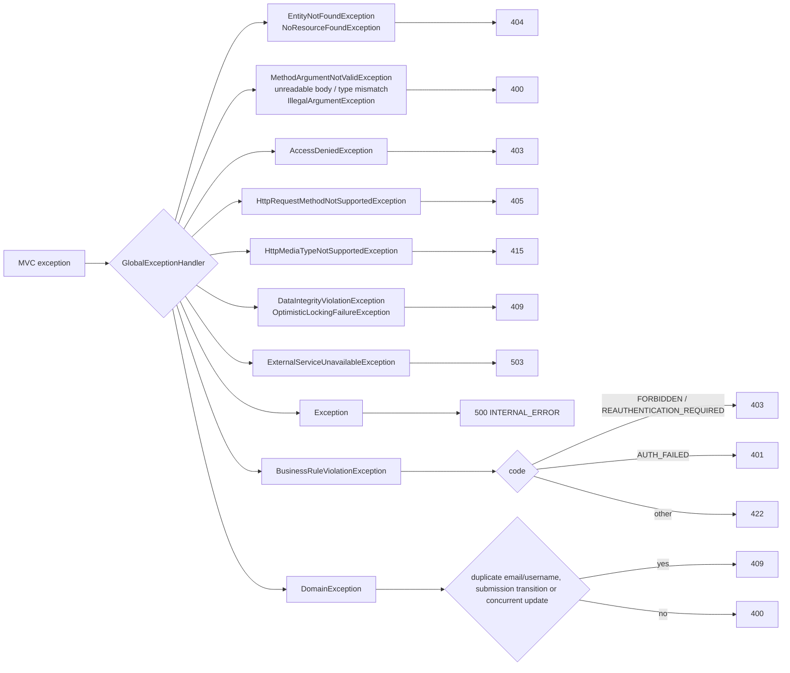
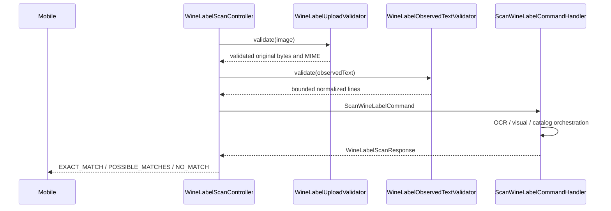
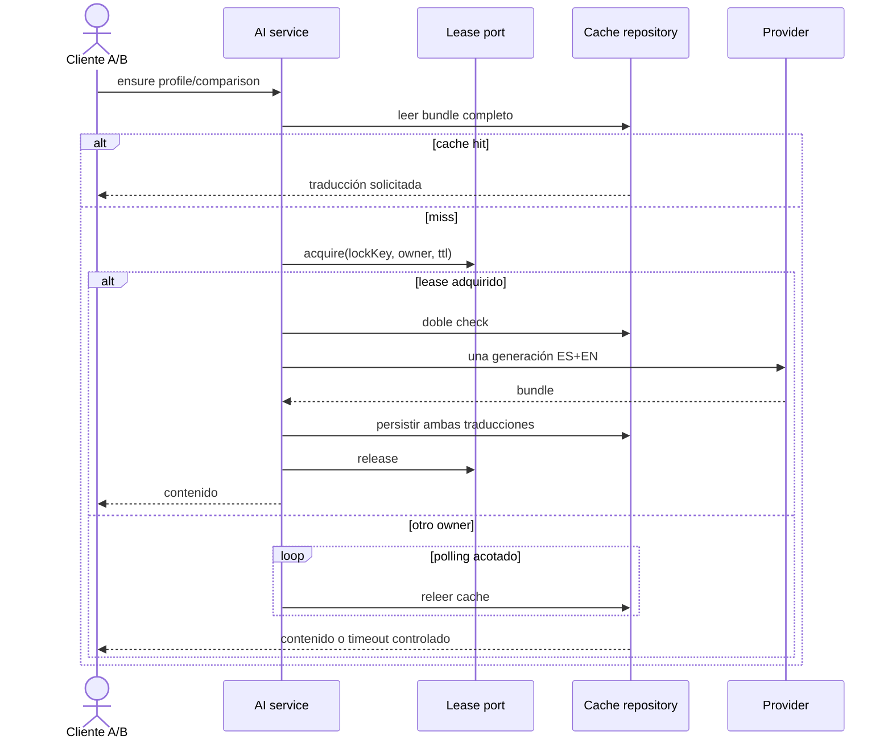

# Ciclo de vida de requests y casos de uso

## Lectura pública paginada

[Ver diagrama de «Lectura pública paginada» completo](https://images.vinnot.com/docs/diagrams/v1/es/backend-diagrams-request-lifecycle-7ac2b62e5023.svg)

El borde público limita tamaño/ventana; PageQuery representa parámetros de aplicación. El read model SQL selecciona e hidrata entidades, el adapter las transforma a dominio y el handler proyecta DTOs. No se expone Page<JpaEntity>. Los filtros efectivos y totales se detallan en [búsqueda](../../modules/wines/architecture.md).

## Command transaccional

[Ver diagrama de «Command transaccional» completo](https://images.vinnot.com/docs/diagrams/v1/es/backend-diagrams-request-lifecycle-93dfe7341238.svg)

## Error estable

[Ver diagrama de «Error estable» completo](https://images.vinnot.com/docs/diagrams/v1/es/backend-diagrams-request-lifecycle-a994706dc54c.svg)

El body del advice contiene timestamp, path, status, code, message y details. X-Request-ID pertenece al header/MDC, no a ese record. Filtros de seguridad/rate limiting pueden terminar la solicitud antes de MVC y escriben sus propias respuestas. No se atribuye al advice un mapper específico para cada excepción de framework.

## Multipart de escaneo

[Ver diagrama de «Multipart de escaneo» completo](https://images.vinnot.com/docs/diagrams/v1/es/backend-diagrams-request-lifecycle-bbcc8227266e.svg)

El pipeline completo, los errores y la diferencia entre validación y sanitización persistida están en [escaneo backend](../../modules/wines/architecture.md).

## Generación cacheada distribuida

[Ver diagrama de «Generación cacheada distribuida» completo](https://images.vinnot.com/docs/diagrams/v1/es/backend-diagrams-request-lifecycle-505a4a0a97ac.svg)

## Relaciones con otros documentos

- [API](../architecture/api.md)
- [Errores, transacciones y consistencia](../architecture/errors-transactions-and-consistency.md)
- [Seguridad](../architecture/security-and-authorization.md)
- [Búsqueda de vinos](../../modules/wines/architecture.md)
- [Escaneo mobile](../../modules/wines/architecture.md)
