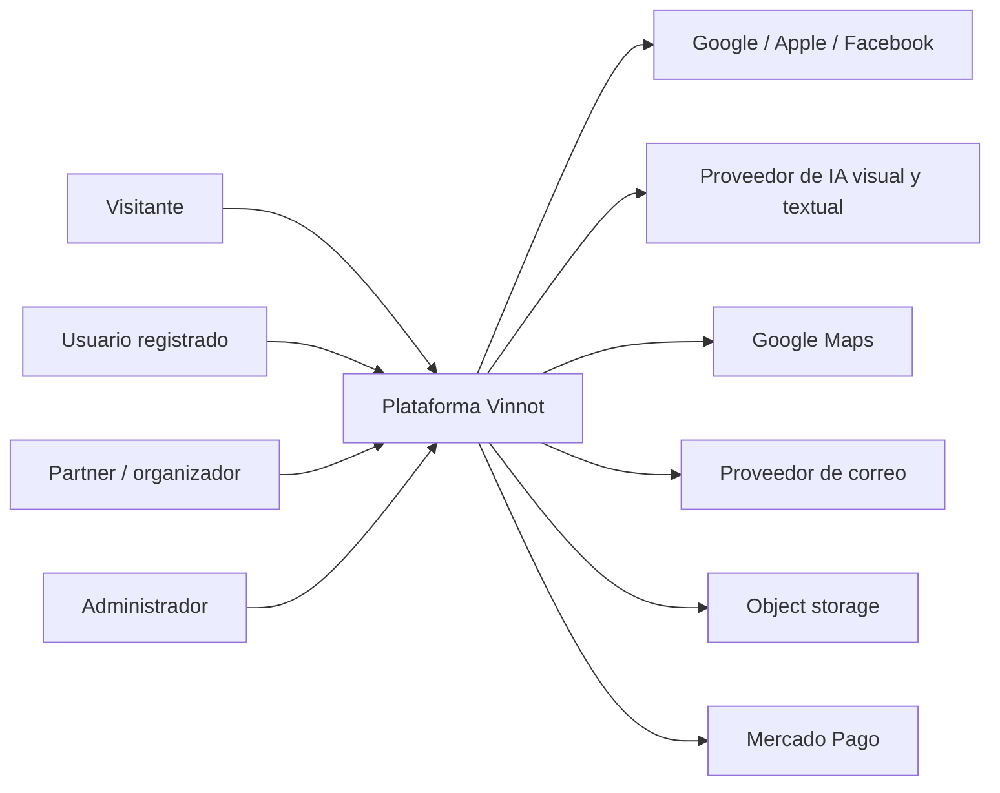
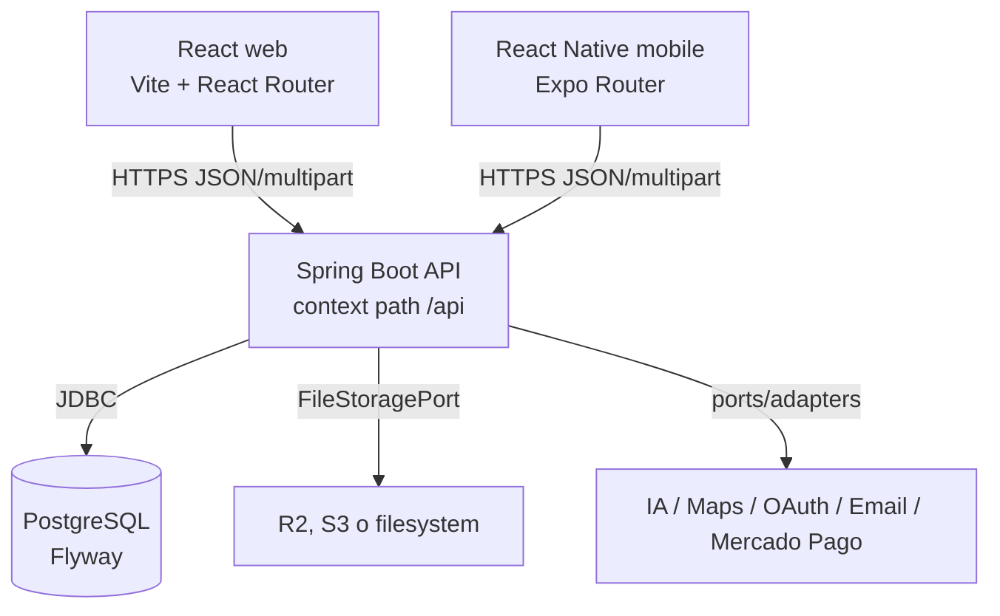
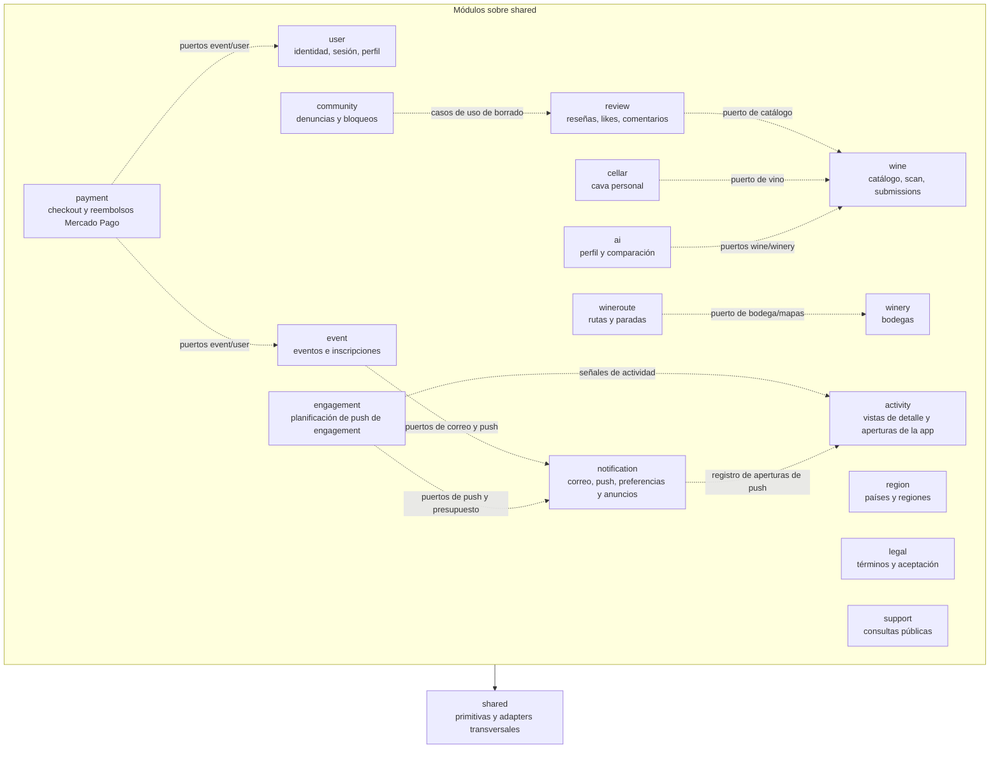
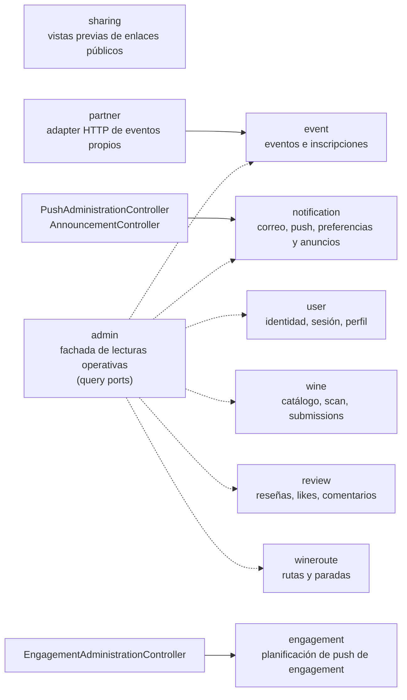
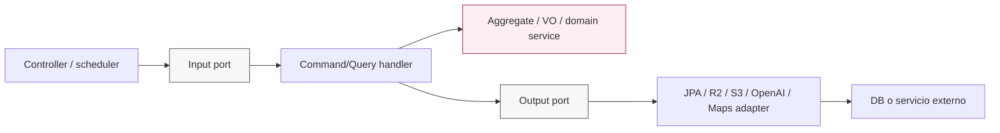
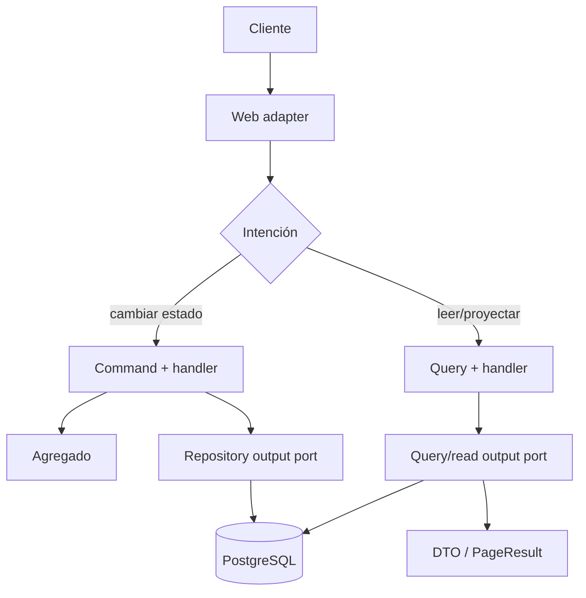
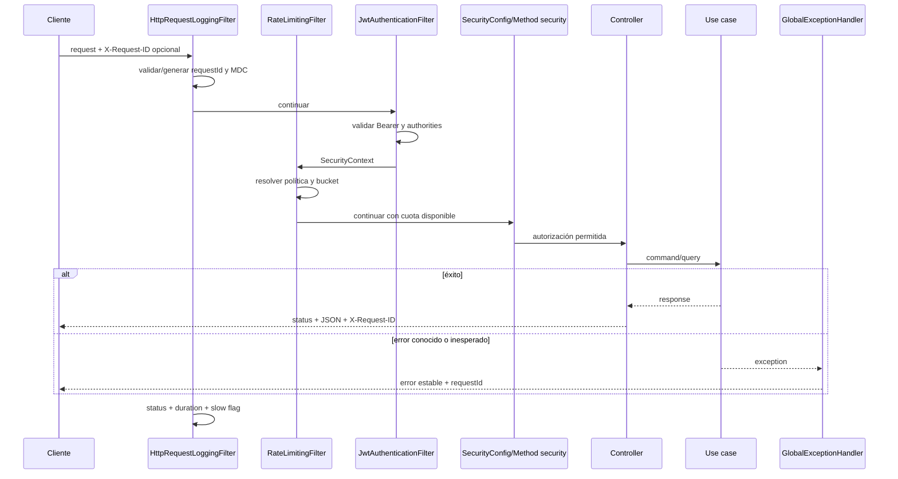
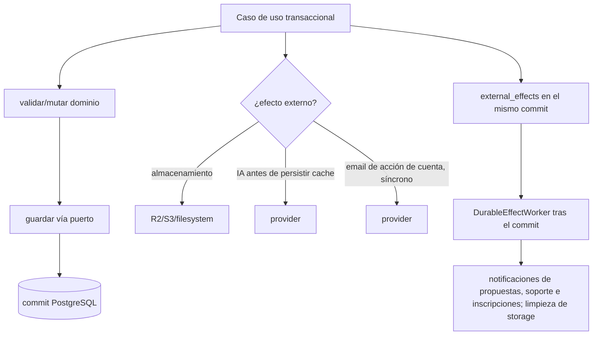

# Mapas del sistema backend

## Cómo leer estos diagramas

Cada vista responde una pregunta diferente. El contexto muestra actores y
sistemas externos; contenedores muestra procesos desplegables; módulos muestra
ownership; capas muestra dirección de dependencias. No deben mezclarse como si
fueran un único nivel de abstracción.

## Contexto del producto

[Ver diagrama de «Contexto del producto» completo](https://images.vinnot.com/docs/diagrams/v1/es/backend-diagrams-system-map-62703e2b80ca.svg)

## Contenedores lógicos

[Ver diagrama de «Contenedores lógicos» completo](https://images.vinnot.com/docs/diagrams/v1/es/backend-diagrams-system-map-881104931fc0.svg)

## Bounded contexts y ownership

### Módulos de dominio

[Ver diagrama de «Módulos de dominio» completo](https://images.vinnot.com/docs/diagrams/v1/es/backend-diagrams-system-map-4e67db85c986.svg)

### Fachadas y adaptadores

[Ver diagrama de «Fachadas y adaptadores» completo](https://images.vinnot.com/docs/diagrams/v1/es/backend-diagrams-system-map-b8a364ee5f17.svg)

Las flechas punteadas representan colaboración mediante contratos, no acceso a
repositorios JPA ajenos. `admin` y `partner` no son dueños de los agregados que
operan. `sharing` lee una proyección JDBC mínima y no importa otros módulos.
`event` representa a los módulos que envían correo o push: `review`,
`community`, `payment`, `user`, `wine`, `legal`, `support` y `admin` usan los
mismos puertos de `notification`. Los endpoints `/admin/notifications/**` no
viven en `admin`: los controllers de push y anuncios son de `notification` y
el de métricas de engagement, de `engagement`; `admin` sólo usa
`NotificationPort` para el resumen de moderación.

## Corte hexagonal de un módulo

Esta vista muestra el recorrido de ejecución, no flechas de imports.

[Ver diagrama de «Corte hexagonal de un módulo» completo](https://images.vinnot.com/docs/diagrams/v1/es/backend-diagrams-system-map-9c189559d814.svg)

La dependencia de código apunta hacia dominio/aplicación. El flujo de ejecución
puede continuar hacia afuera mediante un puerto, pero el handler sólo conoce la
interfaz.

## Separación CQRS lógica sobre una única base

[Ver diagrama de «Separación CQRS lógica sobre una única base» completo](https://images.vinnot.com/docs/diagrams/v1/es/backend-diagrams-system-map-966016a0473c.svg)

CQRS aquí no implica dos bases ni event sourcing. Significa que la intención de
escritura y la proyección de lectura poseen contratos diferentes, permitiendo
optimizar read models sin contaminar agregados.

## Pipeline HTTP transversal

[Ver diagrama de «Pipeline HTTP transversal» completo](https://images.vinnot.com/docs/diagrams/v1/es/backend-diagrams-system-map-c28fac5fe997.svg)

## Persistencia y efectos externos

[Ver diagrama de «Persistencia y efectos externos» completo](https://images.vinnot.com/docs/diagrams/v1/es/backend-diagrams-system-map-d2287295e92d.svg)

PostgreSQL no comparte transacción con S3, email ni IA. El flujo de avatar tiene
compensación específica del objeto nuevo ante fallo de persistencia; esto no es
una garantía general de todos los uploads. Perfiles IA usan cache/lease;
submissions coordinan escrituras mediante un advisory lock por clave de
identidad. El email de acciones de cuenta es síncrono, separado del commit
PostgreSQL; las notificaciones de propuestas, soporte e inscripciones se entregan
mediante el outbox durable `external_effects`.

## Navegación documental

- [Modelo de dominio UML](domain-class-model.md)
- [Ciclo detallado de requests](request-lifecycle.md)
- [Estados de dominio](domain-state-machines.md)
- [Datos, locks y consistencia](data-consistency.md)
- [Límites modulares](../architecture/module-boundaries.md)
- [Errores y transacciones](../architecture/errors-transactions-and-consistency.md)
- [DER y modelo relacional](../data/database-model.md)
- [Seguridad](../architecture/security-and-authorization.md)
