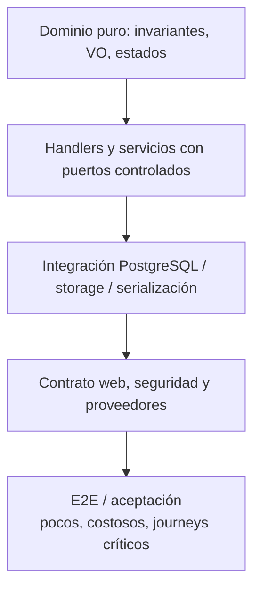
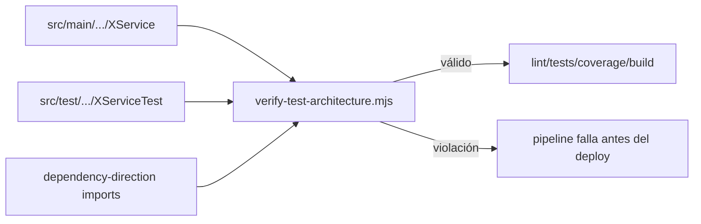
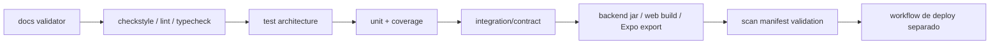

# Estrategia integral de pruebas

## Objetivo de calidad

backend/pom.xml configura JaCoCo en verify. Los umbrales son configuración de gate, no resultados medidos de la rama actual.

CI ejecuta `mvn -B clean verify`. El agente JaCoCo tiene `append=false`: cada ejecución reemplaza la cobertura anterior, evitando que pruebas manuales u opt-in oculten escenarios sin cubrir en la suite automática. La configuración actual utiliza un único proceso de tests; si se introducen forks paralelos, se deben generar archivos separados por fork y combinarlos sólo dentro de la misma corrida.
| Elemento | Selección | Umbral |
|---|---|---|
| BUNDLE | clases incluidas | LINE >= 90%, BRANCH >= 65% |
| PACKAGE | com.vinnot.*.application.service, com.vinnot.*.domain.service | LINE = 100%, METHOD = 100% |
| CLASS | com.vinnot.*.application.command.handler.*, com.vinnot.*.application.query.handler.* | LINE = 100% |

Se instrumentan domain/model, domain/valueobject, domain/service, application/service, command/handler, query/handler, query/*Handler* y application/util. La regla CLASS usa sólo sus dos patrones; incluir una clase en el bundle no le aplica automáticamente el gate por clase. No hay un umbral universal de 100% de ramas. Web/mobile tienen selecciones propias fuera de JaCoCo.

Además de cobertura, se evalúan invariantes, errores, ownership, concurrencia, contratos y persistencia. La presencia de un test espejo no demuestra por sí sola cobertura de comportamiento.

## Pirámide y responsabilidades



[Ver diagrama de «Pirámide y responsabilidades» completo](https://images.vinnot.com/docs/diagrams/v1/es/backend-testing-strategy-6e5b5b9dc337.svg)

| Nivel | Qué demuestra | Dependencias permitidas |
|---|---|---|
| dominio | invariantes y transiciones | JUnit/Jest/Vitest; sin framework ni I/O |
| aplicación | orquestación, orden, errores, compensación | puertos mock/fake |
| persistencia | mapeo, SQL, constraints, locks, índices | PostgreSQL real |
| web | validation, auth, status, headers, JSON | MVC/contexto acotado |
| proveedor | parsing y degradación | fixture, fake server o sandbox acotado |
| presentación | estados y eventos de usuario | Testing Library |
| E2E | integración del journey | stack desplegable controlado |
| benchmark | latencia, precisión, estabilidad, costo | dataset versionado y gates |

La aceptación legal y la baja propia también se prueban con el contexto completo
de Spring, HTTP real en loopback y PostgreSQL de Testcontainers. El ensayo activa
el enforcement: login, refresh y cambio de idioma no crean consentimiento;
aceptar exige el hash vigente y es idempotente. La baja permanece disponible sin
aceptar términos, revoca sesiones, recalcula agregados de reseñas y preserva la
evidencia privada de denuncias con la autoría eliminada. IA y correo se sustituyen
en este entorno aislado; estas pruebas no certifican proveedores externos ni la
interfaz de un dispositivo físico.

## Arquitectura espejo de tests

Por ejemplo (nombres ilustrativos), una clase con lógica en:

```text
src/main/java/com/vinnot/wine/application/service/ExampleService.java
```

debe tener:

```text
src/test/java/com/vinnot/wine/application/service/ExampleServiceTest.java
```

La misma regla aplica a `domain/service` y a servicios frontend:

```text
frontend-mobile/src/application/services/wines.service.ts
frontend-mobile/src/application/services/wines.service.test.ts
```

Los handlers pueden compartir una suite en el mismo paquete si el test referencia
explícitamente cada handler. `scripts/verify-test-architecture.mjs` automatiza:

- test espejo para application/domain services;
- referencia de cada handler desde un test del mismo paquete;
- test de cada service frontend;
- test de validators y mappers;
- ausencia de tests vacíos;
- ausencia de dependencias de infraestructura/Spring/JPA dentro de dominio;
- ausencia de controllers dependientes de output ports.



[Ver diagrama de «Arquitectura espejo de tests» completo](https://images.vinnot.com/docs/diagrams/v1/es/backend-testing-strategy-dd6ea92f31a9.svg)

## Backend: dominio

Los tests de dominio son unitarios puros. No levantan Spring, no mockean value
objects y no serializan HTTP. Deben cubrir:

- construcción válida y cada invariante inválida;
- valores límite y normalización Unicode/case;
- igualdad de value objects;
- transición permitida y prohibida de cada state machine;
- idempotencia cuando forma parte del contrato;
- aritmética de capacidad, ratings y counters;
- ownership en dominio cuando el agregado contiene al propietario; cuando la
  identidad solicitante sólo existe en el command, la matriz de ownership se
  cubre en tests del handler;
- fechas antes, dentro y después de los límites.

Ejemplos críticos:

- `Event` y `EventRegistration`: capacidad, holds, aprobación, pago, confirmación,
  cancelación y expiración;
- `WineSubmission`: estados terminales y decisiones válidas;
- `WineLabelMatcher`: evidencia positiva, contradicciones, threshold y margin;
- `User`: roles, lock, activación, onboarding e identidad;
- `Review`: autoría, rating y contadores;
- `WineRoute`: stops, orden, publicación y archivo.

## Backend: aplicación

Un handler se prueba con puertos mockeados o fakes deterministas. La suite debe
verificar no sólo el resultado sino las interacciones relevantes:

1. qué repositorio se consulta;
2. qué validación ocurre antes de efectos;
3. qué agregado se muta;
4. qué datos se persisten;
5. qué puerto externo se invoca y cuántas veces;
6. qué compensación ocurre si falla una etapa posterior;
7. qué excepción/código se propaga.

Para queries se prueban filtros, normalización de paginación, orden de
proyecciones y not-found. Para commands se prueban camino feliz, cada precondición
y fallos parciales.

### IA

- cache completa versus incompleta;
- generación ES+EN atómica;
- ensure versus force;
- par de comparación canónico y respuesta invertida;
- lease adquirido, espera, takeover vencido y timeout;
- JSON inválido, idioma faltante y fallback;
- generación de perfiles sin mutación de campos del catálogo;
- proveedor deshabilitado o no disponible.

### Escaneo y submissions

- imagen inválida, calidad insuficiente y EXIF;
- OCR/visión con términos, sin términos y con contradicciones;
- exact, suggestions y no-match;
- timeout SQL con fallback indexado;
- moderación fail-closed;
- duplicate recheck bajo lock;
- promoción de imagen y compensación;
- retención por estado;
- ownership al consultar una submission.

### Identidad

- registro duplicado y normalización;
- password local versus cuenta social;
- verificación criptográfica por proveedor;
- linking seguro;
- refresh rotation/replay y logout;
- tokens de acción usados, vencidos o de tipo incorrecto;
- cambio de email y revocación de sesiones;
- eliminación Apple con autorización reciente.

## Backend: persistencia PostgreSQL

El SQL específico nunca se certifica con H2. Las pruebas usan PostgreSQL real,
idealmente Testcontainers o una instancia efímera compatible con la versión
runtime.

Casos mínimos:

- Flyway desde cero y upgrade desde la versión anterior;
- unique constraints de review, like, cellar, identity y registro activo;
- check constraints de eventos, submissions y ratings;
- `ON DELETE CASCADE` y `SET NULL` esperados;
- queries trigram/FTS con acentos y múltiples tokens;
- sincronización de `wine_catalog_search` por triggers;
- filtros y orden estable;
- locks PESSIMISTIC_WRITE en eventos/registrations;
- advisory/distributed locks de submissions e IA;
- JSONB ES/EN y orientación de comparaciones;
- multipart + metadata + storage lifecycle.

Las pruebas de repository validan semántica. El plan y la latencia se validan en
benchmarks separados para no volver frágil la suite unitaria.

Ningún test espera para siempre a la base. `src/test/resources/org/postgresql/driverconfig.properties`
le da a toda conexión de test (Hikari, Flyway y `DriverManager` directo) 10 s para
conectar, 15 s para el login y 120 s por lectura, así una conexión de Docker que se cae
hace fallar el test en segundos en vez de colgar el build. `PostgresTestConnectionTimeoutsTest`
lo fija con un servidor que acepta la conexión y nunca contesta. Como último recurso,
Surefire corta una JVM de tests que siga corriendo después de 20 minutos, el mismo límite
del job de CI. Las conexiones de producción no usan estos archivos.

### Suites y alcance de evidencia

DatabaseIndexContractPostgresIntegrationTest, WineSubmissionPostgresIntegrationTest y WinePersistenceAdapterPostgresIntegrationTest usan PostgreSQL Testcontainers con disabledWithoutDocker=true. Revisar los tests omitidos: un build sin Docker no certifica esas integraciones. WineSubmissionMultipartContractTest cubre multipart del adapter web. OpenAiClientContractTest usa servidor HTTP fake local; no llama al proveedor real. SecurityConfigAccessTest usa controllers de prueba y filtros mock, por lo que no sustituye ownership sobre endpoints reales. JacksonJsonContractTest fija el formato JSON de HTTP del mapper de la aplicación (fechas ISO, enums por nombre, nulls explícitos, escala de BigDecimal, nombre `isActive`, orden de declaración, null en primitivos, contenido final); una actualización de Jackson o Spring Boot debe mantenerlo en verde. En Spring Boot 4 los slices viven en módulos por tecnología (`spring-boot-webmvc-test`, `spring-boot-data-jpa-test`, `spring-boot-jdbc-test`), `@SpringBootTest` necesita `@AutoConfigureTestRestTemplate` para `TestRestTemplate` y Testcontainers 2 usa `org.testcontainers.postgresql.PostgreSQLContainer`.

## Backend: web, seguridad y contratos

Cada familia de endpoints requiere:

- request válida e inválida;
- ausencia de autenticación (`401`);
- rol/authority insuficiente (`403`);
- recurso ajeno aunque exista authority (`403` o error de negocio definido);
- status y headers;
- wrapper normal y paginado;
- shape estable de errores con `code`, `message`, `requestId` y fields;
- `Content-Type`, límites multipart y cache headers;
- idioma/locale cuando cambia el payload;
- no exposición de imagen en cuarentena;
- rate limit y `429`.

Los tests de `SecurityConfig` protegen el orden de matchers. Si una ruta nueva no
aparece en la matriz de acceso, debe fallar la revisión o un test.

## Frontend web

Vitest + jsdom cubren lógica y presentación acotada; Testing Library valida lo
que observa el usuario. MSW permite probar contratos HTTP sin acoplar los tests a
Axios.

### Dominio y aplicación

- mappers DTO → modelo;
- validators y mensajes por campo;
- normalización de páginas;
- services que llaman al client correcto;
- propagación/categorización de errores;
- idioma en perfiles y comparaciones;
- operaciones admin/partner y payloads.

### Presentación

- guardas de rutas y redirecciones;
- loading, empty, error y success;
- filtros debounced y query params;
- invalidación de TanStack Query después de mutaciones;
- formularios, confirmaciones y accesibilidad por teclado;
- cambio de idioma sin regenerar IA;
- selección/reemplazo de vino en comparación.

### E2E web

Playwright está configurado para journeys de alto valor: autenticación, búsqueda,
detalle, cava, evento, administración y partner. No debe duplicar todas las ramas
unitarias; prueba wiring, navegación y contrato integrado.

## Frontend mobile

Jest Expo y Testing Library cubren services, hooks/view models y screens. Las APIs
nativas se reemplazan por adapters mockeables, no por condiciones dispersas en
la UI.

Casos críticos:

- restauración de sesión y refresh;
- rutas auth/app/onboarding y roles;
- persistencia de idioma;
- cámara denegada y botón volver;
- captura congelada, cancelación y respuesta tardía ignorada;
- clasificación offline, timeout, sesión expirada y proveedor;
- foto temporal preservada hasta búsqueda/submission;
- formulario de submission y estado posterior;
- perfil/comparación cacheados por idioma;
- safe area y barra inferior sin tapar contenido;
- transiciones de loading completas y sin superposición.

Las pruebas JS no certifican cámara, SecureStore entitlements, Google/Apple native
sign-in, mapas o performance de un dispositivo real. Esos riesgos pertenecen a
preflight nativo y matriz física.

## Benchmarks de escaneo

Las regresiones de seguridad verifican dimensiones JPEG/PNG desde cabecera antes
de decodificar, subsampling acotado, publicación sólo con identidad exacta,
preservación de imágenes concurrentes y revisiones modificadas. Los fallos de
catálogo/proveedor se prueban separadamente de NO_MATCH y con deadline compartido.

El benchmark automatizado usa un manifiesto versionado y separa cohortes
argentinas/globales/negativas. Cada caso debe declarar identidad esperada y si el
resultado válido es exact, top-3 o rechazo.

Métricas:

- exact precision;
- top-1 recall (exacto o primera sugerencia correcta);
- top-3 recall;
- false exact rate;
- safe rejection;
- estabilidad entre repeticiones;
- p50, p95 y máximo;
- errores técnicos;
- consumo/costo estimado del proveedor.

La suite normal ejecuta validación estructural sin gastar proveedor. Una corrida
real requiere opt-in, credenciales controladas, presupuesto y preserva la salida
como artefacto de CI/release, no como narrativa fechada dentro de la arquitectura.

`scripts/data/wine-label-variety-regression-v1.json` fija IDs esperados de etiquetas
reportadas y cepas hermanas antes de evaluar. Sus gates incluyen top-1 recall,
precisión exacta, errores técnicos, latencia y estabilidad entre repeticiones.
Los scores son evidencia de ranking, no probabilidad calibrada. Se contabilizan
exactos incorrectos sobre vinos conocidos además de falsos exactos en negativos.

`VINNOT_SCAN_INTERVAL_MS` separa solicitudes fuera de la latencia medida; no
reintenta escaneos fallidos. El reloj inicia tras preparar la imagen y mide el
round trip de API, no captura/OCR nativo ni descarga de la imagen fuente. El
reporte debe conservar el entorno: un catálogo restaurado localmente no certifica
latencia AWS. `VINNOT_SCAN_PROGRESS_FILE` guarda checkpoints JSONL opcionales fuera
de documentación oficial. Imágenes de referencia validan recuperación del catálogo;
fotos independientes y dispositivos físicos validan condiciones diferentes.

## Matriz física

Debe cubrir al menos:

| Plataforma | Riesgos |
|---|---|
| iOS simulator | routing, layout, bundle JS; no cámara real |
| iPhone físico | permisos, cámara, memoria, red, SecureStore, OAuth |
| Android emulator | routing, back button, layout, bundle |
| Android físico | cámara, permisos, fabricantes, memoria, deep links |

Escenarios de cámara: etiqueta curva, reflejo, poca luz, tipografía pequeña,
movimiento, fondo complejo, sin texto, orientación y cancelación. La evidencia
debe registrar app version, OS, dispositivo y resultado; no se marca aprobada sin
ejecución física.

## CI y orden de gates



[Ver diagrama de «CI y orden de gates» completo](https://images.vinnot.com/docs/diagrams/v1/es/backend-testing-strategy-cc8c60fdc97f.svg)

Comandos principales:

```bash
python3 scripts/validate_documentation.py
node scripts/verify-test-architecture.mjs

cd backend && mvn clean verify
cd frontend-react && npm ci && npm run lint && npm run test:coverage && npm run build
cd frontend-mobile && npm ci && npm run lint && npm run typecheck && npm run test:coverage
```

Para iOS antes de consumir EAS:

```bash
cd frontend-mobile
npm run preflight:ios:native
```

## Diseño de un buen test

Un nombre expresa condición, acción y resultado observable. El patrón AAA puede
usarse sin comentarios redundantes. Reglas:

- una razón de fallo por test;
- fixtures pequeñas y builders explícitos;
- reloj/UUID/proveedor inyectable cuando hay no determinismo;
- no mockear la clase bajo prueba;
- no verificar detalles irrelevantes de implementación;
- evitar snapshots grandes como única aserción;
- probar límites y ramas negativas;
- reproducir un bug con un test antes del fix;
- mantener independencia y limpieza de datos.

## Política ante flakes

Un test flaky no se reintenta indefinidamente ni se ignora. Se clasifica:

- tiempo/reloj;
- concurrencia;
- orden compartido;
- red/proveedor;
- animación/esperas;
- datos o puertos reutilizados.

La corrección debe eliminar la fuente de no determinismo. Los retries sólo son
aceptables en pruebas externas explícitas y deben quedar medidos.

## Criterio de terminado

Una funcionalidad no está cerrada hasta que:

1. invariantes y ramas de aplicación tienen tests;
2. la arquitectura espejo se cumple;
3. cobertura supera gates sin exclusiones oportunistas;
4. SQL/constraints se prueban con PostgreSQL;
5. seguridad y contratos HTTP están cubiertos;
6. loading/error/retry/cancelación están probados en clientes;
7. el journey crítico tiene aceptación proporcional al riesgo;
8. documentación y diagramas reflejan el comportamiento comprobado.
