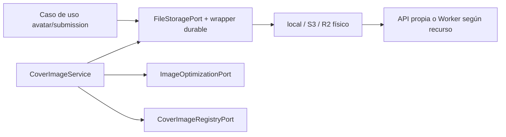
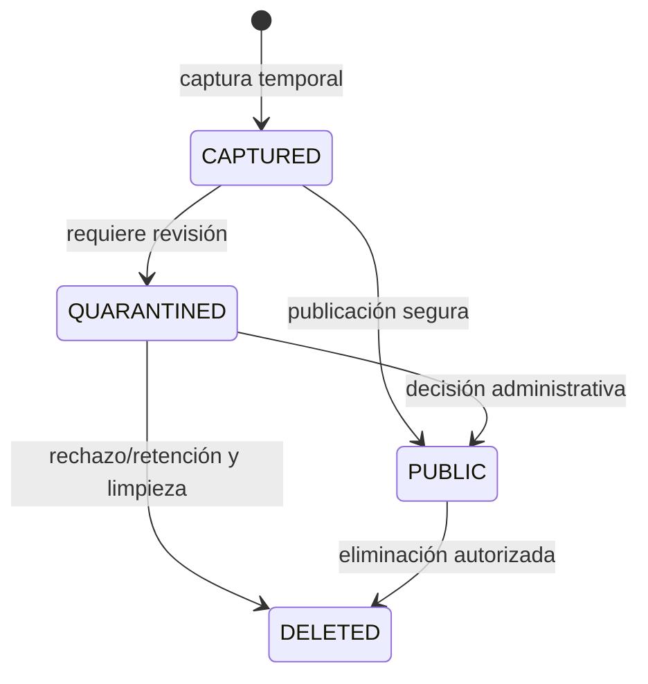
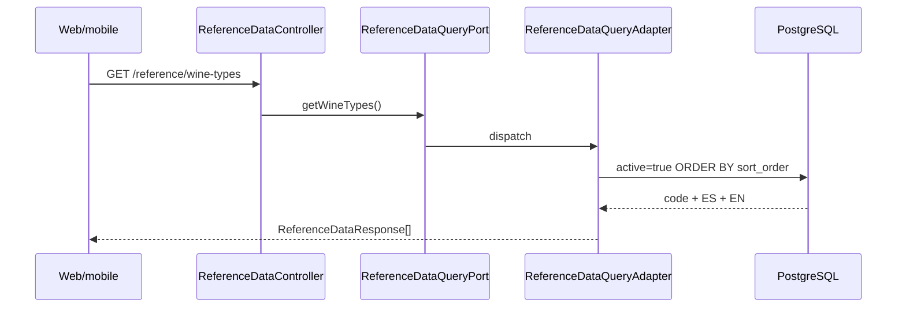

# Archivos públicos, cuarentena y datos de referencia

## Alcance y composición

Las imágenes compartidas se orquestan mediante puertos de aplicación:
`FileStoragePort` administra avatares, etiquetas públicas/cuarentena y bytes de
portadas; `CoverImageUseCase`, `ImageOptimizationPort` y
`CoverImageRegistryPort` coordinan las portadas de eventos/rutas. Los casos de
uso de cada módulo deciden cuándo adjuntar, promover o retirar una imagen.
La segunda capacidad es la lectura de catálogos de referencia y geografía.

`TransactionalFileStorageAdapter` es el wrapper primario del puerto y delega en
el proveedor físico seleccionado por `app.storage.provider`:

| Provider | Implementación | Uso |
|---|---|---|
| `local` o ausente | `FileStorageService` | filesystem local |
| `s3` | `S3FileStorageService` | almacenamiento AWS compatible con URLs históricas |
| `r2` | `R2FileStorageService` | nuevos uploads WebP, con adapter S3 separado para referencias anteriores |

`R2StorageConfiguration` configura el cliente S3 compatible con R2 y
`legacyFileStorage`; usar el protocolo S3 no significa almacenar el objeto en
AWS. Los handlers dependen de puertos, no de SDKs, buckets ni paths físicos.

[Ver diagrama de «Alcance y composición» completo](https://images.vinnot.com/docs/diagrams/v1/es/backend-use-cases-uploads-and-reference-data-38c9d7e899d2.svg)

## Validación y formato persistido

El servidor valida tamaño positivo hasta 8 MiB, MIME declarado, firma/contenido
y nombres generados; no acepta una key arbitraria del cliente. Los formatos de
entrada soportados son JPEG, PNG, GIF y WebP. Las validaciones de reconocimiento
conservan los bytes de entrada. `WineLabelUploadValidator.validateAndSanitizeForPersistence`
decodifica las etiquetas y genera JPEG RGB hasta 1600 píxeles sin copiar metadata.

Con `provider=r2`, el adapter optimiza avatares y etiquetas a WebP mediante
`WebpImageOptimizer`. Las portadas pasan por ese optimizador en
`CoverImageService` para los tres proveedores. Se comprueba MIME contra el
contenido, un máximo de 24 millones de píxeles, orientación EXIF, decodificación
acotada y primer frame de GIF. Se escribe una imagen raster nueva y `cwebp`
ejecuta con `-metadata none`, sin shell ni argumentos del usuario.

| Propósito | Lado largo máximo | Bytes WebP máximos |
|---|---|---|
| Avatar | 512 px | 128 KiB |
| Etiqueta | 1600 px | 512 KiB |
| Portada evento/ruta | 1600 px | 512 KiB |

Superar el límite de salida rechaza la subida; no guarda silenciosamente una
imagen grande. El encoder es una dependencia de infraestructura del host/imagen,
no del dominio. Los fallos de archivo son errores de cliente; un encoder/storage
indisponible se trata como fallo de infraestructura sin exponer credenciales.

## Nombres, ownership y entrega

Avatares incluyen usuario y UUID aleatorio; etiquetas incluyen submission UUID.
R2 usa sufijo `.r2.webp` y namespace `uploads/{environment}/`. Portadas usan
`/api/uploads/covers/{UUID}.webp`, con objeto e inventario privados. No se mezclan
uploads dev/prod; el catálogo tiene una copia compartida independiente.
Las respuestas de la API entregan la foto de perfil como URL absoluta: la ruta
relativa guardada se completa con `app.public-api-base-url`
([detalle](../../modules/users/architecture.md#valor-guardado-y-url-que-recibe-el-cliente)).

| Recurso | Entrega | Caché y acceso |
|---|---|---|
| Avatar/etiqueta histórica o local | `UploadController`, `/uploads/avatars/{filename}` y `/uploads/wine-labels/{filename}` | pública 30 días, filename validado |
| Avatar/etiqueta nueva R2 | Worker `images.vinnot.com` | pública 60 s, formatos de key explícitos |
| Etiqueta en cuarentena | `/admin/wine-submissions/{id}/image` | ADMIN/MODERATOR, `no-store` |
| Portada administrada | `CoverImageController`, `/uploads/covers/{id}.webp` | visibilidad/ownership evaluados por solicitud, `no-store` |

Los buckets permanecen privados; el Worker no entrega cuarentena ni portadas,
ni permite subir/borrar/listar. La entrega API incluye MIME y longitud; los
endpoints públicos históricos agregan `Content-Disposition: inline`. Los nombres
inmutables permiten caché; una retirada no revoca bytes ya descargados o cacheados.

## Portadas de eventos y rutas

`POST /uploads/covers` recibe multipart `kind=EVENT|WINE_ROUTE` y `file`. El
controller exige permiso de creación/edición del tipo elegido. El caso de uso
registra dueño/tipo y reserva cuota antes de procesar; marca `ready` después de
almacenar. Retorna ID, URL, dimensiones y bytes, sin publicar el evento/ruta.

Los commands de evento/ruta validan la referencia mediante `CoverImageUseCase`:
una nueva portada debe estar lista, corresponder al tipo y ser del actor o de
staff autorizado. Conservar una referencia previa también bloquea/verifica el
inventario. Una URL externa conserva el contrato previo, sin convertirse en
un objeto administrado por indicar ese dominio.

`JdbcCoverImageRegistry.permitsRead` permite al dueño ver su upload aún sin
adjuntar, a staff autorizado y al propietario del recurso. Lectores públicos
sólo acceden a eventos publicados alguna vez y fuera de DRAFT, o rutas PUBLISHED.
Otros casos devuelven 404. Un Bearer vencido devuelve 401 y habilita refresh;
no se degrada a lectura anónima de un borrador.

Web y mobile descargan las portadas gestionadas con la sesión (`useCoverImagePreview`).
Mientras dura la descarga, `CoverImage` muestra un placeholder neutro del mismo
tamaño; la ilustración incluida sólo aparece cuando no hay portada o no se puede
cargar. Cada app guarda las portadas descargadas en memoria de sesión (40
entradas, nunca en disco) y registra el archivo recién subido bajo la URL
devuelta, así la portada nueva se abre al instante. La memoria se vacía al
cerrar la sesión o cambiar de usuario. El cliente envía credenciales sólo a los
hosts de la API de Vinnot o al origen de API configurado.

## Ajuste de la foto antes de subirla

Desde #516, toda subida de fotos en la web y en la app pasa por un paso de
ajuste antes de enviar nada: portadas de eventos y rutas, foto de perfil,
imágenes de vinos del admin y logo/portada de bodegas. Después de elegir el
archivo (o sacar la foto en la app), se muestra dentro del marco donde se va a
ver. La foto siempre cubre el marco. La persona la arrastra para moverla y hace
zoom hasta 4x (rueda del mouse, barra o teclas `+`/`-` en la web; pellizco en la
app). **Usar foto** sube exactamente lo que muestra el marco; **Cancelar** no
sube nada y conserva la imagen anterior.

| Imagen | Marco |
|---|---|
| Portada de evento y ruta | 16:9, con la franja 21:8 del encabezado del detalle web marcada como siempre visible |
| Foto de perfil | 1:1, máscara redonda |
| Imagen de vino | 3:4 |
| Logo / portada de bodega | 1:1 / 16:9 |

El recorte se hace en el dispositivo: primero corren las validaciones de tamaño
y formato existentes sobre el archivo elegido, después la app exporta el área
elegida como JPEG (calidad 0,9, lado mayor de hasta 2400 px, 1200 px para fotos de perfil y logos en la app, sin agrandar,
con la orientación EXIF aplicada; la app conserva PNG en imágenes de catálogo para no perder la transparencia) y la envía por los mismos endpoints. El
backend no cambia y no guarda metadatos de recorte. Las tarjetas de eventos y
rutas y los encabezados de detalle de la app muestran las portadas en 16:9, así
el área elegida es la que se ve.

- Web: `ImageCropDialog` → `useImageCropEditor` → `imageCropService` →
  `canvasImageCropper`, geometría en `src/domain/media/imageCrop.ts`.
- App: `ImageCropModal` (gesture-handler + reanimated) → recorte del gateway
  del selector de imágenes (`expo-image-manipulator`), geometría en
  `src/domain/media/imageCrop.ts`. No se agregó ninguna dependencia nativa.

## Cuarentena, promoción y compensación

[Ver diagrama de «Cuarentena, promoción y compensación» completo](https://images.vinnot.com/docs/diagrams/v1/es/backend-use-cases-uploads-and-reference-data-e42523a3009c.svg)

Local copia a su directorio público; S3 copia al prefijo público con AES-256.
R2 publica los bytes WebP y también convierte cuarentenas S3 antiguas cuando se
promueven. El borrado de la copia privada se agenda después de persistir la
decisión, no antes de confirmar la transacción.

PostgreSQL y storage no comparten transacción. El wrapper registra
reconciliación durable antes de guardar/promover, en transacción independiente
con dos horas de gracia. Pedidos de borrado se encolan con el negocio.
`StorageCleanupEffectHandler` vuelve a verificar referencias de usuario,
submission y vino; un avatar huérfano también debe superar una hora. La limpieza
de avatares solo borra archivos guardados para ese usuario (`avatar_<userId>_…`);
la URL externa de una foto guardada por el inicio de sesión social no es un
archivo propio y termina sin borrar nada. La limpieza es idempotente y conserva
reintentos. Portadas reemplazadas, abandonadas o cuyos
recursos se borraron se reconcilian por inventario y outbox, revalidando bajo lock.

V27 conserva cuotas e inventarios aunque se revierta una operación de negocio.
La API limita operaciones/bytes por entorno y subidas por usuario; deshabilitar
escrituras no retira la lectura de objetos existentes. Los límites concretos,
activación, migración CAS y reversión se mantienen en el
[runbook WebP/R2](../../infra/operations/user-images-r2.md).
El [contrato de efectos externos](../architecture/session-and-data-integrity.md)
describe el worker, reintentos y protección de referencias.

## Catálogos de referencia

`ReferenceDataController` expone datos administrables desde PostgreSQL:

- `GET /reference/wine-types`;
- `GET /reference/event-types`;
- `GET /reference/event-statuses`.

Cada item devuelve `code`, `nameEs` y `nameEn`. Los adapters filtran `active=true`
y ordenan por `sort_order`. Esto evita enums de presentación hardcodeados y
permite agregar una fila sin desplegar clientes, siempre que el backend soporte
su semántica.

[Ver diagrama de «Catálogos de referencia» completo](https://images.vinnot.com/docs/diagrams/v1/es/backend-use-cases-uploads-and-reference-data-ec3ccfd918a0.svg)

El adapter compartido conoce repositorios JPA de `wine` y `event`, por lo que es
una proyección cross-module deliberada de sólo lectura. No debe evolucionar a un
servicio de escritura transversal.

## Países, regiones y uvas

Geografía posee su propio módulo:

- `GET /regions/countries`;
- `GET /regions`;
- `GET /regions/country/{countryId}`.

Los handlers consultan repositorios de dominio y proyectan DTOs. `countries.code`
es único y `(regions.name, country_id)` también. El endpoint por país evita
filtrar toda la lista en el cliente.

`GET /grape-types` devuelve el catálogo de uvas activo mediante el módulo
`wine`. Los formularios deben conservar el ID/código de dominio y localizar sólo
la etiqueta visible; no deben persistir el texto traducido como identidad.

## Cache e internacionalización

Los catálogos cambian con poca frecuencia y son buenos candidatos para TanStack
Query cache en clientes. La respuesta contiene ambos idiomas
para evitar una llamada por cambio de locale. El cliente elige `nameEs` o
`nameEn`; agregar un idioma requiere ampliar el contrato persistente, no traducir
ad hoc strings de negocio en la UI.

## Pruebas requeridas

### Storage contract

La misma suite debe ejecutarse contra local, S3 y R2 con dependencias simuladas/integración:

- cada MIME válido;
- MIME falso y magic bytes inválidos;
- tamaño cero y superior al límite;
- filename/path traversal;
- ownership de avatar;
- store/load/delete idempotente;
- cuarentena, promoción y cleanup;
- content type y size preservados;
- objeto ausente.

### Web

- headers de cache e inline;
- filename inválido y not-found;
- cuarentena restringida a administradores/moderadores y `no-store`;
- límites multipart;
- ausencia de exposición de bucket/key.

### Referencia

- sólo activos y orden estable;
- nombres ES/EN;
- país sin regiones;
- país inexistente;
- constraints únicas en PostgreSQL;
- clientes seleccionan locale sin alterar identidad.

## Contrato operativo

- El almacenamiento local pertenece al filesystem de la instancia; no se
  comparte automáticamente entre nodos.
- La escritura/copia de un objeto R2/S3 y el commit PostgreSQL son operaciones independientes.
- La caché API histórica de 30 días y la caché Worker de 60 s requieren nombres inmutables; portadas/cuarentena usan `no-store`.
- El contrato de upload general admite GIF; las etiquetas usan su propia
  validación y normalización de imagen.
- Los adapters cargan los objetos completos en memoria, sujetos al límite de
  tamaño configurado.
- Los catálogos localizados contienen campos ES/EN.

## Archivos fuente

- `shared/application/port/FileStoragePort.java`;
- `shared/infrastructure/storage/FileStorageService.java`;
- `shared/infrastructure/storage/S3FileStorageService.java`;
- `shared/infrastructure/storage/R2FileStorageService.java`;
- `shared/infrastructure/storage/TransactionalFileStorageAdapter.java`;
- `shared/application/media/CoverImageService.java`;
- `shared/infrastructure/media/{WebpImageOptimizer,JdbcCoverImageRegistry}.java`;
- `shared/infrastructure/web/controller/CoverImageController.java`;
- `shared/application/service/PublicUploadService.java`;
- `shared/infrastructure/web/controller/UploadController.java`;
- `shared/infrastructure/web/ReferenceDataController.java`;
- `shared/infrastructure/persistence/ReferenceDataQueryAdapter.java`;
- `region/**` y `wine/.../GrapeTypeController.java`.
