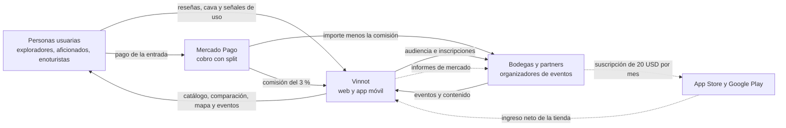

# Modelo de negocio

Este capítulo explica cómo crea, ofrece y captura valor Vinnot: a quién sirve, contra
qué alternativas compite, cómo gana dinero hoy, qué planea cobrar y cuánto cuesta
operarlo a distintas escalas. Reúne el análisis competitivo, el modelo Canvas, el
análisis FODA y la economía de la plataforma en un solo lugar, sin repetir lo que ya
documentan los módulos.

## Resumen ejecutivo

**Propuesta de valor.** «Descubre vinos que te gustan y conéctalos con su origen:
compara etiquetas, guarda experiencias, sigue bodegas y encuentra dónde vivir el vino.»
El desarrollo completo está en el [modelo Canvas](business-model-canvas.md#propuesta-de-valor).

**Para quién.** Cuatro segmentos priorizados: exploradores y consumidores ocasionales,
aficionados, viajeros y enoturistas, y bodegas y partners profesionales. La primera
versión comercial prioriza a la persona usuaria final y a las bodegas
([segmentos y decisión de foco](business-model-canvas.md#segmentos-prioritarios)).

**Posicionamiento: del catálogo al ecosistema.** Vinnot no compite por tener más
funciones que las plataformas globales, sino por conectar decisiones que hoy están
fragmentadas: descubrir un vino, entenderlo, compararlo, guardarlo, conocer su bodega
y convertir ese interés en una experiencia física, como una visita, una cata o un
evento. El producto es global; la primera etapa es Argentina, donde el producto y el
turismo del vino están fuertemente relacionados ([análisis competitivo](competitive-analysis.md) y
[contexto de mercado](swot.md#contexto-de-mercado)).

**Cómo gana dinero.**

| Fuente | Estado | Detalle |
|---|---|---|
| Comisión sobre entradas de eventos pagos | Implementado | 3 % del total en ARS, cobrado con el split de Mercado Pago ([Pagos](../modules/payments/README.md)) |
| Aumento de esa comisión | Planificado | 8 % cuando crezca la base de usuarios y 12 % en el horizonte de un año ([Monetización y planes](monetization.md)) |
| Suscripción para bodegas | Planificado | Plan gratuito para editar el perfil, cargar y editar sus propios vinos, crear eventos y ver métricas básicas; plan Pro de 20 USD por mes, cobrado con App Store o Google Play, con un pulso semanal y un informe mensual sobre el interés, la opinión y la audiencia de sus vinos; lanzamiento objetivo el 01-03-2027 ([Monetización y planes](monetization.md)) |

**Cómo se mide.** La métrica norte es la cantidad de usuarios activos mensuales que
realizan al menos dos acciones de valor vinculadas al vino
([Métricas clave](key-metrics.md#métrica-norte)).

## Ecosistema y flujos de valor

Las flechas continuas son flujos que ya existen en el producto; las punteadas son
flujos planificados.

[Ver diagrama de «Ecosistema y flujos de valor» completo](https://images.vinnot.com/docs/diagrams/v1/es/business-readme-37632edba010.svg)

## Cómo leer este capítulo

| Página | Qué responde |
|---|---|
| [Análisis competitivo](competitive-analysis.md) | Qué hacen cinco plataformas internacionales del vino, cómo ganan dinero y qué aprende Vinnot de cada una |
| [Modelo Canvas](business-model-canvas.md) | Los nueve bloques del modelo de Vinnot, sus hipótesis y la secuencia de etapas del negocio |
| [Análisis FODA](swot.md) | El contexto del mercado argentino, fortalezas, debilidades, oportunidades y amenazas, y el plan de acción |
| [Métricas clave](key-metrics.md) | La métrica norte, los indicadores por dimensión y qué señales ya registra la plataforma |
| [Monetización y planes](monetization.md) | La comisión sobre entradas, su aumento planificado y la suscripción para bodegas |
| [Costos actuales](costs.md) | Cuánto cuesta operar Vinnot hoy, por mes y por año |
| [Proyección de usuarios a 12 meses](user-acquisition-projection.md) | Cuántos usuarios puede sumar Vinnot en un año y por qué canal, con datos públicos y supuestos |
| [Hoja de ruta de precios para bodegas](winery-pricing-roadmap.md) | La oferta de bodega fundadora, cómo sube el precio del plan Pro y qué gana la bodega |
| [Informes para bodegas](winery-reports.md) | Qué contienen los informes del plan Pro, de qué datos salen, qué reglas de privacidad cumplen y cómo se validan |
| [Capacidad y proyección de costos](capacity-and-cost-projections.md) | Cuántos usuarios soportan los planes actuales y qué cambia a mayor escala |
| [Simulador de ingresos](revenue-simulator.mdx) | Un cálculo interactivo de los ingresos por comisión y por suscripciones |
| [Simulador de costos por escala](cost-simulator.mdx) | Un cálculo interactivo de los costos según la cantidad de usuarios |

## Estado de la información

Este capítulo mezcla hechos del producto con decisiones de negocio, planes y
estimaciones. Para que no se confundan, cada afirmación lleva uno de estos estados:

| Estado | Significado |
|---|---|
| Implementado | Existe en el código y se enlaza la fuente |
| Planificado | Decisión del negocio todavía sin implementar |
| Hipótesis | Idea del modelo que debe validarse antes de planificarse |
| Estimación | Cifra calculada o proyectada, no medida |
| Pendiente de instrumentar | El producto todavía no registra el dato |

El análisis competitivo y el contexto de mercado corresponden a fuentes públicas
consultadas en octubre de 2026. Los estados del producto reflejan el código de
octubre de 2026; si el código cambia, el código manda.
